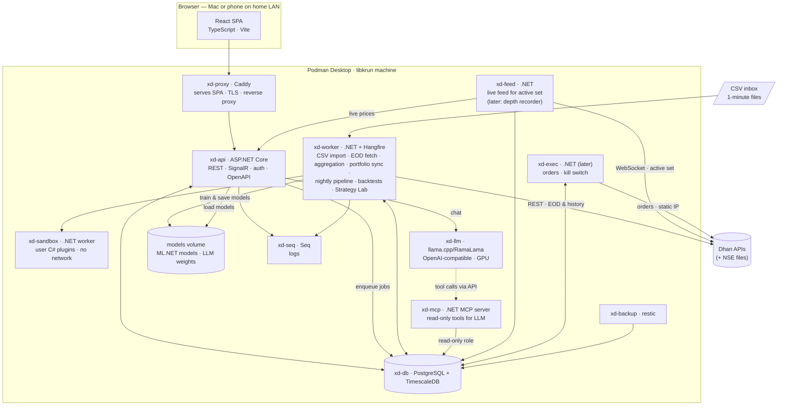
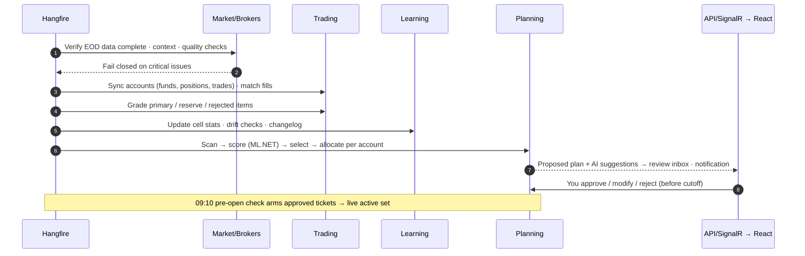

# 03 — Target Architecture

## 1. Architecture at a glance

**Style:** a **.NET modular monolith** (one codebase, clear module boundaries) deployed as a few
containers, with a **React** single-page app, **PostgreSQL + TimescaleDB** as the only database, **ML.NET** for machine
learning (no Python), and a **local LLM** — all on Podman Desktop.

Why a modular monolith (not microservices): one developer, one machine, shared engine code across
backtest / Strategy Lab / nightly scan / grading. Modules can be split into services later if ever needed.



## 2. Technology decisions

### 2.1 Frontend — React

| Concern | Choice | Reason |
|---------|--------|--------|
| Framework | **React 19 + TypeScript + Vite** | Your choice; fast dev build |
| UI kit | **MUI (Material UI)** + MUI X Data Grid (community) | Mature components, dense data tables |
| Price charts | **TradingView Lightweight Charts** (open source) | Candles with entry/stop/target/trail overlays, trade replay |
| Analytics charts | **Apache ECharts** (`echarts-for-react`) | Heatmaps, calendar, Monte Carlo fans, scatter, large data |
| Server state | **TanStack Query** | Caching, refetch, pagination |
| Routing | React Router | — |
| Forms | React Hook Form + Zod | Strategy form builder, config forms |
| Code editor | **Monaco** + `monaco-yaml` with JSON Schema | Strategy rules & config editing with live validation |
| Real-time | `@microsoft/signalr` | Live prices & P&L for the active set, job progress, notifications |
| File upload | `react-dropzone` + chunked upload | CSV imports with preview |
| API client | Generated from OpenAPI (`orval`) | Typed client, no hand-written DTOs |
| Tests | Vitest + Testing Library; Playwright for E2E | — |

### 2.2 Backend — .NET

| Concern | Choice | Reason |
|---------|--------|--------|
| Runtime | **.NET 10 (LTS)**, C# | Your choice; LTS support window |
| Web | **ASP.NET Core** (Minimal API endpoint groups), OpenAPI | Lightweight, typed |
| Real-time | **SignalR** | Progress & notifications to React |
| Data access | **EF Core + Npgsql** for domain tables; **Npgsql binary COPY / Dapper** for bulk bars | EF for productivity, raw speed for time series |
| Background jobs | **Hangfire + Hangfire.PostgreSql** | Cron schedules, retries, queues, built-in dashboard; no extra infra |
| Validation | FluentValidation; **JsonSchema.Net** for YAML config/strategy | One schema shared with the React editor |
| YAML | YamlDotNet | Trading config & strategy rules |
| Strategy DSL | Own parser (**Superpower 3.2.1**) → **compiled LINQ expression trees** (`XDrishti.Strategies`, built in P3-02, [ADR 0034](../adr/0034-the-rules-expression-language-lint-and-compiler.md); §4.2) | Safe (no eval), fast, look-ahead-checked |
| Indicators | Own streaming implementations (`XDrishti.Indicators`, built in P3-01, [ADR 0031](../adr/0031-streaming-indicators-and-the-feature-frame.md)); cross-checked in the tests against **Skender.Stock.Indicators 2.7.3** (MIT, test-only, exact pin) | Point-in-time control, speed |
| Numerics | MathNet.Numerics | Statistics, Monte Carlo, Bayesian updates; own XIRR solver (Newton–Raphson + bisection) |
| CSV parsing | **Sep** or CsvHelper (streaming) + Npgsql binary COPY | Fast bulk import of 1-minute files |
| Spreadsheet reading | **ExcelDataReader 3.7.0** (MIT), `Infrastructure/Portfolio/SpreadsheetReader` behind `ISpreadsheetReader` (P2-17, [ADR 0029](../adr/0029-dhan-report-imports-and-source-precedence.md)) | Dhan's downloaded reports come as legacy `.xls` (BIFF8) and `.xlsx`; read natively, no conversion step; the Application layer never references the package |
| Live feed | `System.Net.WebSockets` client + binary packet parser (Dhan little-endian format) | Active-set streaming in `xd-feed` |
| Machine learning | **ML.NET** (LightGBM / FastTree trainers, PAV calibration, feature contributions) | Train and score in-process; one language, one code path |
| LLM client | **Microsoft.Extensions.AI** (OpenAI-compatible) | Tool calling against the local model |
| MCP server | **ModelContextProtocol C# SDK** | Read-only tools for the assistant / Hermes |
| HTTP resilience | Microsoft.Extensions.Http.Resilience (Polly) | Broker API retries, rate limits |
| Auth | ASP.NET Core Identity (single user, password) | Personal use; cookie auth |
| CLI | System.CommandLine (`xd` tool) | Strategy Lab and ops from terminal |
| Logging/telemetry | Serilog → **Seq**; OpenTelemetry metrics/traces | Local, searchable logs |
| Tests | xUnit, **Testcontainers** (real Postgres/Timescale), Verify snapshots | Engine correctness & look-ahead tests |

### 2.3 Data — PostgreSQL

| Concern | Choice | Reason |
|---------|--------|--------|
| Database | **PostgreSQL 17+** | Your choice |
| Time series | **TimescaleDB** extension (official image) | Hypertables + native compression for 1-min bars/ticks; **continuous aggregates** build 5m/10m/15m/30m/1h bars from 1m with 09:15 alignment; refreshed after CSV imports and EOD fetch |
| Queue | Hangfire tables in Postgres; `LISTEN/NOTIFY` for events | No separate broker (Redis/RabbitMQ) needed |
| Analytics | Plain SQL + materialised views for report aggregates | Single database to back up and query |
| Backups | `pg_dump` nightly + restic to external SSD | Simple, verifiable |

Estimated size: 1-min bars for ~200 symbols × 8 years ≈ 150 M rows → ~5–10 GB with Timescale compression.

### 2.4 ML — ML.NET only (no Python)

Our ML need is modest and well-defined: a **binary classifier on tabular features** (~10⁵–10⁶ rows,
~50–150 features) answering "does this candidate hit target before stop?", plus calibration and
explanations. ML.NET covers all of it:

| Need | ML.NET capability |
|------|-------------------|
| Gradient-boosted trees | `LightGbm` trainer (Microsoft.ML.LightGbm); `FastTree` (ML.NET's own GBDT) as fallback |
| Baselines | `LbfgsLogisticRegression`, `SdcaLogisticRegression` |
| Probability calibration | Calibrators incl. **PAV (isotonic)** and Platt; plus own reliability-curve check |
| Per-prediction explanation | `CalculateFeatureContribution` (supported for LightGBM/FastTree/linear models) |
| Global importance | Permutation Feature Importance (PFI) |
| Metrics | AUC, log-loss, Brier score via evaluation APIs + own walk-forward metrics |
| Persistence | Model `.zip` in the models volume + `research.model_versions` row; champion/challenger = DB pointer |

Flow: features and triple-barrier labels are computed by the same .NET code used for scanning → a
weekly Hangfire job trains, calibrates and validates per walk-forward fold → the model is saved and
registered → `PredictionEngine`/batch transform scores candidates in-process during the nightly run.

Why not Python: no second language/runtime, no extra container, no model-export hop, identical feature code
for training and scoring. What we give up — exact SHAP values, Optuna-style tuning, notebook ecosystem — is
not needed: feature contributions + PFI explain decisions, and the design deliberately avoids heavy tuning
(few parameters, plateaus).

**Platform check (Phase 0 spike):** containers on Apple Silicon are `linux/arm64`. Verify the LightGBM native
library loads there (if not, build `lib_lightgbm.so` from source in the worker image); fall back to the
managed `FastTree` trainer otherwise. The model sits behind an `IProbabilityModel` interface, so the trainer
can change without touching Planning or Learning.

### 2.5 AI

| Concern | Choice |
|---------|--------|
| Model server | **llama.cpp server** (pinned RamaLama image) in a container with GPU (libkrun); OpenAI-compatible API; started on demand ([ADR 0005](../adr/0005-local-llm-runtime-and-models.md)) |
| Model | Qwen3-30B-A3B at 4-bit (alternate gpt-oss-20b), 16K default / 32K supported context; no separate small model |
| Integration | Assistant endpoint in `xd-api` (Microsoft.Extensions.AI) + `xd-mcp` read-only tool server |
| Optional | Hermes Agent as hardened front-end after PoC ([doc 14](14-ai-assistant.md)) |

### 2.6 Infrastructure

| Concern | Choice |
|---------|--------|
| Containers | **Podman Desktop**, libkrun machine (GPU for LLM), `compose.yaml` with profiles |
| Proxy | **Caddy** — serves the React build, local TLS, routes `/api`, `/hubs`, `/hangfire` |
| Secrets | macOS Keychain → Podman secrets → .NET `KeyPerFile` configuration provider |
| Logs | Seq (free single-user) |
| Backups | restic → external SSD |

## 3. Modules (inside the .NET solution)

| Module | Responsibility |
|--------|----------------|
| **Market** | Bars, aggregation, context, calendar, corporate actions, data quality |
| **Data import** | CSV profiles, import jobs (preview, validate, upsert, undo), folder watcher |
| **Catalog** | Instrument master, tracked instruments, baskets (manual / rule / system), membership history |
| **Live** | Active-set computation, WebSocket subscriptions, live 1-minute bars, quote polling, live P&L & alerts |
| **Brokers** | Adapters (Dhan in v1; others later; NSE files) implementing `IMarketDataProvider`, `ILiveFeed`, `IAccountReader`, `ITokenProvider`, (later) `IOrderExecutor` |
| **Portfolio** | Transactions, FIFO lots, positions, buckets, valuations, returns, XIRR, benchmark, alerts |
| **Indicators & Features** | Streaming indicators, multi-timeframe features, regime labels |
| **Strategies** | Built-in strategies, DSL parser/compiler, plugin host (the rules language — parser, binder, look-ahead lint, compiler — and the typed strategy model with the compile of its sections are built: §4.2; the simulator is P3-03, the YAML strategy file P3-02c, storage P3-02d, the BUY → SELL mirror P3-02e) |
| **Simulation** | Event-driven bar-by-bar engine: conditional entries, exits, pyramids, gaps, costs, slippage, MAE/MFE (built: the trade walker, the entry scanner and the `Simulator` that composes them, §4.3, [ADR 0037](../adr/0037-simulation-conventions-and-the-two-stage-seam.md) with Amendments 1 and 2; the window-independent replay and the run record of P3-04 are built; ORB v1 is the first strategy it runs; fills are modelled since P3-03b, [ADR 0038](../adr/0038-fill-realism-the-entry-limit-gaps-slippage-ticks-and-the-order-inside-a-minute.md): an entry limit order, gaps, slippage on the tick grid, the order inside a minute; costs and sizing are built since P3-03c, [ADR 0042](../adr/0042-costs-and-sizing-the-charge-sheet-the-quantity-net-r-and-simtrade-schema-4.md): a charge sheet applied by the replay line by line on the filled prices, net R next to filled and exact R, the skips counted; the sheet's store and the request's choice are P3-03f) |
| **Learning** | Walk-forward runner, cell stats (Bayesian), exit selection, drift, lifecycle, hypothesis loop, ML.NET training & scoring, execution feedback, lessons, experiments (replay), autonomy rules |
| **Planning** | Scanner, scorer, selector, per-account allocator, pre-open check |
| **Trading** | Accounts, sync, journal, fill matching, outcomes grading, (later) execution |
| **Lab** | Strategy submissions, test runs, verdicts, test ledger |
| **Reporting** | Report queries with lenses (all / basket / instrument / trade / strategy / account), aggregates, exports |
| **Assistant** | LLM chat, tool routing, briefings |
| **Workflow** | Proposals, approvals (plan tickets, suggestions), review cutoff, suggestion inbox, pre-trade checklist |
| **Insights** | Portfolio action-center rules, price alerts, report auto-insights ([doc 15](15-smart-insights-and-automation.md)) |
| **Data quality** | Validation runs (completeness, sanity, spikes, stored vs recomputed aggregates, derived vs official daily), repairs, quality score |
| **Scheduling** | Service schedules (DB-stored), dependency & timing rules, run-after chains, catch-up, failover |
| **Platform** | Config versions, auth (Identity, password re-entry), audit, notifications, commands, service runs |

**Single code path:** Simulation + Strategies + Features are used identically by the Strategy Lab,
walk-forward learning, the nightly scanner and the outcome grader.

## 4. Repository & solution structure

One repository (monorepo) holds the code, configuration, deployment and design material.

```
xDrishti/
├── backend/                         # .NET 10 solution
│   ├── XDrishti.slnx                # solution (src/, tests/ folders)
│   ├── global.json                  # SDK pin + Microsoft Testing Platform
│   ├── Directory.Build.props        # shared build settings, analyzers, nullable, warnings-as-errors
│   ├── Directory.Packages.props     # central package versions
│   ├── Dockerfile                   # multi-stage: targets api, worker (chiseled, non-root)
│   ├── contracts/XDrishti.Api.json  # OpenAPI contract generated at build (source of frontend types)
│   ├── src/
│   │   ├── XDrishti.Domain/         # entities & value objects: Bar, Instrument, Signal, TradeTicket, RMultiple, Cell…
│   │   ├── XDrishti.Application/    # use cases, interfaces (ports), pipeline orchestration
│   │   ├── XDrishti.Infrastructure/ # EF Core, Npgsql COPY, Timescale, secrets, LLM client, model store, default seed
│   │   ├── XDrishti.Brokers.Dhan/   # REST + WebSocket feed + instrument master
│   │   ├── XDrishti.Brokers.Nse/    # optional reconciliation files
│   │   ├── XDrishti.DataImport/     # CSV profiles, parsers, import jobs
│   │   ├── XDrishti.Catalog/        # instruments, tracked list, baskets
│   │   ├── XDrishti.Portfolio/      # lots, positions, valuations, XIRR
│   │   ├── XDrishti.Indicators/     # streaming indicators, TimeframeBuilder, FeatureFrame (pure; references Domain only; P3-01)
│   │   ├── XDrishti.Strategies/     # the rules language (Syntax, Binding, Lint, Compilation; pure; Domain + Indicators + Superpower; P3-02), later built-ins + plugin host
│   │   ├── XDrishti.Simulation/     # the entry scanner, the trade walker, the `Simulator` that composes them and the replay of one instrument (pure; Domain + Indicators + Strategies; P3-03, P3-03a, P3-04)
│   │   ├── XDrishti.SimExport/      # the export of a simulation run: trades.csv, open_at_end.csv, run.json, README.txt, manifest.json and, since P3-04c, index.html and cards/ (pure; Domain only; writes UTF-8 to an `IBufferWriter<byte>` the host owns; referenced by `XDrishti.Api` only; P3-04b1)
│   │   ├── XDrishti.Learning/       # cells, meta-model, smart rules, experiments, lessons
│   │   ├── XDrishti.Planning/
│   │   ├── XDrishti.Hosting/        # shared host defaults: KeyPerFile secrets, Serilog, app info
│   │   ├── XDrishti.Api/            # host: endpoints, SignalR hubs, auth, OpenAPI; `migrate` command
│   │   ├── XDrishti.Worker/         # host: Hangfire server, scheduled services
│   │   ├── XDrishti.Mcp/            # host: MCP read-only tool server
│   │   ├── XDrishti.Cli/            # `xd` command-line tool
│   │   ├── XDrishti.Feed/           # host: market-hours live feed for the active set (later: depth recorder)
│   │   └── XDrishti.Execution/      # host (later): order service
│   └── tests/                       # Domain/Application unit, Architecture (layer rules), Api.IntegrationTests (Testcontainers)
├── frontend/                        # React 19 + TypeScript + Vite + MUI; Dockerfile builds xd-proxy (Caddy + app)
│   └── src/{app, features/<name>, shared/{api,ui,lib}, theme, test}
├── data/                            # local runtime data, git-ignored: inbox/ (CSV drop, mounted into xd-worker), exports/, models/
├── deploy/                          # compose.yaml (+ compose.dev.yaml), caddy/Caddyfile, db/init, xd-up.sh / xd-down.sh
├── scripts/                         # check.sh (all gates), gen-api.sh, dev-api.sh, build-docs.sh, serve.sh
├── docs/
│   ├── design/                      # these design documents (Markdown source of truth)
│   ├── adr/                         # architecture decision records
│   ├── engineering/                 # engineering standards (SOLID, modularity, testing, performance, DoD)
│   ├── prototype/                   # clickable UX prototype (reference for the React app)
│   └── site/                        # generated HTML version of docs/design
└── tools/                           # docs-site builder, prototype vendoring
```

Trading configuration and strategies are **not repository folders**: they live in the database (versioned,
validated, audited) and are managed in the app; built-in defaults ship inside the backend and are seeded on first
start ([ADR 0002](../adr/0002-config-and-strategies-in-app.md)).

Dependency rule: `Domain` ← `Application` ← (`Infrastructure`, `Brokers.*`) ← hosts, and the engine modules sit
**beside Infrastructure and are reached only from an adapter in it**.
Engine modules (Indicators, Strategies, Simulation, Learning, Planning) have **no I/O dependencies** —
they're pure and fully unit-testable. `XDrishti.SimExport` is pure in the same way but is not an engine: it renders a finished run and is referenced by a **host** (`XDrishti.Api`, whose folder writer is the one place that touches the file system for the export), never by Application or Infrastructure (§4.4). **Application references Domain only and never an engine module**
([ADR 0039](../adr/0039-an-engine-module-is-reached-from-an-adapter-in-infrastructure-never-from-application.md)):
a use case that needs an engine declares a port in `Application/Abstractions/<module>` whose signatures use Domain
values only, and an adapter in `Infrastructure/<module>` implements it over the engine. The sequence is
**handler → port → adapter → engine**: the handler reads through its own ports (bars, instruments, baskets, actions,
calendar) and hands plain values to the engine port; the engine stays pure. Infrastructure is the only project that
references an engine module; an architecture test enforces it (`ResearchLayeringArchitectureTests`). The first use is
the simulation run of P3-04a (`RunSimulationHandler` → `ISimulationEngine` → `SimulationEngineAdapter` →
`XDrishti.Simulation.Replay`, §4.3).

### 4.1 `XDrishti.Indicators` as built (P3-01, P3-01b and P3-01c, [ADR 0031](../adr/0031-streaming-indicators-and-the-feature-frame.md), [ADR 0032](../adr/0032-frame-history-closed-flags-and-the-remaining-indicators.md), [ADR 0033](../adr/0033-weekly-monthly-timeframes-calendar-features-and-the-market-context.md))

The first engine module. A pure library that turns a stream of **closed 1-minute bars** into indicator values, closed higher-timeframe bars (up to weekly and monthly), session context, the calendar and a daily market context; back-tests and live trading use the same code.

| Part | What it is |
|------|------------|
| `IIndicator` | `Update(in Bar)`, `Value`, `IsReady`, `WarmUp`, `Reset()`; constant (or amortised constant) work per bar, 0 bytes allocated in steady state. A value that is not ready is `NaN` with `IsReady = false` (the two always agree). The value after bar *k* is a function of the bars 1..*k*; the **date-driven** features are a function of the India dates of those bars and of the context days strictly before each date, their `WarmUp` is counted in **days of the context** (not bars), and their `IsReady` can fall back to false (a day without a VIX) |
| `IndicatorCatalog` | The 56 features (19 of P3-01, 25 of P3-01b: ADX/DMI, MACD, Bollinger, Supertrend, ROC, the candle patterns, pivots and the raw bar features, and 12 date-driven ones of P3-01c: `day_of_week`, `is_expiry_day` and the ten market-context names) with parameters (name, kind, min, max, default; at most 4), warm-up as a function of the spec (counted in bars of the spec's own timeframe; in days of the context for the date-driven names), session behaviour (`Continuous` / `PerSession`) and whether the feature restarts each session in the frame (`RestartsEachSession(spec)`: the twelve `PerSession` names on 1m to 1h, not on 1D; [ADR 0035](../adr/0035-per-session-features-keep-the-history-of-the-session-only.md)), whether the source price is read, whether it is intraday-only, which timeframes it supports (`Supports(tf)`: the nine of `SupportedTimeframes` for the continuous ones, fewer for the session-bound ones, 1m only for the date-driven ones), whether a frame that computes it needs a market context or the expiry dates (`RequiresContext`: true for exactly the ten names `index_trend index_adx index_vol_pct vix vix_pct vix_chg breadth regime_trend regime_vol regime`; `RequiresExpiryDays`: `is_expiry_day` only; P3-02, so the rules language asks the catalog instead of knowing the names) and a factory. The validator and lint of the rules language read it |
| `TimeframeBuilder` | Builds *closed* 5m, 10m, 15m, 30m, 1h, 1D, 1W and 1M bars with the rules of the stored aggregates ([doc 05 §4](05-data-and-brokers.md)); `Push` returns 0, 1 or 2 closed bars per minute; optional `TradingCalendar`; late bars are ignored and counted (`Ignored`). A week or month is built from the 1D bars and is emitted at the close of the period's last session when a calendar is given, at the first bar of the next period when not (later, never earlier) |
| `FeatureFrame` | Created once from a list of `FeatureSpec` (name, timeframe, price source, up to four parameters); validates them before any bar is fed, shares one instance between equal specs, builds only the needed builders, and exposes the value *as of the last closed bar of each timeframe* by a numeric handle. Counts the incomplete higher-timeframe bars it consumed (`IncompleteBarsConsumed`) |
| Frame API for the DSL (P3-01b) | `Create(specs, FrameOptions?)` with `FrameOptions(Calendar, HistoryDepth = 8, 1..256, Context, ExpiryDays)`; `BarClosed(tf)`, `ClosedBarsAt(tf)`, `TryLastClosed(tf, out ClosedBar)` and `HasTimeframe(tf)` (what the **last** step closed; a timeframe not asked for throws); `At(handle, lag)` and `IsReadyAt(handle, lag)` read the value a feature had `lag` closed bars of **its own** timeframe ago (a lag outside `0..HistoryDepth−1` throws; the history is written only when that timeframe closes a bar, twice when one minute closes two; for the twelve per-session names on an intraday timeframe only the current session counts, next row); the raw bar features `open high low close volume`; an **ordering guard** (a 1-minute bar at or before the previous one is skipped by every lane and counted in `IgnoredBars`; `Steps` counts accepted bars); `PriceSource.Default` resolves to the catalog default (`High` for `highest`, `Low` for `lowest`); the catalog collections are read-only; `LastBarTime` (P3-02): the epoch-second start of the last accepted 1-minute bar, 0 before the first step, unchanged by a skipped bar, cleared by `Reset`, read without allocation (the compiled `time` is its minute plus one, in India time) |
| `FeatureFrame`: per-session features ([ADR 0035](../adr/0035-per-session-features-keep-the-history-of-the-session-only.md)) | The twelve names that start again on every India date (`vwap`, `or_high`, `or_low`, `today_open/high/low`, `prev_day_open/high/low/close/volume`, `gap_pct`) keep, on an intraday timeframe (1m to 1h), the value history of the **current session only**, and this is a rule of the frame, so every reader sees it. With S the bars the feature's timeframe has closed on the India date of the last accepted 1-minute bar: S = 0 (the frame has moved to the date and a coarser timeframe has not yet closed its first bar of it) is *pending*, not ready at any lag, `Value` is `NaN`; with S ≥ 1 lag 0 is the value and lag k ≥ 1 is the value k bars ago when k < S, else `NaN`. It reads as if the frame had been created at the first accepted bar of the date (for `prev_day_*` and `gap_pct`: of the previous date that had bars). On 1D nothing restarts (a lag is by position); 1W and 1M refuse the names; rolling and date-driven features are untouched. A session is the India date of the start of the bar a timeframe feeds its indicators (`IndiaDays.DayOf`, the call the indicators restart on); a bucket that closes late is consumed with its own date, so it does not un-pend the new one; a frame must be fed whole sessions (started mid-day it takes that bar's date as its session, so a live restart replays the current session from its first bar). Built without a new member of `FeatureFrame`, so the seven members the compiled library may reference are unchanged: an internal `IRestartingIndicator.MarkPending()` on `Vwap`, `OrHigh`, `OrLow` and `SessionContext`, restart slots in the `Lane`, `StartSession` after the lanes have consumed the minute, and the first `Consume` of a date clears the ring slots of the restarting features. `IndicatorInfo.RestartsEachSession(spec)` is the one place that says which features restart (the frame, the lint of the rules language and the tests ask there). The readiness of those four indicators depends on a flag that the frame sets and the next `Update` or `Reset` clears (covered by the determinism and reset tests and by the mutation runs). Known limits (doc 11 §2, *Limits of the rule*): a coarser timeframe is pending conservatively (`tf("1h").prev_day_close` is unknown for up to 60 minutes although the value is known), and a session is a date, so a morning and an evening block of one date are one session |
| Calendar and market context (P3-01c) | `MarketContext.Create(IEnumerable<ContextDay>, ContextOptions?)` / `Append` / `TryAsOf(date, out ContextValues)`: a pure object built from daily records (index high / low / close, VIX close and breadth if known), each day's values computed from that day and earlier days only (streaming `Sma`, `Atr`, `Adx` and a percentile window), shared by any number of frames (`Append` is single-writer; readers may run meanwhile and see a day only once it is complete); a context that nobody extends keeps its last day's values for ever, so the caller extends it and checks its age (ADR 0033, known risk); invalid input returns a validation error with a code (`indicators.context_*`), never an exception. `TryAsOf(D)` returns the latest day **strictly before** `D`. `ContextOptions` (50-day average, 5-day slope, ADX(14) ≥ 20, ATR(14), 252-day percentile window, terciles 100/3 and 200/3), `ContextValues`, `Regime.Name` / `Regime.Code` (`UP_LOW_VOL` 1 … `DOWN_HIGH_VOL` 9). `FeatureFrame` keeps the 12 date-driven features (`DateFeature`, kinds `DateFeatureKind`; named `ContextFeature` before P3-02, since two of them read no context) in a **date lane** refreshed at the first accepted step of each India date (history one entry per date); the library never reads a database, and the expiry dates are passed in by the caller |

**References and rules.** The project references `XDrishti.Domain` only (for `Bar`, `Timeframe`, `SessionClock`, `TradingCalendar`). Architecture tests keep it that way: no Application, Infrastructure, Hosting, EF Core, ASP.NET Core, Npgsql,
Serilog, `System.IO`, `System.Net`, `System.Data`, `System.Diagnostics`, `Environment`, `Random` or `TimeProvider`; no `DateTime.Now/UtcNow/Today` (scanned in the compiled code); no mutable static field; every public class
sealed or static. The tests also read the project file: only the `ProjectReference` to `XDrishti.Domain` and no `PackageReference`. The only package outside the base class library that is involved is Skender.Stock.Indicators, and only in `XDrishti.Indicators.Tests`.

**Guarantees pinned by tests.** Each indicator equals an independent batch reference over seeded random series; `sma`, `ema`, `rsi`, `atr`, `adx`/`plus_di`/`minus_di`, `macd_*`, `bb_*` (population σ) and `roc` also agree with Skender (differences: the ATR seed, an RSI over a series that never
moves is 50 here and 100 in Skender, and `supertrend`, which starts a bar earlier here and always starts up); the history `At(handle, lag)` equals a record kept independently by the test, for depths 1, 2, 8 and 256; the *prefix property* (the output for the first *k* bars is the same when more bars are fed) over 220 seeds, also for the weekly and monthly lanes and for the market context (the values of the first *k* days do not change when the series is cut or continues differently, and a frame never reads a context day dated on or after the date of its step); every `MarketContext` value, and every weekly and monthly bar, equals an independent batch reference; the frame never shows the forming bar; two runs are bit-identical; `Reset()`
returns every indicator to its first state. **The per-session rule ([ADR 0035](../adr/0035-per-session-features-keep-the-history-of-the-session-only.md))** is pinned by hand-calculated two-session examples, by comparison with an independent reference of the rule (built from the definition, with S counted from the start dates of the buckets) on dense, gappy, sparse and late-closing series, by a positional negative control that fails when the rule is removed, and by 28 of 30 mutations of the implementation being caught by the tests of the rule (the two survivors are provably equivalent); 480 adversarial tests written from the design by a second agent found no failing case. `XDrishti.Indicators.Tests`: 5,517 (5,508 run and 9 explicit benchmarks).

**Throughput.** The benchmarks are explicit tests, not part of `scripts/check.sh` (a solution run lists them as skipped). From `backend/`, in Release:

```
dotnet test --project tests/XDrishti.Indicators.Tests -c Release -- --explicit only --filter-class "*ThroughputBenchmarks*" --report-trx --results-directory <dir>
```

On an Apple-silicon Mac (best of 5 passes of 1,000,000 steps, through `IIndicator`): `sma(20)` 104 M steps/s, `ema(20)` 359, `rsi(14)` 109, `atr(14)` 209, `highest(20)` 64, `lowest(20)` 55, `vwap` 172, `rel_volume(20)` 199,
`or_high(15)` 208, `gap_pct` 182; `TimeframeBuilder` 109 M bars/s (5m) to 251 M (1D) (targets: 10 M updates/s per indicator and 1 µs per frame step). The P3-01b features, same method: `adx(14)` 127, `plus_di` 101, `minus_di` 72,
`macd_line` 155, `macd_signal` 113, `macd_hist` 157, `bb_upper(20,2)` 53, `bb_middle` 90, `bb_lower` 54, `bb_width` 74 (the Bollinger deviation is an exact O(n) second pass), `supertrend(10,3)` 87, `supertrend_dir` 77, `roc(10)` 194,
`inside_bar` 114, `nr(7)` 83, `engulfing` 109, `pivot_high(5)` 86, `pivot_low` 67, `pivot_high_age` 72, `pivot_low_age` 66, `close` 201. A 20-feature frame (1m, 5m, 15m, 1h and 1D, history depth 8) runs at 10.7 M steps/s, that is
0.094 µs per 1-minute step; the 12-feature frame of P3-01 went from 0.045 to 0.060 µs with the history. P3-01c: the same frame plus 6 context features 0.085–0.093 µs; a 28-feature frame on 1m, 1h, 1D, 1W and 1M 0.057–0.061 µs, with or without a calendar; `DateFeature.Update` about 1 ns; the weekly and monthly builders 31 to 111 M bars/s (the same binary runs in a fast mode of about 105–111 M and a slow one of about 31–62 M, a factor of 3 or more between runs; the cause is not found, issue ISS-11 in the [roadmap](18-roadmap.md); the benchmark has no assertion on them, and the recorded figures are all above 10 M bars/s); `MarketContext.Create` of 5,000 days 11.6–11.9 ms. Every step allocates 0 bytes (tested on gap-free and gappy series, with and without a calendar, with weekly, monthly and date-driven lanes, including the step that changes the date; for the per-session rule also across 38,000 date changes at history depths 8 and 256). **The per-session rule** costs a few nanoseconds per step (interleaved A/B in fresh processes, Release: the 12-feature frame 0.066 → 0.068 µs, the 20-feature frame with history 0.092 → 0.094 µs, the worst case of 81 handles 0.088 → 0.094 µs, +6.8 %, all against the budget of 1 µs; about 1.5–1.8 ns per restarting lane and step) and more on the **first bar of a date**: about 0.24 µs at depth 8 (it was about 0.10) and about 2.8 µs at depth 256 on the 81-handle frame (72 of the handles restart; the 9 on 1D do not), because `ClearRestartHistory` fills every ring slot of every restarting handle (O(handles × depth), once per date). A prototype of about 25 lines (a per-lane dirty count, wiping only the newest entries) brought the sparse worst case from 3.2 to 0.54 µs; it was not applied, since it is once a day and inside every budget. These benchmarks are explicit: the frame-step budget has no automated guard in `scripts/check.sh`.

### 4.2 `XDrishti.Strategies` as built (P3-02, [ADR 0034](../adr/0034-the-rules-expression-language-lint-and-compiler.md))

The second engine module: the **rules expression language** — the text of one condition becomes a checked, compiled predicate over a `FeatureFrame` (the language itself is described in [doc 11 §2](11-strategy-lab.md)). A pure library; since P3-02b ([ADR 0036](../adr/0036-the-typed-strategy-model-and-the-compile-of-its-sections.md)) it also holds the **typed strategy model** (`Model`) and the compile of one side of it (`StrategyCompiler`, in `Compilation`). It does not yet hold the built-in strategies or the plug-in host of the module table in §3 (the simulator is P3-03, the YAML strategy file P3-02c, storage and the seeding of the built-ins P3-02d, the BUY → SELL mirror P3-02e); it holds nothing that reads a database, a file, a clock or the network.

| Namespace | What it is |
|-----------|------------|
| `XDrishti.Strategies` | `SourceSpan` (UTF-16 offsets, end exclusive, 1-based line and column), `Problem` (stable code, message, span, optional suggestion, severity) and `ProblemSeverity` (error, warning, information): errors are data, never exceptions |
| `Syntax` | `ConditionParser.Parse(text)` → `ParseResult(Tree, Problems)`: a Superpower tokenizer that never fails (what it cannot read becomes an error token, so every wrong place is reported), the grammar (a hybrid: combinators for the small productions, plain Superpower parser functions with precedence climbing for the recursive spine, because nine combinator layers needed more than 1 MB of stack at 64 levels), a recovery loop that explains a failure and repairs the token list so the next problem can be found, an immutable tree of sealed records with source spans (equality ignores spans), the limits (4,000 characters, 64 levels of nesting counted as the depth of the tree, so about 60 conditions joined by `and` is the most one condition holds; each a problem rather than a stack overflow) and `ExpressionPrinter` (canonical text; `Parse(Print(tree))` equals the tree). `SyntaxCodes` lists the 20 `strategy.syntax.*` codes; the recovery stops after 100 problems or 232 parses and says so (`too_many_problems`: the first 100 found, in source order; lexical problems are found before syntax ones and an unclosed bracket at the end may not be listed), so the work is bounded for any text of 4,000 characters |
| `Binding` (internal) | The binder: resolves every identifier (strategy parameter, then builtin / constant / `time`, then catalog feature), maps feature arguments to the catalog's parameters and builds the canonical `FeatureSpec`, asks the catalog (by running `FeatureFrame.Create` on a one-spec frame) whether it is valid instead of copying its rules, types every node and builds the bound tree (17 sealed record types); a part that fails becomes `BoundInvalid` that keeps its bound operands, so a condition with several faults gets them all in one pass. "Did you mean" is an optimal-string-alignment distance over the closed vocabulary |
| `Lint` | The look-ahead and timeframe rules over the bound tree — history depth and `lag_too_deep`, `mixed_timeframes_in_lag`, `lag_across_session` (a warning for a read that no session can hold, `lag · T` ≥ 375 minutes; [ADR 0035](../adr/0035-per-session-features-keep-the-history-of-the-session-only.md)), `time_on_daily`, `constant_condition`, `needs_context` / `needs_expiry_days` (read from `IndicatorInfo.RequiresContext` / `RequiresExpiryDays`) — and `LintCodes`, the 16 `strategy.lint.*` codes (the binder reports the others while it reads the names) |
| `Model` | The typed strategy of schema 1 (P3-02b, [ADR 0036](../adr/0036-the-typed-strategy-model-and-the-compile-of-its-sections.md)): sealed records, readonly record structs and enums, one public type per file, equal by value (lists compare element by element) — `StrategyDefinition` (id, style, entry timeframes, sides, at most four `StrategyParam`s, the buy and sell `SideRules`, `TimeRules`, filter names), `SideRules` (`ConditionList`s `setup`, `trigger` and `invalidate` of `all`/`any` condition texts, `EntrySpec`, `StopSpec`, candidate `ExitSpec`s and `OverlaySpec`s), `Quantity` (a number or the name of a parameter) and the closed sets of entry kinds, stop kinds, exit policies and overlays. The side `XDrishti.Domain.Research.Side { Buy, Sell }` is in the Domain. A snapshot test pins every name and bound as a stored contract |
| `Compilation` | `ConditionCompiler.Compile(text, CompileContext)` → `CompileResult(Condition, Problems)`; `CompiledCondition` (exactly the features the text reads, the history depth 1 … 256, whether a market context or expiry dates are needed, the warnings; `Bind(frame)`); `BoundCondition` (`Evaluate` → bool, `EvaluateTruth` → `Truth` true / false / unknown); `ConditionSet.Merge` → `CompiledPlan` (the union of features, the largest depth, `BindAll(frame)`). `ExpressionBuilder` turns the bound tree into a `System.Linq.Expressions` tree compiled once, at the first `Bind`, to a delegate over the frame and an `int[]` of handles that serves every frame; `Kernel` holds each rule (Kleene's tables, the comparisons that answer "unknown" for a NaN, crossings, runs, `between`, the division that is NaN, `time`) as plain code a test can walk exhaustively, and is the only place that reads the frame. `StrategyCompiler.Compile(definition, evaluationTimeframe, side)` checks the model (identity, style, timeframes, sides, parameters, time rules, filters) and compiles **every condition of every list as its own condition** (never joined into one text, so the 64-level limit is never reached and every problem has the path of its item, `buy.trigger[1]`, and the span inside it), the stop, the exits and the overlays, into one `CompiledSide`: the single feature list a frame is created from (the conditions', then the stop's, then the exits', then a `close` on the evaluation timeframe when nothing is on it, so that `BarClosed` can be asked), the history depth and the needs of the frame, and a `BoundSide` that evaluates the lists at list level with no allocation (`SideEvaluation.Fires` is the one definition of the entry condition) and answers `InEntryWindow`; 46 `strategy.model.*` codes, at most 100 errors and 100 warnings listed. `CompilerWarmup.Run()` (public, static, stateless, no clock) compiles 28 valid and 31 invalid fixed sources, and the valid and invalid strategy definitions of `WarmupStrategies`, through the public pipeline so that the JIT has compiled the compiler before the first real request: the **compiler warm-up** (not to be confused with the warm-up of an indicator); a host calls it once in the background after it starts, and the hosted service that does so, `StrategyWarmupService`, belongs to P3-03, the first project that references the library (`XDrishti.Simulation`): it lives in `XDrishti.Api` and must land in the same change, or the architecture rule fails |

**References and rules.** The project references `XDrishti.Domain` and `XDrishti.Indicators` and one package, **Superpower 3.2.1** (pinned in `Directory.Packages.props`; no Superpower type appears in a public signature). Architecture tests (`StrategiesArchitectureTests`, 25 of the 136) read the compiled references and the project file and keep it that way: no Application, Infrastructure, Hosting, EF Core, ASP.NET Core, Npgsql, Serilog, `System.IO`, `System.Net`, `System.Data`, `System.Diagnostics`, `Environment`, `Random` or `TimeProvider`; no `DateTime.Now/UtcNow/Today`; no `Reflection.Emit`, Roslyn, dynamic LINQ, CodeDom, `Activator`, `AppDomain` or assembly loading (nothing turns a string into code); `System.Linq.Expressions` only in `ExpressionBuilder`; only seven members of `FeatureFrame` referenced (four to read through, three to bind with: nothing that feeds or peeks at the frame); no mutable static field; every class sealed except the three abstract bases of the syntax tree; public types only in the six namespaces (`Model` joined in P3-02b; the seven members of `FeatureFrame` are unchanged); and, when any `src` project other than the library references it, some source file outside the library must call `CompilerWarmup.Run` (a textual check across `src`, not per project; vacuous today because no project references the library yet, so the first slice that does, P3-03, fails the test until its hosted service calls the warm-up). The project is in `XDrishti.slnx` and the `Dockerfile` copies it; nothing below it (Domain, Indicators) references it.

**Prerequisites in `XDrishti.Indicators`** (done first, ADR 0034): `ContextFeature` / `ContextFeatureKind` became `DateFeature` / `DateFeatureKind` (they also hold the two calendar features); `IndicatorInfo.RequiresContext` and `RequiresExpiryDays` (see the catalog row in §4.1); `FeatureFrame.LastBarTime` (the clock the compiled `time` reads).

**Guarantees pinned by tests** (`XDrishti.Strategies.Tests`, 7,560: 7,551 run and 9 explicit benchmarks). The parser reads 98 valid sources to hand-written trees and gives the exact code, span and suggestion for 108 invalid ones; 1,000 generated trees round-trip through the printer; fuzzing (6,000 random texts, 4,000 damaged valid sources, every prefix of every valid source) never throws and every problem has a span, line and column. Every one of the 56 names binds to its `DefaultSpec` and equal spellings give equal specs; the lint table has 166 failing and 99 near-miss examples with exact codes, spans and messages, and the arithmetic of `lag_across_session` (`lag · T` ≥ 375) is checked against the real frame in 42 shapes of strategy timeframe, feature timeframe and lag. The per-session rule ([ADR 0035](../adr/0035-per-session-features-keep-the-history-of-the-session-only.md)) is checked by hand-calculated two-session examples, by a regression measure (on a seeded random walk of 500 sessions no crossing of a per-session feature is ever true at the first evaluation of a session, each is true in-session now and then (the crossings at about 5 to 9 percent of the bars in a scratch run; the test asserts a rate above zero and below a cap), and the level form `close > prev_day.high and close[1] <= prev_day.high` is true at the first evaluation of some sessions) and by the oracle below. The compiled conditions equal an independent tree-walking interpreter written from the definitions (864 random conditions on all nine evaluation timeframes, compared after every 1-minute step, and 288 more over the twelve per-session names on the six intraday timeframes, read through an independent reference of the session rule; a compiler-mutant control, five faulty compilers, must be caught by the same corpus) and Kleene's tables are pinned exhaustively. **No look-ahead:** for 240 seeds and 1,200 conditions the result at every closed bar is the same when all later bars are removed and when they are replaced by extreme values, and, on the seeds with a context, when the context days from the cut date on are removed or changed; the same property run through a feeder that reads the next bar, the forming bar of a higher timeframe or the context record of the date itself reports violations. That property guards the feed of the frame, not the compiler (a compiled condition is a pure function of the frame at the step): the compiler is held to reading only the past by the architecture test on the seven frame members and by an audit of the expression trees of the written and of about 2,700 generated conditions (only kernel calls, the frame reached through three functions, nothing but numbers held, no negative lag; the exact lag is held by the oracle and the hand examples). Steady-state `Evaluate` allocates 0 bytes (100,000 steps, ten conditions, a 20-feature frame, date changes and closes included).

**Guarantees pinned by tests for the strategy model** (P3-02b, 441 tests of the 7,560). A snapshot of the public types of `Model`, the exit tables, the filter names and the 46 problem codes is a stored contract; the records compare by value; every code has a failing example (exact code, path, severity) and a near miss that compiles without that problem; the stop and exit tables have a valid example, a failing row and a near miss per parameter; 500 seeded items give, with the path added, the problems of `ConditionCompiler.Compile`; the fold of the truths of a list equals Kleene's tables for every assignment of one to four items; for 200 seeds a list evaluates, item by item and as a whole, like the one condition joined from it, unknown included; the 48 combinations of setup, trigger and invalidate give the one `Fires`; the two-session example of ADR 0035 and the window and late-bar tables are worked out by hand; `Evaluate` and `InEntryWindow` allocate 0 bytes over 100,000 steps; the truncation and future-perturbation property is run through the side for 60 sides with a negative control; 1,000 seeded mutations of the example definitions never throw; 16 threads bind one side to 16 frames and get one thread's decisions.

**Speed.** On an Apple M4 Pro in Release (explicit benchmarks, not part of `scripts/check.sh`; details and the guards in [doc 11 §2](11-strategy-lab.md), *Speed*). The time of a condition is **bounded by its text**: it never grows with the history the frame keeps or with the number of bars, but it is an upper bound and not the same for every condition (`rising`/`falling(x, n)` cost n reads, about 1.75 ns each, with no early exit on purpose; `and`/`or` skip the right side when the left one decides). Ten conditions over a 20-feature frame cost 245–258 ns per 1-minute step on top of the step itself (47 ns while the frame stands still; target 300 ns); the committed benchmark of long runs gave 444–449 ns for `rising(close, 255)` and 866–868 ns for two features; steady-state `Evaluate` allocates 0 bytes. Parse + bind + lint + the ten delegates take a warm median of 2.45–2.69 ms (target 3 ms). The first compile of a fresh process takes 37.6–41.1 ms (median 38.1; the JIT compiles about a thousand methods of Superpower, the binder and the expression compiler; no runtime setting changes it; ReadyToRun of the assemblies would give about 32 ms and was not shipped). After the **compiler warm-up** (`CompilerWarmup.Run()`, about 60 ms of one background core: 59.7–62.9 ms, and 76–90 ms on a loaded machine; once per process; since P3-02b, which added the strategy definitions to its sets, 92–95 ms) the first compile of the ten conditions takes 3.0–4.5 ms. Criterion 12 of ADR 0034 is therefore: warm ≤ 3 ms and first compile after the warm-up ≤ 20 ms (both asserted by explicit benchmarks), warm-up ≤ 150 ms (asserted), process-cold reported; `scripts/bench-coldstart.sh` runs the cold-start benchmarks in fresh processes (min / median / max, exit 1 when a median is over target) and is a pre-release check, not part of `check.sh` (ISS-12, closed; the open guard gap is ISS-16 in the [roadmap](18-roadmap.md)).

### 4.3 `XDrishti.Simulation` as built: the trade walker, the entry scanner, the `Simulator` and the replay (P3-03, P3-03a, P3-03b, P3-04, [ADR 0037](../adr/0037-simulation-conventions-and-the-two-stage-seam.md) with Amendments 1 and 2, [ADR 0038](../adr/0038-fill-realism-the-entry-limit-gaps-slippage-ticks-and-the-order-inside-a-minute.md))

The simulator has two stages that share one small value. The **entry scanner** (built, P3-03a) decides where a strategy enters; the **trade walker** (built, P3-03) turns that decision and the 1-minute bars after it into a trade; the **`Simulator`** (P3-03a) compiles a strategy, runs one scanner per side over the bars of one instrument and walks every candidate. The value they share, `EntryCandidate`, carries the strategy, the instrument, the side, the decision (the list index of the minute that closed the evaluation bar and the decision instant), the trigger bar, the stop and the decision-time trace, and **no exit**, so that P4 can walk the same entries under every exit policy.

| Where | What |
|-------|------|
| `XDrishti.Domain.Research` | `Side { Buy, Sell }` (shared with the strategy model of P3-02b; not the ledger's `TradeSide`), `SimTrade` (schema 4, 33 fields, computed `Key`; schema 3 had 32, schema 2 had 30 and schema 1 24), `ExitReason { Stop, Target, SquareOff, EndOfData, MaxHold }`, `FillBasis { Exact, Modelled }`, `CostBasis { None, Charged }`, `NoTradeReason { NoFillBar, AfterSquareOff, EntryThroughStop, LimitNotReached, PositionOpen }`, `EntryFill { AtOpen, AtLimit }`, `FillRules` / `SlippageConfig` / `GapFillRule`, `TickSpec`, `FillLimits` / `FillLimit` / `FillDescription`, `SimulationErrors`, `WalkCounters` and `ScanCounters` / `ConditionCounter` (pure sums). In Domain because the run record of P3-04 holds them. The costs are here too (P3-03c, ADR 0042): `CostSheet` / `ChargeSchedule` / `ChargeRates` / `ChargeRounding` / `CostSegment` and `CostSheetJson` (the strict reader), `CostModel` (`LegCharges`), `SizingProfile` / `Sizing` / `CostContext`, `TradeCostApplier` (`CostApplication`, `TradeSkip`, `TradeCosting`), `CostRecord`, `CostDescription` / `CostLimits` and `CostErrors`; pure, no sheet is invented in `src/`. The run record itself is here too (P3-04): `SimulationRun` (schema 4) with `StrategyRecord`, `UniverseRecord`, `CalendarExceptionDay`, `InstrumentRun` (sessions, notes, flagged days, counters, `RunFates`, the bar hash), `RunCounters`, `RunTrade`; `InstrumentReplayInput`, `ReplayOptions`, `SkipReason`; and the pure functions `BarStreamHash`, `RunAssembler` (totals, order, calendar exceptions, run key) and `CanonicalText` |
| `XDrishti.Simulation` | `EntryCandidate`, `InstrumentRef`, `DecisionTrace` / `TraceItem` / `TraceValue` / `TraceTruth` (filled by the scanner; the walker never reads them), `SimulationEngine` (`Version = "sim-4"`, `MaxFillDelayMinutes = 5`) |
| `XDrishti.Simulation.Scanning` | `EntryScanner.Create(side, instrument, calendar?)` → `Result<EntryScanner>` (its own `FeatureFrame` from the compiled side; `Step(bar)`, `Candidates`, `Counters`) |
| `XDrishti.Simulation.Walking` | `TradeWalker.Walk(candidate, bars, rules)` → `Result<WalkOutcome>`, `WalkRules(RewardRisk?, SquareOffMinute, Fills, Tick)`, `WalkOutcome` (`ToCounters()`); `TickGrid` (decimal) is internal |
| `XDrishti.Simulation.Running` | `Simulator.Create(definition, evaluationTimeframe, fills?)` (null is `FillRules.Default`) → `SimulatorBuild(Simulator?, Problems)`, `Simulator.Run(instrument, bars, tick, calendar?)` → `Result<SimulationResult>`; `SimulationResult` (`Trades`, `OpenAtEnd`, `Outcomes`, `Scans`, `Walk`, `Header`), `CandidateOutcome`, `SimulationHeader` (with the `FillRules` of the run), `SimulatorCodes`. The result types live here because they hold a type of `Walking` |
| `XDrishti.Simulation.Replay` | The replay of one instrument (P3-04, ADR 0037 Amendment 2): `StrategyPreparation.Prepare(definition, parameters, evaluationTimeframe, fills?)` → `PreparedBuild(PreparedStrategy?, Problems)` (the `StrategyRecord` with the canonical JSON of the definition and its SHA-256), `BuiltInStrategies.Build(id, parameters)` and `BuiltInStrategies.Prepare(id, parameters, evaluationTimeframe, fills?)` (a table of `BuiltInEntry` rows since P3-04b2, today `ORB` with `or_min`, `rr`; `Catalog` gives the rows as `BuiltInStrategyInfo` values for the engine port's `BuiltIns`, so a later strategy is one row; P3-04a added `Prepare`, which builds and prepares in one step so that the adapter names no strategy-model type), `InstrumentReplayer.Replay(strategy, input)` → `InstrumentReplay(Record, Trades, OpenAtEnd)` (with a `CostContext` in the input it also sizes and charges the trades that survive the window cut, and is the only code of the library that calls `TradeCostApplier`). Internal: the session classification, the adjusted copy, the discontinuity test, the segment windows and the JSON writer. May use `Running` and `Strategies`; no other namespace uses it |
| `XDrishti.Strategies.BuiltIn` | `OrbV1.Create(orMinutes = 15, rewardRisk = 2.0)`: the interim C# source of the built-in ORB until P3-02d seeds it as stored text (ADR 0002) |
| `XDrishti.Api` (host) | `StrategyWarmupService`: starts `CompilerWarmup.Run()` on the thread pool when the host starts and returns at once (§4.2; the compiler warm-up rule is met non-vacuously from here) |

**The rules** (ADR 0038, which supersedes decisions D3, D4, D5 and D7 of ADR 0037; the numbers are pinned by 25 hand-calculated trades, 9 entry boundaries and the properties over 500 seeded days; ADR 0037's first-stage rules are kept as history and its D1, D6, D8 and D9 stand). *Entry:* a limit order placed at the decision instant at the trigger close +0.1 % rounded down to the tick (a sell: −0.1 %, up), which lives for the first minute that holds a trade at or after the decision instant, at most five minutes after it, before the square-off, on the same India date; it fills at that minute's open when the open is within the limit (`AtOpen`), at the limit when the minute trades back to it (`AtLimit`), and is otherwise a counted miss, `LimitNotReached`, never filled later; a fill at or through the stop is no trade; a minute with volume 0 holds no trade. *Exit:* from the fill minute on, the first minute that holds a trade at or after the square-off leaves at its open (a stop or a target already passed at that open is what fills); a touched stop leaves at the stop, or at the open when the market gapped through it; a touched target leaves at the target and never better; **stop first** when one minute holds the stop and the target, unless its open is already beyond the target; after an entry at the limit only the stop is checked in the fill minute; the end of the entry date's data leaves at the last close (`EndOfData`, reported apart). *Slippage:* market-type fills pay `(Ticks + extra) × tick + BarRangeFrac × range` against the trade, rounded on the instrument's tick grid; a resting limit does not slip; decisions use the exact prices. *R, MAE, MFE* in units of `|entry − stop|` of the exact entry; every trade carries `RExact`, `RFilled` and `SlippageR`, and **says whether its fills are modelled or exact** (`FillBasis`) and that costs are none. Counters (`WalkCounters`) keep the identities `Candidates = Trades + NoFillBar + AfterSquareOff + EntryThroughStop + LimitNotReached` and `Trades = EntriesAtOpen + EntriesAtLimit`.

**The scanner and the `Simulator`** (ADR 0037, Amendment 1; P3-03a decisions D1, D2, D10, D11). *Decisions:* the scanner steps its own frame with the 1-minute bars and decides only at a step where a bar of the evaluation timeframe closed; a step that closes two bars decides the second (the first is `LostDecisions`); a step whose last closed bar belongs to an earlier India date (a bucket closed late by the first minute of the next date) is stale: counted, never evaluated. At a decision step, per side: the invalidation latch, then the entry window (`first_entry` to `last_entry`, both included), then the eligible step (setup and trigger true) and its fate (`LaterTriggers`, `BlockedByInvalidation`, `UnknownInvalidation`, `StopNotReady`, or a candidate): **at most one candidate per instrument, side and date, the first**. `ScanCounters` make a rule that never fires visible (decision steps, window steps, `FullyReadySteps`, and per condition the counts true, false, unknown and not ready). The scanner reads the stop as the value of a level feature on the evaluation timeframe with no buffer; it knows nothing of exits. *The `Simulator`* compiles every listed side with `StrategyCompiler` and runs only what it can run honestly: an intraday strategy, or a swing strategy on 30m or 1h (P3-03d), entered at the close of the trigger bar, the stop `or_opposite` without a buffer, exactly one `FIXED_RR` with one `rr` value and no overlay, no filter, no market context and no expiry dates; everything else is refused by name with a located problem (`simulation.unsupported_entry`, `unsupported_stop`, `unsupported_exit`, `filter_not_available`, `needs_context`, `needs_expiry_days`, `scanner_timeframe_unsupported`) and a side that does not compile means no simulator at all. `Run` checks once that the minutes ascend (`simulation.bars_not_ascending`), scans both sides, walks every candidate and returns `Trades` (by entry instant, then Buy before Sell), `OpenAtEnd` (the `EndOfData` trades), `Outcomes` (every candidate, with the reason when there is no trade), the counters of both stages and a header with the `FillRules` and five labels: `fills: exact` or `fills: modelled`, `entry limit: +0.1 %` (the first two come from `FillDescription.Labels` of the fill rules, ADR 0038), `costs: none`, `portfolio limits: not simulated`, `sample: in-sample`. A `Simulator` is immutable and shared between threads; every run makes its own frames. **ORB v1** is the first strategy it runs (doc 07 §3).

**References and rules.** The project references `XDrishti.Domain`, `XDrishti.Indicators` and `XDrishti.Strategies` and no package. `SimulationArchitectureTests` (24 of the architecture tests) read the compiled references and the project file and keep it that way, with a sentinel for each rule: no Application, Infrastructure, Hosting, EF Core, ASP.NET Core, Npgsql, Serilog, `System.IO`, `System.Net`, `System.Data`, `System.Threading.Tasks`, `System.Diagnostics`, `Environment`, `Random` or `TimeProvider`; no `DateTime.Now/UtcNow/Today`; no mutable static field; every class sealed or static; public types only in `XDrishti.Simulation` and its `Walking`, `Scanning`, `Running` and `Replay` namespaces; no `System.Text.Json` (the canonical JSON is hand-written); the root and `Walking` depend on nothing in `Indicators` or `Strategies`; `Scanning` and `Walking` know neither each other nor `Running`, which may use both and does not reach `Indicators`; `Replay` uses `Running` and `Strategies`, never the walker or `Indicators`, and no other namespace uses `Replay`; the library reaches the `FeatureFrame` only through the twelve members it needs (all used, none other) and no public signature exposes a frame, a bound side or a bound condition; nothing below it references it. The project is in `XDrishti.slnx` and the `Dockerfile` copies it. The compiler warm-up rule of §4.2 is met non-vacuously: `XDrishti.Simulation` and `XDrishti.Api` reference `Strategies`, and `StrategyWarmupService` is registered in `ApiSetup`.

**Guarantees pinned by tests** (`XDrishti.Simulation.Tests`, 806 run and 5 explicit benchmarks, counted on 2026-10-18 after P3-03d; the figures below are those of the slice that added each guarantee, and the schema and rules they describe were then replaced as §4.3 says). *The scanner and the `Simulator`:* the scanner makes exactly the hand-made candidates of the walker's days, traces included, and the counters and identities of every fixture are worked out by hand (F1 to F23); a `Run` of those days gives the trades of the walker table field for field; the candidates and their traces are equal under a reward-risk of 1.5, 2.0 and 3.0 while the trades differ; 16 refusals each give the code, the path and a message that names the kind; a run after another equals a run on a fresh simulator, and four threads sharing one simulator give the results of one; the rendering of F1 to F22 through `Run` equals a golden file next to the walker's and the scanner's. **No look-ahead through the loop:** for 100 seeded series and a cut at a random place, at a candidate, before it and at a trade's exit, the candidates (trace included) and the outcomes settled at or before the cut are equal when the later minutes are removed and when they are replaced by arbitrary values, for both sides of ORB and for the invalidate, setup and per-session strategies; a feed in which each minute carries the next minute's prices is caught on 100 of 100 seeds and the peeking walker input on 99 of 100, the honest run on none. *The walker:* The 30 fields of `SimTrade` (24 in schema 1) and the members of the enums are pinned by reflection. Every fixture and row gives exactly the trade (or the absence of one) worked out by hand, field by field, and the SELL mirror of the BUY rows gives the mirrored result. The same F1 candidate walked under a reward-risk of 1.5, 2.0, 3.0 and none gives the four results of the spec. Same input, same bytes: the fixtures and 100 seeded series are rendered twice (the second time on a copy of the bars) to identical text, and the rendering of the fixtures equals a golden file that starts with the engine version. **No look-ahead:** for 100 seeded series and a random cut, every outcome settled at or before the cut is the same when the later minutes are removed and when they are replaced by extreme values; the same property run on a doctored input that peeks one minute ahead is violated on 35 of the 100 seeds, and the honest walker on none. For every seeded trade the fill is where the rules say, and R, MAE and MFE equal a plain reference loop written in the test. A walk allocates the same bytes for a position that lives 11 minutes and one that lives 331 (the result objects only). Explicit benchmarks (Apple M4 Pro, Release): 1,500 walks over 250 sessions (93,750 minutes) in about 16 ms cold; the scan of both sides about 5.6 million minutes per second, a whole `Run` about 4.4 million (the walks about a fifth of it), so the owner's 214 instruments of about 190,000 minutes take about 9 s of one core (measured with the P3-03 walker, before ADR 0038).

**Fill realism (P3-03b, [ADR 0038](../adr/0038-fill-realism-the-entry-limit-gaps-slippage-ticks-and-the-order-inside-a-minute.md); supersedes decisions D3, D4, D5 and D7 of ADR 0037, so the rows above describe the first stage).** `WalkRules(RewardRisk?, SquareOffMinute, Fills, Tick)`; `SimTrade` is schema 2 (30 fields: `RExact`, `RFilled`, `SlippageR`, `EntryFilledPrice`, `ExitFilledPrice`, `EntryFill`, `TickFallback` are the changes), `FillBasis { Exact, Modelled }`, `NoTradeReason` gains `LimitNotReached`, `WalkCounters` has 20 fields, `SimulationEngine.Version = "sim-2"`. `XDrishti.Domain.Research` also holds `SlippageConfig`, `FillRules`, `TickSpec`, `GapFillRule`, `EntryFill`, `FillLimit` / `FillLimits`, `FillDescription` and `SimulationErrors`; `TickGrid` (decimal) is internal to `Walking`. The entry is a limit order at the trigger close +0.1 % rounded to the tick, a gapped stop fills at the open, a target at the target, a minute with both is a stop unless its open is beyond the target, a minute with volume 0 holds no trade, and market-type fills pay slippage on the tick grid. The 471 tests of `XDrishti.Simulation.Tests` (above) include the 25 hand-calculated trades, the entry boundaries and the properties over 500 seeded days with their negative controls, among them the fill timing, range and grid property (criterion 19) and the signal-minute control that reuses it. The throughput figures above were measured with the P3-03 `double` walker; the decimal walker of ADR 0038 is about four times slower in the walker's part (ADR 0038, *Performance*).

**Swing positions (P3-03d, [ADR 0040](../adr/0040-swing-positions-held-across-sessions-the-maximum-hold-the-position-gate-and-simtrade-schema-3.md); supersedes decision 8 of ADR 0038).** `WalkRules` gains `Hold` (a `SwingHold`: 1 to 5 sessions and the trading calendar that counts them) and `NoSquareOff`; a walk with a hold is a swing walk: the rows X2 to X5 of ADR 0038 (one internal routine, `MinuteRule`, shared by the intraday loop and the swing loop `SwingWalk`) apply to every minute that holds a trade on every date, there is no square-off, the position leaves at the close of the due session (`ExitReason.MaxHold`, or at the last known close when the due minute holds no trade) or is `EndOfData` when the list ends. `SimTrade` is schema 3 (30 fields + `SessionsHeld`, `SessionsUnseen`), `WalkCounters` has 27 fields, `RunFates` 10, `SimulationEngine.Version = "sim-3"`, `FillLimits` ten codes. `Simulator.Create` runs the swing style on 30m and 1h (BUY only) and `Simulator.HoldsOvernight` says so; the internal `PositionGate` between the scanner and the walks keeps one open position per instrument and side (`NoTradeReason.PositionOpen`). In the replay a swing position open at the end of a segment that a flagged day follows is excluded and counted (`ExcludedAcrossDiscontinuity`); the run record is schema 3 and the run key starts `xd-run 3`. Intraday trades are byte-identical in the schema-2 view (three frozen files made before the change).

**The replay and the run record (P3-04, [ADR 0037](../adr/0037-simulation-conventions-and-the-two-stage-seam.md) Amendment 2).** `InstrumentReplayer.Replay` runs a prepared strategy over the raw 1-minute bars of one instrument, from its first stored bar to the end of `To`, and returns an `InstrumentReplay` (a record, the trades in the window, the `EndOfData` trades apart). It is pure: values in, values out, no clock, no random source, no I/O; reading the bars, choosing the universe and the skips that need I/O are the use case of P3-04a (below), an Application handler that reaches this engine through a port implemented in Infrastructure ([ADR 0039](../adr/0039-an-engine-module-is-reached-from-an-adapter-in-infrastructure-never-from-application.md)). *Rules:* (1) the replay starts at the **first stored session whatever `From` is** and only the trades are cut to `[From, To]`, so a trade does not depend on the window (an `ema(10)` is seeded by the first stored bar); (2) each date is classified with the trading calendar into a session that runs, `closed_day`, `special_session`, `short_session` (fewer than 90 % of 375 minutes) or `missing_session`, the excluded ones feed nothing, are counted and noted, and read as a closed market; (3) prices are adjusted for the applied actions on a copy (the raw list and its SHA-256 are never touched); (4) a day whose first open is more than 20 % from the previous close (in `decimal`, exactly 20 % is not flagged) is flagged, gets no entry and **restarts the indicators** (a new `Simulator.Run` over a window of the one list of fed bars, so a candidate's decision index is its index in the list the walker reads); (5) every candidate outcome has exactly one fate (suppressed, before the window, open at the end, a trade, or a no-trade by reason) and their sum equals the scanner's candidates; (6) an instrument with no trades says why (`no_bars`, `no_runnable_sessions`, `no_sessions_in_window`, `features_not_ready`, and the preset `csv_adjusted_twice` and `tick_size_invalid` that the runner decides). `RunAssembler.Assemble` builds the `SimulationRun`: totals, trades and open-at-end trades in one order with the basket ids of the universe, the exceptions of the calendar in the range of the data, and the **run key**, the SHA-256 of a fixed text (engine, strategy hash, effective parameters, timeframe, window, options, acknowledgement, fill rules, universe label, per instrument the hash of its bars, skip, applied actions and tick, and the calendar exceptions) that changes whenever anything that can change a trade changes. The record is the reproducibility record of [doc 11 §6](11-strategy-lab.md). *Pinned by tests:* the session and discontinuity tables, window independence with a control, the hash and the key with known answers computed with Python 3, a golden record with a table of versions, the names of the record's properties, 100 seeded series for the look-ahead property of the replay's own filtering (457 trades, 72 flagged days and 66 excluded sessions compared; the control differs in 100 of 100), and memory: one replay of 190,125 bars allocates 1.1 MB (0.12 times the raw list), or 10.1 MB (1.11 times) when it adjusts a copy.


**The run over the ports (P3-04a, [ADR 0039](../adr/0039-an-engine-module-is-reached-from-an-adapter-in-infrastructure-never-from-application.md), [ADR 0037](../adr/0037-simulation-conventions-and-the-two-stage-seam.md) Amendment 3).** `RunSimulationHandler` (`XDrishti.Application/Research`, internal, sealed, registered in `AddResearch`) is the use case: `RunSimulationQuery(SimulationRequest)` gives `Result<SimulationRun>`. Order: validate the request (`simulation.invalid`, a field error each; the year 2000 to 2099; one of a list of 1 to 2,000 ids or a basket; every number finite), build the fill rules (`simulation.slippage_invalid`, `simulation.fill_rules_invalid`), **prepare the strategy through the engine port** (`simulation.strategy_invalid`, the path and code of each problem, at most 20), and only then read a port. The universe is the list in the order given (an id with no row is the skip `instrument_not_found`) or a **manual, not archived** basket's members now (`MembersAsync(basketId, null, null)`, in the basket's order, retired members and members without bars included; label `members as of today`; a portfolio basket, an archived one and an unknown id are `simulation.basket_not_found`). Per instrument, one at a time and in order: the row (symbol and tick), `IBarStore.ReadAsync` from 2000-01-01 to 23:59 India time of `To` (both bounds with offset 0), the adjustment factors and, for the whole run, the trading calendar and `ListCsvAdjustedThroughAsync` once; the guard of [doc 05 §4.2](05-data-and-brokers.md) and the tick give a preset skip; the engine replays and the record is assembled with `RunAssembler`. Nothing is written; time is read only to time the phases for three log lines (event ids 4402 to 4404). Port and adapter: `ISimulationEngine` and `IPreparedStrategy` in `Application/Abstractions/Research`, `SimulationEngineAdapter` (internal, stateless, a singleton) in `Infrastructure/Research` over `BuiltInStrategies.Prepare` and `InstrumentReplayer.Replay`. Infrastructure gained the one project reference to `XDrishti.Simulation`.

### 4.4 `XDrishti.SimExport` as built: the export library and the folder writer (P3-04b1)

A finished `SimulationRun` is turned, by pure code, into the bytes of the files of `data/exports/sim/<run-id>/`. The library references `XDrishti.Domain` only and no package (`System.Text.Json` is part of the framework), does no I/O, reads no clock, no random source, no zone and no environment, builds no copy of a whole file and keeps no mutable static state: it writes UTF-8 to an `IBufferWriter<byte>` that the host owns, so a file of tens of megabytes streams to disk and is hashed as it is written. `XDrishti.SimExport.Tests` (pure) and the architecture rules of `SimExportArchitectureTests` (each with a sentinel) keep it that way; only `XDrishti.Api` references the project, and Application never does (ADR 0039: a renderer is not a port).

| Where | What |
|-------|------|
| `XDrishti.SimExport` | `ExportSpellings`: one exhaustive spelling table for every enum of the record (`BUY`/`SELL`, `stop`, `target`, `square_off`, `end_of_data`, `modelled`/`no_slippage`, `at_open`/`at_limit`, the timeframe code, the skip-reason code, and so on); an unknown member throws, never a default string. Used by both writers |
| `XDrishti.SimExport.Csv` | `TradesCsv.Write(sink, runKey, trades)`: the 42 columns of `trades.csv` and `open_at_end.csv` (the same in both; `open_at_end.csv` holds `run.OpenAtEnd`, apart on purpose). UTF-8 without a byte order mark, `\n`, RFC 4180 quoting; numbers in the round-trip form (`-0` as `0`; a NaN or an infinity throws); `*_ist` is India time derived from the epoch; text cells lose control and format characters and gain a leading `'` when they start with `=`, `+`, `-`, `@`, TAB, CR or LF (before or after the stripping) |
| `XDrishti.SimExport.Json` | `SimExportJson.Write(sink, run, labels, format)`: `{ "export", "labels", "run" }`, compact, `snake_case`, source-generated; dictionaries with ordinal sorted keys; decimals in the fewest digits; no clock time, no machine path |
| `XDrishti.SimExport.Manifest` | `ManifestEntry(Name, Bytes, Sha256)`; `ExportManifest.Build` / `Parse` (strict, and the stated export key must be the key of the content); `ExportKey.Of(format, runKey, basketId, entries, extraLines)` (the run key does not cover the basket, so the export key does); `RunId.Of(strategyId, from, to, runKey)`; `ExportNames` (the file-name rules). Generic over a list of entries and extra lines, so the trade cards (P3-04c) add files and lines without changing a type here |
| `XDrishti.SimExport.Cards` | The trade cards (P3-04c, [ADR 0041](../adr/0041-the-simulate-verb-the-export-library-and-the-pipeline-in-the-host.md) Amendment 1): `CardSelection.Choose(run, cap)` (strata derived from the enums, equal-weight round-robin) and `SeededRank` (the one seeded-order primitive), `TradeCardHtml.Write` and `IndexHtml.Write` (static, inert, escaped HTML), `CandleSvg` (the fixed-geometry chart), `RuleView` (the rule from the recorded definition text), `Html` (the one encoder) and `CardNames` (the file names). Pure like the rest of the library |
| `XDrishti.SimExport.Text` | `RunBanner.Visible` / `Limits` / `Text` and `RunReadme.Text`: the labels that say what a P3 number means, as plain text (no HTML) |
| `XDrishti.Domain.Research` | `RunLabels.Of(run, fillRules)` giving `RunLabelSet(Lines, NotModelled)` (it throws unless the rules are the ones the run recorded), `RunLabels.FixedLabels` (the engine header delegates to it), `TickUnitCheck.Suspect` / `TickProbe` (the net for a tick table held in rupees) |
| `XDrishti.Api` (host, `Simulate/`, internal) | `ExportFolderWriter.WriteAsync(root, runId, files, buildManifest, force, ct)` and `HashingFileSink`: writes into a staging folder (`manifest.json` last, flushed), renames it to `<run-id>` in one move; folders 0700 and files 0600 at creation; the path guard (absolute root with an existing parent, `sim` and the run folder not symbolic links, names resolved under `<root>/sim/`); the overwrite policy (the same export again is `Unchanged` after hashing every file on disk; a different or modified one is refused unless forced, when the old folder is kept once as `<run-id>.previous`; a folder with no valid manifest is never replaced); the writer deletes nothing but its own staging folder and reports the `.staging-*` folders of killed processes without removing them |

The labels, the banner and the readme carry the roadmap's "what a P3 number means"; no file prints a performance statistic (counts per category are allowed, ratios, sums and means of R and percentages are not). The folder is never read back by the system.

**The `simulate` verb** (P3-04b2, [ADR 0041](../adr/0041-the-simulate-verb-the-export-library-and-the-pipeline-in-the-host.md)). `XDrishti.Api/Simulate` (all internal) is a host step that calls handlers, on the precedent of `OwnerBootstrap`, and the one deliberate exception to "a use case is a handler" (ADR 0039 forbids Application from referencing the renderers, and a handler cannot touch the file system): `VerbDispatch.Of(args)` selects it by the first argument alone and is tested before the older steps; `SimulateHost.Create` builds a generic host with the handlers and the ports and no `AddApi()`, no vault key and no command-line arguments in configuration, validated at build, never started, logging to stderr; `SimulateOptions.Parse` is the strict, culture-free parser; `UniverseResolver` resolves `--symbols` and `--basket` through `ResolveInstrumentsQuery`, `ListBasketsQuery`, `GetInstrumentQuery` and `GetBasketMembersQuery`, so that the stored tick and type of every instrument are known before any bar is read; `SimulateCommand` holds the order (parse, configuration, universe, `TickUnitCheck`, `RunSimulationQuery`, `RunLabels`, render and write with `ExportFolderWriter`, banner and summary) and returns the exit code (0 done, 1 refused, 2 usage or configuration, 3 failure, 130 cancelled); `SimulateLog` has the event ids 4405 to 4411. No endpoint, table or migration. `scripts/simulate.sh` runs it on the host.

**The trade cards** (P3-04c, [ADR 0041](../adr/0041-the-simulate-verb-the-export-library-and-the-pipeline-in-the-host.md) Amendment 1). With `--cards <0..500>` (default 200) the verb chooses trades with `CardSelection`, asks `BuildTradeCardsQuery(Run, TradeKeys)` (`BuildTradeCardsHandler` in `XDrishti.Application/Research`, internal, ports only: it reads again the stored bars of the instruments that have a chosen trade, one at a time, adjusts the trade day by the replay's rule, and refuses with `simulation.cards_stale` when the bars, the applied actions or the tick are no longer what the run read) and passes `index.html` and `cards/…` to the same folder writer, with the extra manifest lines and the format string `xd-sim-export-2`. `BuildTradeCardsQuery` is the extension point of P3-09, which names its own 20 trades; P3-04d will add the decision trace to the cards.

## 5. Data model (PostgreSQL schemas)

| Schema | Key tables |
|--------|-----------|
| `market` | `instruments`, `instrument_broker_ids`, `master_refreshes`, `bars_1m` (hypertable, source csv/dhan), `bars_1m_live`, `bars_1d`, continuous aggregates `bars_5m…bars_1h`, `context_daily`, `calendar`, `corporate_actions`, (later) `ticks`, `depth` |
| `catalog` | `tracked_instruments`, `baskets`, `basket_members` (valid_from/to), `index_membership` |
| `data` | `import_profiles`, `import_jobs`, `import_issues` |
| `portfolio` | `transactions`, `lots`, `lot_closures`, `positions`, `buckets`, `cash_flows`, `valuations_daily`, `corporate_action_adjustments` |
| `research` | `sim_runs`, `sim_trades` (with MAE/MFE, R, exit reason, feature snapshot), `cell_stats`, `exit_choices`, `regimes`, `training_sets`, `model_versions`, `hypotheses`, `learning_changelog`, `lessons`, `experiments`, `execution_gap` (per trade: plan vs fill), `autonomy_settings`, `smart_rules`, `meta_models`, `entry_windows`, `loss_tags`, `digests` |
| `trading` | `accounts`, `account_roles`, `account_snapshots`, `plans`, `plan_items` (primary/reserve/rejected), `outcomes`, `journal_entries`, `fills`, (later) `orders`, `order_events` |
| `lab` | `strategies`, `strategy_versions`, `lab_runs`, `lab_results`, `test_ledger` |
| `config` | `config_versions` (YAML, hash, author, activated_at), `active_config` |
| `ops` | `commands`, `service_schedules`, `service_runs`, `validation_runs`, `validation_results`, `data_quality_issues`, `audit_log`, `notifications` |
| `insights` | `alerts`, `action_items` (status: open / snoozed / done), `action_thresholds` |
| `workflow` | `approvals`, `suggestions` |
| `auth` | ASP.NET Core Identity tables (owner user, password hash, lockout) |
| `ai` | `conversations`, `tool_calls` (audit) |
| `hangfire` | job storage |

Every decision-relevant row carries `as_of` timestamps and the `config_version` / `model_version` used.

## 6. API surface (REST + SignalR)

| Area | Endpoints (examples) |
|------|----------------------|
| Instruments & baskets | `GET /api/instruments?q=&type=&sector=` · `POST /api/tracked` · `DELETE /api/tracked/{id}` · `GET/POST/PUT /api/baskets` · `POST /api/baskets/{id}/members` · `GET /api/baskets/{id}/preview` (rule) |
| Data import | `POST /api/imports` (upload) · `POST /api/imports/{id}/preview` · `POST /api/imports/{id}/commit` · `POST /api/imports/{id}/undo` · `GET/PUT /api/import-profiles` |
| Portfolio | `GET /api/portfolio?groupBy=&asOf=` (groupBy: bucket, basket, account, strategy, sector) · `GET /api/portfolio/positions/{id}` · `POST /api/portfolio/transactions` (manual/CSV) · `GET /api/portfolio/history?from=&to=` |
| Live | `GET /api/live/active-set` · `PUT /api/live/pins` |
| Plans | `GET /api/plans?date=&account=` · `GET /api/plans/{id}` · `POST /api/plans/{id}/preopen-check` |
| Journal | `GET /api/journal?from=&to=` · `PATCH /api/journal/{id}` (taken/skipped/notes) |
| Reports | `GET /api/reports/{type}?lens=&from=&to=&basket=&strategy=&tf=&side=&exit=&regime=&account=` · `GET /api/reports/{type}/export?format=` |
| Learning | `GET /api/cells` · `GET /api/cells/{key}` · `GET /api/changelog` · `POST /api/changelog/{id}/revert` · `GET/POST /api/hypotheses` · `GET /api/learning/journey` · `GET /api/lessons` · `GET /api/execution-gap` · `POST /api/experiments` (replay job, SignalR progress) · `POST /api/experiments/{id}/shadow` · `POST /api/experiments/{id}/apply` · `GET/PUT /api/autonomy` · `GET/PUT /api/smart-rules` · `GET /api/smart-rules/evidence` · `GET /api/digest/latest` · `GET /api/loss-tags` |
| Strategy Lab | `POST /api/lab/strategies` · `POST /api/lab/validate` · `POST /api/lab/runs` · `GET /api/lab/runs/{id}` · `POST /api/lab/runs/{id}/promote` |
| Config | `GET /api/config` · `POST /api/config/drafts` · `POST /api/config/drafts/{id}/validate` · `POST /api/config/drafts/{id}/activate` |
| Auth | `POST /api/auth/login` · `POST /api/auth/logout` · `POST /api/auth/reauth` |
| Accounts | `GET/POST/PUT /api/accounts` · `PUT /api/accounts/{id}/roles` (step-up) · `POST /api/accounts/{id}/test` · `POST /api/accounts/{id}/sync` |
| Approvals | `GET /api/plans/{date}/review` · `POST /api/plans/items/{id}/{approve, modify, reject}` · `POST /api/plans/{date}/approve-all` |
| Suggestions | `GET /api/suggestions?status=` · `POST /api/suggestions/{id}/accept` · `POST /api/suggestions/{id}/reject` |
| Services | `GET /api/services` · `PUT /api/services/{id}/schedule` (validated against dependency rules) · `POST /api/services/{id}/run` · `POST /api/services/{id}/pause` · `GET /api/services/{id}/runs` |
| Data quality | `GET /api/quality?status=` · `GET /api/quality/{symbol}` (checks, stored vs recomputed) · `POST /api/quality/run` · `POST /api/quality/{symbol}/repair` |
| Insights | `GET /api/portfolio/actions?account=&severity=` · `POST /api/portfolio/actions/{key}/{snooze, done}` · `GET/POST/DELETE /api/alerts` · `GET /api/reports/insights` |
| Risk profiles | `GET/POST/PUT/DELETE /api/risk-profiles` (step-up) |
| Data | `GET /api/data/quality` · `GET /api/data/coverage` |
| Assistant | `POST /api/assistant/chat` (streaming) |
| Real-time | SignalR `/hubs/events`: live prices & P&L (active set), alerts, job/import progress, nightly status. **Built in P2-10a ([ADR 0024](../adr/0024-live-feed-xd-feed-and-live-prices.md) §7, [spec](../specs/P2-10a-live-hub-and-live-portfolio-screen.md)):** the hub with server methods `Subscribe(scope)` / `Unsubscribe` and client events `pricesChanged` and `feedStatus`, plus `GET /api/live/status` (see below); alerts, job progress and nightly status use the same hub later |

## 7. Key flows

### Daily timeline (trading day)

| Time (IST) | What runs |
|------------|-----------|
| 09:00–15:35 | `xd-feed`: live data for the active set; quote polling for holdings; live P&L & alerts |
| 09:10 | Pre-open check arms approved tickets (after the 09:05 review cutoff) |
| ~15:50 | EOD fetch: today's 1-minute + daily for all tracked instruments, gap backfill, aggregates refresh |
| ~16:30 | Account sync: holdings, positions, trade history, ledger → portfolio & auto-journal; daily valuation |
| ~18:30 | Nightly pipeline (below) → next-day plan |

### Nightly pipeline (Hangfire recurring job, ~18:30 IST)

Weekly: retrain/recalibrate (ML.NET job), exit re-selection, hypothesis loop. Monthly: full walk-forward review.

### CSV import
Upload or drop files → profile detection & preview in React → commit → Hangfire job parses (streaming),
validates, maps symbols, bulk-COPYs into `bars_1m`, refreshes aggregates for the affected range → import report
via SignalR → instruments auto-tracked. Details: [05-data-and-brokers.md](05-data-and-brokers.md) §3.

### Live active set
Planning (armed tickets) + Portfolio (open positions, holdings) + context indices + pins → `xd-feed` diffs the set
and (un)subscribes on the Dhan WebSocket → ticks → live 1-minute bars + LTP → Portfolio/alerts → SignalR to React.

**Built in P2-10 ([ADR 0024](../adr/0024-live-feed-xd-feed-and-live-prices.md)):** `xd-feed` → ticks → last price per instrument (every 2 s) into the holdings, `market.live_quotes` and the price alerts → `NOTIFY live_prices` → (P2-10a) `xd-api` reads what changed and pushes it over SignalR. The feed and the API never call each other; the database is the only meeting point. Live 1-minute bars are not built yet.

**Built in P2-10a - the hub `/hubs/events` in `xd-api`.** Owner session cookie only (the same session middleware as the REST API, including the 30-minute idle timeout; a connection without one is refused with 401, and a connection is closed within 30 seconds after its session ends by logout, idle timeout or the 12-hour limit; an open connection does not keep a session alive, the screen's own requests do), same origin only (a request with another `Origin` is refused with 403; no CORS, no wildcard), WebSockets only, no anonymous method. A browser connects with `skipNegotiation` and the WebSockets transport (otherwise the `negotiate` POST needs the `X-CSRF-Token` header like every POST). **Server methods:** `Subscribe(scope)` where `scope = {accountId?, bucketId?, holdingIds?}` (the screen's scope with the meaning it has for `GET /api/holdings/summary`, plus the holdings shown; the server turns them into instruments, at most 1,000 instruments and 1,000 holding ids per connection) answers `{subscribed, truncated, failed}`; `Unsubscribe()`. A second `Subscribe` replaces the first. **Client events:** `pricesChanged {asOf, instruments:[{instrumentId, lastPrice, priceAt, source}]}` - first the current price of every followed instrument, then only changes; at most one burst a second per connection, at most 500 instruments and 32 KB per message (larger changes come as several messages); `source` is `live`, `quote` or `sync`. `feedStatus {state, subscribed, lastTickAt}` - on connect, on a change of `state` or `subscribed` (looked at every 5 seconds) and at least every 15 seconds, from the `xd-feed` heartbeat; `state` is the feed's own word or `not_running`. `GET /api/live/status` returns the same object. How it works: a hosted service in `xd-api` listens on `NOTIFY live_prices` (its own database connection, reopened by itself with a growing wait of 1 to 30 seconds after a database restart; a notification lost meanwhile is made up by one read when listening resumes), reads the current price of the instruments that connections follow (the holdings' price columns and `market.live_quotes`) and sends each connection what differs from what it was last sent; a read also happens every 30 seconds without a notification, because quote and sync prices are written without one. `xd-api` runs and stays healthy without the feed (the status then says `not_running`). The types of the hub are generated from the C# contract (`XDrishti.Application/Live/Push`) by `scripts/gen-api.sh` into `frontend/src/shared/realtime/hubContract.generated.ts`. Caddy proxies `/hubs/*` to `xd-api` (WebSocket upgrade is automatic in `reverse_proxy`).

### Strategy Lab run
React editor → `POST /api/lab/runs` → Hangfire job in `xd-worker` (plugins in `xd-sandbox`) → progress over
SignalR → results in `lab` schema → report page. Details: [11-strategy-lab.md](11-strategy-lab.md).

## 8. Security

- **Login required everywhere**: single owner, ASP.NET Core Identity (password), idle timeout, lockout, password re-entry for sensitive actions
  for sensitive actions; HTTPS via Caddy on LAN; optional WireGuard for remote access ([doc 04](04-accounts-access-and-operations.md) §2).
- **Service identity**: background services act on persisted desired state, not on user sessions; every action
  records the configuring actor for audit.
- Secrets per container via Podman secrets; only `xd-worker`/`xd-feed` (data/account tokens) and later
  `xd-exec` (order tokens) receive broker secrets.
- `xd-mcp` and the LLM use a **read-only database role**; no tool can change config, plans or orders.
- `xd-sandbox` has no network and a read-only data mount.
- Audit log for config activations, promotions, approvals and (later) orders.
