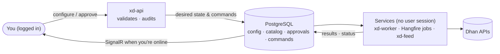
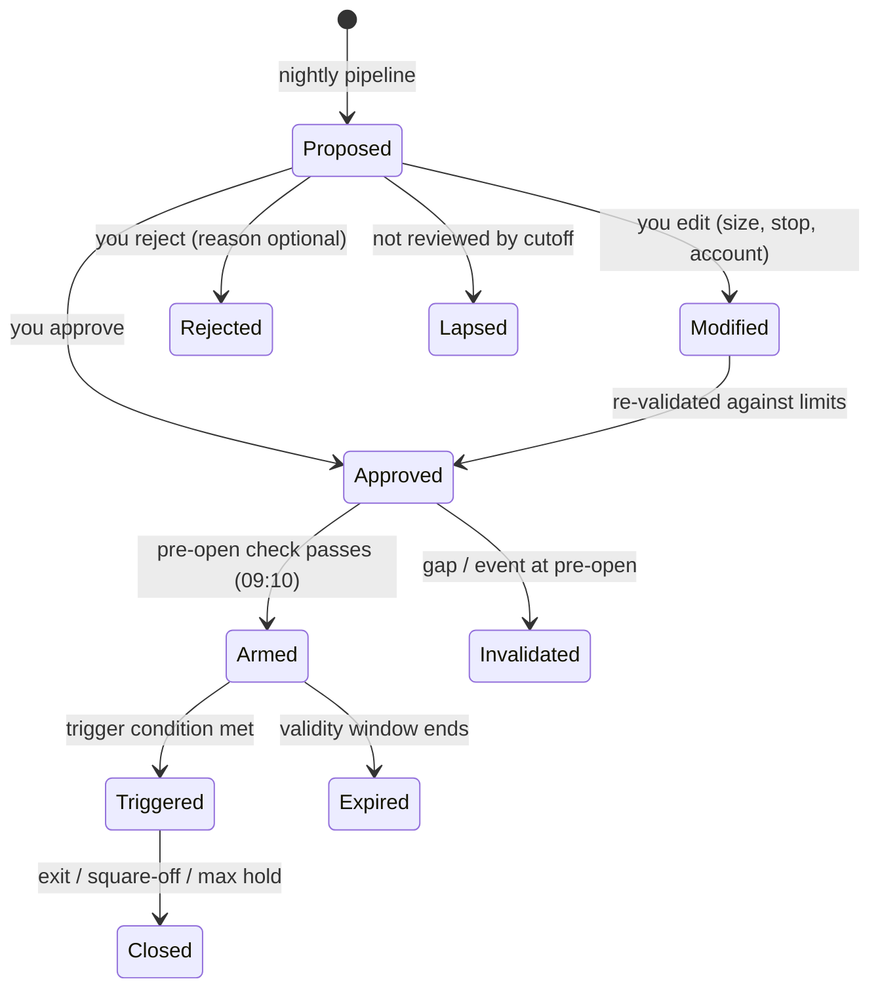

# 04 — Accounts, Access & Operating Model

Four rules shape how xDrishti is used day to day:

1. **Personal use only** — one owner, only the owner's broker accounts.
2. **Login required** — nobody else can open or use the application.
3. **Configure once, services run it** — what you set up is executed by background services on the machine,
   not by your browser session.
4. **Human in the loop** — the system and the AI *propose*; you *confirm* the decisions that matter.

## 1. Broker accounts and their roles

You can register any number of broker accounts. Each account is given one or more **roles**:

| Role | What the account is used for | Requirements |
|------|------------------------------|--------------|
| **Data** | Market data: instrument master, historical & end-of-day 1-minute data, live feed for the active set, quotes | Dhan Data API subscription on this account |
| **Trading** | Receives next-day plan tickets (sized to its capital and risk profile); auto-journal of fills; later order execution | Risk profile, capital source, allowed styles/instruments |
| **Portfolio** | Holdings, positions, trade history and ledger are synced and monitored | Sync schedule, default bucket |

One account can hold several roles at once, for example:

| Account | Data | Trading | Portfolio | Notes |
|---------|:----:|:-------:|:---------:|-------|
| Dhan · Main | ✅ primary | ✅ | ✅ | Pays the ₹499 Data API; trades and is monitored |
| Dhan · Long-term | — | — | ✅ | Monitoring only (holdings, XIRR) |
| Dhan · Swing | ✅ standby | ✅ | ✅ | Can take over data if the main account's token fails |

**Rules enforced by the system**
- Exactly **one primary Data account**; optionally one **standby** that takes over automatically if the primary's
  token or subscription fails (only if it also has an active Data API subscription).
- A Trading account must have a risk profile; plan allocation only goes to accounts with the Trading role.
- Portfolio views include only accounts with the Portfolio role (filterable per account).
- Removing a role stops the related services for that account; history is kept.
- Every role change is audited and needs re-authentication (password).

**Per-account settings:** display name, broker (Dhan only, [ADR 0009](../adr/0009-dhan-consent-flow-only.md)), Dhan client id (shown
masked: first 4 + last 2), the Dhan API key and secret (write-only, encrypted — see below), the day the API key was generated, roles,
mode (`paper` / `manual_live`; automated modes in a later phase), risk profile, capital source, sync schedule, token status & last successful sync.

**Dhan accounts** ([ADR 0008](../adr/0008-broker-credentials-vault-and-connection.md), narrowed by [ADR 0009](../adr/0009-dhan-consent-flow-only.md)): Dhan is the only
broker and the documented *API Key & Secret* consent flow the only way to connect. Adding an account asks for what Dhan needs; the setup steps and the
redirect URL are shown in the wizard and on the Connection tab (Dhan facts are constants in the UI):

| | Dhan |
|---|---|
| Identity | **Client id** — required (e.g. `1000000001`) |
| Secrets (write-only) | **API key** (`app_id`), **API secret** (`app_secret`) — valid **12 months**; the owner gives the day it was generated (default today, India time); warning 30 days before expiry |
| Setup steps shown | web.dhan.co → My Profile → Access DhanHQ APIs → switch on *API key* → app name, **Redirect URL** (copy button), Postback optional |
| Notes shown | A static IP is needed only for placing orders (not for data/portfolio); 25 consents a day |

The redirect URL is `<Brokers__PublicBaseUrl>/api/brokers/dhan/callback` (default base `http://localhost:8080`); the UI reads it from
`GET /api/brokers/dhan` → `{redirectUrl}`. Another broker later means a new decision (the `broker` column and the connector port stay).

**Connecting an account** ([P1-16c](../specs/P1-16c-connect-dhan-and-upstox.md), [P1-16d](../specs/P1-16d-dhan-consent-only-and-header-accounts.md), ADR 0008, 0009) follows Dhan's documented flow (details in doc 05 §8):

1. **Connect** — `POST /api/accounts/{id}/connect` (step-up) → `{authorizeUrl, expiresAt}`. The API asks Dhan for a consent (`generate-consent`,
   at most **25 per account and India day**; the 26th answers `429 accounts.consent_limit` with `retryAfterSeconds` until midnight IST) and returns
   Dhan's login page. A **pending sign-in** (`accounts.pending_connects`) is stored: bound to the session, valid **10 minutes**, usable **once**; a newer
   sign-in of the same session closes an older one.
2. The browser opens Dhan's login page (`consentApp-login`) in the same tab; the owner signs in there with Dhan's own 2FA.
3. **Callback** — Dhan redirects to `GET /api/brokers/dhan/callback?tokenId=…`. The callback needs the signed-in session (the session cookie is
   `SameSite=Lax` so it comes along with this top-level redirect) and the session's open pending sign-in (Dhan sends no state), uses it up at once,
   exchanges the `tokenId` server-side (`consumeApp-consent`), checks that the token belongs to the account's client id, stores the token encrypted
   (`access_token`) and always answers **302** to
   `/accounts?account={id}&connected=1` or `/accounts?[account={id}&]connectError={code}`. Codes: `accounts.connect_expired` (too late, used
   or another session), `accounts.connect_cancelled` (no tokenId), `accounts.connect_mismatch` (other client id; nothing stored),
   `accounts.broker_error`, `accounts.app_not_configured`, `auth.unauthenticated` (no session). It never shows broker data.
4. **Disconnect** — `DELETE /api/accounts/{id}/token` (step-up; deletes the stored token locally, no broker call: Dhan has no logout for these tokens).
   Dhan refusing, failing or timing out answers `502 accounts.broker_error` with a safe message (at most Dhan's error code).

Every account shows `connection {status, expiresAt, brokerUserName, brokerUserId (masked), lastConnectedAt, lastError}`
(`accounts.broker_connections`): status `not_connected` · `connected` · `expired` (derived when read once `expiresAt` has passed — no broker call).
`tokenStatus` repeats the status for the list's health dot.
A token belongs to the client id it was issued for: **changing the client id** of an account that has a token or a connected / expired
connection deletes the stored token, resets the connection to `not_connected` and closes its open sign-ins in the same change (no broker call;
audited as "client id changed; broker connection cleared"). **Archiving** deletes the token with the other secrets, resets the connection and
deletes the account's pending sign-ins.
Audit: `BrokerConnected`, `BrokerConnectFailed`, `BrokerDisconnected` (names, times and Dhan error codes only). Tokens, secrets and codes never
appear in responses, redirects, logs or audit text.

**Credential vault** ([ADR 0008](../adr/0008-broker-credentials-vault-and-connection.md), replaces the credential references of ADR 0007): the API key
and secret are entered in the app — in the add-account wizard (both required) or on the Connection tab (*Replace*, step-up; a value left out stays,
an empty one is refused) — and stored in `accounts.broker_secrets` (one row per account and secret: `api_key`, `api_secret`, `access_token`) encrypted with **AES-256-GCM**: random 96-bit nonce per value, the account id and secret name as associated data (a value only
decrypts for the account and name it was written for), a 256-bit key derived with HKDF-SHA256 from `BrokerVault__Key` (Keychain
`xdrishti/broker/vault-key`, ≥ 32 characters; the API refuses to start without it) and a key version per row for later rotation. Responses only
say `secrets: [{name, set, updatedAt}]` (plus `apiKeyIssuedOn` / `apiKeyExpiresOn`); values never appear in responses, logs, audit text, exceptions or
`ToString()`. Replacing is audited by name only ("API key replaced"). Archiving an account deletes its stored secrets. Accounts created before the
vault show "API key: not set".

**Sensitive changes need password re-entry (step-up, 5 minutes):** creating, changing the connection (name, client id, colour, notes), replacing broker secrets, connecting, disconnecting, changing roles or
the primary Data account, changing trading settings, removing an account, and creating, editing or deleting risk profiles. Without a recent
step-up these endpoints answer `403 auth.step_up_required`. Portfolio and Data settings and adding portfolio buckets do not need it.

**Removing an account archives it:** it disappears from lists and services, its history and audit trail (`accounts.account_events`, insert-only
for the runtime role) stay, its name becomes free again and its stored broker secrets are deleted. The primary Data account cannot be removed or lose the
Data role until another account has been made primary (an atomic swap; the old primary becomes the standby when that slot is free).

### 1.1 Accounts screen

| View | Content |
|------|---------|
| **Accounts** (list + detail) | Left: every account with roles, token health, holdings value. Right: tabs **Overview** (value, P&L, funds, token, sync) · **Roles** · **Trading** (mode, risk profile, capital source/amount, styles, allowed instruments per style, per-account overrides of risk %, max entries, max open, daily loss) · **Portfolio** (default bucket, trade-history import start, include in totals, buckets) · **Data** (primary/standby, subscription & renewal, live-feed budget, failover test) · **Connection** (client id masked, name, colour, notes; secret status — set / last changed, Dhan key expiry — with *Replace* (write-only dialog, step-up); Dhan's setup steps and redirect URL; connection status chip and expiry with *Connect / Reconnect* and *Disconnect*) · **Activity** (audit for this account) |
| **Add account wizard** | 1 *Dhan app* (client id, API key and secret — masked, never pre-filled —, day the key was generated, setup steps, redirect URL with copy button) → 2 *Identity* → 3 *Roles* → 4 *Role settings* → 5 *Review & create* (secrets shown as "•••• set"; confirm with your password; *Create and connect* starts the Dhan login) |
| **Header accounts menu** | Every account with colour dot, name and status chip (expiry when connected), and *Connect / Reconnect* for each account that is not connected ([P1-16d](../specs/P1-16d-dhan-consent-only-and-header-accounts.md)) |

The **role matrix** (all accounts × roles; tick to change, step-up; pick the primary Data account) and the shared **risk profiles** (Standard,
Conservative, …: risk per trade, max new entries/day, max open positions, daily loss, max per sector, max heat; which accounts use each) live under
**Settings** (`/settings`, tabs *Risk profiles* · *Account roles*), not on the Accounts page.

**Automatic failover:** if the primary Data account's token or subscription fails, the services switch to the
standby Data account, notify you and record it in the audit log.

## 2. Access control (login)

| Control | Design |
|---------|--------|
| Login | E-mail + password on a centred sign-in panel; a locked session shows *Welcome back · Unlock* (password only, survives reload); single fixed owner account, **no sign-up**: provisioned by `xd-migrate` from the Keychain items `xdrishti/auth/owner-email\|owner-name\|owner-password` (created with `scripts/auth-secrets.sh`) if none exists. Wrong e-mail and wrong password give the same `401 auth.invalid_credentials`. No second factor: the app is personal and reachable only on this machine / home LAN (a passkey can be added later if remote access is ever enabled) |
| Password storage | PBKDF2-HMAC-SHA512, ≥ 210,000 iterations, random salt (parameters stored with the hash; upgraded at the next login); never stored or logged in plain text. Changed with `scripts/auth-secrets.sh` + `deploy/xd-up.sh --owner-reset` (also signs out every session) |
| Sessions | Server-side, revocable, stored hashed in `auth.sessions`; opaque cookie `xd.sid` (HttpOnly, SameSite=Lax — `Strict` until ADR 0008: Dhan's sign-in redirect is a top-level cross-site GET that must carry it —, `Secure` on HTTPS); idle timeout 30 min (sliding, last-seen written ≤ once a minute); absolute timeout 12 h; CSRF header `X-CSRF-Token` on every POST/PUT/PATCH/DELETE; sign-out revokes the session; "lock" button (later) |
| Lockout | 5 consecutive failures → 15-minute lock (`423 auth.locked` + `retryAfterSeconds`; a correct password is refused during the lock); login route also limited to 10 attempts/minute per client address (`429`); every sign-in event (success, failure, lock, logout, idle/absolute expiry, owner provisioning/reset) in `auth.audit_events`, readable via `GET /api/auth/audit` |
| Step-up auth | Password re-entry for sensitive actions: account roles, broker secrets and connection, trading risk, risk profiles, removing accounts, config activation, enabling execution, deleting data. `POST /api/auth/step-up {password}` elevates the current session for **5 minutes** (`auth.sessions.elevated_until`; ends at logout/expiry), endpoints answer `403 auth.step_up_required` without it; wrong passwords count toward the same lockout as sign-in (`StepUpSucceeded` / `StepUpFailed` in the audit trail) |
| Recovery | No recovery codes: the owner resets the password from the Keychain (`xd-up.sh --owner-reset`); there is no e-mail reset |
| Every endpoint protected | Closed by default (fallback authorization policy): REST, OpenAPI/API docs, SignalR, Hangfire dashboard and file downloads require a session; only `/health/*`, `POST /api/auth/login` and `GET /api/auth/session` are anonymous. The Dhan callback `GET /api/brokers/dhan/callback` passes routing without a session but check it themselves and, without one, redirect to `/accounts?connectError=auth.unauthenticated` instead of answering 401. The static docs at `/prototype/` and `/docs/` are protected by the proxy (`forward_auth` → `GET /api/auth/verify`); the React shell and its assets stay public so the login page can load |
| Network | Reachable only on the home LAN via HTTPS (Caddy); optional WireGuard for remote; MCP/LLM on the internal network only |

## 3. Operating model — configure once, services run it

The UI is a **control plane**: it records what you want. Background **services** are the **execution plane**:
they do the work on the machine, whether or not you are logged in or the browser is open.

- Every action you take is stored as **desired state** (e.g. "INFY is tracked", "basket MyChoice contains …",
  "ticket T-123 approved") plus an **audit record** (who, when, what changed).
- Services run under a **service identity**, not your session. Logging out, closing the browser or the phone
  has no effect on scheduled work.
- Services **reconcile** desired vs actual state: on every run and on start-up. If the Mac was asleep at
  15:50, the end-of-day fetch runs as soon as the services are back (catch-up for missed schedules).
- Jobs are idempotent, retried with back-off and resumable; failures raise in-app notifications.

| You do this (once) | Services then do this (automatically) |
|--------------------|----------------------------------------|
| Track an instrument | Backfill history (CSV, then Dhan), add to end-of-day fetch, build all timeframes |
| Create a basket / add instruments | Include in the next scan scope, reports and portfolio grouping |
| Assign the Data role to an account | Switch market-data jobs and the live feed to that account |
| Assign the Portfolio role | Nightly sync of holdings, trades, ledger; valuations; XIRR |
| Assign the Trading role | Allocate and size plan tickets for that account |
| Approve tomorrow's tickets | Pre-open check, arm tickets, subscribe live feed, trigger/stop/target alerts |
| Drop CSV files in the inbox | Import, validate, aggregate, report |
| Activate a config version | Apply from the next scheduled run |
| Accept an AI suggestion | Apply the change (e.g. add instrument to basket) and log it |

**Services overview** (default schedules — all editable on the Services screen):

| Service / job | Default schedule | Runs as |
|---------------|------------------|---------|
| Live feed (active set) | Window 09:00–15:35, trading days | `xd-feed` |
| Holdings quote refresh | Every 5 min, 09:15–15:30 | `xd-feed` |
| **Pre-open check & arming** | **09:10** (after the 09:05 review cutoff and NSE pre-open price discovery, before the 09:15 open) | `xd-worker` |
| Price alerts & action center | Every 1 min, 09:15–15:30 | `xd-worker` |
| End-of-day fetch & aggregation | 15:50 | `xd-worker` |
| Data validation | Runs after the EOD fetch | `xd-worker` |
| Account & portfolio sync | 16:30 | `xd-worker` |
| Nightly pipeline → proposed plan | 18:30 | `xd-worker` |
| AI suggestions & briefing | After the nightly pipeline; starts `xd-llm` on demand and waits for readiness (a 30B load took 22–105 s) | `xd-worker` + `xd-llm` |
| CSV inbox watcher | Continuous | `xd-worker` |
| Weekly retrain / monthly review | Sat 10:00 / 1st of month | `xd-worker` |
| Backup | Daily 23:30 | `xd-backup` |

### 3.1 Schedule configuration

Each service has an editable schedule stored in the database (not in code):

| Setting | Options |
|---------|---------|
| Schedule type | Daily at a time (chosen days) · Weekly · Run after another service · Time window · Every N minutes within a window · Continuous |
| Execution | Enabled/paused · retries (0–5) · timeout · catch up missed runs · notify on failure |
| Parameters | Service-specific, e.g. EOD throttle and gap look-back; validation sessions, tolerance and spike multiple; pre-open gap threshold; live-feed instrument cap |

**Dependency & timing rules** (checked on every change; errors block saving, warnings are shown):
pre-open check after the review cutoff and before 09:15 (warning before ~09:08); EOD fetch after 15:35; nightly
pipeline after the EOD fetch and the portfolio sync; live window covers 09:15–15:30; no backup during market
hours; no circular "run after" chains; window start before end. The Services screen also shows a trading-day
**timeline** with market hours, the review cutoff, every scheduled run and the run-after chains, plus a preview
of the next three runs while editing.

## 4. Human in the loop

### 4.1 Who decides what

| Category | Examples | Decision |
|----------|----------|----------|
| **Automatic** (no approval) | Data fetch, aggregation, quality checks, grading, cell statistics, portfolio sync, valuations | Services |
| **Proposed → you confirm** | Next-day trade tickets · AI instrument suggestions (track, add to / remove from basket) · hypothesis promotions · cell promotions to Active · config change proposals · (later) semi-auto orders | You |
| **Only you** | Accounts & roles, credentials, baskets you create, risk limits, enabling execution | You |

### 4.2 Next-day plan approval

- The nightly pipeline produces a **proposed plan** (primary tickets + reserve list) with reasons, P(win),
  expected R and the AI briefing. You review it in the evening or morning (phone works via the PWA).
- Actions per ticket: **Approve**, **Modify** (reduce size, tighten stop, change account, choose reserve instead),
  **Reject**. Bulk "approve all within limits" is available. Every modification is re-validated against risk limits.
- **Review cutoff** (default 09:05): unreviewed tickets **lapse** (safe default — `unreviewed_policy: lapse`).
- Only **Approved → Armed** tickets enter the live active set and alerts.
- Every decision is recorded. Reports compare **system proposal vs your decision** — e.g. "rejected tickets would
  have made +4.2R this month" — so you can see whether your overrides add value.

### 4.3 AI suggestions inbox

The assistant and learning engine post suggestions to an **inbox**; each has a reason, evidence and an expiry:

| Suggestion | Example | If accepted |
|------------|---------|-------------|
| Track instrument | "Track PERSISTENT — strong RS, 3 passing setups in Best stocks rules" | Instrument tracked & backfilled |
| Add to / remove from basket | "Add TATAPOWER to Best stocks (rule match, liquidity ok)" | Membership updated (dated) |
| Next-day focus | "Prefer swing over intraday tomorrow: high-VIX regime" | Shown with the plan (no automatic effect) |
| Hypothesis / promotion | "ORB 15m BUY: target 2.0R → 2.5R passed walk-forward + shadow" | Config version created for activation |

Rejected suggestions are not repeated for a configurable number of days.

## 5. Data model additions

| Table | Purpose |
|-------|---------|
| `trading.accounts` | Broker accounts (no secrets) |
| `trading.account_roles` | account_id, role (data/trading/portfolio), is_primary/standby, enabled, settings |
| `auth.*` | ASP.NET Core Identity tables (user, password hash, lockout) |
| `ops.commands` | Desired-state changes and requested actions, status, actor, timestamps |
| `ops.audit_log` | Every login, configuration change, approval and service action |
| `workflow.approvals` | Item type, item id, decision, modifications, actor, decided_at, cutoff |
| `workflow.suggestions` | Source (AI / engine), type, payload, reason, expiry, status |
| `ops.service_runs` | Service/job runs with schedule, start/end, outcome, catch-up flag |
