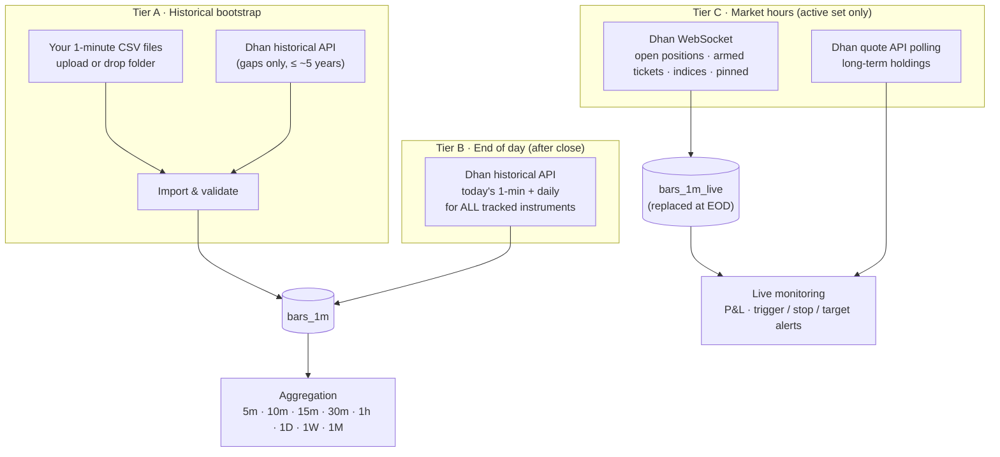

# 05 — Data & Brokers

## 1. Data sources (v1)

| Source | Role | Cost |
|--------|------|------|
| **Your CSV files (1-minute)** | Historical bootstrap and any bulk history you provide | ₹0 |
| **Dhan Data API** | The **only market-data API** in v1: instrument master, end-of-day 1-minute/daily fetch for tracked instruments, live feed for the active set, quotes for holdings | ₹499 + taxes / 30 days, on one account |
| **Dhan Trading API** | Funds, positions, holdings, trade history, ledger — every Dhan account | Free |
| NSE files (optional) | Free official bhavcopy / corporate actions / holidays for reconciliation | ₹0 |

## 2. Three data tiers



- **Tier A** fills history once (and whenever you add instruments or files).
- **Tier B** keeps every tracked instrument complete each evening — the learning engine and nightly plan use only
  Tier A/B data.
- **Tier C** streams live data **only for what you are actively trading or holding**, keeping the system light.

## 3. CSV import (1-minute data)

> **Built so far (P1-17a, [ADR 0016](../adr/0016-market-bars-csv-load-dhan-fetch-and-app-managed-aggregates.md)):** one fixed profile instead of the configurable ones below —
> the folder `Data:CsvFolder` (mounted read-only at `/data/csv`) with files `<SYMBOL>_1m.csv[.gz]` whose header columns `time` (epoch seconds, UTC, bar start), `open`, `high`,
> `low`, `close`, `volume` are found by name (others ignored). Each file is streamed (never held in memory) through the row rules, written with binary `COPY` into a staging table and merged in
> one transaction; a file already loaded and unchanged (name, size, modified time in `market.csv_files`) is skipped unless forced. Rules: an inconsistent high/low (the opening bar when the open
> is the pre-open price) is **repaired** (high = max, low = min of open/high/low/close) and counted; unparseable rows, prices not above zero, negative volume, a minute twice (the first is
> kept) and a time that is not a whole minute are **rejected** and counted with the first ten reasons; zero volume and special sessions (Muhurat) are kept. `CSV never overwrites Dhan`;
> Dhan overwrites CSV. `<SYMBOL>` ↦ `NSE:<SYMBOL>` (shares and ETFs that are not retired); unknown or ambiguous symbols are listed and skipped. Preview, undo, profiles and the watched
> folder stay with P1-07/P1-08.
>
> **A file is refused as a whole, before anything of it is merged** (nothing stored, the file is not recorded as loaded, the reason is in the job's `failedFiles`) when
> - its **clock is wrong**: most bars lie outside the regular session (India time) but nearly all (≥ 99 %) fit a session after adding or subtracting 5 h 30 min (the message names the shift), or most lie outside
>   every session, or the bars are stamped with the *end* of each minute (15:30 present, 09:15 absent) — the streaming counterpart of the window check of the Dhan fetch (§6); a few stray bars, the 60-bar
>   Muhurat evening session and Saturday special sessions are legitimate and never trigger it (verified on the 214 real files: 41 M rows, none refused);
> - most of its **times are not epoch seconds** between 2000 and 2100 (milliseconds are named as such) or are **later than one day from now**; a few such rows are only rejected and counted (`timeOutOfRange`, `timeInFuture`);
> - it exceeds the **limits that bound the work per file**: `Data:Csv:MaxRowsPerFile` (default 5 000 000 rows; the real files have ≈ 200 000), `Data:Csv:MaxBytesPerFile` (default 1 GiB read *after* decompression, so a
>   gzip bomb stops), `Data:Csv:MaxSpanDays` (default 3 700 days ≈ 120 monthly chunks of the hypertable).
>
> **Tracking after a load.** After the files, the instruments that have bars from CSV files — loaded in this run *or in an earlier one*, so a tracking that failed is tried again by the next run even for unchanged
> files — are tracked, **but only those that have never had a tracking row** (active or not). An instrument the owner untracked is never tracked again behind their back, by a changed file or a forced load.

### 3.1 How files arrive
- **Upload** in the Data → Import screen (multiple files / zip), or **drop** into the watched folder
  `data/inbox/` (mounted into `xd-worker`), or CLI `xd data import <path> --profile <name>`.
- One file per instrument (symbol from file name) or multi-instrument files (symbol column) — both supported.

### 3.2 Import profiles (column mapping)
Different CSV sources use different layouts; a saved **profile** describes yours once:

```yaml
csv_profiles:
  my_1min_files:
    delimiter: ","
    header: true
    symbol: { from: filename, pattern: "^(?<symbol>[A-Z0-9&-]+)_1min\\.csv$" }   # or { from: column, name: symbol }
    exchange: NSE
    columns: { timestamp: datetime, open: open, high: high, low: low, close: close, volume: volume, oi: null }
    timestamp: { format: "yyyy-MM-dd HH:mm:ss", timezone: Asia/Kolkata, label: bar_start }   # bar_start | bar_end
    prices: { adjusted: false }        # raw prices; system applies corporate-action adjustments
    session_filter: { from: "09:15", to: "15:29" }
```

Example accepted file (`TATASTEEL_1min.csv`):
```
datetime,open,high,low,close,volume
2026-10-05 09:15:00,152.10,152.60,151.95,152.40,412530
2026-10-05 09:16:00,152.40,152.55,152.20,152.30,198220
```

### 3.3 Import pipeline
1. **Detect** profile (or use the one specified); preview the first rows in the UI before committing.
2. **Map symbol** → master list; unknown symbols are listed for you to map or skip (never guessed).
3. **Validate** each row: timestamp parse, within session, OHLC consistency (`low ≤ open/close ≤ high`), no
   negative volume, no duplicate timestamps; bar-end labels shifted to bar-start.
4. **Upsert** into `market.bars_1m` with `source = csv`. Precedence on overlap (configurable): Dhan official >
   CSV > live; conflicts beyond tolerance are logged, not silently overwritten.
5. **Refresh aggregates** for the affected instrument/date range.
6. **Report**: rows imported/updated/rejected per file, coverage before/after, quality issues — stored as an
   import job you can review and undo (by job id).

Instruments in the files are auto-added to the **tracked** list (configurable), so they are kept up to date by
Tier B afterwards.

## 4. Aggregation to other timeframes

All timeframes are built from 1-minute bars — identical logic for CSV and Dhan data.

| Rule | Detail |
|------|--------|
| OHLCV | open = first, high = max, low = min, close = last, volume = sum, OI = last |
| Alignment | Intraday buckets anchored to the **09:15** session open: 15m = 09:15, 09:30…; 1h = 09:15–10:15 … 14:15–15:15, then 15:15–15:30 (partial, flagged) |
| Timeframes | 5m, 10m, 15m, 30m, 1h (and any custom minute size) · 1D · 1W · 1M |
| Daily bar | `daily_source: official` (Dhan daily candles, default when available) or `derived` (from 1-minute) — official open uses the pre-open auction price, so the two can differ slightly |
| Missing minutes | Bucket built from available minutes; `bars` (the number of 1-minute bars in it) and a `complete` flag are stored (what complete means: see below) |
| Special sessions | Holidays skipped; special sessions (e.g. Muhurat) are kept as they come; the calendar (P1-11) will name them |
| Implementation | **In the application, not continuous aggregates** (ADR 0016): set-based SQL upserts (`date_bin` with the 09:15 origin) run by the aggregate phase of the data job, for the ranges whose 1-minute bars changed since the last build (or everything on request); real-time aggregation combines materialised + newest rows (P2) |

**Why not continuous aggregates.** The runtime role `xd_app` has plain DML only and may not refresh or own a continuous aggregate; a refresh policy would need a second privileged path, and a
continuous aggregate cannot express the rules above (09:15 anchoring with a partial 15:15 hour, Monday weeks, a completeness flag, a day that is the *India* date, a special evening session) as plainly
as a query we can test. So the application builds `market.bars_agg` itself with idempotent upserts (a bucket that comes out the same is not written), per instrument and changed range, as `xd_app`,
and a test recomputes every bucket with an independent implementation over fixtures (a Muhurat evening, month and week boundaries, gaps) and compares them exactly.

**Bucket rules as built** (all from the stored 1-minute bars; times are India time, UTC+05:30, no daylight saving):

| Timeframe | Bucket start (`ts`) | `bars` | `complete` |
|-----------|---------------------|--------|------------|
| 5m, 10m, 15m, 30m | 09:15 + k × N minutes of the same India date (09:15, 09:30 … for 15m) | 1-minute bars in the bucket | exactly the minutes of the bucket's window, clipped at the 15:30 close for buckets that start before it (the 10m bucket at 15:25 and the 30m bucket at 15:15 hold 5 and 15) |
| 1h | 09:15, 10:15 … 14:15, then 15:15 (the partial 15:15–15:30 hour holds 15 bars) | as above | as above |
| 1D | India midnight of the India date (a Muhurat evening belongs to its own date) | 1-minute bars of the date | all 375 minutes of 09:15–15:29 are there; for a date without a single regular-session minute (an evening session) every minute between its first and last bar is |
| 1W | India midnight of the **Monday** of the week | sum of its days | every day with bars is complete |
| 1M | India midnight of the first of the month | sum of its days | every day with bars is complete |

`complete` for 1W and 1M means that every *day that has bars* is complete — not that the week or month is over: the running week or month is `complete` as long as the days so far are; use the last bucket's
date, not the flag, to tell an unfinished period.

`ts` of every bar is a UTC instant; the API shows it with the India offset (`+05:30`). The days, weeks and months are built from the day bars, the day bars and the intraday bars from the 1-minute bars.
Prices are raw (adjustments come with P1-10).

## 5. Real-time data — the active set only

To keep the system fast and within limits, live data is streamed only for the **active set**:

| Member of active set | Why | Method |
|----------------------|-----|--------|
| Open intraday / swing positions (all accounts) | Live P&L, stop/target alerts | WebSocket (quote mode) |
| Today's armed plan tickets (until triggered/expired) | Trigger detection & alerts | WebSocket |
| Context indices (NIFTY 50, NIFTY BANK, INDIA VIX) | Market filter, live context | WebSocket |
| Pinned basket (optional) | Your live watch list | WebSocket (counts toward budget) |
| Long-term holdings | Valuation | Quote API polling (≤ 1,000 per request, every 5 min) |

- Dhan limits: up to 5 WebSocket connections × 5,000 instruments; our active set is typically < 100 → one
  connection. `live.max_ws_instruments` caps it (default 200).
- `xd-feed` builds **live 1-minute bars** in memory from ticks and persists them to `market.bars_1m_live`.
- At end of day, Tier B fetches the **official** 1-minute bars; live bars are reconciled and discarded.
- Subscriptions update automatically when a ticket arms, a position opens/closes, or holdings change.
- Runs 09:00–15:35 on trading days; auto-reconnect; gaps logged.

## 6. End-of-day fetch (Tier B)

Scheduled after close (default 15:50 IST) before the nightly pipeline:

1. Refresh Dhan token; refresh instrument master (new listings, lot sizes, expiries).
2. For every tracked instrument: fetch today's 1-minute candles and daily candle (throttled, chunked, resumable).
3. Detect gaps for recent days and backfill; corporate actions; calendar.
4. Quality checks (§9); reconcile with NSE files if enabled.
5. Refresh aggregates; then the nightly pipeline starts ([doc 03](03-target-architecture.md) §7).

Adding new tracked instruments triggers a backfill job (CSV first, then Dhan for gaps).

> **Built so far (P1-17a, [ADR 0016](../adr/0016-market-bars-csv-load-dhan-fetch-and-app-managed-aggregates.md) §7):** the manual **Dhan phase** of the Update data button, without the schedule,
> gap detection or the daily candle. For every tracked, not retired share, ETF or index with a Dhan id (`instrument_broker_ids`) it calls Dhan's Data API once per window of at most 90 days, from
> two days before the instrument's last stored bar (the overlap proves the timestamp alignment: price differences beyond 0.05 % are counted as warnings) or `Data:Dhan:InitialDays` (365) back, up to now:
>
> | | |
> |---|---|
> | Request | `POST https://api.dhan.co/v2/charts/intraday`, headers `access-token` (the primary Data account's token from the vault) and `Content-Type: application/json` (no `client-id`: not documented for this endpoint, and the holdings read works without it) |
> | Body | `{"securityId":"<SECURITY_ID, text>","exchangeSegment":"NSE_EQ"\|"IDX_I","instrument":"EQUITY"\|"INDEX","interval":1,"oi":false,"fromDate":"yyyy-MM-dd HH:mm:ss","toDate":"yyyy-MM-dd HH:mm:ss"}` — dates in **India time**, `toDate` = now; shares/ETFs are `NSE_EQ`/`EQUITY`, indices `IDX_I`/`INDEX` (a type and segment that do not belong together are not sent) |
> | Answer | parallel arrays `open, high, low, close` (float), `volume`, `timestamp` (and `open_interest`, ignored). The documentation does not state the time base: `timestamp` is read as **Unix seconds**, or milliseconds when it has 13 digits. Empty arrays are "no bars", arrays of different lengths are a failure |
> | Proof | the bars of a window must lie within a day of the period asked for, and not be 5 h 30 min off: when most bars lie outside the regular session but all fit a session after adding or subtracting 5 h 30 min, or the bars include one stamped 15:30 and none 09:15 (stamped with the minute's end), that instrument **fails** with a message naming the suspicion — nothing is shifted or guessed. Bars outside sessions are rejected and counted by the pipeline; the minute still running is left for the next fetch |
> | Limits | 15 s per request, answers up to 16 MB, no redirects, one request at a time through a shared throttle (`Data:Dhan:RequestsPerSecond`, default 4); the documentation states no rate limit |
> | Errors | 401/403, or DH-901/DH-902 on a 4xx → the token or Data API subscription is refused: the phase ends (`data.dhan_not_connected`, reconnect under Accounts); **429, 5xx or DH-904 → one retry after 2 s**, then the instrument fails; every other 4xx is never retried and fails only that instrument (the run goes on). `DH-907` is *not* read as "no data" here (it also means wrong parameters): it is a visible failure of that instrument |
> | Leaks | only the HTTP status and a well-formed Dhan error code (`DH-905`) are logged or shown; never the token, the URL, the request body or the text of Dhan's answer |

## 7. Broker abstraction

| Interface | Methods | v1 adapter |
|-----------|---------|-----------|
| `IMarketDataProvider` | instruments, intraday/daily history, quotes | Dhan (built so far: the 1-minute history behind `IIntradayBarSource`, §6) |
| `ILiveFeed` | subscribe/unsubscribe, tick stream | Dhan WebSocket |
| `IAccountReader` | funds, positions, holdings, trades (history), ledger | Dhan |
| `IBrokerConnector` (P1-16c) | start/complete the browser consent login | Dhan (API key & secret consent flow) — §8.1 |
| `ITokenProvider` | get, refresh, expiry for the services | Reads the vault and `accounts.broker_connections` (P1-12) |
| `IOrderExecutor` | place/modify/cancel (later phase) | — |
| `IFileImporter` | CSV profiles → bars | CSV |

Dhan is the only broker ([ADR 0009](../adr/0009-dhan-consent-flow-only.md)); another one means a new decision, one connector and one adapter project. Dhan API keys, secrets and tokens are kept in the encrypted broker vault (`accounts.broker_secrets`, doc 04 §1).
The instrument master maps each broker id
(Dhan `security_id` + segment) to a canonical symbol; mapping mismatches are quality issues, never guessed.

### 7.1 Instrument master sources (ADR 0010, P1-03)

The master list ([doc 06](06-instruments-and-baskets.md) §2) is built from two **public files**; no credentials, cookies or account data are sent. The API's HTTP clients call them with an allow-list
(`GET`, HTTPS, exact host and path, no query, no redirects followed, no cookies, `User-Agent: xDrishti/0.1 (personal use)`, no request logging beyond the source name and HTTP status), size caps and total timeouts:

| File | URL | Size / cap / timeout | Used for |
|------|-----|----------------------|----------|
| Dhan detailed scrip master | `https://images.dhan.co/api-data/api-scrip-master-detailed.csv` | 207,560 rows, 35 MB · 100 MB · 120 s | Instruments: canonical symbols, `SECURITY_ID`, ISIN, series, lot and tick size, expiry, ASM/GSM, MTF leverage, freeze quantity. Serves `ETag` and `Last-Modified`; a conditional request returns `304` when unchanged |
| NSE Nifty Total Market list | `https://nsearchives.nseindia.com/content/indices/ind_niftytotalmarket_list.csv` | 49 KB, 755 stocks · 5 MB · 30 s | Sector (NSE "Industry", 22 values) by ISIN. NSE refuses clients without a `User-Agent` and ignores `If-None-Match`, so it is fetched in full on every changed master (it is small); a failure to get or read it never fails the refresh |

Dhan's header has 33 columns (the last one empty). The importer finds the 17 columns it reads by name and **fails closed** with a plain message when one is missing or repeated; extra or no-longer-present unused columns, and single unreadable or oversize rows, are tolerated with a warning (doc 06 §2.2). Both files can change format without notice; a refused file leaves the previous list untouched.
Using them follows the sources' terms for personal use ([doc 19](19-risks-and-compliance.md)).

## 8. Accounts

Any number of accounts (all your own), each with **roles** — Data, Trading, Portfolio — as described in
[doc 04](04-accounts-access-and-operations.md) §1. The market-data jobs and live feed in this document always use
the **primary Data account** (with automatic failover to a standby Data account if configured). Trading accounts
have mode (`paper` / `manual_live`; automated modes later), risk profile, allowed styles/instruments and capital source. Nightly sync reads funds, positions, holdings, trade
history and ledger → feeds the **auto-journal** (fills matched to plan tickets) and **portfolio monitoring**
([doc 12](12-portfolio-monitoring.md)). The instrument master needs no account: it comes from two public files (§7.1).

### 8.1 Connecting: Dhan's consent flow

From Dhan's own documentation (verified 2026-10-11; ADR 0008, 0009, specs P1-16c, P1-16d). The connector calls only the endpoints below (allow-list in
the HTTP client: HTTPS, exact host and path, method; no redirects followed), with a 15-second timeout, no retries (codes are single-use) and no
request logging (URLs and headers carry tokens and codes; the `tokenId` in the consume URL counts as a secret). Dhan error codes are kept
only when they have Dhan's form (`DH-901`); message texts are never used.

| Step | Dhan (API key & secret) |
|------|-------------------------|
| Start | `POST https://auth.dhan.co/app/generate-consent?client_id={clientId}`, headers `app_id`, `app_secret` → `consentAppId` (max 25 a day) |
| Browser | `https://auth.dhan.co/login/consentApp-login?consentAppId=…` → redirect `?tokenId=…` (no state) |
| Exchange | `POST https://auth.dhan.co/app/consumeApp-consent?tokenId=…`, headers `app_id`, `app_secret` → `accessToken`, `expiryTime`, `dhanClientId`, `dhanClientName`, `dhanClientUcc` |
| Holder check | `dhanClientId` = the account's client id |
| Expiry | `expiryTime` (ISO, India time unless an offset is given); otherwise 24 h after issue |
| Disconnect | token deleted locally (Dhan has no logout for these tokens; no call) |

A 4xx answer is a refusal (wrong key/secret, used or expired tokenId), anything else (5xx, 3xx, timeout, network, unreadable body)
is "broker unavailable"; both surface as `502 accounts.broker_error` with a safe message. Expiry times are stored in UTC.

### 8.2 Reading the holdings (ADR 0012, P2-01)

`GET https://api.dhan.co/v2/holdings` with the header `access-token` (the account's stored token, read from the vault) answers an array of
`{exchange, tradingSymbol, securityId, isin, totalQty, dpQty, t1Qty, mtf_t1_qty, mtf_qty, availableQty, collateralQty, avgCostPrice, lastTradedPrice}` — no purchase
date and no previous close. xDrishti uses `exchange`, `tradingSymbol`, `securityId`, `isin`, `totalQty`, `avgCostPrice` and `lastTradedPrice`. It is the only `api.dhan.co`
endpoint on the allow-list (GET, HTTPS, exact path, no query, no redirects, 30 s, answers up to 5 MB). A 401/403 means the saved token is expired or revoked
(`409 portfolio.not_connected`, "sign in to Dhan again"); other 4xx and 5xx/timeouts are `502 accounts.broker_error`. An empty array (HTTP 200 `[]`) and Dhan's documented data error `DH-907` ("incorrect parameters or no data present";
this request has no parameters, so here it can only mean no data) both read as an empty list; `DH-1111` is not in Dhan's documentation and is only tolerated as an alias.
An empty list is never trusted blindly: see the safeguard in [doc 12](12-portfolio-monitoring.md) §3. Rows of one holding (same ISIN, or same security id and exchange) are added up (quantity summed, average cost weighted). Neither the token, the URL nor the
raw answer is logged or returned.

## 9. Storage

| Table | Type | Notes |
|-------|------|-------|
| `market.instruments` | Table (P1-03) | The master list: canonical symbol (unique), type, name, ISIN, series, lot/tick size, expiry, sector, flags, first/last seen, `retired_at`; trigram indexes for search |
| `market.instrument_broker_ids` | Table (P1-03) | Dhan `SECURITY_ID` + exchange segment per instrument |
| `market.master_refreshes` | Table (P1-03) | One row per refresh run: trigger, status, phase, counts, validators, warnings, error |
| `market.bars_1m` | Hypertable (P1-17a), 1-month chunks, compressed after 7 days (segmented by instrument, ordered by time) | PK (instrument_id, ts) with ts = bar start (UTC); raw o/h/l/c (double), volume, `source` = `csv` / `dhan`. `xd_app`: no DELETE. The one index is the primary key |
| `market.bars_agg` | Table (P1-17a), not a hypertable | One row per (instrument_id, timeframe, ts) for 5m, 10m, 15m, 30m, 1h, 1D, 1W, 1M: o/h/l/c, volume, `bars`, `complete`; 09:15-anchored (§4). Built by the application. `xd_app`: no DELETE |
| `market.bar_coverage` | Table (P1-17a) | Per instrument: first/last bar, 1-minute bars (all, csv, dhan), the changed range not aggregated yet (`dirty_from`/`dirty_to`), when and what the aggregates hold (`aggregates` JSON). Kept up to date by every write of bars |
| `market.csv_files` | Table (P1-17a) | The CSV files loaded: name, size, modified time, instrument, rows / inserted / updated / repaired / rejected, loaded at (written in the transaction of the file's bars) |
| `market.data_jobs` | Table (P1-17a) | One row per run of the data pipeline (CSV → Dhan → aggregates): steps, status, and per phase its progress and counts (JSON); at most one row `running` (unique partial index + advisory lock); history is kept |
| `market.bars_1m_live` | Hypertable, short retention | Live bars for the active set |
| `market.bars_1d` | Table | Official (Dhan daily candles) or derived (flagged) — the derived day bar is `bars_agg` `1D` until the official one exists |
| `market.context_daily` | Table | Indices, VIX, breadth, regime |
| `data.import_profiles`, `data.import_jobs`, `data.import_issues` | Tables | CSV import config, history, rejected rows |
| Adjustment factors | Table | Research reads adjusted views; plans use raw prices |

Size: ~200 instruments × 8 years of 1-minute data ≈ 150 M rows → ~5–10 GB compressed.

**The chunks of `bars_1m` are protected too.** A hypertable's chunks are tables of their own (`_timescaledb_internal._hyper_*_chunk`, and for compressed ones `_hyper_*_chunk_compressed`), reachable by name,
so the missing DELETE on `market.bars_1m` would mean little if `xd_app` could delete from them. It cannot: TimescaleDB gives every new chunk — ordinary and compressed, whenever created — the privileges of the
hypertable (`xd_app` has `SELECT, INSERT, UPDATE` on them, no DELETE, TRUNCATE, REFERENCES or TRIGGER), and the default privileges that grant DELETE on new tables do not override that. This is verified by
`DataTableGrantsTests` against the real extension as the real role (privilege check and an attempted `DELETE`/`TRUNCATE` on a chunk created after the migrations and on a compressed chunk), so no extra migration
or event trigger is needed; a TimescaleDB upgrade that changed it fails that test.

## 10. Data quality

| Check | Action |
|-------|--------|
| Missing minutes (no halt) | Backfill from Dhan; flag if unresolved |
| Spike > X × ATR with reversal | Flag bad tick |
| OHLC inconsistency / duplicate timestamps (CSV) | Reject row, report |
| Timestamp label mismatch (bar end vs start) | Detected by session boundary check; profile fix suggested |
| CSV vs Dhan conflict beyond tolerance | Keep by precedence; log |
| Unapplied corporate action | Alert |
| Rename / merger / delisting | Master update; history linked |
| Circuit-locked days | Mark unfillable |

The nightly plan is not produced (fail closed) if index data fails or more than X% of tracked instruments fail;
individual instruments that fail validation are skipped by the scan (per-instrument fail-closed).

### 10b. Data quality window (validation workbench)

The **Data validation** service runs after every end-of-day fetch (and on demand) over the last N sessions
(default 5) of every tracked instrument:

| Check | How |
|-------|-----|
| Completeness | 375 one-minute bars per session; lists missing minutes |
| Bar sanity | low ≤ open/close ≤ high, positive prices |
| Duplicates | No repeated timestamps |
| Spikes | Move > k × median one-minute move and > 1% |
| **Aggregates vs 1-minute** | Every stored 5m/15m/30m/1h/1D bucket is recomputed from the 1-minute bars with an independent reference implementation and compared exactly (OHLC and volume) — catches aggregates not refreshed after late data |
| **Derived vs official daily** | 1D built from 1-minute vs the broker's official daily candle (±0.05% OHLC, ±1% volume) |
| Freshness | Data present up to the last trading day |

The **Data quality** screen lists every tracked instrument with status (pass / warning / fail), coverage, bars
checked, missing minutes, per-timeframe aggregate status, official-daily status and source (CSV / Dhan), plus a
data quality score. **Inspect** shows each check, a side-by-side table of stored vs recomputed buckets (with
"differences only"), the chart built from 1-minute data and the missing minutes. **Re-fetch** / **Refresh
aggregates** repair an instrument and re-validate it automatically; every run is kept in a history.

## 11. Biases avoided

Survivorship (historical index membership incl. delisted stocks), look-ahead (closed bars only; higher-TF from
last closed bar; point-in-time regime), selection (basket rules are dated; point-in-time membership available).
