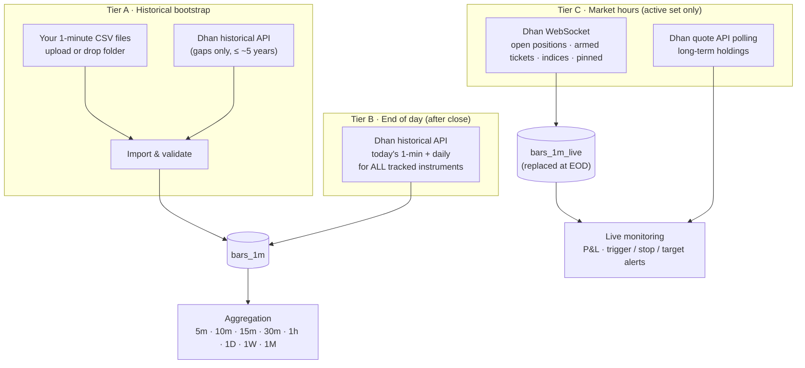

# 05 — Data & Brokers

## 1. Data sources (v1)

| Source | Role | Cost |
|--------|------|------|
| **Your CSV files (1-minute)** | Historical bootstrap and any bulk history you provide | ₹0 |
| **Dhan Data API** | The **only market-data API** in v1: instrument master, end-of-day 1-minute/daily fetch for tracked instruments, live feed for the active set, quotes for holdings | ₹499 + taxes / 30 days, on one account |
| **Dhan Trading API** | Funds, positions, holdings, trade history, ledger — every Dhan account | Free |
| NSE files (optional) | Free official bhavcopy / corporate actions / holidays for reconciliation | ₹0 |
| Corporate actions (splits, bonus) | Not from a feed: detected in the stored day bars and **confirmed by you**, typed in, or imported from CSV text (§4.2). Bars stay raw; adjusted reads apply them | ₹0 |

## 2. Three data tiers



- **Tier A** fills history once (and whenever you add instruments or files).
- **Tier B** keeps every tracked instrument complete each evening — the learning engine and nightly plan use only
  Tier A/B data.
- **Tier C** streams live data **only for what you are actively trading or holding**, keeping the system light.

## 3. CSV import (1-minute data)

> **Built so far (P1-17a, [ADR 0016](../adr/0016-market-bars-csv-load-dhan-fetch-and-app-managed-aggregates.md)):** one fixed profile instead of the configurable ones below —
> the folder `Data:CsvFolder` (mounted read-only at `/data/csv`) with files `<SYMBOL>_1m.csv[.gz]` whose header columns `time` (epoch seconds, UTC, bar start), `open`, `high`,
> `low`, `close`, `volume` are found by name (others ignored). Each file is streamed (never held in memory) through the row rules, written with binary `COPY` into a staging table and merged in
> one transaction; a file already loaded and unchanged (name, size, modified time in `market.csv_files`) is skipped unless forced. Rules: an inconsistent high/low (the opening bar when the open
> is the pre-open price) is **repaired** (high = max, low = min of open/high/low/close) and counted; unparseable rows, prices not above zero, negative volume, a minute twice (the first is
> kept) and a time that is not a whole minute are **rejected** and counted with the first ten reasons; zero volume and special sessions (Muhurat) are kept. `CSV never overwrites Dhan`;
> Dhan overwrites CSV. `<SYMBOL>` ↦ `NSE:<SYMBOL>` (shares and ETFs that are not retired); unknown or ambiguous symbols are listed and skipped. Profiles and the watched
> folder stay with P1-07/P1-08; the **review step and the undo** are built (below).
>
> **A file is refused as a whole, before anything of it is merged** (nothing stored, the file is not recorded as loaded, the reason is in the job's `failedFiles`) when
> - its **clock is wrong**: most bars lie outside the regular session (India time) but nearly all (≥ 99 %) fit a session after adding or subtracting 5 h 30 min (the message names the shift), or most lie outside
>   every session, or the bars are stamped with the *end* of each minute (15:30 present, 09:15 absent) — the streaming counterpart of the window check of the Dhan fetch (§6); a few stray bars, the 60-bar
>   Muhurat evening session and Saturday special sessions are legitimate and never trigger it (verified on the 214 real files: 41 M rows, none refused);
> - most of its **times are not epoch seconds** between 2000 and 2100 (milliseconds are named as such) or are **later than one day from now**; a few such rows are only rejected and counted (`timeOutOfRange`, `timeInFuture`);
> - it exceeds the **limits that bound the work per file**: `Data:Csv:MaxRowsPerFile` (default 5 000 000 rows; the real files have ≈ 200 000), `Data:Csv:MaxBytesPerFile` (default 1 GiB read *after* decompression, so a
>   gzip bomb stops), `Data:Csv:MaxSpanDays` (default 3 700 days ≈ 120 monthly chunks of the hypertable).
>
> **Tracking after a load.** After the files, the instruments that have bars from CSV files — loaded in this run *or in an earlier one*, so a tracking that failed is tried again by the next run even for unchanged
> files — are tracked, **but only those that have never had a tracking row** (active or not). An instrument the owner untracked is never tracked again behind their back, by a changed file or a forced load.

> **Review step and undo (P1-07a, [ADR 0017](../adr/0017-trading-calendar-eod-schedule-quality-adjustments-and-csv-undo.md) §6).**
> - **`GET /api/data/csv/files`** lists the folder from its directory entries and the log of loaded files only (no file is opened, so 214 files list at once): per file `state` — `pending` (never loaded, or its load was undone) ·
>   `loaded` (size and modified time are what they were when it was loaded) · `changed` (loaded, but size or modified time differ now) —, size, modified time, the `symbol` parsed from the name, the `instrument` it maps to
>   or `mapping` `unknown` · `ambiguous` (several instruments, or several files, claim the symbol) · `invalidName` (a `.csv`/`.csv.gz` that is not `<SYMBOL>_1m.csv[.gz]`; other extensions are not listed), and for loaded files
>   `rows`, `firstBar`, `lastBar` (null for a file loaded before the range was recorded), `loadedAt` and `overlapsWith` (the names of the other loaded files of the same instrument whose first-to-last range intersects this one's — a file renamed after its load is loaded twice; a file without a recorded range counts as covering everything; null for pending files). Changed and pending files first, then loaded, each by name; `q`, `state`, `page`, `pageSize` (≤ 200); counts by state.
> - **`POST /api/data/csv/preview {files[≤ 20]}`** is a **dry run of the real reader**, the same row rules, limits and session check as a load, writing nothing: per file the rows, accepted, repaired and rejected counts
>   (rejections by reason and up to 10 examples, line numbers only), first and last bar (India time), trading days (distinct India dates), the verdict — `pass`, or `refused` with the load's own refusal message (wrong clock, wrong time unit,
>   a limit, no usable header) — the symbol mapping, the first 5 accepted rows and **what loading would do to the stored bars**: would insert, would update, keep existing Dhan bars, unchanged, counted by primary-key lookups of the file's
>   minutes against `market.bars_1m` (the same classification as the merge, so the counts equal what the load then reports). A request looks up at most 1 million stored bars; beyond that a **spread sample of whole batches** is compared and the file's
>   comparison says `sampled` with the rows it compared. A request also reads at most **2 ×** the per-file limits of `Data:Csv` (rows and bytes) and works for at most **60 seconds**; the files after either limit, and the one being read when the time runs out, are `error` with the reason. Names are checked against the folder listing: a path, a traversal,
>   a name with control characters or a file that is gone is that file's `error`, never a failure of the request.
> - **`POST /api/data/refresh {csvFiles}`** loads only the named files (≤ 214, each in the folder listing with a loadable name, else `400 data.invalid` naming it; only with the csv step; unchanged files are still skipped unless `forceCsv`).
>   The job keeps the list (`csvFiles`).
> - **`POST /api/data/csv/files/{name}/undo`** (session and CSRF, no step-up) starts a job that removes the file's **`csv`-source bars of its instrument within the file's recorded first-to-last bar** — never Dhan bars, never another
>   instrument, never a CSV bar outside the range — and then rebuilds the instrument's aggregates; the file is pending again and the audit trail says `CSV load of <file> undone, N bars removed` (no row data). **Values that
>   an earlier load had overwritten are not restored** (no history of replaced bars is kept): loading the file again writes its current values. **The removal is by instrument and range, not by file:** when another loaded file of the instrument overlaps the range (`overlapsWith`), its bars in the overlap go too; the job then carries a warning naming those files ("…cover the same time (a.csv, b.csv): the undo removed their bars in the overlap too. They stay loaded; load them again with force…"). `404 data.csv_file_not_found` (never loaded or undone already), `409 data.job_running`. The
>   app role has no DELETE on bars (§9), so the removal is `market.undo_csv_bars(instrument, from, to)`, one `SECURITY DEFINER` function owned by the migrating role (`xd_owner`) with a pinned search path, executable by `xd_app` only (§9).
> - **The real files are already adjusted.** The 214 CSV files of the owner are split- and bonus-adjusted **at the source** (checked on HDFC Bank's 2025 bonus and Bajaj Finance's 2025 split: prices are continuous across the ex-dates), so
>   corporate actions (§4.2) only matter for ex-dates **after** the CSV data ends; entering the historical ones would adjust the history twice.

### 3.1 How files arrive
- **Upload** in the Data → Import screen (multiple files / zip), or **drop** into the watched folder
  `data/inbox/` (mounted into `xd-worker`), or CLI `xd data import <path> --profile <name>`.
- One file per instrument (symbol from file name) or multi-instrument files (symbol column) — both supported.

### 3.2 Import profiles (column mapping)
Different CSV sources use different layouts; a saved **profile** describes yours once:

```yaml
csv_profiles:
  my_1min_files:
    delimiter: ","
    header: true
    symbol: { from: filename, pattern: "^(?<symbol>[A-Z0-9&-]+)_1min\\.csv$" }   # or { from: column, name: symbol }
    exchange: NSE
    columns: { timestamp: datetime, open: open, high: high, low: low, close: close, volume: volume, oi: null }
    timestamp: { format: "yyyy-MM-dd HH:mm:ss", timezone: Asia/Kolkata, label: bar_start }   # bar_start | bar_end
    prices: { adjusted: false }        # raw prices; system applies corporate-action adjustments
    session_filter: { from: "09:15", to: "15:29" }
```

Example accepted file (`TATASTEEL_1min.csv`):
```
datetime,open,high,low,close,volume
2026-10-05 09:15:00,152.10,152.60,151.95,152.40,412530
2026-10-05 09:16:00,152.40,152.55,152.20,152.30,198220
```

### 3.3 Import pipeline
1. **Detect** profile (or use the one specified); preview the first rows in the UI before committing.
2. **Map symbol** → master list; unknown symbols are listed for you to map or skip (never guessed).
3. **Validate** each row: timestamp parse, within session, OHLC consistency (`low ≤ open/close ≤ high`), no
   negative volume, no duplicate timestamps; bar-end labels shifted to bar-start.
4. **Upsert** into `market.bars_1m` with `source = csv`. Precedence on overlap (configurable): Dhan official >
   CSV > live; conflicts beyond tolerance are logged, not silently overwritten.
5. **Refresh aggregates** for the affected instrument/date range.
6. **Report**: rows imported/updated/rejected per file, coverage before/after, quality issues — stored as an
   import job you can review and undo. Built (P1-07a): the job's report per file, the preview before the load and the undo **per file** (see the notes above); undo by job id is not built.

Instruments in the files are auto-added to the **tracked** list (configurable), so they are kept up to date by
Tier B afterwards.

## 4. Aggregation to other timeframes

All timeframes are built from 1-minute bars — identical logic for CSV and Dhan data.

| Rule | Detail |
|------|--------|
| OHLCV | open = first, high = max, low = min, close = last, volume = sum, OI = last |
| Alignment | Intraday buckets anchored to the **09:15** session open: 15m = 09:15, 09:30…; 1h = 09:15–10:15 … 14:15–15:15, then 15:15–15:30 (partial, flagged) |
| Timeframes | 5m, 10m, 15m, 30m, 1h (and any custom minute size) · 1D · 1W · 1M |
| Daily bar | `daily_source: official` (Dhan daily candles, default when available) or `derived` (from 1-minute) — official open uses the pre-open auction price, so the two can differ slightly |
| Missing minutes | Bucket built from available minutes; `bars` (the number of 1-minute bars in it) and a `complete` flag are stored (what complete means: see below) |
| Special sessions | Holidays skipped; special sessions (e.g. Muhurat, a Saturday session) are kept as they come, and the trading calendar (below) names them: a special session has its own window, a 1D bar of a Muhurat evening is complete when every minute between its first and last bar is there |
| Implementation | **In the application, not continuous aggregates** (ADR 0016): set-based SQL upserts (`date_bin` with the 09:15 origin) run by the aggregate phase of the data job, for the ranges whose 1-minute bars changed since the last build (or everything on request); real-time aggregation combines materialised + newest rows (P2) |

**Why not continuous aggregates.** The runtime role `xd_app` has plain DML only and may not refresh or own a continuous aggregate; a refresh policy would need a second privileged path, and a
continuous aggregate cannot express the rules above (09:15 anchoring with a partial 15:15 hour, Monday weeks, a completeness flag, a day that is the *India* date, a special evening session) as plainly
as a query we can test. So the application builds `market.bars_agg` itself with idempotent upserts (a bucket that comes out the same is not written), per instrument and changed range, as `xd_app`,
and a test recomputes every bucket with an independent implementation over fixtures (a Muhurat evening, month and week boundaries, gaps) and compares them exactly.

**Bucket rules as built** (all from the stored 1-minute bars; times are India time, UTC+05:30, no daylight saving):

| Timeframe | Bucket start (`ts`) | `bars` | `complete` |
|-----------|---------------------|--------|------------|
| 5m, 10m, 15m, 30m | 09:15 + k × N minutes of the same India date (09:15, 09:30 … for 15m) | 1-minute bars in the bucket | exactly the minutes of the bucket's window, clipped at the 15:30 close for buckets that start before it (the 10m bucket at 15:25 and the 30m bucket at 15:15 hold 5 and 15) |
| 1h | 09:15, 10:15 … 14:15, then 15:15 (the partial 15:15–15:30 hour holds 15 bars) | as above | as above |
| 1D | India midnight of the India date (a Muhurat evening belongs to its own date) | 1-minute bars of the date | all 375 minutes of 09:15–15:29 are there; for a date without a single regular-session minute (an evening session) every minute between its first and last bar is |
| 1W | India midnight of the **Monday** of the week | sum of its days | every day with bars is complete |
| 1M | India midnight of the first of the month | sum of its days | every day with bars is complete |

The streaming `TimeframeBuilder` of `XDrishti.Indicators` (P3-01 and P3-01c, [ADR 0031](../adr/0031-streaming-indicators-and-the-feature-frame.md), [ADR 0033](../adr/0033-weekly-monthly-timeframes-calendar-features-and-the-market-context.md)) reproduces these rules for 5m, 10m, 15m, 30m, 1h, 1D, **1W and 1M** on a live stream of 1-minute bars and is tested against an independent grouping of the same fixtures; it emits a bucket when its last minute has arrived, or — flagged `complete = false` — when a later bucket or session proves the minute will not come. **Where it can differ from the stored aggregates:** (a) a regular date's 1D bar is closed by the 15:29 bar and any later bar of the same date (an evening bar) is ignored and counted, while the stored 1D merges every bar of the date; (b) a calendar entry that disagrees with the data (a session shorter than the bars) closes the day at the calendar's end; (c) the last bucket of a stream whose final minute never arrives is not emitted (there is no flush), and a special session without a calendar closes its last bucket and its day only at the next date. To compare with stored data, pass the same `TradingCalendar`.

**1W and 1M in the streaming builder (P3-01c).** A week or month is built from the days of the builder's own 1D rules (open = first day's open, high = highest high, low = lowest low, close = last day's close, volume and `bars` = the sums, `complete` = every day that has bars is complete) and is emitted once, when the period is over:

| | With a `TradingCalendar` | Without a calendar |
|---|---|---|
| Emitted | at the step that closes the **last session of the period** — the greatest date of the week (Monday to Sunday) or month with `IsTradingDay` — which is the step at which the 1D bar of that date closes (the Thursday when Friday is a holiday; the last weekday of a month that ends on a weekend; the last minute of a known Saturday session) | at the **first bar of a later period** (the next Monday, the 1st of the next month): the builder cannot know that a Friday is the last session — later, never earlier |

In both cases the first bar of a later period closes a period that the last session did not (a last session whose final minute never arrived, or a calendar session without bars), so a period is never lost; a period with no bar is never emitted. Where it can differ from the stored `1W` / `1M`: (d) the stored bucket merges every bar of the period, the streaming bar only the days the 1D lane accepts, so a bar of a period that has already been emitted (a special session the calendar did not know, a date after the calendar's last session of the period, a calendar that says Friday is a holiday while the data has Friday bars) and a bar the 1D lane ignores (an evening bar after a regular close) are ignored and counted in `Ignored`; (e) the streaming bar exists when the period is over, the stored one while it runs; (f) the last period of a stream is not emitted (no flush), and a stream that starts in the middle of a period gives that period only the days from its first bar.

### 4.1 Trading calendar (ADR 0017 §1, P1-11a)

What a session is comes from one place, `market.trading_days` (one row per date that is **not** an ordinary weekday session; nothing is seeded), read through the pure domain type `TradingCalendar` and, for any slice, the application port `ITradingCalendar` (the confirmed days are read once per request or job and kept as an in-memory snapshot; changing the calendar invalidates it).

| Column | Meaning |
|--------|---------|
| `date` (PK) | the India date |
| `kind` | `holiday` (a weekday without a session) · `special` (a session of its own on any date: a Saturday session, the Muhurat evening) |
| `session_from`, `session_to` | India time, `to` exclusive; only for `special` (a holiday has none) |
| `source` | `manual` (the owner) · `observed` (derived from the stored bars) · `nse` (NSE's public holiday list) |
| `status` | `confirmed` (counts) · `proposed` (waits for the owner) · `dismissed` (declined; kept so it is not proposed or listed again) |
| `note`, `updated_at` | free text up to 200 characters, last change |
| `proposal_status`, `proposed_kind`, `proposed_from`, `proposed_to`, `proposed_note` | a **proposal next to a confirmed row** (P1-11a review): what the stored bars show when it contradicts a confirmed day, e.g. a session on an NSE-listed holiday. `proposal_status` `proposed` (waits) · `dismissed` (declined; remembered so it is not proposed again) · null. The confirmed row keeps deciding what a session is; the proposal changes nothing until the owner confirms it |
| `xmin` | PostgreSQL's row version, mapped as the optimistic-concurrency token: a save based on a row someone changed meanwhile is refused, never overwriting or deleting the newer row |

`TradingCalendar` answers `IsTradingDay(date)` (a weekday that is not a confirmed holiday, or a confirmed special session), `SessionOf(date)` (09:15–15:30 India time, or the special window), `ExpectedMinutes(date)` (375, the window's length, 0 when closed), `LastClosedSession(now)` (today once its session is over — 15:29:59 is still before the close, 15:30:00 is after it, a Muhurat day closes at its own end —, otherwise the trading day before) and `TradingDaysBetween(after, upTo)` (trading days after the first date up to and including the second). Only *confirmed* days count; a proposal changes nothing until the owner confirms it.

**"Behind"** is the last bar's date against the last closed session, counted in trading days — the Data screen's status ribbon, the overview's `expectedSession`/`daysBehind`/`stale` and every coverage row's `status` (`current`/`behind`/`empty`) and `daysBehind`. A long weekend with a holiday on the Friday is therefore not "behind". The overview also carries `nextHoliday` (the first confirmed holiday today or later) and `calendarProposals` (how many days wait for confirmation).

**Sources and trust (manual > observed > NSE).** The owner adds a holiday or a special session (`POST /api/data/calendar`: confirmed at once, replacing whatever the date had), confirms a proposal (`PUT /api/data/calendar/{date}/confirm`) or removes a day (`DELETE /api/data/calendar/{date}`: the owner's own entry is deleted; a proposal or an NSE day becomes `dismissed`, so it comes back neither as a proposal nor from the list; removing a dismissed day deletes it; **a date with a proposal next to a confirmed day dismisses only that proposal and leaves the confirmed day — remove the date again to take the day itself off**). Changes are audited ([doc 04](04-accounts-access-and-operations.md) §2: `CalendarDayAdded`, `CalendarDayConfirmed`, `CalendarDayRemoved`, `CalendarRefreshedFromNse`: the date, kind and window — never the note).

* **Observed proposals** are computed after every data job, from the daily aggregates (so the bars must be aggregated; while any instrument has changes that are not, nothing is concluded). A **weekday** on which fewer than **5 %** of the instruments that have bars before *and* after it have any bar is a suspected **holiday** (a day with normal coverage, or one on which a handful of instruments lack their files, is nowhere near; a day on which only 3 of 214 instruments have bars is suspected, however it came about). A **weekend** date with bars from at least 5 % of the instruments, or a weekday whose bars lie in the evening window (17:30–20:00), is a **special** session with the window most instruments share (first bar to the minute after the last): the 2024-11-01 Muhurat evening (60 bars from 18:15) and the Saturday sessions of the real files come out this way. So is any **weekday that is a confirmed holiday** (NSE's list, say) on which at least 5 % of the instruments have bars, whatever their window — a holiday that was moved or called off trades a regular session (09:15–15:30), a Muhurat session on a listed Diwali holiday is in the evening. Proposals are refreshed on every run (a proposal the bars no longer support, because the day was filled in later, is withdrawn) and **never confirmed** by the system. One window per date: a Saturday with two separate sessions gets one window around both.
* **NSE's list** (`GET https://www.nseindia.com/api/holiday-master?type=trading`, the `CM` segment, entries `tradingDate` `dd-MMM-yyyy` and `description`) is fetched best effort, once a day after a data job and on request (`POST /api/data/calendar/refresh`, always 200: `succeeded` false with the reason and nothing changed when NSE refuses — it often wants a browser-like client and a cookie from its home page, which are not sent — or the format has changed). A failure is only a warning of the job; manual add is the path that always works. New weekday holidays are stored confirmed (`nse`). **A session seen on a confirmed NSE holiday does not replace it:** the observation is attached to the confirmed row as a proposal (`GET /api/data/calendar` lists it under `proposals` with `replaces` = the kind of the confirmed day, and the overview counts it in `calendarProposals`), the date stays a holiday for gaps, quality and "behind" until the owner confirms the proposal (`PUT …/confirm` turns the day into the special session, source `observed`) or dismisses it (`DELETE`). The proposal is refreshed with every run and withdrawn when the bars no longer support it or agree with the holiday. NSE's list never overrides the owner's rows or days the owner dismissed. Withdrawing a proposal deletes the proposal row only if it has not changed since the pass read it (row version): a proposal the owner confirms at the same moment is never deleted. The endpoint is on the master-data allow-list ([doc 17](17-deployment-and-operations.md) §3, ADR 0010).

`complete` for 1W and 1M means that every *day that has bars* is complete — not that the week or month is over: the running week or month is `complete` as long as the days so far are; use the last bucket's
date, not the flag, to tell an unfinished period.

`ts` of every bar is a UTC instant; the API shows it with the India offset (`+05:30`). The days, weeks and months are built from the day bars, the day bars and the intraday bars from the 1-minute bars.
Prices are raw by default; `adjusted=true` on the bars read applies the owner's confirmed splits and bonus issues on read (§4.2).

### 4.2 Corporate actions and price adjustments (ADR 0017 §5, P1-10a)

Bars are stored **raw**. A split or bonus issue changes the share count and so the price level; `market.corporate_actions` records them, and **adjusted reads** (`GET /api/data/instruments/{id}/bars?...&adjusted=true`, and the reusable application service `IAdjustmentFactors` for later research reads) multiply the older prices on read. Plans and anything about tradable levels use raw prices. Dividends are not adjusted (`adjust.dividends: false`; `adjust.splits_bonus: true` in [doc 16](16-configuration.md)).

| Column | Meaning |
|--------|---------|
| `id`, `instrument_id` | the action and its instrument (unique per `instrument_id`, `ex_date`, `kind`) |
| `ex_date` | the India date the price level changes: the first session at the new level |
| `kind` | `split` · `bonus` |
| `numerator`, `denominator` | whole numbers 1 to 100000. **Split `n:d` = old shares : new shares** — `1:5` turns one share into five (a `5:1` is a consolidation). **Bonus `a:b` = bonus shares : shares held** — `1:1` is one bonus share for each held, `1:2` one for every two |
| `factor` | the price multiplier for the bars **before** the ex-date, derived and stored (12 decimals): split `n / d` (`1:5` → 0.2), bonus `b / (a + b)` (`1:1` → 0.5, `1:2` → 2/3, `1:3` → 0.75). A split `1:1` changes nothing and is refused |
| `status` | `suggested` (found by the detection; changes nothing) · `applied` (counts) · `ignored` (declined; kept so it is not suggested again). Rows are never deleted: `xd_app` has no DELETE |
| `source` | `manual` · `detected` · `csv` |
| `note`, `created_at`, `decided_at`, `decided_by` | a note up to 200 characters, when it was created, when and by whom (the owner's e-mail) it was confirmed, edited or ignored (null while suggested) |
| `detected_ex_date` | the ex-date the detection first found the action on (null for actions nobody detected); it stays when the owner corrects the ex-date, so the detection does not suggest the old date again |

**Adjustment** (pure `AdjustmentFactors`): a bar whose India date is **strictly before** an action's ex-date is multiplied by its factor; the ex-date itself and later are not. Several actions multiply (order does not matter). Open, high, low and close are multiplied and rounded to **4 decimals only at the output**; volume is **divided** by the cumulative factor (more shares before a split) and rounded to whole shares. It works for every timeframe: each bar uses the factor of its own start date — a 1m or intraday bar its India date, a 1D bar its day. A **1W or 1M bar is built from the adjusted day bars when its bucket contains an ex-date after its first day** (open of the first day, highest high, lowest low, close of the last day, volumes added, with the same bucket rules as the aggregates: weeks from Monday, calendar months); a bucket lying wholly before or after the ex-dates has one factor for all its days and is adjusted like a day bar, one that starts on the ex-date is not adjusted. Without an applied action the adjusted weeks and months equal the raw ones. (An earlier version applied the first day's factor to the whole bucket, which was wrong for the days from the ex-date on.) The response carries `adjustment {applied, factor, actions[{exDate, kind, ratio, factor}]}`: `applied` is the number of applied actions that changed the bars returned (ex-date after the oldest bar returned), `factor` the cumulative factor of the oldest bar, `actions` those actions oldest first. Without `adjusted=true` the prices are raw and `adjustment` is `null`.

**Detection** (pure `ActionDetector`, over the day bars `bars_agg` `1D`; suggestions only, never applied). A day `d` is a candidate when
1. its **open**, or else its **close**, is within **2.5 %** of one of the common price factors **1/2, 1/3, 1/4, 1/5, 1/10, 1/20, 2/3, 3/4** of the previous close;
2. its volume is at least **1.5 ×** the median volume of the 20 sessions before it (at least 10 must exist; the volume must be above 0);
3. the move is **not reversed**: neither the close of `d` nor the closes of the next 3 sessions that exist come back above `previousClose × √factor` (the middle between the old level and the new, in log terms). A candidate on the newest day is judged on the sessions there are.

Reverse splits (a price rise) are not looked for. The ratio found maps to **one** reading, with a note naming the other: 1/2 → split 1:2 (also bonus 1:1), 1/3 → split 1:3 (bonus 2:1), 1/4 → split 1:4 (bonus 3:1), 1/5 → split 1:5 (bonus 4:1), 1/10 → split 1:10 (bonus 9:1), 1/20 → split 1:20 (bonus 19:1), 2/3 → bonus 1:2 (split 2:3), 3/4 → bonus 1:3 (split 3:4). The owner edits the kind or ratio when confirming. A date on which the instrument has **any** action (any kind, any status, ignored included), or on which an action was first **detected** (`detected_ex_date`, also after the owner moved it to another ex-date), is never suggested again, and the store ignores a suggestion that exists, so running the detection again suggests nothing new. It runs **after the aggregate phase** of every data job (only the days that job changed, with the sessions before them as context; a failure is logged and never fails the phase; the phase message says how many were suggested) and **on request** (`POST /api/data/corporate-actions/detect`, the whole history of every share and ETF with day bars).

**Owner decisions** (`/api/data/corporate-actions`): `GET` (filters `status`, `instrumentId`, `page`, `pageSize`; the page also carries `pending`), `POST` (add by hand: applied at once), `PUT /{id}` (confirm a suggestion — an empty body confirms it as it is — or change the ex-date, kind, ratio or note; fields left out keep their value; the result is applied, also for an ignored one), `POST /{id}/ignore`, `POST /import` (CSV text `symbol,exDate,kind,numerator,denominator`, as the request body or the first file of a multipart upload; `preview=true` writes nothing; at most 5,000 lines; unknown symbols are listed and never guessed; lines that repeat an existing action of any status are skipped; bad lines are reported and skipped). Errors: `data.invalid` (fields), `data.instrument_not_found`, `data.corporate_action_not_found`, `data.corporate_action_exists`, `data.corporate_action_conflicts_same_day`, `data.csv_already_adjusted` (below). Each add, confirmation, edit, ignore and import is audited ([doc 04](04-accounts-access-and-operations.md)).

**A split and a bonus on one day.** Applying one kind (add, confirm, edit, import) while the instrument has the other kind on that ex-date: a still-pending *suggestion* of the other kind is declined by itself (it was only a guess; audited as `CorporateActionIgnored`), an *applied* one blocks with `409 data.corporate_action_conflicts_same_day` until it is ignored first. Ignored actions do not count. In an import such a line (or one that clashes with an earlier line of the same text) is a problem line — reported in `errors`, skipped — and the rest is imported.

**The owner's CSV files are already adjusted — double-adjustment protection.** `csvAdjustedThrough` (a date, or null) is, per instrument, the date of the last bar of its loaded CSV files that are not undone (`max(csv_files.last_bar)` in India time); it is on every item of `GET /api/data/corporate-actions` and on the views the add/edit/ignore return. An action with an ex-date **on or before** it would adjust those prices a second time, so adding it, confirming or editing a suggestion into it (when the result is applied and its ex-date, kind or ratio changes — not a note change of an applied action) and importing it is refused with `409 data.csv_already_adjusted` (the problem carries `adjustsCsvTwice` and `instruments`) **unless the owner consents**: `acknowledgeCsvAdjusted=true` in the JSON body or the query of POST/PUT, and as the query `acknowledgeCsvAdjusted=true` of the import. The import preview (`preview=true`, never refused) returns `adjustsCsvTwice` (the importable lines that fall into the adjusted part) and `warnings[{line, symbol, exDate, csvAdjustedThrough, message}]` (the first 50); an import with such lines needs the acknowledgement. Duplicates that are skipped do not count. The UI shows its confirm dialog and then sends the flag.

**The same guard in a simulation run (P3-04a).** The research run reads the raw bars and adjusts a copy with the **applied** actions, so an applied action that falls into a CSV-adjusted series would adjust it twice there too. Before the replay, `RunSimulationHandler` asks `ListCsvAdjustedThroughAsync` **once for all instruments of the run**; if an applied action that changes the bars read (ex-date after the date of the instrument's first bar) has an ex-date on or before `csvAdjustedThrough` (the predicate above, `CsvAdjustment.AdjustsTwice`) and the request does not carry `acknowledgeCsvAdjusted`, the instrument is **skipped as `csv_adjusted_twice`** (its sessions are still classified and its bars hashed) and the run goes on; with the acknowledgement it runs, the record marks each such adjustment `OnCsvBars`, and the acknowledgement is part of the run key. The run asks again although the owner acknowledged when applying the action: a result computed on twice-adjusted prices must be a conscious choice. The rule is the screens' own, conservative one, with known edges that a test pins: it also flags an action dated before the CSV start (harmless for the CSV bars, right for earlier Dhan bars); it flags a CSV range that Dhan bars have since overwritten; a series that mixes Dhan bars and a CSV span is covered by the same predicate (`ReadAsync` returns the merged series with no source per bar); and an instrument with no loaded CSV, or whose files predate the recorded range, is absent from the answer, so the guard is silent for it.

**Where it shows.** `pendingCorporateActions` (the suggestions waiting) on the Data overview and the Data quality overview, and the bell notice `data_corporate_actions_pending` (warn) in `GET /api/data/notices`. Measured on the 214 CSV files of the owner (two years of 1-minute bars, which are **already adjusted** by their source: prices are continuous across HDFC Bank's 2025 bonus and Bajaj Finance's 2025 split — so corporate actions only apply to ex-dates **after** the CSV data ends; adding an earlier one would adjust the history twice) the detection suggested 4 actions in 214 × ~500 sessions, all of them real one-day price collapses (Adani Enterprises 21 Nov 2024, REC 4 Jun 2024, PGEL 8 Aug 2025) or a restructuring (Siemens 7 Apr 2025) that fall in the 2/3 and 3/4 bands and none in the split bands: the owner ignores them. Recall on those series with the adjustment undone synthetically (a split or bonus at three points of each of the 214 series): 1/10 and 1/5 99 %, 1/4 97 %, 1/3 90 %, 1/2 64 %, 2/3 41 %, 3/4 32 % — the 1.5 × volume rule is what a 1:2 split (volume ×2), a 1:2 bonus (×1.5) and a 1:3 bonus (×1.33) rarely clear, so those are the actions to add by hand or by CSV.

## 5. Real-time data — the active set only

To keep the system fast and within limits, live data is streamed only for the **active set**:

| Member of active set | Why | Method |
|----------------------|-----|--------|
| Open intraday / swing positions (all accounts) | Live P&L, stop/target alerts | WebSocket (quote mode) |
| Today's armed plan tickets (until triggered/expired) | Trigger detection & alerts | WebSocket |
| Context indices (NIFTY 50, NIFTY BANK, INDIA VIX) | Market filter, live context | WebSocket |
| Pinned basket (optional) | Your live watch list | WebSocket (counts toward budget) |
| Benchmark index (Nifty 50 by default, P2-07) | Portfolio value history vs the same cash flows in the index | Tracked like any instrument (`IDX_I` day bars from the daily fetch); the Portfolio screen offers *Track the benchmark* |
| Long-term holdings | Valuation, day change | Quote API polling (≤ 1,000 per request, every 5 min) — **built** (P2-06, [ADR 0019](../adr/0019-holdings-quotes-day-change-and-the-first-interval-service.md)): the service `holdings-quotes` |

- **Holdings quotes (built, P2-06).** `POST https://api.dhan.co/v2/marketfeed/quote` with the **primary Data account's** `access-token` and `client-id` headers and the body `{"NSE_EQ":[securityId, …]}` (≤ 1,000 ids per request; more are split into several requests at least 1 s apart by a throttle of its own, 1 request/s, apart from the bar fetch's). The answer per security gives `last_price` and `ohlc.close` (the previous session's close); a security that is missing or has a zero/negative/non-numeric price is left out for that security only. It is the one market-feed path on the endpoint allow-list (`ltp`, `ohlc`, any query, any other method or host stay refused). Failures are fail-closed with fixed safe messages: 401/403 (or DH-901/DH-902) → the token was refused, 429 (or DH-904) → rate limited, anything else or an unexpected answer → failed; nothing is retried inside the call (the next tick is the retry) and neither token, client id nor body is logged. The shapes in `docs/research/dhan-samples/quote-*.json` are written from Dhan's documentation and **unverified** until the owner's first real run. Only the open holdings that map to an NSE instrument of the master are quoted; the rest keep their synced price.
- **Live feed (built, P2-10, [ADR 0024](../adr/0024-live-feed-xd-feed-and-live-prices.md)).** The container `xd-feed` connects to `wss://api-feed.dhan.co` (query `version`, `token`, `clientId`, `authType` — one exact entry on a WebSocket allow-list of its own, checked before anything is opened) with the **primary Data account's** token and client id, between 09:00 and 15:35 IST on trading days (the window of the service `live-feed`; it heartbeats all day). **Active set in P2:** the open holdings that map to an NSE instrument (quote mode), the instruments of active price alerts and the benchmark and context indices NIFTY 50 / NIFTY BANK / INDIA VIX (ticker mode), de-duplicated, recomputed every minute and at once when a holding or alert changes (`NOTIFY active_set_changed`), cut at `Live:MaxWsInstruments` (200) in the order alerts, indices, holdings by value. Subscriptions go out in messages of at most 100. **Ticks are coalesced** (latest per instrument) and **flushed every 2 s** in one statement into the open holdings (`last_price_source = live`; a quote or live price of the same India day survives a holdings sync; a live price never replaces a newer quote and the other way round; **prices before 09:15 IST are indicative and never replace a same-day quote and trigger no alert**; `previous_close` stays with the quote poll), into `market.live_quotes` (unlogged, one row per instrument, emptied at each window start) for instruments that are not holdings, and into the price alerts (the P2-09 evaluator, triggered once). After a flush the feed sends `NOTIFY live_prices` (at most once a second). Reconnects back off 1, 2, 4 … 30 s with jitter and resubscribe from the database; more than 10 reconnects in 5 minutes pause attempts for 5 minutes and end the run failed ("flapping"); a refused token waits until the token changes (checked once a minute). No packet for 30 s counts as dead when an index is subscribed (indices tick all the time). **Observed in the first real session (2026-10-14):** Dhan packs **several packets back to back in one WebSocket message** (a 116-byte frame was a 50-byte quote, a 50-byte quote and a 16-byte previous-close packet), the header's length field is the packet's own length including the 8-byte header, and response codes 2 (ticker, 16 bytes), 4 (quote, 50) and 6 (previous close, 16) arrive as documented; the parser walks every packet of a frame, and a per-code counter (`packetsByCode` in the heartbeat, `feed.packet_summary` in the log) shows what is decoded and what is dropped and why. **The other layouts, request codes (15/17, unsubscribe 16/18) and the time zone of the last trade time stay written from Dhan's documentation and UNVERIFIED** until checked against the Dhan app (`docs/research/dhan-samples/`); a packet that does not decode is dropped and counted, never guessed. The 5-minute quote poll above stays as the safety net and the only writer of `previous_close`.
- Dhan limits: up to 5 WebSocket connections × 5,000 instruments; our active set is typically < 100 → one
  connection. `live.max_ws_instruments` caps it (default 200).
- `xd-feed` builds **live 1-minute bars** in memory from ticks and persists them to `market.bars_1m_live`.
- At end of day, Tier B fetches the **official** 1-minute bars; live bars are reconciled and discarded.
- Subscriptions update automatically when a ticket arms, a position opens/closes, or holdings change.
- Runs 09:00–15:35 on trading days; auto-reconnect; gaps logged.

## 6. End-of-day fetch (Tier B)

Scheduled after close (default 15:50 IST) before the nightly pipeline:

1. Refresh Dhan token; refresh instrument master (new listings, lot sizes, expiries).
2. For every tracked instrument: fetch today's 1-minute candles and daily candle (throttled, chunked, resumable).
3. Detect gaps for recent days and backfill (§6.1); corporate actions (§4.2: the detection follows the aggregate phase and only suggests); calendar (§4.1: NSE's holiday list and the observed proposals follow every data job).
4. Quality checks (§10b, the last step of the same job); reconcile with NSE files if enabled.
5. Refresh aggregates; then the nightly pipeline starts ([doc 03](03-target-architecture.md) §7).

Adding new tracked instruments triggers a backfill job (CSV first, then Dhan for gaps).

> **Built so far (P1-17a, [ADR 0016](../adr/0016-market-bars-csv-load-dhan-fetch-and-app-managed-aggregates.md) §7):** the manual **Dhan phase** of the Update data button, without the schedule,
> gap detection or the daily candle. For every tracked, not retired share, ETF or index with a Dhan id (`instrument_broker_ids`) it calls Dhan's Data API once per window of at most 90 days, from
> two days before the instrument's last stored bar (the overlap proves the timestamp alignment: price differences beyond 0.05 % are counted as warnings) or `Data:Dhan:InitialDays` (365) back, up to now:
>
> | | |
> |---|---|
> | Request | `POST https://api.dhan.co/v2/charts/intraday`, headers `access-token` (the primary Data account's token from the vault) and `Content-Type: application/json` (no `client-id`: not documented for this endpoint, and the holdings read works without it) |
> | Body | `{"securityId":"<SECURITY_ID, text>","exchangeSegment":"NSE_EQ"\|"IDX_I","instrument":"EQUITY"\|"INDEX","interval":1,"oi":false,"fromDate":"yyyy-MM-dd HH:mm:ss","toDate":"yyyy-MM-dd HH:mm:ss"}` — dates in **India time**, `toDate` = now; shares/ETFs are `NSE_EQ`/`EQUITY`, indices `IDX_I`/`INDEX` (a type and segment that do not belong together are not sent) |
> | Answer | parallel arrays `open, high, low, close` (float), `volume`, `timestamp` (and `open_interest`, ignored). The documentation does not state the time base: `timestamp` is read as **Unix seconds**, or milliseconds when it has 13 digits. Empty arrays are "no bars", arrays of different lengths are a failure |
> | Proof | the bars of a window must lie within a day of the period asked for, and not be 5 h 30 min off: when most bars lie outside the regular session but all fit a session after adding or subtracting 5 h 30 min, or the bars include one stamped 15:30 and none 09:15 (stamped with the minute's end), that instrument **fails** with a message naming the suspicion — nothing is shifted or guessed. Bars outside sessions are rejected and counted by the pipeline; the minute still running is left for the next fetch |
> | Limits | 15 s per request, answers up to 16 MB, no redirects, one request at a time through a shared throttle (`Data:Dhan:RequestsPerSecond`, default 4); the documentation states no rate limit |
> | Errors | 401/403, or DH-901/DH-902 on a 4xx → the token or Data API subscription is refused: the phase ends (`data.dhan_not_connected`, reconnect under Accounts); **429, 5xx or DH-904 → one retry after 2 s**, then the instrument fails; every other 4xx is never retried and fails only that instrument (the run goes on). `DH-907` is *not* read as "no data" here (it also means wrong parameters): it is a visible failure of that instrument (the trade-history and ledger reads of §8.3 decide differently: there it is an empty result only after page 0) |
> | Leaks | only the HTTP status and a well-formed Dhan error code (`DH-905`) are logged or shown; never the token, the URL, the request body or the text of Dhan's answer |

### 6.1 Scheduled run and gap backfill (ADR 0017 §2–§3, P1-12a)

> **Built (P1-12a, [spec](../specs/P1-12a-scheduled-end-of-day-run-and-gap-backfill.md); moved onto the services framework by P1-13, [ADR 0018](../adr/0018-services-framework-and-editable-schedules.md)):** the schedule and the gap backfill, in `xd-api`.
>
> **The scheduled run.** The end-of-day run is the service **`eod`** of the Services screen ([doc 04](04-accounts-access-and-operations.md) §3.1): the scheduler starts the ordinary data job with the steps `dhan, aggregate, quality` (every step of the pipeline but `csv`, which is for history the owner brings by hand; the quality checks of P1-14a are §10b) and trigger `daily`, requested by `system:data-eod`, and the run ends as the job does (its progress is linked to the run record, `data_job_id`). The run time is set **on the Services screen** — by default **15:50 India time** on **trading days of the calendar**
> (§4.1: no weekends or holidays, special sessions included) and never before that day's session has closed — a special evening session such as Muhurat moves the day's run to its end. `Data:Eod:Enabled` and `Data:Eod:TimeIst` are only the **first-start settings**: read once, when the service has no stored row, and ignored after it (a service paused there is switched off). **Catch-up:** when the application starts on a trading day after the run time and no run exists for the day, it runs at once (a paused service never does).
> **At most one automatic run per day.** When another data job is running, or the primary Data account cannot fetch (no account, not connected, expired) or the Dhan fetch is not
> available, no job starts: a **skipped run** is recorded (job status `skipped`, the reason as its error, no phase ran) and nothing is retried that day; the owner runs "Update data" by hand. A
> failure (a database error, a failed job) ends the run as failed; it is retried only when the service's *retries* setting says so (default none), and raises a notice when *notify on failure* is on.
> Jobs carry `trigger` (`manual` | `daily`); the overview's `eod` block gives `enabled` (the service is not paused), `timeIst` (the time of the stored schedule), `nextRunAt` (the next scheduled start; null when paused), `scheduleWords` and `lastRun` (the latest automatic data job: id, start, end, status, trigger, reason) — the same schedule the Services screen edits.
>
> **Gap detection and backfill** (the Dhan phase of every job, scheduled or not). For each tracked instrument with bars, the sessions of the last `Data:Gaps:LookbackSessions` (default **30**, 1 to 250)
> trading days of the calendar that have **closed** (never today's open session) and that lie **after the day of the instrument's first bar** are counted. The bars of a day come from the daily
> aggregate's `bars` column — one cheap read of a month of days; only the days of the instrument's not-yet-aggregated range (the dirty range) are counted in the 1-minute table, by its primary key —
> and compared with the calendar's **expected minutes**: 375 for a regular session, the window's length for a special one, none for a holiday or weekend (never a gap). A session with fewer bars
> is a **gap** in `market.bar_gaps (instrument_id, date, expected, found, attempts, last_attempt_at, status, detected_at)`, status `open` | `filled` | `unfillable`.
>
> | Situation | What happens |
> |---|---|
> | A gap older than the ordinary window (two days before the last bar) | Recorded `open` and fetched in extra windows: gap sessions that follow each other in the calendar share a window, windows are cut at 90 days (the planner of §6 above); the bars go through the same merge, precedence and dirty-range path as every fetch, so the aggregates are rebuilt |
> | A partial session inside the ordinary window | Fetched anyway; recorded as a gap only if the fetch does not complete it |
> | After the fetch: all expected bars there | `filled` |
> | After the fetch: more bars than before, but not all | stays `open` (found updated, attempts + 1); asked for again by the next run |
> | After the fetch: no more bars than before (a halt, a circuit-locked day) | `unfillable`, attempts + 1; **scheduled and ordinary runs leave it alone**; "Re-fetch gaps" (`refetchGaps: true`) asks again |
> | The instrument's fetch fails | nothing is decided and no attempt is counted: it is retried by the next run |
> | A known gap complete by other means (a CSV file) | `filled` without a fetch; a `filled` session that lost bars (an undone file) opens again |
> | A gap older than the lookback that is still `open` | still retried until it is filled or unfillable |
>
> **Which gaps count.** The records are kept for every instrument, but the overview, `GET /api/data/gaps`, the `hasGaps` filter and the bell notice count only the gaps of **tracked, not retired** instruments (the quality universe): untracking or retiring an instrument takes its open gaps out of sight, tracking it again brings them back.
>
> **Start-up.** The catch-up at start waits for the data worker's recovery of jobs a previous process left `running` (`DataJobRecovery`, at most two minutes), so such a job is not mistaken for a running one; when a start fails because a job runs, the day's automatic jobs are looked at again before a skipped run is recorded (a run of the day that appeared meanwhile is not followed by a skipped row), and the wait slices are clamped at zero so a clock that jumped cannot make a delay negative.
>
> The phase reports `gapsFound`, `gapsFilled` and `gapsUnfillable` (sessions it asked for or found incomplete) and warns when some stay open. **Notices** for the bell
> (`GET /api/data/notices`, derived from state like the account notices, with an id that includes the situation): sessions are left with **open gaps**
> (`data_gaps_open`, warning; unfillable sessions raise nothing — they are listed, not alarming); P1-14a adds `data_quality_failed` (§10b). A failed automatic run (`data_run_failed`) was a data notice in P1-12a; **replaced by the `service_failed` notice of the end-of-day service in P1-13** (`GET /api/services/notices`, governed by the service's *notify on failure*).

## 7. Broker abstraction

| Interface | Methods | v1 adapter |
|-----------|---------|-----------|
| `IMarketDataProvider` | instruments, intraday/daily history, quotes | Dhan (built so far: the 1-minute history behind `IIntradayBarSource`, §6) |
| `ILiveFeed` | subscribe/unsubscribe, tick stream | Dhan WebSocket |
| `IAccountReader` | funds, positions, holdings, trades (history), ledger | Dhan (built so far: holdings §8.2; **trade history and ledger, P2-13, §8.3** as `IBrokerTrades` / `IBrokerLedger`; funds and positions not built) |
| `IBrokerConnector` (P1-16c) | start/complete the browser consent login | Dhan (API key & secret consent flow) — §8.1 |
| `ITokenProvider` | get, refresh, expiry for the services | Reads the vault and `accounts.broker_connections` (P1-12) |
| `IBrokerOrders` (P12-02, ADR 0157; replaces the planned `IOrderExecutor`) | place/modify/cancel/lookup by client id, inside `XDrishti.Execution` only, never in Application | Dhan **sandbox only** (`XDrishti.Execution/Dhan`, guarded, unreachable unless `Execution__Environment=sandbox`); live is refused until its own ADR |
| `IFileImporter` | CSV profiles → bars | CSV |

Dhan is the only broker ([ADR 0009](../adr/0009-dhan-consent-flow-only.md)); another one means a new decision, one connector and one adapter project. Dhan API keys, secrets and tokens are kept in the encrypted broker vault (`accounts.broker_secrets`, doc 04 §1).
The instrument master maps each broker id
(Dhan `security_id` + segment) to a canonical symbol; mapping mismatches are quality issues, never guessed.

### 7.1 Instrument master sources (ADR 0010, P1-03)

The master list ([doc 06](06-instruments-and-baskets.md) §2) is built from two **public files**; no credentials, cookies or account data are sent. The API's HTTP clients call them with an allow-list
(`GET`, HTTPS, exact host and path, no query, no redirects followed, no cookies, `User-Agent: xDrishti/0.1 (personal use)`, no request logging beyond the source name and HTTP status), size caps and total timeouts:

| File | URL | Size / cap / timeout | Used for |
|------|-----|----------------------|----------|
| Dhan detailed scrip master | `https://images.dhan.co/api-data/api-scrip-master-detailed.csv` | 207,560 rows, 35 MB · 100 MB · 120 s | Instruments: canonical symbols, `SECURITY_ID`, ISIN, series, lot and tick size, expiry, ASM/GSM, MTF leverage, freeze quantity. Serves `ETag` and `Last-Modified`; a conditional request returns `304` when unchanged |
| NSE Nifty Total Market list | `https://nsearchives.nseindia.com/content/indices/ind_niftytotalmarket_list.csv` | 49 KB, 755 stocks · 5 MB · 30 s | Sector (NSE "Industry", 22 values) by ISIN. NSE refuses clients without a `User-Agent` and ignores `If-None-Match`, so it is fetched in full on every changed master (it is small); a failure to get or read it never fails the refresh |

Dhan's header has 33 columns (the last one empty). The importer finds the 17 columns it reads by name and **fails closed** with a plain message when one is missing or repeated; extra or no-longer-present unused columns, and single unreadable or oversize rows, are tolerated with a warning (doc 06 §2.2). Both files can change format without notice; a refused file leaves the previous list untouched.
Using them follows the sources' terms for personal use ([doc 19](19-risks-and-compliance.md)).

## 8. Accounts

Any number of accounts (all your own), each with **roles** — Data, Trading, Portfolio — as described in
[doc 04](04-accounts-access-and-operations.md) §1. The market-data jobs and live feed in this document always use
the **primary Data account** (with automatic failover to a standby Data account if configured). Trading accounts
have mode (`paper` / `manual_live`; automated modes later), risk profile, allowed styles/instruments and capital source. Nightly sync reads funds, positions, holdings, trade
history and ledger → feeds the **auto-journal** (fills matched to plan tickets) and **portfolio monitoring**
([doc 12](12-portfolio-monitoring.md)). The instrument master needs no account: it comes from two public files (§7.1).

### 8.1 Connecting: Dhan's consent flow

From Dhan's own documentation (verified 2026-10-11; ADR 0008, 0009, specs P1-16c, P1-16d). The connector calls only the endpoints below (allow-list in
the HTTP client: HTTPS, exact host and path, method; no redirects followed), with a 15-second timeout, no retries (codes are single-use) and no
request logging (URLs and headers carry tokens and codes; the `tokenId` in the consume URL counts as a secret). Dhan error codes are kept
only when they have Dhan's form (`DH-901`); message texts are never used.

| Step | Dhan (API key & secret) |
|------|-------------------------|
| Start | `POST https://auth.dhan.co/app/generate-consent?client_id={clientId}`, headers `app_id`, `app_secret` → `consentAppId` (max 25 a day) |
| Browser | `https://auth.dhan.co/login/consentApp-login?consentAppId=…` → redirect `?tokenId=…` (no state) |
| Exchange | `POST https://auth.dhan.co/app/consumeApp-consent?tokenId=…`, headers `app_id`, `app_secret` → `accessToken`, `expiryTime`, `dhanClientId`, `dhanClientName`, `dhanClientUcc` |
| Holder check | `dhanClientId` = the account's client id |
| Expiry | `expiryTime` (ISO, India time unless an offset is given); otherwise 24 h after issue |
| Disconnect | token deleted locally (Dhan has no logout for these tokens; no call) |

A 4xx answer is a refusal (wrong key/secret, used or expired tokenId), anything else (5xx, 3xx, timeout, network, unreadable body)
is "broker unavailable"; both surface as `502 accounts.broker_error` with a safe message. Expiry times are stored in UTC.

### 8.2 Reading the holdings (ADR 0012, P2-01)

`GET https://api.dhan.co/v2/holdings` with the header `access-token` (the account's stored token, read from the vault) answers an array of
`{exchange, tradingSymbol, securityId, isin, totalQty, dpQty, t1Qty, mtf_t1_qty, mtf_qty, availableQty, collateralQty, avgCostPrice, lastTradedPrice}` — no purchase
date and no previous close. xDrishti uses `exchange`, `tradingSymbol`, `securityId`, `isin`, `totalQty`, `avgCostPrice` and `lastTradedPrice`. It is the holdings endpoint of the allow-list (GET, HTTPS, exact path, no query, no redirects, 30 s, answers up to 5 MB); the allow-list holds `api.dhan.co` paths for the chart data (§6), the quote (§5), and since P2-13 the trade history and the ledger (§8.3), never orders, positions or funds. A 401/403 means the saved token is expired or revoked
(`409 portfolio.not_connected`, "sign in to Dhan again"); other 4xx and 5xx/timeouts are `502 accounts.broker_error`. An empty array (HTTP 200 `[]`) and Dhan's documented data error `DH-907` ("incorrect parameters or no data present";
this request has no parameters, so here it can only mean no data) both read as an empty list; `DH-1111` is not in Dhan's documentation and is only tolerated as an alias.
An empty list is never trusted blindly: see the safeguard in [doc 12](12-portfolio-monitoring.md) §3. Rows of one holding (same ISIN, or same security id and exchange) are added up (quantity summed, average cost weighted). Neither the token, the URL nor the
raw answer is logged or returned.

### 8.3 Trade history and ledger (ADR 0025, P2-13)

Two more read-only endpoints are on the allow-list, both `GET`, HTTPS, host `api.dhan.co`, header `access-token` (the account's stored token), no redirects, **30 s** timeout, answers up to **5 MB**, calls kept at least `Portfolio:BrokerHistory:CallSpacingMs` (default 250 ms) apart by one process-wide throttle. The guard accepts exactly these shapes and still refuses every other path and method:

| Endpoint | Shape accepted by the guard | Answer (field names from Dhan's public documentation, **not yet seen in a real answer** of the owner's account) |
|----------|-----------------------------|-----------|
| Trade history | `GET /v2/trades/{yyyy-MM-dd}/{yyyy-MM-dd}/{page}`: two valid dates and a page number (digits, pages from 0, at most 10,000) in the path, **no query** | an array (or an object with it under `data`) of `exchangeTradeId` (else `tradeId`), `orderId`, `transactionType`, `exchangeSegment`, `productType`, `tradingSymbol` (can be `null`; `customSymbol` is a company name and never a ticker), `isin`, `securityId`, `tradedQuantity`, `tradedPrice`, six rupee charge fields (`sebiTax`, `stt`, `brokerageCharges`, `serviceTax`, `exchangeTransactionCharges`, `stampDuty`) and `exchangeTime` (else `createTime`, `updateTime`; `"NA"` is missing), India time; at most 20,000 rows per page |
| Ledger | `GET /v2/ledger?from-date=…&to-date=…`: **exactly** those two query keys, each once, valid dates | an array of rows — or, as in Dhan's published sample, **one object** (also under `data`), read as one row — of `voucherdate`, `voucherdesc`, `narration`, `vouchernumber`, `exchange`, `debit`, `credit`, `runbal` (numbers or text such as `"20,000.00"`; dates such as `Jun 22, 2022`); at most 50,000 rows |

Names match in any case and numbers may be text; the mapping is tolerant because it is not yet checked against a real answer of the owner's account (it was checked against Dhan's published sample, read 2026-10-14 from <https://dhanhq.co/docs/v2/statements/>: fixtures `dhan-published-trade.json`, `dhan-published-ledger.json`; [ADR 0025](../adr/0025-dhan-trade-history-and-ledger-sync.md) amendment g). A trade row is kept when it is `NSE_EQ` and its product is **not** an intraday product — delivery (`CNC`, `MTF`), `MARGIN` and a row with no product are all kept: BSE, derivatives, currency, commodity and other segments are skipped per reason, and so are the intraday products (`INTRADAY`, `INTRA`, `MIS`, `CO`, `BO`), counted as `intraday`. A row without an id, side, whole positive quantity, positive price or readable date is dropped and counted. **Security.** `tradingSymbol` can be `null` in Dhan's rows: the ticker is then found through Dhan's `securityId` (`market.instrument_broker_ids`, `dhan`, `NSE_EQ`), else through the `isin`; a row that no instrument matches but that has an ISIN is stored ISIN-only (empty ticker, like a tradebook CSV line with an ISIN and no symbol) and matched to its holding by ISIN; a row with none of ticker, resolvable id and ISIN is not stored and counted as skip reason `no_symbol`. **Charges and ISIN.** `charges` is the sum of the six charge fields (rupees, 4 decimals; strings and `"NA"` tolerated; a missing or unreadable field is 0) and the ISIN is stored with the transaction; the charges are counted in the **net** returns since [P2-14](../specs/P2-14-dividends-and-charges-in-returns.md) ([ADR 0026](../adr/0026-dividends-entered-by-the-owner-and-charges-in-net-returns.md)) as a separate line, and are not used by lots, cost or the gross XIRR. A broker trade stored by an earlier read without its ISIN, ticker or charges is completed when its day is read again (only those three, only when missing, never the date, side, quantity or price; counted as `enriched`, [doc 12](12-portfolio-monitoring.md) §3). A ledger amount is one signed number, credit − debit; a row with an unreadable date or amount, or that moves nothing, is dropped and counted. The classifier knows the published sample's `PAYBNK` (`funds_out`), `FUNDS ADDED` / `PAYIN` (`funds_in`) and `DPC Interest` (`charges`). **Dividends are not in this ledger as a rule:** Dhan credits them to the owner's bank account (a `dividend`-class entry is rare, e.g. rented stocks), so the owner enters dividends (P2-14, [ADR 0026](../adr/0026-dividends-entered-by-the-owner-and-charges-in-net-returns.md)); a `dividend`-class entry is only offered as a suggestion. Of the `charges`-class entries only those naming an account-level cost (DP, AMC, delayed-payment interest, penalty, platform fee, pledge / payout / withdrawal charges, call & trade) count in the net returns; the trade-related ones (brokerage, STT, stamp duty, SEBI, transaction charges, settlements) are never summed, because the trade rows carry those costs.

**Errors.** 401/403 or DH-901 (token refused): `portfolio.token_expired` for the owner; 429/DH-904, 5xx and timeouts are failures of the run — none of these is ever turned into "no data". Since P2-16 ([ADR 0027](../adr/0027-self-healing-sync-and-actionable-notifications.md)) they are noted as the reasons `rate_limited` and `unavailable` and retried quietly inside the day (1, 5 and 15 minutes by default, [doc 12](12-portfolio-monitoring.md) §3 "Self-healing and attention items (P2-16)"); **a 429 is read as DH-904 whether or not Dhan's body carries the code** (an empty body included), so a rate limit is never mistaken for a refusal; any other 4xx is `rejected` and not retried. Since P2-18 ([ADR 0030](../adr/0030-read-only-notices-retention-and-structured-failures.md)) the reason is a structured failure kind set where the status and code are read (a 429, or a 4xx with DH-904, is `RateLimited`); no code matches the text of a message. Only the HTTP status and a well-formed Dhan code are logged; never the token, the URL, the rows or Dhan's text.

**Window too large — DH-905.** Dhan documents **no maximum span and no history depth** for either endpoint, so windows start at 30 days; an earlier `from` is accepted (floor 1990-01-02) and far-back reads mean many 30-day windows. DH-905 ("input exception", how a too-wide range is expected to be refused; unverified), or 200 pages of trades without an empty one, halves the window once and each half is read on its own; if a half is too large too, the run ends `failed` with the "history too large" text and nothing of the window is stored.

**No data — DH-907.** "Incorrect parameters or no data present" cannot tell an empty window from a bad request. The decision (ADR 0025, amended after the first review): on **page ≥ 1** of a trades read it ends the paging (empty result); on **page 0 of a window longer than one day** it is *unclear* — the window is halved once and the halves are used, and a half that also answers DH-907 on page 0 is taken as empty and counted (`emptyByNoData`), so a systematic parameter error does not pass silently; on a one-day window it is an empty result (counted). **The ledger has no paging** (one call per window) and follows the same rule: a multi-day window answering DH-907 is halved once, and a half or a one-day window answering it is empty and counted. The sync status line names the count ("Dhan answered \"no data\" for N date ranges") only when more ranges answered no data than windows were read. (The chart client of §6 reads DH-907 as a failure instead; the holdings read of §8.2 as an empty list.) The first real read settles whether Dhan answers `200 []` or DH-907 for a day without trades. **Mapper version (P2-16).** `IBrokerTrades` and `IBrokerLedger` each report a `MapperVersion` (the `Version` constant of `DhanTradeMapper` and `DhanLedgerMapper`, 1 today); a change to a mapper that could make rows readable which an older version had to drop **must raise it**, and the next run then reads again the stored windows that dropped rows ([doc 12](12-portfolio-monitoring.md) §3). **Deepening (P2-16).** The nightly run may read one year before the earliest date read so far, per day and up to 8 years back, while the trades do not explain a holding; it stops at the first year Dhan refuses with something retrying cannot change or that holds no trade. How the run uses these reads — windows, watermark, gap refusal, rebuild — is in [doc 12](12-portfolio-monitoring.md) §3 "Dhan sync (P2-13)".

**Imported ledger entries and the DP file (P2-17, [ADR 0029](../adr/0029-dhan-report-imports-and-source-precedence.md)).** The ledger API is not the only source of `portfolio.ledger_entries`: since P2-17 an entry has a `source` — `broker` (read from the endpoint above, with its run) or `import` (made from a **DP-charges sheet** the owner downloaded from Dhan, with its batch, the security's ISIN and the quantity). An imported entry is class `charges`, a negative amount, description "DP charges", and counts in the net returns like any account-level cost (once: a line whose amount equals a `charges` entry of the Dhan ledger on the same day is skipped as *already in the ledger*, and ₹0 and buy-side lines are not stored). The sheet is read from legacy `.xls`, `.xlsx` or CSV (ExcelDataReader 3.7.0 behind `ISpreadsheetReader`, no conversion step); nothing is fetched from Dhan for it and no allow-list entry is needed. Imports are undone by voiding (the entry leaves the lists and the figures; nothing is deleted). How the file is read, matched and previewed: [doc 12](12-portfolio-monitoring.md) §3 "Dhan report imports (P2-17)".

### 8.4 The day's trade book and order book (ADR 0149, P11-01)

For an account in `manual_live` mode the system reads, with two GETs and nothing else, what the owner did at Dhan today: `GET /v2/trades` (every fill of every NSE_EQ product) and `GET /v2/orders` (every order and its state, behind its own switch). Both are exact paths on the allow-list with no id and no query (the pinned list and the phase check's refused probes change in the same commit); a write, an id, a query, `super` and `forever` orders, positions and funds stay refused. Rows are stored insert-only in `trading.live_*` (an intraday fill never enters `portfolio.transactions`), matched to the approved tickets with the unchanged journal matcher, and each ticket gets one final outcome (filled, partial, over_allocation, not_triggered, missed_no_order, missed_unfilled, rejected, missed_unknown, unknown). Without order evidence every order-dependent field is `unavailable`. The field names come from Dhan's documentation; the first real answer of the owner's account replaces the made-up samples of the tests.

## 9. Storage

| Table | Type | Notes |
|-------|------|-------|
| `market.instruments` | Table (P1-03) | The master list: canonical symbol (unique), type, name, ISIN, series, lot/tick size, expiry, sector, flags, first/last seen, `retired_at`; trigram indexes for search |
| `market.instrument_broker_ids` | Table (P1-03) | Dhan `SECURITY_ID` + exchange segment per instrument |
| `market.master_refreshes` | Table (P1-03) | One row per refresh run: trigger, status, phase, counts, validators, warnings, error |
| `market.bars_1m` | Hypertable (P1-17a), 1-month chunks, compressed after 7 days (segmented by instrument, ordered by time) | PK (instrument_id, ts) with ts = bar start (UTC); raw o/h/l/c (double), volume, `source` = `csv` / `dhan`. `xd_app`: no DELETE. The one index is the primary key |
| `market.bars_agg` | Table (P1-17a), not a hypertable | One row per (instrument_id, timeframe, ts) for 5m, 10m, 15m, 30m, 1h, 1D, 1W, 1M: o/h/l/c, volume, `bars`, `complete`; 09:15-anchored (§4). Built by the application. `xd_app`: no DELETE |
| `market.bar_coverage` | Table (P1-17a) | Per instrument: first/last bar, 1-minute bars (all, csv, dhan), the changed range not aggregated yet (`dirty_from`/`dirty_to`), when and what the aggregates hold (`aggregates` JSON). Kept up to date by every write of bars |
| `market.csv_files` | Table (P1-17a, P1-07a) | The CSV files loaded: name, size, modified time, instrument, rows / inserted / updated / repaired / rejected, loaded at (written in the transaction of the file's bars), `first_bar`/`last_bar` (the range its undo works on; null for files loaded before they were recorded), `undone_at` (set by the undo: the file is pending again; a new load clears it). `xd_app`: no DELETE |
| `market.data_jobs` | Table (P1-17a) | One row per run of the data pipeline (CSV → Dhan → aggregates → quality checks): steps, status, the one instrument a fix action is about (`instrument_id`, else null), the files a job was asked to load (`csv_files`, JSON, null = all), the file whose load it undoes (`undo_csv_file`), and per phase its progress and counts (JSON); at most one row `running` (unique partial index + advisory lock); history is kept |
| `market.undo_csv_bars(p_instrument uuid, p_from timestamptz, p_to timestamptz) → bigint` | Function (P1-07a) | `SECURITY DEFINER`, owned by the migrating role (`xd_owner`), `SET search_path = pg_catalog, market, pg_temp`, every object schema-qualified. In one call: deletes the `source = 'csv'` rows of that instrument with `p_from ≤ ts ≤ p_to` from `bars_1m` (Dhan rows and other instruments never), the `bars_agg` buckets (all timeframes, India-time days, weeks from Monday, months) that overlap the range, then brings `bar_coverage` up to date with the range added to its changed range (`dirty_from`/`dirty_to`) — or deletes the coverage row when no bar is left. Returns the bars removed. `EXECUTE` revoked from PUBLIC, granted to `xd_app` only; `xd_app` cannot replace or alter it. Compressed chunks: see below |
| `market.quality_runs`, `market.quality_results` | Tables (P1-14a) | One row per data quality run (trigger, window, counts by result, mean score, the data job it belongs to, the one instrument it is about for a fix action; at most one `running`) and one row per run and instrument (status, score, bars checked, missing minutes, the checks as `jsonb`); `xd_app`: no DELETE (§10b) |
| `market.bars_1m_live` | Hypertable, short retention | Live bars for the active set |
| `market.bars_1d` | Table | Official (Dhan daily candles) or derived (flagged) — the derived day bar is `bars_agg` `1D` until the official one exists |
| `market.context_daily` | Table (**built, P3-01d**) | One row per India trading day: `date` (key), `index_instrument_id`, `index_high` / `index_low` / `index_close` (NIFTY 50), `vix_close` (INDIA VIX, null when the day went without one), `index_bars` / `vix_bars` (the 1-minute bars each came from), `source` (`derived_1m`), `written_at`. Derived by the end-of-day data job from the stored daily rows of the two tracked indices (the 1-minute bars the Dhan phase already fetches through the one allow-listed chart endpoint; `Data:Dhan:InitialDaysIndex`, default 1825 days, for the first fetch of an index); a day is written only when final (at or before the last closed session, at least 96 % of the calendar's expected minutes) and waits up to 5 sessions for its VIX leg, then goes without. **Insert-only** (`INSERT … ON CONFLICT DO NOTHING`; the runtime role has no table-level UPDATE or DELETE), checks equal the validation of the engine's `MarketContext`, so a stored row is never refused by it. Read through `IContextFigures` (the latest stored day strictly before a date, with its basis `index_and_vix` / `index_only`; unavailable with a reason before the first day or past `MaxAgeDays`); coverage at `GET /api/data/context` and `scripts/context.sh coverage`; notices `data_context_stale` and `data_context_gap`. The close is derived from 1-minute bars, so it can differ slightly from NSE's official daily close. **Breadth (built, P3-01e)** adds six nullable columns set once per day by the post-step after the index figures: `breadth` (percent 0 to 100 of the owner's tracked, not retired **shares**, ETFs out, whose close is strictly above the mean of their closes on the last 20 calendar sessions; raw closes; a share needs a complete `1D` bar on each of the 20 sessions and leaves the vote when an ex-date of a corporate action of any status falls in the window), `breadth_voters`, `breadth_universe`, `breadth_excluded`, `breadth_state` (`value`, or `insufficient` under 50 voters or half the shares that have a bar: then `breadth` is null) and `breadth_computed_at`. The table stays without a table-level UPDATE; the runtime role has a **column-level UPDATE on these six columns only**, and the code sets them once (`WHERE breadth_state IS NULL`, or `insufficient` inside `BreadthGraceSessions` sessions of the last closed one so that a late Dhan load of stock bars does not freeze a thin day); a day that can still gain bars (the last closed session while a share lacks its bar) waits. Only `scripts/context.sh rebuild-breadth --from --to [--write]` replaces a stored figure (dry run by default, at most 400 sessions). It is the breadth of **your tracked shares as they are today**, not of the market and not of the members of each past date (ISS-22); `breadth_universe` is stored beside every value because adding shares makes the series inhomogeneous. `sector_rs(n)` is not planned; [ADR 0033](../adr/0033-weekly-monthly-timeframes-calendar-features-and-the-market-context.md) |
| `data.import_profiles`, `data.import_jobs`, `data.import_issues` | Tables | CSV import config, history, rejected rows |
| `market.corporate_actions` | Table (P1-10a) | Splits and bonus issues per instrument and ex-date: ratio, derived price `factor`, `status` (suggested · applied · ignored), `source`, note, decision time and by whom (§4.2). Unique (instrument, ex-date, kind). `xd_app`: no DELETE (a declined action is `ignored`). Research reads apply the applied ones on read (`adjusted=true`, `IAdjustmentFactors`); plans use raw prices |

Size: ~200 instruments × 8 years of 1-minute data ≈ 150 M rows → ~5–10 GB compressed.

**The chunks of `bars_1m` are protected too.** A hypertable's chunks are tables of their own (`_timescaledb_internal._hyper_*_chunk`, and for compressed ones `_hyper_*_chunk_compressed`), reachable by name,
so the missing DELETE on `market.bars_1m` would mean little if `xd_app` could delete from them. It cannot: TimescaleDB gives every new chunk — ordinary and compressed, whenever created — the privileges of the
hypertable (`xd_app` has `SELECT, INSERT, UPDATE` on them, no DELETE, TRUNCATE, REFERENCES or TRIGGER), and the default privileges that grant DELETE on new tables do not override that. This is verified by
`DataTableGrantsTests` against the real extension as the real role (privilege check and an attempted `DELETE`/`TRUNCATE` on a chunk created after the migrations and on a compressed chunk), so no extra migration
or event trigger is needed; a TimescaleDB upgrade that changed it fails that test.

**Residual risk (accepted).** `xd_app` has `UPDATE` on `bars_1m` (the merge needs it), including its `source` column, so a bug or an attacker with the app's database credentials could relabel Dhan bars as `csv`, after which `undo_csv_bars` could remove them. The DELETE protection is therefore only as strong as the app's honesty about `source`; a column-level privilege would break the merge's upsert, and the risk is accepted for a single-owner local system. `undo_csv_bars` does not reject `±infinity` as a range end (`date_bin` passes it through): called directly with one, it would remove **all** `csv`-source bars of that one instrument and the matching aggregates — still inside the function's scope (one instrument, CSV source, never Dhan), and the application only ever calls it with the recorded first and last bar of a file. An explicit check would mean replacing the whole function in a further migration; it was left out and is documented here instead.

**The one door for removing bars (P1-07a).** `market.undo_csv_bars` is the only way `xd_app` can remove bars, and `DataTableGrantsTests` proves its narrowness as `xd_app` against the real extension: a direct `DELETE`/`TRUNCATE` is still refused;
the function deletes only CSV rows of the one instrument within the range (ends included) and nothing for a wrong instrument or a range without CSV bars; Dhan rows survive; another role cannot execute it (and a `GRANT … TO PUBLIC` by `xd_app` grants nothing); `xd_app` cannot
`CREATE OR REPLACE`, `ALTER` or `DROP` it; a caller's hostile `search_path` (a schema with decoy tables, an always-true `>=` operator, failing `date_bin`/`now` functions, a temp table of the same name) is never picked up. On
**compressed chunks** the delete works (TimescaleDB decompresses the batches the delete touches, with the function owner's rights): the chunk is then *partially compressed* (status `compressed + partial`), all rows remain readable, and the compression policy — or
`compress_chunk(…, if_not_compressed => true)` — packs it again. Verified on TimescaleDB 2.30 (the version of the compose stack).

## 10. Data quality

| Check | Action |
|-------|--------|
| Missing minutes (no halt) | Backfill from Dhan; flag if unresolved |
| Spike > X × ATR with reversal | Flag bad tick |
| OHLC inconsistency / duplicate timestamps (CSV) | Reject row, report |
| Timestamp label mismatch (bar end vs start) | Detected by session boundary check; profile fix suggested |
| CSV vs Dhan conflict beyond tolerance | Keep by precedence; log |
| Unapplied corporate action | Alert: the suggestion (§4.2) shows as `pendingCorporateActions` on the Data and Data quality screens and as the bell notice `data_corporate_actions_pending` until confirmed, edited or ignored |
| Rename / merger / delisting | Master update; history linked |
| Circuit-locked days | Mark unfillable |

The nightly plan is not produced (fail closed) if index data fails or more than X% of tracked instruments fail;
individual instruments that fail validation are skipped by the scan (per-instrument fail-closed).

### 10b. Data quality window (validation workbench)

The **Data validation** service runs after every end-of-day fetch (and on demand) over the last N sessions
(default 5) of every tracked instrument:

| Check | How |
|-------|-----|
| Completeness | 375 one-minute bars per session; lists missing minutes |
| Bar sanity | low ≤ open/close ≤ high, positive prices |
| Duplicates | No repeated timestamps |
| Spikes | Move > k × median one-minute move and > 1% |
| **Aggregates vs 1-minute** | Every stored 5m/15m/30m/1h/1D bucket is recomputed from the 1-minute bars with an independent reference implementation and compared exactly (OHLC and volume) — catches aggregates not refreshed after late data |
| **Derived vs official daily** | 1D built from 1-minute vs the broker's official daily candle (±0.05% OHLC, ±1% volume) |
| Freshness | Data present up to the last trading day |

The **Data quality** screen lists every tracked instrument with status (pass / warning / fail), coverage, bars
checked, missing minutes, per-timeframe aggregate status, official-daily status and source (CSV / Dhan), plus a
data quality score. **Inspect** shows each check, a side-by-side table of stored vs recomputed buckets (with
"differences only"), the chart built from 1-minute data and the missing minutes. **Re-fetch** / **Refresh
aggregates** repair an instrument and re-validate it automatically; every run is kept in a history.

> **Built (P1-14a, [spec](../specs/P1-14a-data-quality-checks-and-screen.md), ADR 0017 §4):** the backend of the window above, without the official-daily comparison (reported `notAvailable` until official daily candles are fetched).
>
> **Where it runs.** The quality run is the **fourth step of the data job** (`csv`, `dhan`, `aggregate`, `quality`, always in that order), recorded in `market.quality_runs` / `market.quality_results`. A job therefore shares everything a data job has: the single
> one-at-a-time rule (a quality run and a data job **exclude each other**, `409 data.job_running`), the worker, the progress (the job's `quality` block: `done` of `total` instruments, `passed`/`warned`/`failed`, `runId`) and the recovery at start-up (a run still `running` that began before the process is marked `failed`;
> a run whose data job ended is failed when the next one starts). Without `steps` "Update data" still runs `csv, dhan, aggregate` — the quality step is only run when the request lists it (`trigger` of the run: `after_job`). The scheduled end-of-day run is `dhan, aggregate, quality` (`daily`).
> `POST /api/data/quality/run {instrumentId?}` is a job with the single step `quality`; the fix actions are jobs about one instrument (`instrumentId` on the job): **Re-fetch** = `dhan` (the instrument only, `refetchGaps` so unfillable days are asked for again) → `aggregate` → `quality`;
> **Refresh aggregates** = `aggregate` (the instrument's window marked changed and rebuilt) → `quality`. A job about one instrument is not counted as the last run of a phase on the Data screen and runs no calendar upkeep.
>
> **The window.** The last `Data:Quality:Sessions` (default 5, 1 to 60) trading sessions of the calendar that have closed (never today's open one), the same for every instrument. Instruments: tracked, not retired, with bars. For every instrument the 1-minute bars are read once, by the primary key, from the earlier of the
> Monday and the 1st of the month of the window's first session (the week and month buckets reach back that far) to now, and the stored aggregates from `bars_agg` by its primary key. About 560,000 rows for 214 instruments; measured **1.7 s** for the whole run on generated data (TimescaleDB in a container).
>
> | Check | Rule as built |
> |---|---|
> | Completeness | For every window session **after the day of the instrument's first bar**: the minutes the calendar expects (375, or the special session's length; none on a holiday) against the stored minutes of the session. Missing minutes are listed as ranges (≤ 500 ranges kept; the totals are exact). `warning` when the missing share of the window is above `Data:Quality:MaxMissingPercent` (default 1) **or** a session `bar_gaps` marks `unfillable` still lacks minutes (`unfillableMinutes`); never `fail` |
> | Bar sanity | Every window bar: prices finite and positive, low ≤ open, close ≤ high, volume ≥ 0. Any bad bar = `fail` (first 10 listed). Duplicate timestamps cannot occur (the primary key) and are not checked |
> | Spikes | Close-to-close move of consecutive bars **of the same session** (overnight gaps are never moves) as a fraction of the previous close; excessive = more than `Data:Quality:SpikeMultiple` (default 20, 2 to 1000) times the median move of the window **and** more than 1 %. Excessive and the next bar takes back **at least half** (|next close − previous close| ≤ ½ |move|) = a **spike** (`warning`; the return leg is not counted again); excessive and not taken back (or the last bar of a session) = a **large move**, a real jump, only reported (`largeMoves`) |
> | Aggregates vs 1-minute | `MinuteAggregator` (domain, in memory, integer calendar arithmetic, nothing shared with the SQL that builds `bars_agg`) recomputes every 5m, 10m, 15m, 30m, 1h, 1D, 1W and 1M bucket from the bars read; every **stored** bucket from the window's first day on (week buckets from the Monday, month buckets from the 1st) and every recomputed one is compared **exactly** on open, high, low, close, volume and bar count (`complete` is not compared). A bucket the bars give that is not stored is `missing`, a stored one the bars do not give is `unexpected`. Any difference = `fail`; the result names the differing buckets (first 200) and the timeframes that differ |
> | Freshness | The last bar's date against the calendar's last closed session, counted in trading days (the rule of the Data screen: a long weekend or a holiday on the last weekday is not behind); behind or no bars = `fail` |
> | Official daily | `notAvailable` (not counted) |
>
> **Verdict.** Status = the worst of completeness, sanity, spikes, aggregates and freshness (`pass` · `warning` · `fail`). **Score** 0–100 = completeness 30 × (share of expected minutes stored) + aggregates 25 + sanity 20 + freshness 15 + spikes 10, where a failed check earns nothing and a spike warning half
> (so a stale instrument scores 85, one with a tampered aggregate 75). An instrument whose checks crash is recorded as `fail` with score 0 (fail-closed; the reason is in the log). The run's `score` is the mean of its instruments.
>
> **Results.** An instrument's *current* result is the one of the latest run that checked it (a fix action's run replaces it, so the table always shows the latest state); the overview's counts and the gate read the current results of the tracked instruments with bars. Results are saved every 20 instruments, so progress is visible and an interrupted run keeps what it did.
> `market.quality_results.checks` is the stored `jsonb` of all checks with the long lists under `details` (missing ranges, differing buckets), which the table query leaves out.
>
> **Gate** (`GET /api/data/quality/gate`, fail-closed, no consumer yet): judges the latest **finished** run over every instrument — a run that is still running is no verdict, so it neither hides a failed finished run (the gate stays blocked while the next run is underway) nor clears the gate. `blocked` when no finished run over every instrument exists, the latest finished one `failed`, it is **older than 3 trading days** of the calendar (stale; the reason names the age), or more than `Data:Quality:MaxFailedPercent` (default 5) of the checked instruments currently `fail`; `ok` when not blocked and no instrument fails; `reasons` in words. Individually failing instruments are skipped by the scan whatever the gate says. Missing index data is out of scope.
> **Notice** (`GET /api/data/notices`, additive): `data_quality_failed` when instruments fail after at least one run — `warn` within the allowed share, `error` when the gate blocks — with an id that includes the run and the number failing.
>
> | Route | Answer |
> |---|---|
> | `GET /api/data/quality/overview` | `lastRun` (latest run over every instrument), `counts` {tracked, checked, passed, warned, failed, notChecked, score}, `gate`, `window` {sessions, from, to}, `spikeMultiple`, `maxMissingPercent` |
> | `GET /api/data/quality/instruments?status&q&sort&page&pageSize` | page of rows: `status` (pass · warning · fail · notChecked), `score`, `coverage` (%), `barsChecked`, `missingMinutes`, `checks` {completeness, sanity, spikes, aggregates, freshness, officialDaily}, `aggregates` {5m … 1M → status}, `issues`, `source` (csv · dhan · mixed), `checkedAt`, `runId`. Sort: symbol · name · status (severity) · score · coverage · barsChecked · missingMinutes · checkedAt, `-` for descending |
> | `GET /api/data/quality/instruments/{id}?differencesOnly&timeframe` | `checks` (every check in full), `missing` {total, truncated, items [{date, time}] ≤ 500}, `buckets` {computedAt, total, differences, truncated, items [{timeframe, ts, stored, recomputed, differs, fields}] ≤ 2000} — the buckets are recomputed when asked, so they show the state now; `notChecked` for an instrument never checked |
> | `GET /api/data/quality/runs?take` | runs, newest first (1 to 100, default 20) |
> | `GET /api/data/quality/gate` | `{ok, blocked, reasons[], checkedInstruments, failedInstruments, failedPercent, maxFailedPercent, lastRunAt}` |
> | `POST /api/data/quality/run {instrumentId?}` · `POST …/instruments/{id}/refetch` · `POST …/instruments/{id}/refresh-aggregates` | `202` with the data job (`Location: /api/data/jobs/{id}`; progress there). `409 data.job_running`, `404 data.instrument_not_found`; re-fetch also `409 data.dhan_not_available` / `data.dhan_not_connected` (Dhan cannot be asked, or the instrument has no Dhan id) before any job is started |
>
> Errors are RFC 7807 problems with the `data.*` codes above, `400 data.invalid` (with the field) for a bad `status`, `sort`, `page`, `pageSize`, `q` or `timeframe`. Every route needs a session; the three POSTs also the CSRF token; none needs a step-up.

## 11. Biases avoided

Survivorship (bounded and disclosed, not avoided: no table of historical index membership is built, a basket is tested with today's members and says so, ISS-22 in the [roadmap](18-roadmap.md)), look-ahead (closed bars only; higher-TF from
last closed bar; point-in-time regime), selection (basket rules are dated; point-in-time membership available). The regime and the other market-context features are read **as of the previous session** (the latest day strictly before the date being traded, [ADR 0033](../adr/0033-weekly-monthly-timeframes-calendar-features-and-the-market-context.md)), so the close of the day being traded is never in them; the daily records written by the context data job must themselves be point-in-time (no restated closes, breadth from that day's closes only).
The closed-bar rule is built into `XDrishti.Indicators` (P3-01, [ADR 0031](../adr/0031-streaming-indicators-and-the-feature-frame.md)) and checked from two sides: the frame never shows the bar still forming (a test builds a forming bar worth 200 against a closed bar worth 100 and asserts 100), and a *prefix property* (the outputs for the first *k* bars do not change when more bars are fed) guards against hidden state and any dependence on later input. The prefix property alone cannot detect a forming-bar leak in a push-only API, which is why the frame-semantics tests exist.

**The data is never repaired, and the replay says what it left out** (P3-04, [ADR 0037](../adr/0037-simulation-conventions-and-the-two-stage-seam.md) Amendment 2; figures from the scan of the owner's 214 files on 2026-10-18). The simulator reads the stored bars as they are. A date on which the calendar has no session (a weekend, a holiday), a special session, and a regular session with fewer than 90 % of its 375 minutes are **excluded**, counted and noted per instrument, and treated like a closed market (so `prev_day_*` and the check below read the previous session that ran); a trading day of the calendar with no bar at all is counted as missing. The 427 complete Saturday and Sunday dates of the files are closed days unless the calendar (§4.1) has a confirmed special session for them; three dates hold 635 short sessions (2024-05-18, 2024-11-01, 2025-10-21). A day whose first open is more than 20 % from the previous close, on the adjusted series, is **flagged** (informational), gets no entry and restarts the indicators; a split or bonus that explains the jump makes the adjusted series continuous, so it is not flagged. The opening bar that the importer widened (§3) is stored data and is not touched. Every run records a SHA-256 of the stored bars it read, so a backfill that changes a price changes the run key. Survivorship is bounded and disclosed (above): a basket universe is labelled `members as of today`.
