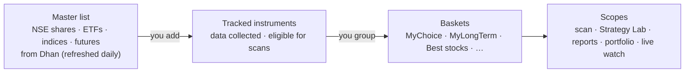

# 06 — Instruments & Baskets

How you choose **what the system works on** and how you **group and evaluate** it.

## 1. Concepts

| Concept | Meaning |
|---------|---------|
| **Master list** | The instruments v1 works with from Dhan's instrument (scrip) master — NSE shares, ETFs, indices and futures (§2.1; options later) — refreshed every morning and on demand, mapped to canonical symbols ([doc 05](05-data-and-brokers.md) §7) |
| **Tracked instrument** | An instrument you've switched on. Only tracked instruments get historical data, end-of-day updates, scans and analytics |
| **Basket** | A named group of tracked instruments; an instrument can be in many baskets |
| **Scope** | Which basket(s) a strategy scan, a Strategy Lab test, a report or a portfolio view applies to |

## 2. Master list & tracked instruments

### 2.1 What the master list contains (ADR 0010, P1-03)

Dhan's detailed scrip master has about 207,000 rows (35 MB, republished daily around 08:20 IST); v1 keeps the **≈ 4,400 NSE rows** it works with and skips the rest on import:

| Kept (type) | Rule on Dhan's columns | Real file, 2026-10-11 |
|-------------|------------------------|-----------------------|
| **Share** | `EXCH_ID = NSE`, `SEGMENT = E`, `INSTRUMENT_TYPE = ES` (any series: EQ, BE, SM, ST, …) | 3,204 |
| **ETF** | `NSE`, `E`, `INSTRUMENT_TYPE = ETF` | 405 |
| **Index** | `NSE`, `SEGMENT = I`, `INSTRUMENT = INDEX` (NIFTY, BANKNIFTY, INDIA VIX, …) | 119 |
| **Future** | `NSE`, `SEGMENT = D`, `INSTRUMENT ∈ {FUTSTK, FUTIDX}` — stock futures (213 underlyings) and index futures | 653 (635 stock, 18 index) |

Skipped: exchange test symbols (`*NSETEST*`), debt, bonds, mutual-fund units, REITs/InvITs, BSE, MCX, currency, commodity and options (options come with their phase, P14). Futures past their expiry date (India date) are not kept; one that was kept and has expired is retired.

**Canonical symbols** (exchange-qualified, independent of any broker; every other module uses them):

| Type | Canonical symbol | Example |
|------|------------------|---------|
| Share, ETF | `NSE:{UNDERLYING_SYMBOL}` (the ticker) | `NSE:RELIANCE`, `NSE:SETFNIF50` |
| Index | `NSE:{SYMBOL_NAME}` upper-case, spaces as `_` | `NSE:NIFTY`, `NSE:NIFTY_MIDCAP_150`, `NSE:INDIA_VIX` |
| Future | `NSE:{UNDERLYING}-{YYYY}-{MM}-FUT` (expiry month) | `NSE:RELIANCE-2026-10-FUT` |

A **collision** (two rows with the same canonical symbol, or one Dhan id for two symbols) is a data-quality problem: the first row is kept, the others are skipped, and every one is listed in the refresh result — never silently merged. The real file has none.

**Flags and sector are derived, not guessed:**
- *F&O eligible* = a share with an active stock future (213 in the real file); futures, indices and ETFs are never flagged.
- *ASM/GSM* = Dhan's `ASM_GSM_FLAG` (anything but `N`) and category.
- *Sector* = the industry of the share's ISIN in NSE's Nifty Total Market list (`ind_niftytotalmarket_list.csv`: 755 stocks in 22 industries; 748 are shares of the master, 3 are REITs outside the scope). Only shares get a sector, so the sector facet and filter work on shares: shares without a match show "Unclassified" (a facet value; filtering by it returns exactly those shares). If the list cannot be fetched or read, for whatever reason, the refresh still succeeds with a warning and keeps the sectors it has.

### 2.2 Refresh

| Trigger | Behaviour |
|---------|-----------|
| **Refresh list** (Instruments screen, any signed-in session, no step-up — it only reads public files) | `POST /api/instruments/refresh` → 202 and a background run; progress phases *downloading → parsing → enriching → saving* with the number of rows read; `409 instruments.refresh_running` while one runs |
| **Force refresh** | Same with `force: true`: skips the "file unchanged" check and imports again |
| **Daily automatic run** | A hosted service in `xd-api` at `Instruments:AutoRefresh:TimeIst` India time (default 08:45, after Dhan's 08:20 publication); `Enabled` switches it off. It starts the same command as the button; the run is recorded as *daily*. It waits in slices of at most one minute and re-reads the clock, so a sleeping or adjusted machine still runs on time. **Catch-up:** when the API starts and no refresh has run since the most recent scheduled time (it was down, or the list was never loaded), it refreshes at once — one conditional request when nothing changed |

Rules of a run:
- **One at a time** across all instances (database advisory lock + a unique "running" row). When the API starts, a run still marked running from an earlier process is marked failed (interrupted) at once; a run that never ended is anyway treated as interrupted after 30 minutes.
- **Conditional download:** the `ETag` / `Last-Modified` of the last good run are sent, and an unchanged file ends as **unchanged** without any work. The shortcut is not used when the list is empty, when the last good run could not apply the sector list, or when the last run worked under other importer rules (`RefreshRules.Version`, bumped whenever scope or parser rules change; recorded on every run).
- **Streamed and tolerant:** the 35 MB file is streamed (never held as a string; a line over 64 KB is refused), columns are found by name. The run **fails closed** only on structural problems: unreadable header, a column the importer reads is missing, no in-scope rows, or too many unreadable rows (more than 50 or more than 1 % of the in-scope rows). Smaller problems are tolerated and listed in the run's warnings: extra or unused columns, and single in-scope rows that are malformed or do not fit the stored limits (series, ISIN, names, …) are skipped with a message naming the Dhan id (the first 10, then a count). The instrument of a skipped row is **not retired** because of it.
- **Tripwire:** a file that would leave fewer than half of the currently active instruments is refused (the run fails with a plain message); a forced refresh applies it anyway.
- **All or nothing:** the kept rows are copied into a temporary table (binary `COPY`) and merged in **one transaction**, so a failed run changes nothing. Instruments no longer in the file are **retired** (`retired_at`, hidden by default, never deleted) and **revived** when they come back.
- **Sectors are optional:** whatever goes wrong with the NSE list (timeout, refusal, bad data) only adds a warning; the stored sectors stay and the next refresh does not skip the unchanged master.
- **Recorded:** every run — succeeded, unchanged or failed — is a row in `market.master_refreshes` with counts (added / updated / retired / revived / unchanged / skipped by scope / collisions / sector matches / F&O underlyings), source validators, rules version, warnings and error. The daily run moves into the service framework with P1-13.

### 2.3 Searching, tracking and the instrument record

- **Search & add** from the Instruments screen: server-side search (partial symbol, name, display name or ISIN) and filters (type, sector, F&O, ASM/GSM, series, retired), sortable and paginated (≤ 100 per page; `GET /api/instruments`, facets at `/api/instruments/facets`); later also exchange/segment, index membership, price and turnover.
- **Bulk add** by pasting symbols, uploading a CSV list, or adding all members of an index/rule-based basket.
- **On activation** the system backfills history: first from your CSV files if present, then gaps from the
  Dhan historical API (1-minute up to ~5 years, daily since listing), and builds all timeframes.
- **On deactivation** collection stops; history is kept (re-activation only fills the gap).
- Status shown per instrument: data coverage (from/to), last update, quality issues, baskets, open positions.

| Field | Example |
|-------|---------|
| Canonical symbol | `NSE:TATASTEEL` |
| Broker ids | Dhan `SECURITY_ID` + exchange segment (`NSE_EQ`, `IDX_I`, `NSE_FNO`) in `market.instrument_broker_ids` |
| Type / segment | share · etf · index · future / NSE_EQ · IDX_I · NSE_FNO (options later) |
| Series | EQ, BE, SM, ST, … (shares, ETFs) |
| Sector / industry | Metals & Mining |
| Lot size, tick size | 1 / 0.05 (futures: contract lot size); expiry date for futures |
| Flags | F&O eligible, ASM/GSM, MTF leverage, freeze quantity, retired |
| First / last seen | when the instrument first appeared in the file / last appeared |
| Tracking | active since 2026-10-15; data from 2021-10-01 *(P1-05)* |

## 3. Baskets

### 3.1 Basket types

| Type | How membership is defined | Examples |
|------|---------------------------|----------|
| **Manual** | You add/remove instruments | MyChoice, MyLongTerm, Best stocks, Watchlist |
| **Rule-based (dynamic)** | A saved filter re-evaluated nightly | "F&O stocks with turnover > ₹50 Cr", "Nifty 50 members", "Sector = IT", "Near 52-week high" |
| **System** | Maintained automatically | Open positions, Holdings, Today's plan, Paused-cell instruments |

### 3.2 Basket attributes

| Attribute | Purpose |
|-----------|---------|
| Name, colour, description | Display |
| Purpose | `trading` · `long_term` · `watch` — drives defaults (e.g. long-term baskets excluded from intraday scans) |
| Allowed styles / sides | e.g. MyLongTerm: swing BUY only |
| Strategies in scope | Which strategies scan this basket (default: all enabled) |
| Risk profile override (optional) | e.g. smaller risk per trade for a speculative basket |
| Target weights (optional, long-term) | For allocation drift view in the portfolio |
| Membership history | Added / removed dates and notes — enables point-in-time evaluation |

### 3.3 How baskets are used

| Use | Example |
|-----|---------|
| **Scan scope** | Nightly plan scans "Best stocks" and "MyChoice" for intraday; "MyLongTerm" only for swing BUY |
| **Strategy Lab universe** | "Test VWAP_RSI_TREND on MyChoice, 2022–today" |
| **Reports lens** | Compare results of all baskets side by side |
| **Portfolio grouping** | Value, return and XIRR per basket ([doc 12](12-portfolio-monitoring.md)) |
| **Live watch** | Pin a basket to the live price panel (counts toward the live-feed budget, [doc 05](05-data-and-brokers.md) §5) |

## 4. Evaluation lenses — looking at results from different angles

Every analytic screen uses the same **lens + filters** model: pick the lens (how rows are grouped), then
filter by date range, source, account, style, strategy, timeframe, side, exit, regime, basket.

| Lens | Rows | Typical question |
|------|------|------------------|
| **All trades** | One summary + equity curve | "How is the whole system doing this quarter?" |
| **By basket** | One row per basket | "Is MyChoice better than Best stocks for intraday?" |
| **By instrument** | One row per symbol | "Which stocks consistently work / fail?" |
| **By individual trade** | One row per trade, drill to replay | "Why did this TATASTEEL trade lose?" |
| **By strategy / cell** | Strategy × TF × side × exit | "Which setups work in which basket?" |
| **By account** | One row per broker account | "How does each account perform?" |
| **By sector / regime / month** | Grouped rows | "Where and when does it work?" |

Lenses can be combined as a pivot (e.g. *basket × strategy* heatmap of expectancy, or *basket × month*
returns). Each basket row also shows a **buy-and-hold benchmark** (equal-weight basket return and Nifty 50
over the same period) so trading results are judged against simply holding the basket.

**Overlapping baskets:** an instrument in several baskets appears under each, so per-basket totals are not
additive — the UI says so. For additive totals (e.g. portfolio value) a position has one **portfolio bucket**
([doc 12](12-portfolio-monitoring.md) §5).

**Point-in-time vs current membership:** reports default to *current* membership; switch to *as-of*
membership to evaluate a basket exactly as it was composed on each trade date.

## 5. Data model

| Table | Key columns |
|-------|------------|
| `market.instruments` | id, canonical_symbol, type, segment, sector, lot_size, tick_size, flags, listed_on |
| `market.instrument_broker_ids` | instrument_id, broker, broker_id, segment |
| `catalog.tracked_instruments` | instrument_id, active, active_since, data_from, data_to, last_update |
| `catalog.baskets` | id, name, type (manual/rule/system), purpose, colour, settings (JSON), rule (JSON) |
| `catalog.basket_members` | basket_id, instrument_id, valid_from, valid_to, note, target_weight |

## 6. Screens

- **Instruments** — master-list search with facets; tracked list with coverage/quality/basket chips; bulk actions
  (track, untrack, add to basket, backfill).
- **Baskets** — list with key stats; editor (manual add/remove, drag & drop, rule builder with live preview);
  basket detail (members, performance by lens, benchmark, open positions).
