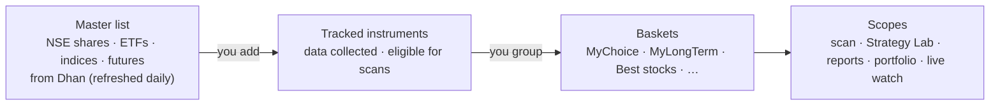

# 06 — Instruments & Baskets

How you choose **what the system works on** and how you **group and evaluate** it.

## 1. Concepts

| Concept | Meaning |
|---------|---------|
| **Master list** | The instruments v1 works with from Dhan's instrument (scrip) master — NSE shares, ETFs, indices and futures (§2.1; options later) — refreshed every morning and on demand, mapped to canonical symbols ([doc 05](05-data-and-brokers.md) §7) |
| **Tracked instrument** | An instrument you've switched on. Only tracked instruments get historical data, end-of-day updates, scans and analytics |
| **Basket** | A named group of tracked instruments; an instrument can be in many baskets |
| **Scope** | Which basket(s) a strategy scan, a Strategy Lab test, a report or a portfolio view applies to |

## 2. Master list & tracked instruments

### 2.1 What the master list contains (ADR 0010, P1-03)

Dhan's detailed scrip master has about 207,000 rows (35 MB, republished daily around 08:20 IST); v1 keeps the **≈ 4,400 NSE rows** it works with and skips the rest on import:

| Kept (type) | Rule on Dhan's columns | Real file, 2026-10-11 |
|-------------|------------------------|-----------------------|
| **Share** | `EXCH_ID = NSE`, `SEGMENT = E`, `INSTRUMENT_TYPE = ES` (any series: EQ, BE, SM, ST, …) | 3,204 |
| **ETF** | `NSE`, `E`, `INSTRUMENT_TYPE = ETF` | 405 |
| **Index** | `NSE`, `SEGMENT = I`, `INSTRUMENT = INDEX` (NIFTY, BANKNIFTY, INDIA VIX, …) | 119 |
| **Future** | `NSE`, `SEGMENT = D`, `INSTRUMENT ∈ {FUTSTK, FUTIDX}` — stock futures (213 underlyings) and index futures | 653 (635 stock, 18 index) |

Skipped: exchange test symbols (`*NSETEST*`), debt, bonds, mutual-fund units, REITs/InvITs, BSE, MCX, currency, commodity and options (options come with their phase, P14). Futures past their expiry date (India date) are not kept; one that was kept and has expired is retired.

**Canonical symbols** (exchange-qualified, independent of any broker; every other module uses them):

| Type | Canonical symbol | Example |
|------|------------------|---------|
| Share, ETF | `NSE:{UNDERLYING_SYMBOL}` (the ticker) | `NSE:RELIANCE`, `NSE:SETFNIF50` |
| Index | `NSE:{SYMBOL_NAME}` upper-case, spaces as `_` | `NSE:NIFTY`, `NSE:NIFTY_MIDCAP_150`, `NSE:INDIA_VIX` |
| Future | `NSE:{UNDERLYING}-{YYYY}-{MM}-FUT` (expiry month) | `NSE:RELIANCE-2026-10-FUT` |

A **collision** (two rows with the same canonical symbol, or one Dhan id for two symbols) is a data-quality problem: the first row is kept, the others are skipped, and every one is listed in the refresh result — never silently merged. The real file has none.

**Flags and sector are derived, not guessed:**
- *F&O eligible* = a share with an active stock future (213 in the real file); futures, indices and ETFs are never flagged.
- *ASM/GSM* = Dhan's `ASM_GSM_FLAG` (anything but `N`) and category.
- *Sector* = the industry of the share's ISIN in NSE's Nifty Total Market list (`ind_niftytotalmarket_list.csv`: 755 stocks in 22 industries; 748 are shares of the master, 3 are REITs outside the scope). Only shares get a sector, so the sector facet and filter work on shares: shares without a match show "Unclassified" (a facet value; filtering by it returns exactly those shares). If the list cannot be fetched or read, for whatever reason, the refresh still succeeds with a warning and keeps the sectors it has.

### 2.2 Refresh

| Trigger | Behaviour |
|---------|-----------|
| **Refresh list** (Instruments screen, any signed-in session, no step-up — it only reads public files) | `POST /api/instruments/refresh` → 202 and a background run; progress phases *downloading → parsing → enriching → saving* with the number of rows read; `409 instruments.refresh_running` while one runs |
| **Force refresh** | Same with `force: true`: skips the "file unchanged" check and imports again |
| **Daily automatic run** | A hosted service in `xd-api` at `Instruments:AutoRefresh:TimeIst` India time (default 08:45, after Dhan's 08:20 publication); `Enabled` switches it off. It starts the same command as the button; the run is recorded as *daily*. It waits in slices of at most one minute and re-reads the clock, so a sleeping or adjusted machine still runs on time. **Catch-up:** when the API starts and no refresh has run since the most recent scheduled time (it was down, or the list was never loaded), it refreshes at once — one conditional request when nothing changed |

Rules of a run:
- **One at a time** across all instances (database advisory lock + a unique "running" row). When the API starts, a run still marked running from an earlier process is marked failed (interrupted) at once; a run that never ended is anyway treated as interrupted after 30 minutes.
- **Conditional download:** the `ETag` / `Last-Modified` of the last good run are sent, and an unchanged file ends as **unchanged** without any work. The shortcut is not used when the list is empty, when the last good run could not apply the sector list, or when the last run worked under other importer rules (`RefreshRules.Version`, bumped whenever scope or parser rules change; recorded on every run).
- **Streamed and tolerant:** the 35 MB file is streamed (never held as a string; a line over 64 KB is refused), columns are found by name. The run **fails closed** only on structural problems: unreadable header, a column the importer reads is missing, no in-scope rows, or too many unreadable rows (more than 50 or more than 1 % of the in-scope rows). Smaller problems are tolerated and listed in the run's warnings: extra or unused columns, and single in-scope rows that are malformed or do not fit the stored limits (series, ISIN, names, …) are skipped with a message naming the Dhan id (the first 10, then a count). The instrument of a skipped row is **not retired** because of it.
- **Tripwire:** a file that would leave fewer than half of the currently active instruments is refused (the run fails with a plain message); a forced refresh applies it anyway.
- **All or nothing:** the kept rows are copied into a temporary table (binary `COPY`) and merged in **one transaction**, so a failed run changes nothing. Instruments no longer in the file are **retired** (`retired_at`, hidden by default, never deleted) and **revived** when they come back.
- **Sectors are optional:** whatever goes wrong with the NSE list (timeout, refusal, bad data) only adds a warning; the stored sectors stay and the next refresh does not skip the unchanged master.
- **Recorded:** every run — succeeded, unchanged or failed — is a row in `market.master_refreshes` with counts (added / updated / retired / revived / unchanged / skipped by scope / collisions / sector matches / F&O underlyings), source validators, rules version, warnings and error. The daily run is the service `instrument-master` of the services framework (P1-13, [doc 04](04-accounts-access-and-operations.md) §3.1): its time and switch are set on the Services screen; `Instruments:AutoRefresh:*` are the first-start settings only.

### 2.3 Searching, tracking and the instrument record

- **Search & add** from the Instruments screen: server-side search (partial symbol, name, display name or ISIN) and filters (type, sector, F&O, ASM/GSM, series, retired), sortable and paginated (≤ 100 per page; `GET /api/instruments`, facets at `/api/instruments/facets`); later also exchange/segment, index membership, price and turnover.
- **Bulk add** by pasting symbols or uploading a CSV list (both resolved by `POST /api/instruments/tracked/resolve`, below), or adding all members of an index/rule-based basket (with the baskets, P1-15).
- **Tracking** (P1-05) is the owner's choice of what the system works on; it needs a session, no step-up. Rows live in `market.tracked_instruments` (the module's schema is `market`;
  the `catalog` schema of the first sketch was not created): `instrument_id` (key, FK to `market.instruments`, restrict), `active`, `active_since`, `deactivated_at`, `data_from`, `data_to`, `last_update`,
  `backfill_requested_at`, `note`, `tracked_by`; a row is kept for good.
  - `POST /api/instruments/tracked {instrumentIds}` tracks 1–500 instruments, `DELETE /api/instruments/tracked {instrumentIds}` untracks them. Both are **idempotent and all-or-nothing** (one transaction),
    duplicates count once, an unknown id is `400 instruments.invalid`, and the answer counts what happened (`added`, `reactivated`, `alreadyTracked` / `untracked`, `notTracked`, `totalTracked`).
  - **Retired instruments** (no longer in Dhan's list) cannot be newly tracked or re-tracked: `400 instruments.retired` naming them, nothing in the call is applied. One that retires **after** being tracked stays
    tracked: it keeps appearing in `?tracked=true` (whatever `includeRetired` says) with `tracked.retiredButTracked: true` (the UI shows "no longer in Dhan's list"); it can still be untracked, and then cannot come back.
  - **Untrack** only sets `active = false` and `deactivated_at`; `data_from`, `data_to`, `last_update` stay. **Tracking again** reactivates the same row (`active_since` restarts, `deactivated_at` clears, the history fields are kept, so only the gap is filled).
  - Tracking sets `backfill_requested_at`; **the backfill job itself belongs to P1-06 / P1-12**. Until history exists, `dataFrom`/`dataTo`/`lastUpdate` are null and the screens show "—" ("history not collected yet").
  - **Audit** (`accounts.account_events`, no account): `InstrumentsTracked` / `InstrumentsUntracked` with counts ("Tracked 12 of 15 instruments (10 new, 2 tracked again, 3 already tracked)"), written only when something changed; never symbols or ids.
  - `POST /api/instruments/tracked/resolve {symbols}` (up to 5,000 entries, blanks ignored) looks up pasted tickers (`RELIANCE` = `NSE:RELIANCE`), canonical symbols (`NSE:RELIANCE-2026-10-FUT`) and ISINs of shares/ETFs, trimmed and
    case-insensitive, repeats collapsed. The answer is `{matched[], unmatched[], entries, duplicates}`; a matched entry carries `retired` and `tracked`; an unmatched one has a `reason` (`not_found`, `ambiguous` = an ISIN of several instruments with not exactly one still
    listed, `invalid` = over 100 characters or control characters). Nothing is guessed: no partial or name matching.
  - `GET /api/instruments?tracked=true|false` filters on tracked-now; every instrument in lists and detail has a `tracked` block (`active`, `since`, `deactivatedAt`, `dataFrom`, `dataTo`, `lastUpdate`, `backfillRequestedAt`, `retiredButTracked`),
    and `/api/instruments/facets` has `tracked` (all tracked now, retired ones included) and `trackedRetired`, for the "N tracked" header.
- **On activation** the system will backfill history (P1-06 / P1-12): first from your CSV files if present, then gaps from the
  Dhan historical API (1-minute up to ~5 years, daily since listing), and builds all timeframes.
- **On deactivation** collection stops; history is kept (re-activation only fills the gap).
- Status shown per instrument: data coverage (from/to), last update, quality issues, baskets, open positions. (Baskets are shown in the detail drawer; see §3.4.)

| Field | Example |
|-------|---------|
| Canonical symbol | `NSE:TATASTEEL` |
| Broker ids | Dhan `SECURITY_ID` + exchange segment (`NSE_EQ`, `IDX_I`, `NSE_FNO`) in `market.instrument_broker_ids` |
| Type / segment | share · etf · index · future / NSE_EQ · IDX_I · NSE_FNO (options later) |
| Series | EQ, BE, SM, ST, … (shares, ETFs) |
| Sector / industry | Metals & Mining |
| Lot size, tick size | 1 / 0.05 (futures: contract lot size); expiry date for futures |
| Flags | F&O eligible, ASM/GSM, MTF leverage, freeze quantity, retired |
| First / last seen | when the instrument first appeared in the file / last appeared |
| Tracking | active since 2026-10-15; data from 2021-10-01 (the `tracked` block, P1-05) |

## 3. Baskets

### 3.1 Basket types

| Type | How membership is defined | Examples |
|------|---------------------------|----------|
| **Manual** | You add/remove instruments | MyChoice, MyLongTerm, Best stocks, Watchlist |
| **Rule-based (dynamic)** | A saved filter re-evaluated nightly | "F&O stocks with turnover > ₹50 Cr", "Nifty 50 members", "Sector = IT", "Near 52-week high" |
| **System** | Maintained automatically | **Portfolio** (one per portfolio bucket, built — P1-15a, §3.4), Open positions, Today's plan, Paused-cell instruments |

Each basket carries a `kind` in the API: `manual` or `portfolio` today; rule-based and the other system baskets reuse the same field and the `baskets.system` protection.

### 3.2 Basket attributes

| Attribute | Purpose |
|-----------|---------|
| Name, colour, description | Display |
| Purpose | `trading` · `long_term` · `watch` — drives defaults (e.g. long-term baskets excluded from intraday scans) |
| Allowed styles / sides | e.g. MyLongTerm: swing BUY only |
| Strategies in scope | Which strategies scan this basket (default: all enabled) |
| Risk profile override (optional) | e.g. smaller risk per trade for a speculative basket |
| Target weights (optional, long-term) | For allocation drift view in the portfolio |
| Membership history | Added / removed dates and notes — enables point-in-time evaluation |

### 3.3 How baskets are used

| Use | Example |
|-----|---------|
| **Scan scope** | Nightly plan scans "Best stocks" and "MyChoice" for intraday; "MyLongTerm" only for swing BUY |
| **Strategy Lab universe** | "Test VWAP_RSI_TREND on MyChoice, 2022–today" (in P3 the run takes the members **now** and says so in its label, `members as of today`; see below) |
| **Reports lens** | Compare results of all baskets side by side |
| **Portfolio grouping** | Value, return and XIRR per basket ([doc 12](12-portfolio-monitoring.md)) |
| **Live watch** | Pin a basket to the live price panel (counts toward the live-feed budget, [doc 05](05-data-and-brokers.md) §5) |

**A basket as the universe of a simulation run (P3-04a).** The research run takes a **manual, not archived** basket and runs its members **now** (`MembersAsync(basketId, null, null)`), in the basket's order, retired members and members without stored bars included (a retired instrument that has bars is replayed: leaving it out would add survivorship bias; one without bars is a skip with a reason in the record). A basket is dated only from the day the owner built it (§3.4) and the system has no historical index membership (ISS-22), so the record's universe label is **`members as of today`**: a run over "Nifty 50 in 2022" replays today's members over 2022 and says so. The id of the basket goes into every trade (`RunTrade.BasketIds`). A portfolio basket (a system basket maintained from holdings), an archived one and an unknown id are refused with `simulation.basket_not_found`. An explicit list of instruments is the other universe (label `instruments as listed`).

### 3.4 Manual baskets: what is built (P1-15) and portfolio system baskets (P1-15a)

**Manual** baskets and the **portfolio** system baskets exist so far (rule-based baskets, the other system baskets, allowed styles/sides, strategies in scope, risk override and target weights come with their stories). Tables live in the `market` schema (not `catalog`, which was never created),
next to the instruments they point to; the runtime role has plain DML on both and no DDL. Every route needs a session (changes also the CSRF token), none needs a step-up.

**Rules**
- **Many-to-many, once per basket at a time:** an instrument can be in any number of baskets, but at most once in a basket — `ux_basket_members_active` is a unique index on `(basket_id, instrument_id)` where `valid_to IS NULL`.
  Removing sets `valid_to` (and `removed_by`) and keeps the row; adding again makes a **new row**, so the history shows every stay. Rows are never deleted; baskets are archived, instruments retired (both foreign keys are `restrict`), and the runtime role `xd_app` has no `DELETE` on `market.baskets`, `market.basket_members` or `market.tracked_instruments`.
- **Dated membership:** `valid_from` / `valid_to` are timestamps. `asOf=yyyy-MM-dd` (an India date) returns the members **at the end of that day**: `valid_from < start of the next day (IST)` and `valid_to` empty or `>=` that instant — i.e. a member added on the 13th is a member on the 13th; one removed on the 13th is not.
- **Names:** 1–60 characters, unique among **active** baskets ignoring case (`ux_baskets_active_name_lower` on `lower(name) WHERE archived_at IS NULL`); an archived basket frees its name. Colour is `#rrggbb` (default `#6366f1`), purpose `trading | long_term | watch` (default `trading`), description up to 500 characters, note on a membership up to 500.
- **Seed:** the migration creates, empty and idempotently, **MyChoice** (`trading`, `#6366f1`), **MyLongTerm** (`long_term`, `#10b981`) and **Best stocks** (`trading`, `#f59e0b`) at positions 0–2 (the prototype's palette). The owner can rename or archive them.
- **Tracking:** adding an instrument that is not tracked **tracks it in the same transaction** (the tracking service of §2.3, audited as "… via basket 'Name'"); a retired instrument that is not tracked is refused with `instruments.retired` and nothing in the call is applied. A tracked instrument the add relied on is part of the save (tracking rows carry PostgreSQL's `xmin` as a row version): if a concurrent untrack commits first, the save is refused and the add reads again and tracks it again, so a member is never added on the strength of a stale "tracked".
  Removing the last membership never untracks. Archiving never untracks.
- **Limits:** 2,000 active members per basket (`baskets.too_many_members`), 500 instrument ids per add / remove / transfer call, a reorder must list **every** active basket / member exactly once (else `400 baskets.invalid`).
- **Archived baskets** are hidden from the list (`includeArchived=true` shows them), their members and history stay readable, and every change is refused with `409 baskets.archived`. Archiving twice is fine.
- **Order:** `position` (0 first) among the active baskets and among the active members; a reorder numbers them 0..n-1; new members are appended in the order given. Reads sort by position, then symbol / creation, then id, so the order is deterministic.
- **Concurrency:** `market.baskets.revision` is an optimistic concurrency token that every change of a basket **or of its members** raises. A save based on a stale read fails; the use case then reads again and retries (up to 5 times, which also resolves two requests adding the same instrument or creating the same name). Only when all tries lose does the call end in `409 baskets.conflict`
  (the UI reloads and may retry). A reorder whose list no longer matches because the basket changed between two tries is a `409 baskets.conflict` rather than a `400`.
- **Idempotent and atomic:** add, remove, reorder and transfer can be repeated; what is already done is counted, not repeated, and writes neither rows nor audit entries. Each call is **one transaction** (members, tracking rows, revision and audit entries are written together).

**Portfolio system baskets (P1-15a, [ADR 0014](../adr/0014-portfolio-buckets-appear-as-system-baskets.md))**
- **A view, not copies:** every bucket that `GET /api/portfolio-buckets` lists (not archived; custom, or the default bucket of an active account with the Portfolio role) is shown in the baskets list as `kind: portfolio`, `system: true`, with the bucket's id as the basket id. Nothing is stored in `market.baskets`; the name follows the account (ADR 0011) and archived or role-off buckets disappear. Read through the application port `IPortfolioBasketSource` (the market and portfolio/accounts modules share the one `XDrishtiDbContext`).
- **Order and fields:** system baskets come first (account name, then bucket name; `position` counts within the group, 0 first), then the manual ones in the owner's order. `colour` is the account's colour (the neutral `#6366f1` for a custom bucket), `purpose` `long_term`, `archivedAt` null, `createdAt` the bucket's; `accountId` / `accountName` are set for an account's default bucket (null for custom buckets and for manual baskets). `memberCount` = distinct instruments with quantity > 0, from one grouped query for all buckets.
- **Members** = the instruments of the bucket's current holdings (quantity > 0, active account with the Portfolio role, mapped to an instrument of the master list; holdings without a match are left out), sorted by symbol, `position` 0..n-1. Each item has `quantity` (summed when a custom bucket holds the instrument in several accounts) and `accountName` (the holding accounts, comma separated); `id` is the first holding's id, `validFrom` the first-seen date, `validTo` and `note` null, `addedBy` `portfolio`. For manual baskets `quantity` and `accountName` are null.
- **Read-only:** every change route with a system basket answers `409 baskets.system` — `PUT` / `DELETE /api/baskets/{id}`, add / remove / reorder members, and `transfer` with it as the target (copy or move) or as the source of a **move**. `PUT /api/baskets/order` lists manual baskets only (a system id there is `400 baskets.invalid`). A bucket id that is not listed (archived, role off) is `404 baskets.not_found` everywhere.
- **Copy out:** `transfer` with `mode: copy` and a system source is allowed — the instruments of the holdings are added to the manual target in symbol order (no notes), tracked when not tracked, retired ones refused as before, audited as "Copied … from portfolio basket 'Name' to basket 'Name'".
- **No past:** `GET /api/baskets/{id}/members?asOf=` and `GET /api/baskets/{id}/history` on a system basket are `400 baskets.invalid` (the holdings history is the portfolio module's, not basket history). `GET /api/instruments/{id}/baskets` lists manual baskets only.
- **Screen (built):** the portfolio baskets are the **first cards of the same row** (no group headings; the first of the owner's baskets follows). A portfolio card has the `portfolio` chip with a lock and the instrument count (the account is in its name); it is selectable but has no grip, is not a drop target and shows no highlight. Selecting one opens a read-only panel: the title row carries only the "Portfolio · read only" chip, with the line "Portfolio — follows the account's holdings; read only. Copy instruments to one of your baskets."; there is no add row, Edit, History, Archive, as-of date, Remove or Move to…. The grid shows Quantity and Account instead of Added; each row keeps a grip that only **starts a copy** (drag onto one of the owner's cards: copy only — Alt does not turn it into a move; rows cannot be reordered), and the row menu and the selection toolbar offer **Copy to…** only, with the usual Undo. Empty state: "No holdings in this bucket yet — they arrive when the account's portfolio is imported". The card reorder, the copy / move menus and the Instruments screen's Add to basket dialog list the owner's baskets only. The first of the owner's baskets is still the one shown when the URL names none (`?basket=<id>` works for both kinds; a look-back date in the URL is not sent for a portfolio basket). A stray `409 baskets.system` shows "Portfolio baskets can't be changed" and reloads the list. On a phone the select has two groups (Portfolio, Your baskets).

**API** (`Baskets` tag; every error is a problem-details response with a stable `code`, field problems in `errors`)

| Route | Meaning | Answer |
|-------|---------|--------|
| `GET /api/baskets?includeArchived=` | system (portfolio) baskets first, then the owner's baskets in their order; each has `kind` (`manual` · `portfolio`), `system`, `accountId`, `accountName` | `200 [BasketView]` |
| `POST /api/baskets {name, colour?, purpose?, description?}` | create an empty basket at the end | `201 BasketView` · `400 baskets.invalid` · `409 baskets.name_taken` |
| `PUT /api/baskets/{id}` same body | replace the attributes (members untouched) | `200 BasketView` · `400` · `404 baskets.not_found` · `409 baskets.name_taken` / `baskets.archived` / `baskets.system` |
| `DELETE /api/baskets/{id}` | archive (idempotent) | `204` · `404` · `409 baskets.system` |
| `PUT /api/baskets/order {ids[]}` | every active basket once, wanted order | `204` · `400 baskets.invalid` · `409 baskets.conflict` |
| `GET /api/baskets/{id}/members?asOf=` | members in order with instrument summary + tracked block (system basket: current holdings with `quantity`, `accountName`) | `200 BasketMembers` · `400` (bad asOf, or asOf on a system basket) · `404` |
| `POST /api/baskets/{id}/members {instrumentIds[], note?}` | add 1–500 (idempotent, tracks) | `200 AddMembersResult` · `400 baskets.invalid / instruments.invalid / instruments.retired / baskets.too_many_members` · `404` · `409 archived / conflict / system` |
| `DELETE /api/baskets/{id}/members {instrumentIds[]}` | remove 1–500 (idempotent) | `200 RemoveMembersResult` · `400` · `404` · `409` (incl. `system`) |
| `PUT /api/baskets/{id}/members/order {instrumentIds[]}` | every member once, wanted order | `204` · `400 baskets.invalid` · `404` · `409` (incl. `system`) |
| `POST /api/baskets/transfer {fromBasketId, toBasketId, instrumentIds[], mode: copy\|move}` | atomic, idempotent; only members of the source are transferred, in the source's order, with their notes; a move also ends the stay in the source; a system basket may be the source of a **copy** only | `200 TransferResult` · `400` · `404` · `409` (incl. `baskets.system`) |
| `GET /api/baskets/{id}/history?take=` | newest additions and removals (default 200, max 1000) with dates and who; only additions carry the note | `200 BasketHistory` · `400` (also: a system basket has none) · `404` |
| `GET /api/instruments/{id}/baskets` | the (non-archived) baskets that hold the instrument now | `200 [InstrumentBasketView]` · `404 instruments.not_found` |

**Audit** (`accounts.account_events`, no account): `BasketCreated`, `BasketRenamed`, `BasketUpdated` (names the changed fields), `BasketArchived`, `BasketsReordered`, `BasketMembersAdded`, `BasketMembersRemoved`, `BasketMembersReordered`,
`BasketMembersTransferred` — the basket's name and counts only, never instrument symbols or ids, and only when something changed.

**Screen (Baskets, built in P1-15; frontend `features/baskets`, lazy route `/baskets`)**
- **Layout (as in the prototype; owner 2026-10-12: "Baskets UI should be like the prototype"):** a full-width page. Title row: icon, **Baskets**, the line "Group tracked instruments. Baskets define what the nightly plan scans, Strategy Lab universes, report lenses and portfolio grouping." and **New basket** at the right. Under it a **row of basket cards** across the top (a wrapping grid, `repeat(auto-fill, minmax(240px, 1fr))`): a 4 px bar in the basket's colour, the name, chips for the kind (`manual`; `portfolio` with a lock) and the purpose (`trading` / `long-term` / `watch`) and "N instruments"; the selected card is outlined in the accent; portfolio cards come first, then the owner's in their order, each with a small always-visible grip in its corner to reorder it. Below the cards two columns from `lg` (stacked below): on the left the **members card**, on the right two cards, **Basket performance (taken trades)** and **1-year buy-and-hold benchmark** — empty states ("Appears once trades have been taken in this basket's instruments." / "Needs price history — available after the EOD service (P1-12).") until trades (P3) and price history (P1-12) exist. The page scrolls normally; only a long members list scrolls inside its card (so the cards stay in reach as drop targets). Below `md` the cards become one **Basket** select (reordering baskets and dropping on a basket need the wide layout; the Copy to / Move to menus still work) and the insight cards stack below the members. The selected basket (`?basket=<id>`) and the look-back date (`&asOf=yyyy-MM-dd`) live in the URL; an unknown id falls back to the first of the owner's baskets.
- **Members card header:** one row with the colour dot and name on the left and, on the right, **View as of** (date), **History**, **Edit** and **Archive** (error-coloured; confirmation: members and history are kept); under it one muted line — "Manual — you add and remove instruments." or the basket's description — and, for the owner's baskets, an **add row**: a symbol field ("Add instrument (symbol)…") and **Add**; pressing Add or Enter opens the Add instruments dialog (multi-select) with the typed text as its search. A look-back date makes the card read only (no add row, grip, selection, actions; a *Removed later* column), says so in words and offers *Back to today*.
- **Members grid** (the shared Grid, compact rows, in the owner's order, not sortable): grip, symbol (mono, links to the instrument on the Instruments screen), name, type, sector, status (*Tracked* / *Not tracked* / *Retired* as text), added date, and per row **Copy or move** (menu of the other baskets: *Copy to X* / *Move to X*) and **Remove**. The card is about half the page, so columns are chosen by screen width instead of scrolling sideways: grip, symbol, status and actions always; type from `lg`; name, sector and added from `xl`. The **selection toolbar** (*N selected*, *Clear selection*, *Copy to…*, *Move to…*, *Remove (N)*) is a slim row that appears only while something is selected. All members are listed (no paging; baskets hold at most 2,000).
- **Drag and drop (`@dnd-kit`)**, grip as the handle, for mouse, touch (long press) and keyboard (space picks up, arrows move, space drops, escape cancels), with spoken announcements: a row dropped on another row **reorders** (a dragged selected row takes the whole selection along as a block); dropped on another basket's card it **copies** there, with **Alt / Option held it moves** (the card under the pointer lights up and says "Drop to copy here · hold Alt to move"); dropping on its own basket or nowhere does nothing; cards reorder among themselves (with the keyboard: arrows left / right along the row, up / down between rows). Reordering is optimistic and rolls back (with a message) when the server refuses.
- **Undo toast** after a copy, move or remove: undoing a copy removes only what the copy added (instruments it tracked stay tracked, and the toast says so); undoing a move transfers back what was moved and restores the order where the basket still allows it (the added date of those instruments restarts, because the stay was ended); if the situation before could not be read the toast says the action cannot be undone. A `409 baskets.conflict` reloads the screen and asks to try again.
- **Add instruments** dialog: search the master list or only the tracked instruments (symbol, name, ISIN), tick any number across searches, add. Members are shown ticked and disabled ("Already in X"), retired instruments disabled ("Retired — cannot be added"), untracked ones marked "Will be tracked". **Basket editor:** name, purpose, colour (the app palette or any `#rrggbb`), description; the server's field messages (e.g. name taken) show on the field. **History drawer:** added / removed entries newest first with date and who (additions also show the note).
- **Instruments screen:** the bulk bar's *Add to basket (N)* opens a dialog to tick one or more baskets (more than 500 instruments go out in several calls); the instrument drawer lists the instrument's baskets as links to `/baskets?basket=` and has an *Add to basket* button. The Tracked tab has **no basket-chips column**: the API gives the baskets of one instrument per request, so a column would fire one request per row; it waits for a list endpoint that returns them with the page.

## 4. Evaluation lenses — looking at results from different angles

Every analytic screen uses the same **lens + filters** model: pick the lens (how rows are grouped), then
filter by date range, source, account, style, strategy, timeframe, side, exit, regime, basket.

| Lens | Rows | Typical question |
|------|------|------------------|
| **All trades** | One summary + equity curve | "How is the whole system doing this quarter?" |
| **By basket** | One row per basket | "Is MyChoice better than Best stocks for intraday?" |
| **By instrument** | One row per symbol | "Which stocks consistently work / fail?" |
| **By individual trade** | One row per trade, drill to replay | "Why did this TATASTEEL trade lose?" |
| **By strategy / cell** | Strategy × TF × side × exit | "Which setups work in which basket?" |
| **By account** | One row per broker account | "How does each account perform?" |
| **By sector / regime / month** | Grouped rows | "Where and when does it work?" |

Lenses can be combined as a pivot (e.g. *basket × strategy* heatmap of expectancy, or *basket × month*
returns). Each basket row also shows a **buy-and-hold benchmark** (equal-weight basket return and Nifty 50
over the same period) so trading results are judged against simply holding the basket.

**Overlapping baskets:** an instrument in several baskets appears under each, so per-basket totals are not
additive — the UI says so. For additive totals (e.g. portfolio value) a position has one **portfolio bucket**
([doc 12](12-portfolio-monitoring.md) §5).

**Point-in-time vs current membership:** reports default to *current* membership; switch to *as-of*
membership to evaluate a basket exactly as it was composed on each trade date.

## 5. Data model

| Table | Key columns |
|-------|------------|
| `market.instruments` | id, canonical_symbol, type, segment, sector, lot_size, tick_size, flags, listed_on |
| `market.instrument_broker_ids` | instrument_id, broker, broker_id, segment |
| `market.tracked_instruments` | instrument_id, active, active_since, deactivated_at, data_from, data_to, last_update, backfill_requested_at, note, tracked_by |
| `market.baskets` | id, name, colour, purpose, description, position, created_at, archived_at, revision (concurrency token) — manual baskets (P1-15); type (rule/system), settings and rule (JSON) join with those basket types |
| `market.basket_members` | id, basket_id, instrument_id, position, valid_from, valid_to, note, added_by, removed_by — one row per stay; `target_weight` joins with the allocation story |

## 6. Screens

- **Instruments** — master-list search with facets; tracked list with coverage/quality (basket chips: in the detail drawer, §3.4); bulk actions
  (track, untrack, add to basket, backfill).
- **Baskets** — list with key stats; editor (manual add/remove, drag & drop, rule builder with live preview);
  basket detail (members, performance by lens, benchmark, open positions).
