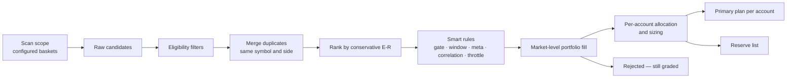

# 10 — Trade Selection & Allocation

From dozens of candidates to the best `max_new_entries_per_day` (e.g. 3), fitted to each account.

## 1. Pipeline



**Scan scope:** candidates come only from instruments in the baskets listed in `scan_scope`
([doc 06](06-instruments-and-baskets.md)), each with its allowed styles/sides (e.g. MyLongTerm → swing BUY only).
Every candidate carries its basket(s) so results can later be evaluated by basket.

### Smart rules (learned, [doc 09](09-learning-engine.md) §14)

| Rule | Effect on the plan |
|------|--------------------|
| Market gate | *Normal* · *reduced* (half the tickets, risk × 0.75) · *no-trade* (no tickets; candidates kept on reserve) |
| Learned entry window | Intraday ticket validity window = the setup's best entry hour from walk-forward results |
| Meta-labelling | Score < `meta.min_take` → reserve; otherwise size × 0.5–1.5 |
| Correlation | 60-day correlation > `corr.max` with a better ticket or an open trade → reserve ("same bet") |
| Equity-curve throttle | Risk × `throttle.cut` while the system's equity is below its N-trade average |

Filtered tickets stay on the reserve list with the reason, and are graded like every other candidate.

## 2. Eligibility filters

| Filter | Default |
|--------|---------|
| Cell status ACTIVE | required |
| Min calibrated P(win) | 0.45 (for ~1:2 exits) |
| Min conservative expectancy | +0.10R |
| Min achievable R:R before obstacle | 1.5 |
| Min OOS sample | 30 |
| Max costs | 0.10R |
| Liquidity / events / F&O ban / surveillance | excluded |

## 3. Merge duplicates

Group by (symbol, side); keep the highest conservative-E[R] ticket; add a confluence bonus when independent
strategies/timeframes agree. Opposite sides for the same symbol: keep the stronger, or drop both if close.

## 4. Ranking

```
rank_score = exp_R_lower + w_conf·confluence + w_regime·regime_fit
           − w_corr·correlation_with_book − w_event·event_risk
```

## 5. Portfolio fill (greedy, constraints checked after each addition)

| Constraint | Default |
|-----------|---------|
| New entries per day | 3 |
| Open positions (incl. carried swing) | 5 |
| Total open risk | 3% |
| Per sector | 2 |
| Pair correlation (60-day) | ≤ 0.70 |
| Intraday / swing mix | 2 / 2 |
| Net long / short risk | 2% / 2% |
| One position per symbol | yes |
| Per basket (optional) | e.g. max 2 from MyChoice |
| Already held long-term | Skip SELL setups on instruments in your holdings (configurable) |

`count_entries_on: trigger` (default): the plan may list up to `max_plan_items` (e.g. 5) conditional tickets;
once 3 trigger, the rest are cancelled. `plan` mode limits the plan itself to 3.

## 6. Per-account allocation

1. Account sync provides funds, open positions and today's trades.
2. For each account: filter by allowed styles/instruments, drop symbols already held, apply the account's risk
   profile, size from its capital and lot sizes.
3. Mode `replicate`: every eligible account gets the same top tickets, sized individually.
   Mode `distribute`: ranked tickets are spread across accounts, no symbol duplicated.
   **Default: `replicate`** (decision Q4, 2026-10-09).
4. Cross-account limits: max accounts per symbol, max total risk across all accounts.

**As built (P7-07, [ADR 0089](../adr/0089-per-account-allocation-a-pure-split-of-the-ticket-by-each-paper-accounts-own-limits-and-unavailable-allocating-nothing.md)):** tickets go to **paper-mode** Trading accounts only (owner Q2, 2026-10-23); the ticket's quantity is a pool split by each account's own risk, capital, funds and open-risk headroom limits, in whole lots; `replicate`/`distribute` and the cross-account caps are not built yet; a missing input allocates nothing.

## 6b. Pre-trade checklist

Each proposed ticket carries automatic checks — data quality, conflict with your holdings (e.g. a SELL on a stock
you hold long-term), sector exposure, **correlation with open trades and approved tickets**, results within 3 days — shown on the ticket in Plan review
([doc 15](15-smart-insights-and-automation.md) §2). A failed check needs an explicit confirmation to approve.

## 6c. Human review

The output of this pipeline is a **proposed** plan. You approve, modify or reject each ticket before the review
cutoff; only approved tickets are armed at the pre-open check ([doc 04](04-accounts-access-and-operations.md) §4.2).
Allocation goes only to accounts with the **Trading** role.

## 7. Day-level guards

Daily loss limit ⇒ cancel remaining tickets; the **market gate** (learned from VIX, breadth and the event
calendar) reduces or cancels the whole plan; the **equity-curve throttle** halves risk while the system is cold. Optional **pre-open check** (default 09:10, after the review cutoff and NSE pre-open price discovery): gap beyond
trigger or > `gap_invalidate_atr` ⇒ invalidate and promote from reserve.

## 8. Proving the selector (and your overrides)

Rejected candidates are graded nightly. Reports compare primary vs reserve vs rejected and "top-1/3/5/all"
curves — showing whether ranking adds value and what `max_new_entries_per_day` should be.
Your decisions are graded too: approved vs rejected vs lapsed vs modified tickets, compared with what the
system proposed.

## 9. As built (P7-01, [ADR 0082](../adr/0082-selection-core-filters-with-unavailable-merge-and-a-deterministic-rank.md))
Sections 2 to 4 exist as pure code (`XDrishti.Domain.Selection`): each filter answers pass, fail or unavailable with a stable code; unavailable is never a pass. Minimum cell state is Candidate until paper days exist and such plans are labelled provisional. The model is advisory and is not used in filters, merge or rank. `xd select cells --date D` shows the stored cells through the filters.

## 11. As built (P7-06, [ADR 0085](../adr/0085-smart-rules-in-the-plan-gate-and-throttle-and-same-bet-with-unavailable-never-a-pass.md))
The smart rules exist as pure code (`XDrishti.Domain.Selection.SmartRules`), applied in the order gate, correlation, throttle. The market gate reads `unavailable` until VIX, breadth and events exist (P3-01d/e, P15): the plan then carries "market gate unavailable" and is never treated as a normal day. The throttle cuts risk only and is inactive below 20 real taken trades. A rule that removes half or more of the candidates it saw in the plan raises a flag (per plan, not over history; exactly half counts, so a reduced gate on an even list flags). Market figures older than the previous session read `unavailable`; a side other than exactly BUY or SELL is never read as a hedge (the pair is counted unavailable). Pair lookup is the P7-02 `CorrelationMatrix`. The meta size multiplier is not applied.
## 10. As built (P7-02, [ADR 0084](../adr/0084-portfolio-fill-greedy-with-every-limit-rechecked-and-unavailable-blocking.md))
Section 5 exists as pure code (`PortfolioFiller` in `XDrishti.Domain.Selection`): the ranked candidates are walked best first and one is taken only if every limit still holds with it added to the open book and the earlier picks. A limit whose input is not known (book, sector, risk, correlation pair, baskets, holding status) is `unavailable` and blocks like a fail. Output: primary, reserve (admissible alone, not taken, with the reason; first `reserve_size`) and rejected, each with the codes and numbers. Pair correlation is judged in the direction of the bets (opposite sides of positively correlated names are a hedge, of negatively correlated names one bet). Per-trade risk 1 %, `max_plan_items` 5 and `reserve_size` 3 are assumptions. No verb, table or order.

## 10. As built (P7-05, [ADR 0087](../adr/0087-pretrade-checklist-pure-unavailable-never-passes-and-an-owner-only-confirm-despite.md))
Section 6b exists as pure code (`XDrishti.Domain.Checklist`): 13 checks per ticket and paper-mode Trading account plus an account gate (live accounts are refused). Each answers pass, fail or unavailable with a stable code and numbers; unavailable never passes. Approving despite needs an `owner:` actor and a reason, and shows as "confirmed despite", never as a pass. Results dates, the F&O ban list and correlation have no source yet, so they are unavailable. No table or verb; P7-10 stores the reason with the approval.

## 12. As built (P7-13, [ADR 0090](../adr/0090-grading-replays-each-ticket-through-the-simulator-on-its-own-session-and-stores-one-insert-only-grade.md))
Section 8 exists: `xd plan grade` walks every ticket of a past plan (primary, reserve, rejected) through the stored bars of its session with the simulator's rules and stores one insert-only grade, labelled `simulated on plan prices`. `GET /api/plans/{id}/grade` and `GET /api/reports/decisions` give the top-1/3/5/all curves, primary versus reserve versus rejected and the owner's decisions (approved, modified, rejected, lapsed, undecided; no auto-approval exists), with a note below 30 triggered tickets. A ticket whose exit label is not one candidate spelling is stored as not gradable with the reason; a ticket whose bars are not there yet waits.

## 13. As built (P7-11, [ADR 0096](../adr/0096-the-pre-open-check-arms-only-approved-tickets-as-a-service-move-a-missing-input-invalidates-and-armed-tickets-join-the-feed-set-last.md))
The pre-open check of section 7 is the paused `preopen` service (09:10, never after 09:15): each Approved ticket is armed or invalidated from `|last - previous close| > 0.5 x ATR(14)`; a missing price, previous close or range invalidates, so nothing is armed on a missing input. **There is no promotion from the reserve**: the owner decided it is off, the code has no path and a test fails if one appears. Ban list, surveillance and the price band are not re-checked (no source). Arming says "Armed: watched with alerts. No order is placed and none exists. A stop is only an alert." The `plan-expiry` service (15:40) expires what is left.
