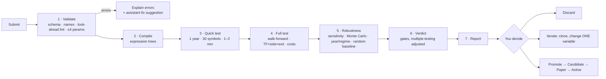

# 11 — Strategy Lab

Submit your own strategy rules at any time; the system validates, tests and reports a verdict — no code
changes, no restart.

## 1. Ways to submit

| Channel | How |
|---------|-----|
| **Rules editor** | React page with Monaco YAML editor, live JSON-Schema validation and autocomplete |
| **Form builder** | Pick indicators, conditions, stops, exits from menus → generates the same YAML |
| **Plain English** | Describe the idea to the assistant → it drafts YAML → **you confirm** |
| **Upload / CLI** | Upload a strategy file in the Lab, or run `xd strategy test file.yaml` — the file is imported into the database |
| **C# plugin** (advanced) | Implement `IStrategy` for logic the DSL can't express; compiled and run in `xd-sandbox` (no network, resource limits) |

All channels produce one validated strategy spec, run by the same engine as built-in strategies.

## 2. Rules language (DSL)

Declarative, safe (parsed and compiled to expression trees, never `eval`), look-ahead-proof (only closed bars;
higher timeframes = last closed bar). The language of one **condition** is built (P3-02, [ADR 0034](../adr/0034-the-rules-expression-language-lint-and-compiler.md): see *The rules language as built* below); the strategy file around it is P3-02b.

> "Intraday: after 9:45 buy when a 15-min candle closes above VWAP with RSI(14) above 55 and 1-hour EMA20
> above EMA50. Stop below last swing low. Target 1:2, or trail after 1R. Exit by 15:15. Mirror for shorts.
> Test 2022 to today on my MyChoice and Best stocks baskets."

```yaml
strategy:
  id: VWAP_RSI_TREND
  version: 1
  style: intraday
  timeframes: [15m]
  sides: [BUY, SELL]              # SELL auto-mirrored unless a `sell:` block is given
  universe: { baskets: [MyChoice, "Best stocks"] }   # or instruments: [...] or a rule-based basket
  params: { rsi_len: 14, rsi_min: 55, swing_lookback: 5 }
  setup:
    all:
      - time >= "09:45"
      - tf("1h").ema(20) > tf("1h").ema(50)
      - rsi(rsi_len) > rsi_min
  trigger:
    all:
      - crosses_above(close, vwap)
  entry: { type: at_close }       # at_close | stop_above_high | limit_pullback
  stop:  { type: swing_low, lookback: swing_lookback, buffer_atr: 0.1 }
  exits:
    - { policy: FIXED_RR, rr: [2.0] }
    - { policy: PARTIAL_TRAIL, book_pct: 50, t1_rr: 1.0, trail: { type: ATR, mult: 2.0 } }
  time_rules: { last_entry: "14:30", square_off: "15:15" }
  filters: [not_event_day, min_turnover]

test:
  period: { from: 2022-01-01, to: today }
  method: walk_forward            # walk_forward | simple_split | full_period (exploration only)
  compare_with: [baseline_random, ORB]
  robustness: { param_sensitivity: true, monte_carlo: 1000, by_year: true, by_regime: true }
```

| Building blocks | Examples |
|-----------------|----------|
| Price & bars | `open high low close volume`, `close[1]`, `prev_day.high`, `today.open`, `or_high(15)` |
| Indicators | `sma ema rsi atr adx macd bbands vwap supertrend roc highest lowest rel_volume` — all exist now (`macd` and `bbands` are several features each, written `macd_line()`, `macd_signal()`, `macd_hist()` and `bb_upper(20, 2)`, `bb_middle()`, `bb_lower()`, `bb_width()`; a feature with parameters needs its parentheses, so `bb_width < 0.05` is an error, and the language has no bare `macd` or `bbands`): see *What exists now* below |
| Multi-timeframe | `tf("1h").ema(50)`, `tf("1D").close`, `tf("1W").close` — 1m, 5m, 10m, 15m, 30m, 1h, 1D, 1W and 1M exist now |
| Conditions | `crosses_above/below`, comparisons, `between`, `rising/falling(x,n)`, `and` / `or` / `not` inside one condition (the strategy file's `all:` / `any:` lists, P3-02b, combine conditions) — all exist now, see *The rules language as built* below |
| Patterns | `inside_bar`, `nr(7)`, `gap_pct`, `engulfing`, `pivot_high/low(n)` (all exist now) |
| Context | `regime()`, `index.trend`, `vix_pct`, `sector_rs(n)`, `day_of_week`, `is_expiry_day` — all exist now except `sector_rs(n)` (P3-01d); breadth exists as a plain field |
| Stops | `fixed_pct`, `atr_mult`, `swing_low/high`, `bar_low/high`, `or_opposite`, `level` |
| Exits | Any policy from [doc 08](08-exits-and-risk.md) |

### What exists now (P3-01, P3-01b and P3-01c, [ADR 0031](../adr/0031-streaming-indicators-and-the-feature-frame.md), [ADR 0032](../adr/0032-frame-history-closed-flags-and-the-remaining-indicators.md), [ADR 0033](../adr/0033-weekly-monthly-timeframes-calendar-features-and-the-market-context.md))

The building blocks are implemented in `XDrishti.Indicators` as streaming code over closed bars; the rules language (P3-02, described under *The rules language as built* below) reads them through the `IndicatorCatalog` and the `FeatureFrame`. The **56 names** that exist (every output is a feature of its own, so `macd` is three names and `bbands` four):

| Group | Names | Notes |
|-------|-------|-------|
| Rolling (continuous across sessions) | `sma(n)`, `ema(n)`, `rsi(n)`, `atr(n)`, `highest(n)`, `lowest(n)`, `rel_volume(n)` | `sma ema rsi highest lowest` take a price source (close, open, high, low); `rsi` and `atr` are Wilder; `rel_volume` divides by the mean of the *previous* n bars |
| Trend, momentum, volatility (continuous) | `adx(n)`, `plus_di(n)`, `minus_di(n)`; `macd_line(fast, slow, signal)`, `macd_signal(…)`, `macd_hist(…)`; `bb_upper(n, k)`, `bb_middle(n, k)`, `bb_lower(n, k)`, `bb_width(n, k)`; `supertrend(n, mult)`, `supertrend_dir(n, mult)`; `roc(n)` | defaults: DMI n = 14, MACD 12/26/9, Bollinger n = 20 k = 2, Supertrend n = 10 mult = 3, `roc` n = 10. `adx`/DMI are Wilder (the DIs are ready at bar n+1, `adx` at bar 2n); `macd` and `bb` and `roc` take a price source; the Bollinger deviation is the *population* σ (÷ n, as TradingView) and `bb_width` is (upper − lower)/middle; `supertrend` is the TradingView-style line (final bands that carry over, the direction flips when the close passes the *current* final band, starts up at bar n) and `supertrend_dir` is +1 / −1; `roc` is the percent change over n bars |
| Patterns and structure (continuous, on the closed bars of the timeframe) | `inside_bar`, `nr(n)`, `engulfing`, `pivot_high(n)`, `pivot_low(n)`, `pivot_high_age(n)`, `pivot_low_age(n)` | `inside_bar` and `nr` are 1 / 0 (`nr(7)`: the range is strictly the smallest of the last n bars); `engulfing` is +1 / −1 / 0 judged on the bodies; a pivot is the price of the most recent *confirmed* swing point (strictly above / below the n bars before **and** after), known only n bars after it formed, so it is look-ahead-safe by construction (not ready until the first pivot is confirmed); `*_age` is the number of bars since that pivot (for structure stops) |
| Raw bar | `open`, `high`, `low`, `close`, `volume` | the value of the **last closed bar** of the timeframe (`tf("1D").close` is yesterday's close until today's daily bar closes); with the value history they make `close[1]` |
| Session-anchored (reset per India trading date) | `vwap`, `or_high(m)`, `or_low(m)` | intraday only (refused on 1D, 1W and 1M); `vwap` on the typical price (H+L+C)/3; the opening range is the first *m* minutes and must be a whole number of bars of the timeframe |
| Session context | `prev_day_open`, `prev_day_high`, `prev_day_low`, `prev_day_close`, `prev_day_volume`, `today_open`, `today_high`, `today_low`, `gap_pct` | the previous *session that had bars* (weekends and holidays skipped by the data); the DSL spellings `prev_day.high`, `today.open` map to these flat catalog names; refused on 1W and 1M (a weekly bar has no session; read them on 1m or 1D) |
| Calendar (date-driven, **1m only**) | `day_of_week`, `is_expiry_day` | `day_of_week` is the ISO weekday of the India date of the step (Monday 1 … Sunday 7), ready from the first step and correct at India midnight; `is_expiry_day` is 1 when that date is one of the expiry dates the caller passes in `FrameOptions.ExpiryDays`, else 0 (NSE has changed its expiry weekdays more than once, so the library does not guess; the frame is refused without the set, an empty set is valid) |
| Market context (date-driven, **1m only**, daily, as of the previous session) | `index_trend`, `index_adx`, `index_vol_pct`, `vix`, `vix_pct`, `vix_chg`, `breadth`, `regime_trend`, `regime_vol`, `regime` | read from a `MarketContext` the caller passes in `FrameOptions.Context`; definitions below; the frame is refused without it |

**What the frame gives the DSL.** For every feature the value as of the last closed bar of its timeframe, plus `BarClosed(tf)` (did a bar of that timeframe close at this step? the moment to evaluate a condition),
`At(handle, lag)` (the value `lag` closed bars of the feature's own timeframe ago: `close[1]`, the previous value for `crosses_above` and `rising(x, n)`; the history depth is 1 to 256, default 8; the compiler works out the depth a condition needs, `CompiledCondition.HistoryDepth` and `CompiledPlan.HistoryDepth`, and the caller must pass it in `FrameOptions.HistoryDepth` — a frame
with the default depth refuses to `Bind` a condition that reads further back, `close[10]` for example) and the last closed bar of each timeframe. A repeated or out-of-order 1-minute bar is skipped by every timeframe and counted.

**Weekly and monthly timeframes (P3-01c).** A feature reads 1m, 5m, 10m, 15m, 30m, 1h, 1D, **1W or 1M**; the continuous indicators (rolling, trend, momentum, volatility, patterns, raw bars) run on all nine, the warm-up
is counted in weekly or monthly bars (`ema(10)` on 1W needs ten weeks), and the closed flags, the history and the raw bar features work as on any timeframe (`tf("1W").close` is the close of the last week that has closed, at
every minute of the week in progress before its closing step). A week starts at India midnight of its Monday (a Saturday session belongs to the Monday-to-Sunday week it falls in), a month on the 1st, and both are built from the 1D bars of the same rules. **When a
week or month counts as closed:** with a `TradingCalendar` in `FrameOptions`, at the step that closes the *last session of the period* (the Thursday when Friday is a holiday, the last weekday of a month that ends on a
weekend, a known Saturday session) — the same minute at which the 1D lane closes that date; without a calendar the builder cannot know the last session, so it emits the bar at the **first bar of the next period**: later, never
earlier. A bar of a period that has already been emitted is ignored and counted. Where this differs from the stored `1W` / `1M`: [doc 05 §4](05-data-and-brokers.md).

**The market context (P3-01c).** The context is **daily and read as of the previous session**: at the first step of an India date *D* the frame takes the values of the latest context day *strictly before* *D* and keeps them
for the whole date (09:15 and 15:29 read the same number), so a strategy at 10:30 on a Tuesday sees Monday's close and never Tuesday's, even when Tuesday's record is already loaded; a weekend or holiday reads the last day
before it. The caller builds the `MarketContext` once from daily records (`ContextDay`: date, high / low / close of the regime index — Nifty 50 by default —, the VIX close if known, the breadth if known) and shares it between
frames; every day's values are computed from that day and earlier days only. The numbers below are `ContextOptions` (their defaults; later trading configuration in the database, [ADR 0002](../adr/0002-config-and-strategies-in-app.md)).

| Name | Definition | Ready after (context days) |
|------|------------|---------------------------:|
| `index_trend` | +1 up when the index close is above its 50-day average, that average is higher than 5 days ago and ADX(14) ≥ 20; −1 down for the mirror image; else 0 (range) | 55 |
| `index_adx` | Wilder ADX(14) of the index's daily bars (same definition as `adx`) | 28 |
| `index_vol_pct` | percentile rank (0 to 100) of ATR(14) as a percent of the close, over the last 252 days; ties take the middle of their span: `100 × (#below + 0.5 × #equal) / 252` | 265 |
| `vix`, `vix_chg` | the VIX close; its percent change against the previous day of the context | 1, 2 |
| `vix_pct` | the same percentile rank of the VIX close over the last 252 days that have a VIX. *Pending owner confirmation, ADR 0033 Amendments 1 and 2* | 252 |
| `breadth` | the percent (0 to 100) the day record carries — "tracked stocks above their 20-day average" — read, not computed here | 1 |
| `regime_trend`, `regime_vol` | the trend (+1 / 0 / −1, as `index_trend`) and the volatility class: 0 LOW, 1 NORMAL, 2 HIGH from the mean of `vix_pct` and `index_vol_pct` (below 100/3 LOW, from 200/3 HIGH; the index percentile alone when `vix_pct` is not ready). *Pending owner confirmation, ADR 0033 Amendments 1 and 2 (the fallback), and 13 (the exact thirds; the owner's wording was 33.3 and 66.7)* | 55, 265 |
| `regime` | `(1 − regime_trend) × 3 + regime_vol + 1`: 1 `UP_LOW_VOL` … 9 `DOWN_HIGH_VOL` ([doc 07](07-strategies.md) §6); `Regime.Name` / `Regime.Code` convert both ways | 265 |

A value that is not ready is `NaN` (a condition on it is *unknown*, which a decision treats as false: see *The rules language as built*). That includes the VIX values (`vix`, `vix_pct`, `vix_chg`) on the date that reads a context day without a VIX — nothing is filled from another day, and `regime` keeps
working from the index alone —, `vix_chg` also on the date after that, and `breadth` when its day has none. The warm-up of the context is counted in **days of the context, not bars**, so a test or a simulation needs more than a year of daily index and VIX data before its first date. **Past the last day of the context** a frame keeps that day's values and stays ready (it does not say how old they are; *pending owner confirmation, ADR 0033 Amendment 14*): the caller extends the context as the days pass and checks its age — the data job (P3-01d) and the market gate (P7) must make a stale context visible ([ADR 0033](../adr/0033-weekly-monthly-timeframes-calendar-features-and-the-market-context.md), known risk). The history of these features (`At`) has
one entry per date.

**Not yet built.** `sector_rs(n)` and the **computation of breadth**, both cross-sectional (they need the daily series of many instruments): they belong to the **context data job (P3-01d)** that writes
`market.context_daily` ([doc 05](05-data-and-brokers.md) §9), and until it exists the caller supplies the `ContextDay` records; intraday index features (the index against its own VWAP, its move since the open) and more indices
(Bank Nifty, sector indices) in the regime are not planned for now; the strategy file around the language (the YAML sections, `params`, the `sell:` block and the BUY → SELL mirror, the JSON Schema, storage) is P3-02b; reading the context from the database is part of P3-01d (it owns the table and the reader that builds the `MarketContext`; the simulator only uses it), and reading bars from the database is the simulator story (P3-03).

**How the closed-bar rule is kept.** A feature on a higher timeframe (`tf("1h").ema(50)`) is computed over bars that a `TimeframeBuilder` emits only once their last minute has arrived, so at 10:30 it reflects the 09:15 hour
(closed at 10:14) and never the 10:15 hour that is still forming. A bar with a missing minute is emitted late and flagged incomplete, and still used; the frame counts those so the simulator can report them. An indicator that is not
ready is `NaN`, and a condition on it is unknown (a decision treats unknown as false, but `not` of it stays unknown: *The rules language as built*). The warm-up is counted in bars of the feature's own timeframe (`ema(20)` on 15m needs 20 fifteen-minute bars, `ema(10)` on 1W ten weekly bars; `prev_day.*` and `gap_pct` need 376 one-minute bars, 26 fifteen-minute
bars or 2 daily bars).

### The rules language as built (P3-02, [ADR 0034](../adr/0034-the-rules-expression-language-lint-and-compiler.md))

A **condition** is one true/false expression: `rsi(14) > 55 and close > ema(20)`. The library `XDrishti.Strategies` ([doc 03 §4.2](03-target-architecture.md)) reads its text, binds every name to the 56 catalog features above, applies the look-ahead lint and compiles it to a delegate that decides over a `FeatureFrame` with zero allocation, in time that does not grow with the history the frame keeps: the same on every bar, except `rising`/`falling(x, n)`, which are a loop of n steps (n up to 255; 14 ns for `rising(close, 3)`, 452 ns for `rising(close, 255)`). It takes the text, the strategy's **evaluation timeframe** and a `{name → number}` map of strategy parameters, and nothing else: the YAML around it (`setup`/`trigger` lists, `params` of at most four, the `sell:` block and the BUY → SELL mirror, the schema, storage) is **P3-02b**. The `all:` / `any:` lists of the example in §2 are lists of conditions; inside one condition the operators are `and`, `or`, `not`. Nothing is ever executed as text: the vocabulary is closed (catalog, nine builtins, seven constants, `time`, the parameters) and the only dynamic code is an expression tree built from the checked tree.

**Grammar** (loosest to tightest):

```
or        := and ( "or" and )*
and       := not ( "and" not )*
not       := "not" not | compare
compare   := sum ( ("<" | "<=" | ">" | ">=" | "==" | "!=") sum )?      -- not chained: a < b < c is an error
sum       := product ( ("+" | "-") product )*
product   := unary ( ("*" | "/") unary )*
unary     := "-" unary | primary
primary   := number | string | "true" | "false" | "(" or ")" | call
           | reference ( "[" ["-"] digits "]" )?                         -- a subscript only right after a reference
reference := ident | ident "." ident | "tf" "(" string ")" "." ident     -- close, prev_day.high, tf("1h").close
call      := ident "(" [ arg ( "," arg )* ] ")" | "tf" "(" string ")" "." ident "(" [ arg ( "," arg )* ] ")"
arg       := or | ident "=" ident                                        -- named argument: source=high
```

Numbers are decimal with an optional lower-case exponent (`55`, `0.5`, `1e-3`; not `.5`, `1.` or `1E5`); strings use double quotes with no escapes; whitespace is free; there are no comments; keywords are lower-case; everything is case-sensitive (`RSI` is `unknown_name` with the suggestion `rsi`). Only ASCII is part of the language outside strings: a full-width `＞`, a no-break space or an accented letter is an `unknown_character` problem that names the code point (a look-alike with a clear meaning is reported once and then read as the token it stands for). A text is at most 4,000 characters and nests at most 64 levels (brackets and prefix operators open at once, and the depth of the tree, where every operator of a chain is a level: a chain of 63 conditions such as `rsi(14) > 55` joined by `and` passes, one of 64 does not). `ExpressionPrinter` writes the canonical text of a tree (one space around infix operators, the fewest brackets, shortest numbers); two sources that differ only in white space or redundant brackets print the same.

**Names.** An identifier means, in this order, a **strategy parameter** (a number known at compile time; one that has the name of a feature, builtin, constant or `time` wins and `shadowed_name` warns), then a **builtin**, **constant** or `time`, then a **catalog feature**. A feature is written `name(args)`; the arguments are positional in the catalog's order with the catalog's defaults for the trailing ones (`rsi()` is `rsi(14)`, `bb_upper(20)` is `bb_upper(20, 2)`), each a number known when the condition is compiled (a literal, a parameter, `MON … SUN`, or arithmetic, `abs`, `min`, `max` of those: `rsi(rsi_len * 2)`), plus the one named argument `source=close|open|high|low` for the features that read a price. A feature without parameters is written `vwap` or `vwap()`; one with parameters needs its parentheses (`rsi` is an error that suggests `rsi()`), and so does every function.

| Kind | Names |
|------|-------|
| Builtins | `crosses_above(a, b)`, `crosses_below(a, b)`, `rising(x, n)`, `falling(x, n)`, `between(x, lo, hi)`, `abs(x)`, `min(a, b)`, `max(a, b)`, `regime()` |
| Keyword | `time` |
| Constants | `MON TUE WED THU FRI SAT SUN` = 1 … 7 (for `day_of_week == TUE`) |
| Dotted spellings | `prev_day.open`, `.high`, `.low`, `.close`, `.volume` → `prev_day_*`; `today.open`, `.high`, `.low` → `today_*`; `index.trend` → `index_trend`; `index.adx` → `index_adx`. Every other dotted pair is an error; the other context names are written flat (`vix_pct`, `index_vol_pct`, `regime_trend` …) |
| Timeframe qualifier | `tf("1h").ema(20)`, `tf("1D").close[1]`: one of `1m 5m 10m 15m 30m 1h 1D 1W 1M` (case as written; `"1d"` suggests `"1D"`). Only a catalog feature can be qualified (`tf("1h").crosses_above(…)` is an error); the calendar and context features are always read on 1m (`tf("1h").vix` is an error) |

An unqualified feature is read on the **evaluation timeframe**; its value is always that of the last closed bar of its timeframe, as the frame gives it. The catalog's refusals apply and name the feature and the timeframe (`vwap` on 1D, `prev_day.high` on 1W).

**Types.** A finished condition is `bool`. `and or not` take `bool`; `+ - * /` and the unary minus take numbers; `< <= > >=` take two numbers; `== !=` take two numbers or two `bool`s. `time` is compared with a text `"HH:MM"` (any of the six comparisons, the text on either side); `regime()` with `==` or `!=` against one of the nine names or a constant integer 1 to 9. A text, `time` or `regime()` anywhere else is a type error. A comparison names both sides (`close > true`: "`>` cannot compare `close` (a number) with `true` (a true/false value)"); the other operators and the builtins name the operand that is wrong, what the place needs and what it is (`close + true > 1`: "The right side of `+` needs a number, but `true` is a true/false value").

**Three-valued logic.** A comparison, `crosses_*`, `rising`, `falling`, `between` or `time` whose data is not ready — a feature in its warm-up, a history too short for the lag, no context for the date, a day without a VIX, a division by zero — is **unknown**, not false. `and`, `or`, `not` follow Kleene's tables:

| `a and b` | b true | b false | b unknown |
|-----------|:------:|:-------:|:---------:|
| **a true** | true | false | unknown |
| **a false** | false | false | false |
| **a unknown** | unknown | false | unknown |

| `a or b` | b true | b false | b unknown |
|----------|:------:|:-------:|:---------:|
| **a true** | true | true | true |
| **a false** | true | false | unknown |
| **a unknown** | true | unknown | unknown |

`not` swaps true and false and leaves unknown unknown.

A **decision** (`Evaluate`) is true only when the result is true, so *unknown acts as false* — but `not` does not turn it into true: `not (rsi(14) > 55)` cannot fire before RSI exists, while `rsi(14) < 45 or close > 0` is true as soon as `close > 0`. `EvaluateTruth` returns the three values. The lagged builtins and `between` are atomic: unknown if any of their values is not ready. Arithmetic on a not-ready value is not ready (NaN); `x / 0` is NaN, never an exception; a quotient that overflows is ±infinity, a number.

**Lags.** `x[k]` (a reference followed by `[k]`, k = 1 … 255) is the feature's value k **closed bars of its own timeframe** ago; `close[1]` on a 15m strategy is the previous 15-minute close, `tf("1D").close[1]` the close before the last closed day. `x[0]` and `x[-1]` are refused (write `x`). Crossings and runs use the previous value of each operand, which may be any numeric expression (every feature in it is read one bar further back; constants stay constants):

| Builtin | Means |
|---------|-------|
| `crosses_above(a, b)` | `a[0] > b[0] and a[1] <= b[1]` — a touch that does not pass is not a cross; equal at the previous bar counts as "not above yet" |
| `crosses_below(a, b)` | `a[0] < b[0] and a[1] >= b[1]` |
| `rising(x, n)` | `x[0] > x[1] > … > x[n]`: n whole steps back, strict at each (n ≥ 1, known at compile time); `falling` is the mirror |
| `between(x, lo, hi)` | `lo <= x <= hi`, both ends included |

The lags add up: `rising(close[200], 100)` reads 300 bars back. The history needed is the largest lag plus 1 and may not exceed 256 (the frame's cap). The operands of `crosses_*`, `rising` and `falling` must all be on one timeframe, or "the previous value" of the two would be different moments: `crosses_above(close, tf("1D").ema(20))` on a 15m strategy is an error, and says to write `close > tf("1D").ema(20) and close[1] <= tf("1D").ema(20)`. The calendar and context features are read on 1m but change once a date, so their previous value is the previous *date*, never the previous minute: they are a clock of their own and may be lagged among themselves and against numbers (`rising(vix, 2)`, `crosses_above(vix, 20)`, `rising(vix - index_trend, 2)`), never together with a bar feature, on any strategy timeframe, 1m included. `crosses_above(close, vix)` is an error that says to write `close > vix and close[1] <= vix` (the bar is lagged, the date's value is read as it is now). **A lag does not stop at the session open.** The history runs on across sessions, so `ema(20)[1]` at 09:30 is the previous day's last value, which is what a rolling average is for. A feature that starts again at the session open and already has a value on the first bar — `vwap`, `today.open|high|low`, `prev_day.*`, `gap_pct` — is read the same way: on the first bars of a session `vwap[1]` is the previous session's last vwap, and `crosses_above(close, vwap)` (the example above) is true on the first bar of a session whenever that bar closes above its own typical price and the last close of the day before was at or below that day's last vwap. The lint warns (`lag_across_session`) when a strategy on an intraday timeframe lags such a feature and gives the check that clears it, `and time >= "09:45"` for one bar back on 15m (09:15 plus `lag + 1` bars of the feature's timeframe); a lower bound of `time` in the same condition's chain of `and` silences the warning, one in another section does not. `or_high` and `or_low` of several bars are not ready at the open, so a crossing against them is unknown there and is not warned about.

**`time`** is the India clock time at which the evaluated bar **closed**: the start of the last accepted 1-minute bar plus one minute (the bar 09:44 makes `time` = 09:45; `FeatureFrame.LastBarTime` is its source). A 15-minute bar covering 09:30–09:45 is evaluated at `time` = 09:45, so `time >= "09:45"` first holds on that bar, not on the one before it. The literal is `"HH:MM"` within 09:15 … 15:30; `time` is refused on a 1D, 1W or 1M strategy and is unknown before the first bar. **`regime()`** is the `regime` feature compared with its name or code: `regime() == "UP_LOW_VOL"` (names `UP_LOW_VOL` 1 … `DOWN_HIGH_VOL` 9, case-sensitive; `"up_low_vol"` suggests `"UP_LOW_VOL"`). When to evaluate is the caller's business: the simulator evaluates at the steps where `frame.BarClosed(evaluationTimeframe)`.

**Problems are data.** A compile returns every problem it found, in source order: a stable `code`, a `message` that names the offending text between backticks, a `span` (UTF-16 offsets, 1-based line and column), a `suggestion` where one exists (the names at the smallest edit distance found when that is at most 2 — at most 1 for a text of one or two letters, case ignored, the nearest tier only, at most five —, the corrected literal, the explicit form) and a `severity`. Nothing is thrown for a bad condition. If the text does not parse the problems are the syntax ones (the first is exact, the later ones best effort, at most 100 of them: a text with more has its first 100 listed and one `too_many_problems` for the rest); if it parses, all name and lint problems are reported together, also those that sit in the same call as another fault (a `rising(close + tf("1h").close, 0.5)` reports the bad count and the mixed timeframes at once). Codes are the contract; the English wording may change.

| Lint code | Severity | Rule and example |
|-----------|----------|------------------|
| `strategy.lint.unknown_name` | error | not a parameter, builtin, constant, `time` or feature, a dotted pair that is none of the spellings, a regime name that is none of the nine: `closee > 1` (`close`), `prev_day.hgih` (`prev_day.high`), `regime() == "up_low_vol"` |
| `strategy.lint.bad_arguments` | error | wrong count, kind or range (the catalog's names, ranges and defaults are quoted): `rsi(0)`, `rsi(14.5)`, `rsi(14, 3)` (the span covers all the surplus arguments), `macd_line(26, 12)`, `rsi > 55` (`rsi()`), `ema(20, source=volume)`, `rsi(close)` (not known at compile time), `crosses_above(close)` |
| `strategy.lint.unsupported_timeframe` | error | `tf("1d")` (`"1D"`), `tf("1D").vwap`, `prev_day.high` on 1W, `tf("1h").vix` |
| `strategy.lint.negative_or_zero_lag` | error | a subscript or run count below 1 or not whole: `close[0]` (`close`), `close[-1]`, `rising(close, 0)`, `rising(close, 1.5)` |
| `strategy.lint.lag_too_deep` | error | history needed above 256: `close[256]`, `rising(close, 256)`, `rising(close[200], 100)`, `crosses_above(close[255], vwap)` (near misses: `close[255]`, `rising(close, 255)`) |
| `strategy.lint.lag_on_non_feature` | error | a subscript on a parameter, a constant or `time`: `MON[1]` (on a call or a group it is the syntax problem `subscript_on_non_reference`) |
| `strategy.lint.mixed_timeframes_in_lag` | error | the operands of `crosses_*`, `rising`, `falling` on different timeframes, or a bar feature with a calendar or context feature: `crosses_above(close, tf("1D").ema(20))` on 15m, `crosses_above(close, vix)` on any (suggests the explicit form) |
| `strategy.lint.time_on_daily` | error | `time >= "09:45"` on a 1D, 1W or 1M strategy |
| `strategy.lint.bad_time_literal` | error | not `HH:MM` within 09:15 … 15:30: `"9:45"` (`"09:45"`), `"09.45"` (`"09:45"`), `"09:00"`, `"15:31"`, `"09:45:00"` |
| `strategy.lint.type_mismatch` | error | `rsi(14)` as a condition, `time > 5`, `regime() < 3`, `regime() == 10`, `close > true`, `not close`; a parameter that is not a finite number |
| `strategy.lint.constant_condition` | warning | a part that reads no data: `1 < 2`, `crosses_above(1, 2)`, a parameter against a number; a bare `true` only when it is the whole condition. `rsi(14) > 100` is *not* detected |
| `strategy.lint.redundant_timeframe` | warning | `tf("15m").ema(20)` on a 15m strategy (`ema(20)`) |
| `strategy.lint.needs_context`, `needs_expiry_days` | information | the plan says the frame must be created with a `MarketContext` / the expiry dates; only for a condition without errors |
| `strategy.lint.shadowed_name` | warning | a parameter named like a feature, builtin, constant or `time` wins over it |
| `strategy.lint.lag_across_session` | warning | a lagged read of `vwap`, `today.*`, `prev_day.*`, `gap_pct` on an intraday strategy: `crosses_above(close, vwap)` (the first bars of a session read the previous session; add `and time >= "09:45"` on 15m), `close > vwap and close[1] <= vwap[1]`, `rising(vwap, 3)`. Near misses: a `time >= "09:45"` (late enough for the lag asked) in the same chain of `and`s, a 1D strategy, `ema(20)`, `or_high(30)` |

The syntax codes (`strategy.syntax.*`) are `empty`, `too_long`, `too_deep`, `unknown_character`, `unterminated_string`, `number_followed_by_identifier` (`55abc`, `5m`), `number_out_of_range` (`1e400`), `unexpected_end`, `unexpected_token`, `missing_operand`, `missing_operator`, `chained_comparison` (`a < b < c`: join comparisons with `and`), `unclosed_bracket`, `unmatched_closing_bracket`, `missing_argument`, `trailing_comma`, `subscript_on_non_reference`, `bad_subscript` (`x[]`, `x[a]`, `x[1.5]`), `bad_timeframe_qualifier` (`tf("1h")` alone) and `too_many_problems` (more than 100 problems: the first 100 are listed and this one covers the rest of the text).

**Using it.** `ConditionCompiler.Compile(text, new CompileContext(timeframe, parameters))` returns a `CompileResult`: the `CompiledCondition` (exactly the features the text reads, in canonical form and in order of appearance; the history depth, 1 … 256; whether the frame needs a market context or expiry dates; the warnings) or the problems. `ConditionSet.Merge(conditions)` unites the plans of several conditions. The caller creates **one frame** from `plan.Features` with `FrameOptions { HistoryDepth = plan.HistoryDepth, Calendar, Context, ExpiryDays }` (the last two when the plan says so), then `plan.BindAll(frame)` gives a `BoundCondition` per condition; at each closed bar `Evaluate(frame)` returns the decision and `EvaluateTruth(frame)` the three values. A condition that reads no feature of the evaluation timeframe (`time >= "09:45"` reads none at all) needs one added to the frame by the caller before it can ask `BarClosed`. All conditions of a strategy must be bound to frames made from the same plan. Checking a condition (what an editor does) does not build the delegate; it is built at the first `Bind` and shared by every frame.

**Why a condition cannot look ahead.** The language has no word for the future: a compiled condition reads the frame through `frame[handle]` (the value as of the last closed bar of its timeframe), `At(handle, lag)` with a lag of 0 or more, and `Steps` and `LastBarTime` for `time`; a lag below 1 in a subscript is refused when the text is read; a lag the frame does not keep, a "previous value" across timeframes (or across a bar and a date) and a `time` on a bar that has no time of day are lint errors. The guarantee rests on three kinds of test, and each guards a different thing. *The library* is kept to those doors: an architecture test allows it to reference only seven members of the frame (four to read, three to bind), and an audit of the expression trees of about 2,700 generated conditions shows that a tree can call only the kernel, hold nothing but numbers and never read a feature nearer than written. *The compiler's meaning* is guarded by an independent tree-walking interpreter written from these definitions, which agrees with the compiled conditions on 864 random conditions at every step, and by hand-calculated examples. *The frame's feed* is guarded by a property test: for 240 seeds and 1,200 random conditions on 1m, 5m, 15m, 1h, 1D and 1W, the result at every closed bar is the same when every later bar is removed and when every later bar is replaced by arbitrary values (extreme prices, zero volume), and, on the seeds that have a market context, the same when the context days dated at or after the cut date are removed or changed (a step on a date reads the day before it); the same property run through a feeder that reads the next bar, runs the frame on to the close of a higher-timeframe bar, or lets the date lane read the context record of the date itself, reports violations ([ADR 0034](../adr/0034-the-rules-expression-language-lint-and-compiler.md)). **What the property proves, and what it does not.** It proves that, fed an honest series, the answer at a step depends on the bars up to that step and on nothing later: it guards the *feed* and the *frame* and the determinism of the chain. It cannot fail for a wrong compiler: a compiled condition is a pure function of the frame as it is at the step, so a compiler that reads the wrong lag or the wrong clock (a `time` one minute late, a crossing whose previous value is the current one) passes it and is caught by the interpreter and the hand examples, and "reads only the past" is held by the audit and the architecture test above. It cannot see a read of the *forming* bar of a higher timeframe that uses only past minutes either (a partial bar is a function of the minutes before it, and truncation does not change it); that is guarded where the bar is made — the frame never shows it ([ADR 0031](../adr/0031-streaming-indicators-and-the-feature-frame.md): the closing minute of every bucket against an independent reference, the frame-semantics tests, the prefix property) —, and the negative controls are wrong *feeders*, not a wrong compiler. What none of them guards is look-ahead in the data itself (a restated close, a breadth computed with later prices: point-in-time is the data job's duty, [ADR 0033](../adr/0033-weekly-monthly-timeframes-calendar-features-and-the-market-context.md)).

**Speed** (Apple-silicon Mac, Release): steady-state `Evaluate` allocates 0 bytes (tested over 100,000 steps of a 20-feature frame with ten conditions); ten conditions cost about 255 ns per 1-minute step on top of the frame's own step (target 300 ns; asserted by the explicit benchmark `EvaluationBenchmarks`, which `scripts/check.sh` skips — only the zero-allocation test is in the gates, so the 300 ns and the 3 ms have no automated guard; ISS-12), a long `rising(close, 255)` costs 452 ns on its own (nothing measures it), parse + bind + lint + delegates for ten conditions take a warm median of 2.5–2.7 ms (target 3 ms), and **the first compile of a fresh process takes 39–41 ms against the target of 20 ms — not met** (first-use JIT; ISS-12 in the [roadmap](18-roadmap.md); *pending owner confirmation, ADR 0034 Amendment 2*).

*Pending owner confirmation (ADR 0034 Amendments 1, 2, 3, 4, 7, 14 and 18):* `x[0]` is refused rather than read as `x`; the cold start misses its target; the 64-level limit counts the depth of the tree, so very long `and` chains are refused; the calendar and context features are a clock of their own (the date) in the lag rule; "all problems are reported" holds within a stage and for 100 syntax problems; the negative controls of the look-ahead property are feeders and the property cannot see a read of a forming bar built from past minutes; "constant time" and "type errors name both sides" are corrected as described above.

## 3. Pipeline



**Built and not yet built.** For one condition, the names and look-ahead lint of step 1 and the expression-tree compile of step 2 are built in P3-02 (the library `XDrishti.Strategies`, [doc 03 §4.2](03-target-architecture.md)): `ConditionCompiler.Compile` returns every problem as data, or a compiled condition that decides over a `FeatureFrame` (*The rules language as built*, above). The **schema** part of step 1 (the YAML sections, at most four `params`, the `sell:` block and the BUY → SELL mirror, the JSON Schema), the storage in `lab.strategies`, the explanation of errors by the assistant and the form builder are P3-02b; steps 3 to 7 need the simulator (P3-03 onwards).

Runs as Hangfire jobs in `xd-worker`; progress streamed to React via SignalR; indicator results cached.
Full walk-forward: ~10–60 min depending on universe, timeframes and exits.

## 4. Report

| Section | Content |
|---------|---------|
| Verdict | PASS / MARGINAL / FAIL with exact reasons (each gate ✓/✗) |
| KPIs | Trades, win rate, avg win/loss R, expectancy, profit factor, max drawdown, net ₹ after costs |
| Best cells | TF × side × exit with OOS expectancy and sample size |
| By basket / instrument | Same metrics per basket and per instrument — where the idea works and where it doesn't |
| Charts | Equity & drawdown, R histogram, MAE/MFE, by year, by regime, parameter heatmap, Monte Carlo fan |
| Comparisons | Random-entry baseline, existing strategies, index buy-and-hold |
| Warnings | Low samples, cost sensitivity, concentration, unstable parameters |
| Trades | Full list with chart replay |
| Summary | Plain English from the assistant, using report numbers only |

## 5. Guarding against "test until it passes"

- Every variant recorded in a per-family **test ledger**; thresholds tighten as variants grow.
- Only walk-forward OOS can PASS; `full_period` is exploration-only.
- Promotion always passes through paper trading.
- The assistant can run tests but **cannot promote**.

## 6. Storage & reproducibility

`lab.strategies` / `lab.strategy_versions` (YAML + hash), `lab.lab_runs` (data snapshot, config version,
engine version), `lab.lab_results`, `lab.test_ledger`. The database is the only home of strategies (no repository
folder); any version can be downloaded as a file and re-imported ([ADR 0002](../adr/0002-config-and-strategies-in-app.md)).
