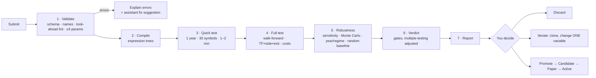

# 11 — Strategy Lab

Submit your own strategy rules at any time; the system validates, tests and reports a verdict — no code
changes, no restart.

## 1. Ways to submit

| Channel | How |
|---------|-----|
| **Rules editor** | React page with Monaco YAML editor, live JSON-Schema validation and autocomplete |
| **Form builder** | Pick indicators, conditions, stops, exits from menus → generates the same YAML |
| **Plain English** | Describe the idea to the assistant → it drafts YAML → **you confirm** |
| **Upload / CLI** | Upload a strategy file in the Lab, or run `xd strategy test file.yaml` — the file is imported into the database |
| **C# plugin** (advanced) | Implement `IStrategy` for logic the DSL can't express; compiled and run in `xd-sandbox` (no network, resource limits) |

All channels produce one validated strategy spec, run by the same engine as built-in strategies.

## 2. Rules language (DSL)

Declarative, safe (parsed and compiled to expression trees, never `eval`), look-ahead-proof (only closed bars;
higher timeframes = last closed bar). The language of one **condition** is built (P3-02, [ADR 0034](../adr/0034-the-rules-expression-language-lint-and-compiler.md): see *The rules language as built* below); the typed strategy model around it and the compile of its sections are built too (P3-02b, [ADR 0036](../adr/0036-the-typed-strategy-model-and-the-compile-of-its-sections.md): see *The strategy model as built* below); the YAML file is P3-02c.

> "Intraday: after 9:45 buy when a 15-min candle closes above VWAP with RSI(14) above 55 and 1-hour EMA20
> above EMA50. Stop below last swing low. Target 1:2, or trail after 1R. Exit by 15:15. Mirror for shorts.
> Test 2022 to today on my MyChoice and Best stocks baskets."

```yaml
strategy:
  id: VWAP_RSI_TREND
  version: 1
  style: intraday
  timeframes: [15m]
  sides: [BUY, SELL]              # SELL auto-mirrored unless a `sell:` block is given
  universe: { baskets: [MyChoice, "Best stocks"] }   # or instruments: [...] or a rule-based basket
  params: { rsi_len: 14, rsi_min: 55, swing_lookback: 5 }
  setup:
    all:
      - time >= "09:45"
      - tf("1h").ema(20) > tf("1h").ema(50)
      - rsi(rsi_len) > rsi_min
  trigger:
    all:
      - crosses_above(close, vwap)
  entry: { type: at_close }       # at_close | stop_above_high | limit_pullback
  stop:  { type: swing_low, lookback: swing_lookback, buffer_atr: 0.1 }
  exits:
    - { policy: FIXED_RR, rr: [2.0] }
    - { policy: PARTIAL_TRAIL, book_pct: 50, t1_rr: 1.0, trail: { type: ATR, mult: 2.0 } }
  time_rules: { last_entry: "14:30", square_off: "15:15" }
  filters: [not_event_day, min_turnover]

test:
  period: { from: 2022-01-01, to: today }
  method: walk_forward            # walk_forward | simple_split | full_period (exploration only)
  compare_with: [baseline_random, ORB]
  robustness: { param_sensitivity: true, monte_carlo: 1000, by_year: true, by_regime: true }
```

**How the sections combine.** `setup`, `trigger` and the optional `invalidate` list (the `invalidation` row of [doc 07](07-strategies.md) §1, "cancel if…") are evaluated **together** at every closed bar of the evaluation timeframe: an entry is possible when `setup` is true, `trigger` is true and `invalidate` is not true. That is why the example may put `time` and `rsi(…)` in `setup`; which parts of a setup are knowable at the previous close, for the nightly shortlist, is the business of the planner (P7), not of the model. An `all:` list is the Kleene AND of its conditions and an `any:` list the Kleene OR; the conditions are compiled and evaluated one by one and **never joined into one text**. `time_rules` is the one place for windows (`first_entry` and `last_entry` inclusive, `square_off` for intraday, `max_hold_sessions` for swing); nothing is read from the configuration, so a stored strategy is self-contained. In the stored form of P3-02b the nested `trail: { type: ATR, mult: 2.0 }` of `PARTIAL_TRAIL` is the field `trail_atr_mult` (the trail is the ATR in schema 1; the YAML reader, P3-02c, refuses other trail types by name and writes the nested form as that field).

In this example `time >= "09:45"` is the trading rule of the sentence above (no entry before 09:45), not something the language needs in order to be correct: `crosses_above(close, vwap)` is unknown at the first evaluation of every session (09:30 on 15m) and can first be true at the second (09:45), see *Lags* below.

| Building blocks | Examples |
|-----------------|----------|
| Price & bars | `open high low close volume`, `close[1]`, `prev_day.high`, `today.open`, `or_high(15)` |
| Indicators | `sma ema rsi atr adx macd bbands vwap supertrend roc highest lowest rel_volume` — all exist now (`macd` and `bbands` are several features each, written `macd_line()`, `macd_signal()`, `macd_hist()` and `bb_upper(20, 2)`, `bb_middle()`, `bb_lower()`, `bb_width()`; a feature with parameters needs its parentheses, so `bb_width < 0.05` is an error, and the language has no bare `macd` or `bbands`): see *What exists now* below |
| Multi-timeframe | `tf("1h").ema(50)`, `tf("1D").close`, `tf("1W").close` — 1m, 5m, 10m, 15m, 30m, 1h, 1D, 1W and 1M exist now |
| Conditions | `crosses_above/below`, comparisons, `between`, `rising/falling(x,n)`, `and` / `or` / `not` inside one condition (the `all:` / `any:` lists of a strategy combine conditions at list level, P3-02b) — all exist now, see *The rules language as built* below |
| Patterns | `inside_bar`, `nr(7)`, `gap_pct`, `engulfing`, `pivot_high/low(n)` (all exist now) |
| Context | `regime()`, `index.trend`, `vix_pct`, `sector_rs(n)`, `day_of_week`, `is_expiry_day` — all exist now except `sector_rs(n)` (not planned until a strategy needs it, see P3-01e); breadth exists as a plain field |
| Stops | `fixed_pct`, `atr_mult`, `swing_low/high`, `bar_low/high`, `or_opposite`, each read on the evaluation timeframe or on an optional `timeframe` of its own (a 15m strategy can stop on the last closed day). `level` is **not a stop kind of schema 1**: a computed price cannot be written in the language and nothing defines it (ADR 0036) |
| Exits | Any policy from [doc 08](08-exits-and-risk.md) §2 as a candidate (`TIME_STOP` and `EVENT_EXIT` are overlays); the model checks `FIXED_RR` and `PARTIAL_TRAIL` and only the shape of the rest until P3-02b2 |

### What exists now (P3-01, P3-01b and P3-01c, [ADR 0031](../adr/0031-streaming-indicators-and-the-feature-frame.md), [ADR 0032](../adr/0032-frame-history-closed-flags-and-the-remaining-indicators.md), [ADR 0033](../adr/0033-weekly-monthly-timeframes-calendar-features-and-the-market-context.md))

The building blocks are implemented in `XDrishti.Indicators` as streaming code over closed bars; the rules language (P3-02, described under *The rules language as built* below) reads them through the `IndicatorCatalog` and the `FeatureFrame`. The **56 names** that exist (every output is a feature of its own, so `macd` is three names and `bbands` four):

| Group | Names | Notes |
|-------|-------|-------|
| Rolling (continuous across sessions) | `sma(n)`, `ema(n)`, `rsi(n)`, `atr(n)`, `highest(n)`, `lowest(n)`, `rel_volume(n)` | `sma ema rsi highest lowest` take a price source (close, open, high, low); `rsi` and `atr` are Wilder; `rel_volume` divides by the mean of the *previous* n bars |
| Trend, momentum, volatility (continuous) | `adx(n)`, `plus_di(n)`, `minus_di(n)`; `macd_line(fast, slow, signal)`, `macd_signal(…)`, `macd_hist(…)`; `bb_upper(n, k)`, `bb_middle(n, k)`, `bb_lower(n, k)`, `bb_width(n, k)`; `supertrend(n, mult)`, `supertrend_dir(n, mult)`; `roc(n)` | defaults: DMI n = 14, MACD 12/26/9, Bollinger n = 20 k = 2, Supertrend n = 10 mult = 3, `roc` n = 10. `adx`/DMI are Wilder (the DIs are ready at bar n+1, `adx` at bar 2n); `macd` and `bb` and `roc` take a price source; the Bollinger deviation is the *population* σ (÷ n, as TradingView) and `bb_width` is (upper − lower)/middle; `supertrend` is the TradingView-style line (final bands that carry over, the direction flips when the close passes the *current* final band, starts up at bar n) and `supertrend_dir` is +1 / −1; `roc` is the percent change over n bars |
| Patterns and structure (continuous, on the closed bars of the timeframe) | `inside_bar`, `nr(n)`, `engulfing`, `pivot_high(n)`, `pivot_low(n)`, `pivot_high_age(n)`, `pivot_low_age(n)` | `inside_bar` and `nr` are 1 / 0 (`nr(7)`: the range is strictly the smallest of the last n bars); `engulfing` is +1 / −1 / 0 judged on the bodies; a pivot is the price of the most recent *confirmed* swing point (strictly above / below the n bars before **and** after), known only n bars after it formed, so it is look-ahead-safe by construction (not ready until the first pivot is confirmed); `*_age` is the number of bars since that pivot (for structure stops) |
| Raw bar | `open`, `high`, `low`, `close`, `volume` | the value of the **last closed bar** of the timeframe (`tf("1D").close` is yesterday's close until today's daily bar closes); with the value history they make `close[1]` |
| Session-anchored (reset per India trading date) | `vwap`, `or_high(m)`, `or_low(m)` | intraday only (refused on 1D, 1W and 1M); `vwap` on the typical price (H+L+C)/3; the opening range is the first *m* minutes and must be a whole number of bars of the timeframe. The frame keeps their history **for the current session only**: a lag never reaches into the day before, and the value is unknown until the timeframe has closed its first bar of the date (*Lags*, [ADR 0035](../adr/0035-per-session-features-keep-the-history-of-the-session-only.md)) |
| Session context | `prev_day_open`, `prev_day_high`, `prev_day_low`, `prev_day_close`, `prev_day_volume`, `today_open`, `today_high`, `today_low`, `gap_pct` | the previous *session that had bars* (weekends and holidays skipped by the data); the DSL spellings `prev_day.high`, `today.open` map to these flat catalog names; refused on 1W and 1M (a weekly bar has no session; read them on 1m or 1D). On an intraday timeframe they restart with the date like the row above (a lag across the open is unknown, no exemption for `prev_day_*` and `gap_pct`); on 1D nothing restarts and a lag is by position (`gap_pct[1]` is yesterday's gap) |
| Calendar (date-driven, **1m only**) | `day_of_week`, `is_expiry_day` | `day_of_week` is the ISO weekday of the India date of the step (Monday 1 … Sunday 7), ready from the first step and correct at India midnight; `is_expiry_day` is 1 when that date is one of the expiry dates the caller passes in `FrameOptions.ExpiryDays`, else 0 (NSE has changed its expiry weekdays more than once, so the library does not guess; the frame is refused without the set, an empty set is valid) |
| Market context (date-driven, **1m only**, daily, as of the previous session) | `index_trend`, `index_adx`, `index_vol_pct`, `vix`, `vix_pct`, `vix_chg`, `breadth`, `regime_trend`, `regime_vol`, `regime` | read from a `MarketContext` the caller passes in `FrameOptions.Context`; definitions below; the frame is refused without it |

**What the frame gives the DSL.** For every feature the value as of the last closed bar of its timeframe, plus `BarClosed(tf)` (did a bar of that timeframe close at this step? the moment to evaluate a condition),
`At(handle, lag)` (the value `lag` closed bars of the feature's own timeframe ago: `close[1]`, the previous value for `crosses_above` and `rising(x, n)`; for the twelve per-session names on an intraday timeframe only the bars of the current session count; the history depth is 1 to 256, default 8; the compiler works out the depth a condition needs, `CompiledCondition.HistoryDepth` and `CompiledPlan.HistoryDepth`, and the caller must pass it in `FrameOptions.HistoryDepth` — a frame
with the default depth refuses to `Bind` a condition that reads further back, `close[10]` for example) and the last closed bar of each timeframe. A repeated or out-of-order 1-minute bar is skipped by every timeframe and counted.

**Weekly and monthly timeframes (P3-01c).** A feature reads 1m, 5m, 10m, 15m, 30m, 1h, 1D, **1W or 1M**; the continuous indicators (rolling, trend, momentum, volatility, patterns, raw bars) run on all nine, the warm-up
is counted in weekly or monthly bars (`ema(10)` on 1W needs ten weeks), and the closed flags, the history and the raw bar features work as on any timeframe (`tf("1W").close` is the close of the last week that has closed, at
every minute of the week in progress before its closing step). A week starts at India midnight of its Monday (a Saturday session belongs to the Monday-to-Sunday week it falls in), a month on the 1st, and both are built from the 1D bars of the same rules. **When a
week or month counts as closed:** with a `TradingCalendar` in `FrameOptions`, at the step that closes the *last session of the period* (the Thursday when Friday is a holiday, the last weekday of a month that ends on a
weekend, a known Saturday session) — the same minute at which the 1D lane closes that date; without a calendar the builder cannot know the last session, so it emits the bar at the **first bar of the next period**: later, never
earlier. A bar of a period that has already been emitted is ignored and counted. Where this differs from the stored `1W` / `1M`: [doc 05 §4](05-data-and-brokers.md).

**The market context (P3-01c).** The context is **daily and read as of the previous session**: at the first step of an India date *D* the frame takes the values of the latest context day *strictly before* *D* and keeps them
for the whole date (09:15 and 15:29 read the same number), so a strategy at 10:30 on a Tuesday sees Monday's close and never Tuesday's, even when Tuesday's record is already loaded; a weekend or holiday reads the last day
before it. The caller builds the `MarketContext` once from daily records (`ContextDay`: date, high / low / close of the regime index — Nifty 50 by default —, the VIX close if known, the breadth if known) and shares it between
frames; every day's values are computed from that day and earlier days only. The numbers below are `ContextOptions` (their defaults; later trading configuration in the database, [ADR 0002](../adr/0002-config-and-strategies-in-app.md)).

| Name | Definition | Ready after (context days) |
|------|------------|---------------------------:|
| `index_trend` | +1 up when the index close is above its 50-day average, that average is higher than 5 days ago and ADX(14) ≥ 20; −1 down for the mirror image; else 0 (range) | 55 |
| `index_adx` | Wilder ADX(14) of the index's daily bars (same definition as `adx`) | 28 |
| `index_vol_pct` | percentile rank (0 to 100) of ATR(14) as a percent of the close, over the last 252 days; ties take the middle of their span: `100 × (#below + 0.5 × #equal) / 252` | 265 |
| `vix`, `vix_chg` | the VIX close; its percent change against the previous day of the context | 1, 2 |
| `vix_pct` | the same percentile rank of the VIX close over the last 252 days that have a VIX. *Pending owner confirmation, ADR 0033 Amendments 1 and 2* | 252 |
| `breadth` | the percent (0 to 100) the day record carries — "tracked stocks above their 20-day average" — read, not computed here | 1 |
| `regime_trend`, `regime_vol` | the trend (+1 / 0 / −1, as `index_trend`) and the volatility class: 0 LOW, 1 NORMAL, 2 HIGH from the mean of `vix_pct` and `index_vol_pct` (below 100/3 LOW, from 200/3 HIGH; the index percentile alone when `vix_pct` is not ready). *Pending owner confirmation, ADR 0033 Amendments 1 and 2 (the fallback), and 13 (the exact thirds; the owner's wording was 33.3 and 66.7)* | 55, 265 |
| `regime` | `(1 − regime_trend) × 3 + regime_vol + 1`: 1 `UP_LOW_VOL` … 9 `DOWN_HIGH_VOL` ([doc 07](07-strategies.md) §6); `Regime.Name` / `Regime.Code` convert both ways | 265 |

A value that is not ready is `NaN` (a condition on it is *unknown*, which a decision treats as false: see *The rules language as built*). That includes the VIX values (`vix`, `vix_pct`, `vix_chg`) on the date that reads a context day without a VIX — nothing is filled from another day, and `regime` keeps
working from the index alone —, `vix_chg` also on the date after that, and `breadth` when its day has none. The warm-up of the context is counted in **days of the context, not bars**, so a test or a simulation needs more than a year of daily index and VIX data before its first date. **Past the last day of the context** a frame keeps that day's values and stays ready (it does not say how old they are; *pending owner confirmation, ADR 0033 Amendment 14*): the caller extends the context as the days pass and checks its age — the data job (P3-01d) and the market gate (P7) must make a stale context visible ([ADR 0033](../adr/0033-weekly-monthly-timeframes-calendar-features-and-the-market-context.md), known risk). The history of these features (`At`) has
one entry per date.

**Not yet built.** `sector_rs(n)` and the **computation of breadth**, both cross-sectional (they need the daily series of many instruments). The computation of breadth is P3-01e (point-in-time, from the tracked stocks' daily bars, stored in `market.context_daily`); `sector_rs(n)` is not planned until a strategy needs it; the index and VIX series are written by the **context data job (P3-01d)** into
`market.context_daily` ([doc 05](05-data-and-brokers.md) §9). All of it comes after the P3 exit check, and until it exists the caller supplies the `ContextDay` records; intraday index features (the index against its own VWAP, its move since the open) and more indices
(Bank Nifty, sector indices) in the regime are not planned for now. The strategy around the language is split: the typed strategy model and the compile of its sections are built (P3-02b, *The strategy model as built*); the YAML sections, the JSON Schema and the hash are P3-02c, storage in `lab.strategies` is P3-02d and the BUY → SELL mirror is P3-02e. Reading the context from the database is part of P3-01d (it owns the table and the reader that builds the `MarketContext`; the simulator only uses it), and reading bars from the database is P3-04 (P3-03 runs on the bars it is given).

**How the closed-bar rule is kept.** A feature on a higher timeframe (`tf("1h").ema(50)`) is computed over bars that a `TimeframeBuilder` emits only once their last minute has arrived, so at 10:30 it reflects the 09:15 hour
(closed at 10:14) and never the 10:15 hour that is still forming. A bar with a missing minute is emitted late and flagged incomplete, and still used; the frame counts those so the simulator can report them. An indicator that is not
ready is `NaN`, and a condition on it is unknown (a decision treats unknown as false, but `not` of it stays unknown: *The rules language as built*). The warm-up is counted in bars of the feature's own timeframe (`ema(20)` on 15m needs 20 fifteen-minute bars, `ema(10)` on 1W ten weekly bars; `prev_day.*` and `gap_pct` need 376 one-minute bars, 26 fifteen-minute
bars or 2 daily bars). A per-session feature is also not ready, at every lag, from the first 1-minute bar of a new date until its timeframe has closed its first bar of that date (up to 60 minutes for `tf("1h")`): it never shows the day before.

### The rules language as built (P3-02, [ADR 0034](../adr/0034-the-rules-expression-language-lint-and-compiler.md))

A **condition** is one true/false expression: `rsi(14) > 55 and close > ema(20)`. The library `XDrishti.Strategies` ([doc 03 §4.2](03-target-architecture.md)) reads its text, binds every name to the 56 catalog features above, applies the look-ahead lint and compiles it to a delegate that decides over a `FeatureFrame` with zero allocation, in a time bounded by the text of the condition: it never grows with the history the frame keeps or the number of bars, but it is an upper bound and not the same for every condition (`rising`/`falling(x, n)` are a loop of n reads, n up to 255; see *Speed*). It takes the text, the strategy's **evaluation timeframe** and a `{name → number}` map of strategy parameters, and nothing else: what surrounds it is split: the typed strategy model (`setup`/`trigger`/`invalidate` lists, `params` of at most four, the `sell:` block) and the compile of its sections are built (**P3-02b**, *The strategy model as built* below), the YAML file and the schema are **P3-02c**, storage **P3-02d**, and the BUY → SELL mirror **P3-02e**. The `all:` / `any:` lists of the example in §2 are lists of conditions, each compiled and evaluated on its own; inside one condition the operators are `and`, `or`, `not`. Nothing is ever executed as text: the vocabulary is closed (catalog, nine builtins, seven constants, `time`, the parameters) and the only dynamic code is an expression tree built from the checked tree.

**Grammar** (loosest to tightest):

```
or        := and ( "or" and )*
and       := not ( "and" not )*
not       := "not" not | compare
compare   := sum ( ("<" | "<=" | ">" | ">=" | "==" | "!=") sum )?      -- not chained: a < b < c is an error
sum       := product ( ("+" | "-") product )*
product   := unary ( ("*" | "/") unary )*
unary     := "-" unary | primary
primary   := number | string | "true" | "false" | "(" or ")" | call
           | reference ( "[" ["-"] digits "]" )?                         -- a subscript only right after a reference
reference := ident | ident "." ident | "tf" "(" string ")" "." ident     -- close, prev_day.high, tf("1h").close
call      := ident "(" [ arg ( "," arg )* ] ")" | "tf" "(" string ")" "." ident "(" [ arg ( "," arg )* ] ")"
arg       := or | ident "=" ident                                        -- named argument: source=high
```

Numbers are decimal with an optional lower-case exponent (`55`, `0.5`, `1e-3`; not `.5`, `1.` or `1E5`); strings use double quotes with no escapes; whitespace is free; there are no comments; keywords are lower-case; everything is case-sensitive (`RSI` is `unknown_name` with the suggestion `rsi`). Only ASCII is part of the language outside strings: a full-width `＞`, a no-break space or an accented letter is an `unknown_character` problem that names the code point (a look-alike with a clear meaning is reported once and then read as the token it stands for). A text is at most 4,000 characters and nests at most 64 levels (brackets and prefix operators open at once, and the depth of the tree, where every call, `not`, minus sign and subscript, and every operator of a chain, is a level and parentheses are none). A chain is as deep as it is long, so **about 60 conditions joined by `and` is the most one condition can hold** (the exact number depends on the shape of each: 63 conditions of the form `rsi(14) > 55` pass, 64 do not); the limit protects everything that walks the tree, and the message of the second check says so. The spec of P3-02b (Draft, awaiting the owner's approval) evaluates the entries of an `all:` / `any:` list one by one at list level (the Kleene AND / OR of the item truths) and never joins them into one text, so this limit does not apply to a list. `ExpressionPrinter` writes the canonical text of a tree (one space around infix operators, the fewest brackets, shortest numbers); two sources that differ only in white space or redundant brackets print the same.

**Names.** An identifier means, in this order, a **strategy parameter** (a number known at compile time; one that has the name of a feature, builtin, constant or `time` wins and `shadowed_name` warns), then a **builtin**, **constant** or `time`, then a **catalog feature**. A feature is written `name(args)`; the arguments are positional in the catalog's order with the catalog's defaults for the trailing ones (`rsi()` is `rsi(14)`, `bb_upper(20)` is `bb_upper(20, 2)`), each a number known when the condition is compiled (a literal, a parameter, `MON … SUN`, or arithmetic, `abs`, `min`, `max` of those: `rsi(rsi_len * 2)`), plus the one named argument `source=close|open|high|low` for the features that read a price. A feature without parameters is written `vwap` or `vwap()`; one with parameters needs its parentheses (`rsi` is an error that suggests `rsi()`), and so does every function.

| Kind | Names |
|------|-------|
| Builtins | `crosses_above(a, b)`, `crosses_below(a, b)`, `rising(x, n)`, `falling(x, n)`, `between(x, lo, hi)`, `abs(x)`, `min(a, b)`, `max(a, b)`, `regime()` |
| Keyword | `time` |
| Constants | `MON TUE WED THU FRI SAT SUN` = 1 … 7 (for `day_of_week == TUE`) |
| Dotted spellings | `prev_day.open`, `.high`, `.low`, `.close`, `.volume` → `prev_day_*`; `today.open`, `.high`, `.low` → `today_*`; `index.trend` → `index_trend`; `index.adx` → `index_adx`. Every other dotted pair is an error; the other context names are written flat (`vix_pct`, `index_vol_pct`, `regime_trend` …) |
| Timeframe qualifier | `tf("1h").ema(20)`, `tf("1D").close[1]`: one of `1m 5m 10m 15m 30m 1h 1D 1W 1M` (case as written; `"1d"` suggests `"1D"`). Only a catalog feature can be qualified (`tf("1h").crosses_above(…)` is an error); the calendar and context features are always read on 1m (`tf("1h").vix` is an error) |

An unqualified feature is read on the **evaluation timeframe**; its value is always that of the last closed bar of its timeframe, as the frame gives it. The catalog's refusals apply and name the feature and the timeframe (`vwap` on 1D, `prev_day.high` on 1W).

**Types.** A finished condition is `bool`. `and or not` take `bool`; `+ - * /` and the unary minus take numbers; `< <= > >=` take two numbers; `== !=` take two numbers or two `bool`s. `time` is compared with a text `"HH:MM"` (any of the six comparisons, the text on either side); `regime()` with `==` or `!=` against one of the nine names or a constant integer 1 to 9. A text, `time` or `regime()` anywhere else is a type error. A comparison names both sides (`close > true`: "`>` cannot compare `close` (a number) with `true` (a true/false value)"); the other operators and the builtins name the operand that is wrong, what the place needs and what it is (`close + true > 1`: "The right side of `+` needs a number, but `true` is a true/false value"); a number where a true/false value is needed (`rsi(14) and close > 1`) also says what to do: "Compare it with something, like rsi(14) > 55".

**Three-valued logic.** A comparison, `crosses_*`, `rising`, `falling`, `between` or `time` whose data is not ready — a feature in its warm-up, a history too short for the lag, no context for the date, a day without a VIX, a division by zero — is **unknown**, not false. `and`, `or`, `not` follow Kleene's tables:

| `a and b` | b true | b false | b unknown |
|-----------|:------:|:-------:|:---------:|
| **a true** | true | false | unknown |
| **a false** | false | false | false |
| **a unknown** | unknown | false | unknown |

| `a or b` | b true | b false | b unknown |
|----------|:------:|:-------:|:---------:|
| **a true** | true | true | true |
| **a false** | true | false | unknown |
| **a unknown** | true | unknown | unknown |

`not` swaps true and false and leaves unknown unknown.

A **decision** (`Evaluate`) is true only when the result is true, so *unknown acts as false* — but `not` does not turn it into true: `not (rsi(14) > 55)` cannot fire before RSI exists, while `rsi(14) < 45 or close > 0` is true as soon as `close > 0`. `EvaluateTruth` returns the three values. The lagged builtins and `between` are atomic: unknown if any of their values is not ready. Arithmetic on a not-ready value is not ready (NaN); `x / 0` is NaN, never an exception; a quotient that overflows is ±infinity, a number.

**Lags.** `x[k]` (a reference followed by `[k]`, k = 1 … 255) is the feature's value k **closed bars of its own timeframe** ago; `close[1]` on a 15m strategy is the previous 15-minute close, `tf("1D").close[1]` the close before the last closed day. `x[0]` and `x[-1]` are refused (`negative_or_zero_lag`; for `x[0]` the suggestion is `x` and replaces the whole subscripted feature): a subscript always asks for the past, and `x` already is the value as of the last closed bar. Crossings and runs use the previous value of each operand, which may be any numeric expression (every feature in it is read one bar further back; constants stay constants):

| Builtin | Means |
|---------|-------|
| `crosses_above(a, b)` | `a[0] > b[0] and a[1] <= b[1]` — a touch that does not pass is not a cross; equal at the previous bar counts as "not above yet" |
| `crosses_below(a, b)` | `a[0] < b[0] and a[1] >= b[1]` |
| `rising(x, n)` | `x[0] > x[1] > … > x[n]`: n whole steps back, strict at each (n ≥ 1, known at compile time); `falling` is the mirror |
| `between(x, lo, hi)` | `lo <= x <= hi`, both ends included |

The lags add up: `rising(close[200], 100)` reads 300 bars back. The history needed is the largest lag plus 1 and may not exceed 256 (the frame's cap). The operands of `crosses_*`, `rising` and `falling` must all be on one timeframe, or "the previous value" of the two would be different moments: `crosses_above(close, tf("1D").ema(20))` on a 15m strategy is an error, and says to write `close > tf("1D").ema(20) and close[1] <= tf("1D").ema(20)`. The calendar and context features are read on 1m but change once a date, so their previous value is the previous *date*, never the previous minute: they are a clock of their own and may be lagged among themselves and against numbers (`rising(vix, 2)`, `crosses_above(vix, 20)`, `rising(vix - index_trend, 2)`), never together with a bar feature, on any strategy timeframe, 1m included. `crosses_above(close, vix)` is an error that says to write `close > vix and close[1] <= vix` (the bar is lagged, the date's value is read as it is now); where no explicit form can be offered (`rising` and `falling`, or a crossing whose bar operand is not a plain reference of the strategy's timeframe) the message says that a calendar or context feature changes once a date, so it is compared without a lag, or only the bar side is lagged by hand.

**A lag counts bars, and a per-session feature keeps the bars of its session only.** For a rolling feature the history runs on across sessions ([ADR 0031](../adr/0031-streaming-indicators-and-the-feature-frame.md), decision 4), so `close[1]` at 09:30 is the previous day's last close and `ema(20)` at 09:30 still uses the previous day's bars, which is what a rolling average is for. Twelve names start again on every India date: `vwap`, `or_high(m)`, `or_low(m)`, `today.open|high|low`, `prev_day.open|high|low|close|volume` and `gap_pct`. On an intraday timeframe (1m, 5m, 10m, 15m, 30m, 1h) the frame forgets their history at the timeframe's first bar of a new date and holds them *pending* (not ready at any lag, `NaN`) from the first 1-minute bar of the date until the timeframe has closed its first bar of it, so a lag never compares two sessions ([ADR 0035](../adr/0035-per-session-features-keep-the-history-of-the-session-only.md)). With S the number of bars the feature's timeframe has closed on the date: lag 0 is the value when S ≥ 1; lag k ≥ 1 is the value k bars ago when k < S and is unknown otherwise. It reads as if the frame had been created at the first bar of the date (for `prev_day.*` and `gap_pct`, with the values of the previous session that had bars known). The session is the India date of the start of the bar the timeframe feeds its indicators, the same date the indicators restart on. Nothing else changes: rolling and date-driven features run as before; on a 1D strategy nothing restarts (a daily bar is a whole session, `gap_pct[1]` is yesterday's gap and `crosses_above(close, prev_day.high)` reads by position); 1W and 1M refuse these names.

**The first evaluations of a session.** For these features every lag is unknown at the start of a session, and unknown is not true ([ADR 0034](../adr/0034-the-rules-expression-language-lint-and-compiler.md), decision 3). `crosses_above(close, vwap)` is unknown at the first evaluation of a session (09:30 on 15m) and can be true from the second bar of the feature's timeframe; `rising(vwap, 3)` from the fourth; `vwap[1]` on the first bar is unknown, not yesterday's last vwap; `not crosses_below(close, vwap)` is unknown on the first bar and so does not fire either. A decision treats unknown as false, so nothing fires on it, and nothing needs a guard to stay correct: a `time >= "HH:MM"` check is a trading rule (when the strategy may act), not a device that makes a lag safe. A coarser timeframe is pending for longer: `tf("1h").vwap` is unknown until the first hourly bar closes at 10:15. The simulator (P3-03) and the live engine get this from the frame and need no code of their own; before it, `crosses_above(close, vwap)` compared the last bar of one session with the first of the next and was true on the first bar of about a quarter of the sessions of a seeded random walk.

**Spellings.** *Yesterday against the day before* is read on the daily timeframe: `tf("1D").close > tf("1D").close[1]`, and likewise for the other daily values (`tf("1D").gap_pct[1]`). A dotted spelling cannot carry `tf(…)`, so a per-session name on another timeframe is written flat: `tf("1h").prev_day_close` (`tf("1h").prev_day.close` is refused by the parser). *A gap through yesterday's level* is written in the **level form**, which reads the level at lag 0 only and lags the close, whose history is continuous: `close > prev_day.high and close[1] <= prev_day.high` is known on the first bar of a session and true on a gap up through the level, where `crosses_above(close, prev_day.high)` is unknown on that bar (it needs the level one bar back). The level form is the spelling for the levels of the previous day. A level that is constant within a session (`today.open`, `prev_day.*`, `gap_pct`, a closed `or_high` / `or_low`) is the other operand of a comparison, not the subject of a run: `rising(today.open, 1)` is never true intraday, while `rising(today.high, 1)` means "the high of the day was raised on this bar" and needs the second bar. The lint (`lag_across_session`) asks for no guard; it warns only about a read that no session can hold (table below).

**Limits of the rule.** (a) A timeframe that has not closed its first bar of the date shows nothing, even a value that is known: `tf("1h").prev_day_close` is unknown for up to 60 minutes. (b) A lag that fits in a session but is large (`rising(vwap, 60)` on 1m) is unknown for the first 60 minutes and is not warned. (c) A session is an India date: a morning and an evening block of one date are one session, and a bucket that closes late (the 15:29 minute is missing) is consumed with its own date, so it is evaluated with these features unknown and the new date stays pending. (d) `or_high(m)` and `or_low(m)` of several bars are not ready until the range has closed, which `lag_across_session` does not count, so it can under-warn; a value is never wrong.

**`time`** is the India clock time at which the evaluated bar **closed**: the start of the last accepted 1-minute bar plus one minute (the bar 09:44 makes `time` = 09:45; `FeatureFrame.LastBarTime` is its source). A 15-minute bar covering 09:30–09:45 is evaluated at `time` = 09:45, so `time >= "09:45"` first holds on that bar, not on the one before it. A `time` comparison is a trading window; it is not what keeps a lag of a per-session feature honest, the frame does that (*Lags*). The literal is `"HH:MM"` within 09:15 … 15:30; `time` is refused on a 1D, 1W or 1M strategy and is unknown before the first bar. **`regime()`** is the `regime` feature compared with its name or code: `regime() == "UP_LOW_VOL"` (names `UP_LOW_VOL` 1 … `DOWN_HIGH_VOL` 9, case-sensitive; `"up_low_vol"` suggests `"UP_LOW_VOL"`). When to evaluate is the caller's business: the simulator evaluates at the steps where `frame.BarClosed(evaluationTimeframe)`.

**Problems are data.** A compile returns every problem it found, in source order: a stable `code`, a `message` that names the offending text between backticks, a `span` (UTF-16 offsets, 1-based line and column), a `suggestion` where one exists (the names at the smallest edit distance found when that is at most 2 — at most 1 for a text of one or two letters, case ignored, the nearest tier only, at most five —, the corrected literal, the explicit form) and a `severity`. Nothing is thrown for a bad condition. If the text does not parse the problems are the syntax ones (the first is exact, the later ones best effort, at most 100 of them: a text with more has the first 100 found listed, in source order, and one `too_many_problems` for the rest; lexical problems are found before syntax ones and an unclosed bracket found at the end of the text may not be listed; the recovery also stops after 232 parses of the text); if it parses, all name and lint problems are reported together, also those that sit in the same call as another fault (a `rising(close + tf("1h").close, 0.5)` reports the bad count and the mixed timeframes at once). Codes are the contract; the English wording may change.

| Lint code | Severity | Rule and example |
|-----------|----------|------------------|
| `strategy.lint.unknown_name` | error | not a parameter, builtin, constant, `time` or feature, a dotted pair that is none of the spellings, a regime name that is none of the nine: `closee > 1` (`close`), `prev_day.hgih` (`prev_day.high`), `regime() == "up_low_vol"` |
| `strategy.lint.bad_arguments` | error | wrong count, kind or range (the catalog's names, ranges and defaults are quoted): `rsi(0)`, `rsi(14.5)`, `rsi(14, 3)` (the span covers all the surplus arguments), `macd_line(26, 12)`, `rsi > 55` (`rsi()`), `ema(20, source=volume)`, `rsi(close)` (not known at compile time), `crosses_above(close)` |
| `strategy.lint.unsupported_timeframe` | error | `tf("1d")` (`"1D"`), `tf("1D").vwap`, `prev_day.high` on 1W, `tf("1h").vix` |
| `strategy.lint.negative_or_zero_lag` | error | a subscript or run count below 1 or not whole: `close[0]` (`close`; the span is the whole subscripted feature, so the suggestion replaces it), `close[-1]`, `rising(close, 0)`, `rising(close, 1.5)` |
| `strategy.lint.lag_too_deep` | error | history needed above 256: `close[256]`, `rising(close, 256)`, `rising(close[200], 100)`, `crosses_above(close[255], vwap)` (near misses: `close[255]`, `rising(close, 255)`) |
| `strategy.lint.lag_on_non_feature` | error | a subscript on a parameter, a constant or `time`: `MON[1]` (on a call or a group it is the syntax problem `subscript_on_non_reference`) |
| `strategy.lint.mixed_timeframes_in_lag` | error | the operands of `crosses_*`, `rising`, `falling` on different timeframes, or a bar feature with a calendar or context feature: `crosses_above(close, tf("1D").ema(20))` on 15m, `crosses_above(close, vix)` on any (suggests the explicit form) |
| `strategy.lint.time_on_daily` | error | `time >= "09:45"` on a 1D, 1W or 1M strategy |
| `strategy.lint.bad_time_literal` | error | not `HH:MM` within 09:15 … 15:30: `"9:45"` (`"09:45"`), `"09.45"` (`"09:45"`), `"09:00"`, `"15:31"`, `"09:45:00"` |
| `strategy.lint.type_mismatch` | error | `rsi(14)` as a condition, `time > 5`, `regime() < 3`, `regime() == 10`, `close > true`, `not close`; a parameter that is not a finite number |
| `strategy.lint.constant_condition` | warning | a part that reads no data: `1 < 2`, `crosses_above(1, 2)`, a parameter against a number; a bare `true` only when it is the whole condition. `rsi(14) > 100` is *not* detected |
| `strategy.lint.redundant_timeframe` | warning | `tf("15m").ema(20)` on a 15m strategy (`ema(20)`) |
| `strategy.lint.needs_context`, `needs_expiry_days` | information | the plan says the frame must be created with a `MarketContext` / the expiry dates; only for a condition without errors |
| `strategy.lint.shadowed_name` | warning | a parameter named like a feature, builtin, constant or `time` wins over it |
| `strategy.lint.lag_across_session` | warning | a read of a per-session feature (`vwap`, `or_high`, `or_low`, `today.*`, `prev_day.*`, `gap_pct`) from further back than one session holds, because the frame keeps no value for it from an earlier session and that part of the condition is **never known**: `lag · T` of at least the 375 minutes of a session, T being the minutes of the feature's own timeframe, whatever the strategy's timeframe. `close > vwap[75]` and `rising(vwap, 75)` on 5m, `rising(vwap, 7)` on 1h, `falling(today_low, 25)` on 15m, `tf("5m").vwap[80] > 0` on a 1D strategy; the lags of a subscript and of a crossing or run add up (`crosses_above(close, vwap[74])` on 5m). The message names the features, how far back, the bars a session holds and the most that can be read ("Read at most 74 bars back"). Near misses: `close > vwap[74]` on 5m, `crosses_above(close, vwap)` and `close > vwap and close[1] <= vwap[1]` (unknown on the first bar of a session, not warned), `crosses_above(close, prev_day.high)` and `rising(today_open, 200)` on a 1D strategy, `rising(ema(20), 200)`, `rising(vix, 2)` |

The syntax codes (`strategy.syntax.*`) are `empty`, `too_long`, `too_deep`, `unknown_character`, `unterminated_string`, `number_followed_by_identifier` (`55abc`, `5m`), `number_out_of_range` (`1e400`), `unexpected_end`, `unexpected_token`, `missing_operand`, `missing_operator`, `chained_comparison` (`a < b < c`: join comparisons with `and`), `unclosed_bracket`, `unmatched_closing_bracket`, `missing_argument`, `trailing_comma`, `subscript_on_non_reference`, `bad_subscript` (`x[]`, `x[a]`, `x[1.5]`), `bad_timeframe_qualifier` (`tf("1h")` alone) and `too_many_problems` (more problems than are listed: the first 100 found are shown, in source order, and this one covers the rest of the text).

**Using it.** `ConditionCompiler.Compile(text, new CompileContext(timeframe, parameters))` returns a `CompileResult`: the `CompiledCondition` (exactly the features the text reads, in canonical form and in order of appearance; the history depth, 1 … 256; whether the frame needs a market context or expiry dates; the warnings) or the problems. `ConditionSet.Merge(conditions)` unites the plans of several conditions. The caller creates **one frame** from `plan.Features` with `FrameOptions { HistoryDepth = plan.HistoryDepth, Calendar, Context, ExpiryDays }` (the last two when the plan says so), then `plan.BindAll(frame)` gives a `BoundCondition` per condition; at each closed bar `Evaluate(frame)` returns the decision and `EvaluateTruth(frame)` the three values. A condition that reads no feature of the evaluation timeframe (`time >= "09:45"` reads none at all) needs one added to the frame by the caller before it can ask `BarClosed`. All conditions of a strategy must be bound to frames made from the same plan. Checking a condition (what an editor does) does not build the delegate; it is built at the first `Bind` and shared by every frame. A host that compiles on request calls `CompilerWarmup.Run()` once, on a thread-pool thread right after it starts and without waiting for it (the **compiler warm-up**: it compiles a fixed set of sources so that the JIT has compiled the compiler before the first real request; see *Speed*).

**Why a condition cannot look ahead.** The language has no word for the future: a compiled condition reads the frame through `frame[handle]` (the value as of the last closed bar of its timeframe), `At(handle, lag)` with a lag of 0 or more, and `Steps` and `LastBarTime` for `time`; a lag below 1 in a subscript is refused when the text is read; a lag the frame does not keep, a "previous value" across timeframes (or across a bar and a date) and a `time` on a bar that has no time of day are lint errors. The guarantee rests on three kinds of test, and each guards a different thing. *The library* is kept to those doors: an architecture test allows it to reference only seven members of the frame (four to read, three to bind), and an audit of the expression trees of about 2,700 generated conditions shows that a tree can call only the kernel, hold nothing but numbers and have no negative lag (the exact lag is held by the oracle and the hand examples). *The compiler's meaning* is guarded by an independent tree-walking interpreter written from these definitions, which agrees with the compiled conditions on 864 random conditions at every step, on 288 more over the twelve per-session names (read through an independent reference of the session rule, built from the definition and the catalog indicators) and on hand-calculated examples; a compiler-mutant control (a lag one bar nearer, the previous value taken as the current one, a run that forgets the lag written in its operand, the clock a minute ahead or at the start of the bar) must be caught by the same corpus. *The frame's feed* is guarded by a property test: for 240 seeds and 1,200 random conditions on 1m, 5m, 15m, 1h, 1D and 1W, the result at every closed bar is the same when every later bar is removed and when every later bar is replaced by arbitrary values (extreme prices, zero volume), and, on the seeds that have a market context, the same when the context days dated at or after the cut date are removed or changed (a step on a date reads the day before it); the same property run through a feeder that reads the next bar, runs the frame on to the close of a higher-timeframe bar, or lets the date lane read the context record of the date itself, reports violations ([ADR 0034](../adr/0034-the-rules-expression-language-lint-and-compiler.md)). **What the property proves, and what it does not.** It proves that, fed an honest series, the answer at a step depends on the bars up to that step and on nothing later: it guards the *feed* and the *frame* and the determinism of the chain. It cannot fail for a wrong compiler: a compiled condition is a pure function of the frame as it is at the step, so a compiler that reads the wrong lag or the wrong clock (a `time` one minute late, a crossing whose previous value is the current one) passes it and is caught by the interpreter and the hand examples, and "reads only the past" is held by the audit and the architecture test above. It cannot see a read of the *forming* bar of a higher timeframe that uses only past minutes either (a partial bar is a function of the minutes before it, and truncation does not change it); that is guarded where the bar is made — the frame never shows it ([ADR 0031](../adr/0031-streaming-indicators-and-the-feature-frame.md): the closing minute of every bucket against an independent reference, the frame-semantics tests, the prefix property) —, and the negative controls of the property are wrong *feeders* (the frame is sealed, so a wrapper is not possible), not a wrong compiler; the compiler is the oracle's business, with its mutant control. What none of them guards is look-ahead in the data itself (a restated close, a breadth computed with later prices: point-in-time is the data job's duty, [ADR 0033](../adr/0033-weekly-monthly-timeframes-calendar-features-and-the-market-context.md)).

**Speed** (Apple M4 Pro, Release; the benchmarks are explicit tests, which `scripts/check.sh` skips). *Evaluation.* Steady-state `Evaluate` allocates 0 bytes (tested over 100,000 steps of a 20-feature frame with ten conditions, date changes included; this test is in the gates). The time of a condition is **bounded by its text**: it never grows with the history the frame keeps or with the number of bars, but it is an upper bound and not the same for every condition. `rising`/`falling(x, n)` are a loop of exactly n steps with one read of the operand per feature in it (about 1.75 ns a read, n up to 255), with no early exit on purpose: runs are atomic over NaN, so the cost does not depend on the data; `and` and `or` skip the right side when the left one decides, so a bar can cost less than the bound. The committed benchmark `Evaluate_runs_by_count` gave 18 ns for `rising(close, 10)`, 85 ns for 50, 170–190 ns for 100 and 444–449 ns for 255, and 866–868 ns for `rising(rsi(14) + ema(20), 255)` (the cost is linear in n: the benchmark asserts only caps four times the measured figures); `RunCostTests` pins the shape of the loop by counting the nodes of the expression tree, without a clock. A condition of 4,000 characters costs at most about 0.1–0.3 ms (a scratch probe, not a committed test). Ten conditions cost 245–258 ns per 1-minute step on top of the frame's own step (298 ns in that 20-feature frame; target 300 ns for the conditions, asserted by `Evaluate_ten_conditions_per_set`, where the share is the difference of two separately minimised timings: a guide and not a regression gate) and 47 ns while the frame stands still. The session rule of [ADR 0035](../adr/0035-per-session-features-keep-the-history-of-the-session-only.md) costs a few nanoseconds per frame step (the 20-feature frame 0.092 → 0.094 µs; the frame step of the evaluation frame 284 → 298 ns), leaves the evaluation share unchanged within noise, and about 0.24 µs on the first bar of a session at depth 8 ([doc 03 §4.1](03-target-architecture.md)).

*Compile.* Parse + bind + lint + delegates for ten conditions have three figures, because the first compile of a process is slow:

| Figure | Measured | Target | Asserted |
|--------|---------:|-------:|----------|
| Warm (the compiler already compiled by use) | 2.45–2.69 ms | ≤ 3 ms | yes (`Compile_bind_and_build_ten_conditions_cold_and_warm`) |
| First compile after the compiler warm-up | 2.99–4.52 ms (median 3.28; 12 methods left to JIT) | ≤ 20 ms | yes (`Compile_ten_conditions_first_run_after_the_warmup`) |
| The compiler warm-up itself | 59.7–62.9 ms of one background core, once per process (76–90 ms on a loaded machine) | ≤ 150 ms | yes (same test) |
| Process-cold: the very first compile of a process, no warm-up | 37.6–41.1 ms (median 38.1; about 1,000 methods JIT-compiled, 39 ms of JIT) | reported | no |

The process-cold figure is the JIT compiling the parser, the binder and the expression compiler; no runtime setting changes it, and ReadyToRun of our assemblies gives about 32 ms (not under 20 ms; +27–34 MB per image, unverified in images), so it was not shipped. `CompilerWarmup.Run()` (public, in `XDrishti.Strategies.Compilation`) compiles 28 valid and 31 invalid fixed sources through the public pipeline (compile, merge, make a frame, bind) so that the JIT is done before a person asks: it is stateless, uses no clock, does not catch exceptions (the host logs and ignores a failure), and a compile that arrives while it runs pays the rest of it. Unit tests prove that the sets cover every builtin, operator, bound node, catalog feature, timeframe and problem code, so a new element of the language fails them until it is added. An architecture rule fails when any `src` project other than the library references it and no source file outside the library calls `CompilerWarmup.Run` (a textual check across `src`; vacuous today because no project references the library yet); the `StrategyWarmupService` hosted service that calls `Task.Run(CompilerWarmup.Run)` from `StartAsync` without delaying readiness belongs to P3-03, the first project that references the library (`XDrishti.Simulation`); it lives in `XDrishti.Api` and must land in the same change, or the rule fails. The warm-up covers compile and bind, not the first `Step` and `Evaluate` of a frame (about 106 methods, about 2.3 ms; the library may not step a frame by architecture rule). Guards: the explicit benchmarks and `scripts/bench-coldstart.sh` (N fresh processes, min / median / max, exit 1 when a median is over its target, run before a release); neither is in `scripts/check.sh` because they need a quiet machine, so the 300 ns, the 3 ms and the 20 ms have no automated guard in the gates (ISS-12, closed, and the open guard gap ISS-16 in the [roadmap](18-roadmap.md); the 20 ms is about six times the measured figure and catches a lost warm-up, not a small regression).

*Note, 2026-10-18 (P3-02b, [ADR 0036](../adr/0036-the-typed-strategy-model-and-the-compile-of-its-sections.md)).* The sets of the compiler warm-up grew: besides the 28 valid and 31 invalid sources it compiles 10 valid and 19 invalid strategy definitions (`WarmupStrategies`: every entry kind, stop kind, exit policy and overlay, both sides and both styles, a fault of each group of `strategy.model.*` codes, a fault in an item with its path, the problem cap) and binds and evaluates the sides that compiled. The counts and the 59.7–62.9 ms quoted above are therefore no longer the figures of the warm-up: it now takes **92–95 ms** of one background core (Apple M4 Pro, Release, quiet; 109 ms in one noisy run), once per process, still inside the 150 ms asserted. The first compile of ten conditions after it is unchanged (2.9–3.1 ms) and the first compile of the example side of §2 is 0.5 ms; process-cold, the first compile of that side is 34 ms. Three budgets are new and, like the others, unguarded by `check.sh` (explicit benchmarks in `StrategyBenchmarks`; ISS-12 and ISS-16 in the [roadmap](18-roadmap.md)): a warm `StrategyCompiler.Compile` of the example side (4 items, 7 features) at most 3 ms (measured 0.19 ms, the model checks and the merge adding 0.02 ms to the compile of the items; target 0.5 ms), the first compile after the warm-up at most 20 ms (0.5 ms), and `BoundSide.Evaluate` of a side of ten simple items at most 0.4 µs per call (31 ns on a frame that stands still; `InEntryWindow` 15 ns).

*Decided under delegation.* These were decided on research under the owner's delegation (2026-10-16/17); the owner may revert any of them. Each was researched by one agent and attacked by another, and the session rule was designed three times and judged. They deviate from, narrow or settle a contradiction in text the owner approved earlier:

| Decision | Where |
|----------|-------|
| `x[0]` stays refused: a subscript always asks for the past and `x` already is the value at the last closed bar; strategies are stored as text with a hash and can be re-imported, so accepting `x[0]` now and refusing it later would break stored versions, while the reverse breaks nothing | [ADR 0034](../adr/0034-the-rules-expression-language-lint-and-compiler.md), Amendment 1 |
| The cold-start criterion is redefined: warm ≤ 3 ms, first compile after the compiler warm-up ≤ 20 ms, process-cold reported | [ADR 0034](../adr/0034-the-rules-expression-language-lint-and-compiler.md), Amendment 2 |
| The 64-level limit counts the depth of the tree, so about 60 conditions joined by `and` is the most one condition holds | [ADR 0034](../adr/0034-the-rules-expression-language-lint-and-compiler.md), Amendment 3 |
| The calendar and context features are a clock of their own (the date) in the lag rule; no exception on 1D | [ADR 0034](../adr/0034-the-rules-expression-language-lint-and-compiler.md), Amendment 4 |
| The parser is a hybrid; recovery is best effort after the first problem; at most 100 problems are listed | [ADR 0034](../adr/0034-the-rules-expression-language-lint-and-compiler.md), Amendment 7 |
| The negative controls of the look-ahead property stay wrong feeders; a compiler-mutant control was added to the oracle | [ADR 0034](../adr/0034-the-rules-expression-language-lint-and-compiler.md), Amendment 14 |
| "Constant time" is restated as an upper bound bounded by the text; type errors name the wrong operand | [ADR 0034](../adr/0034-the-rules-expression-language-lint-and-compiler.md), Amendment 18 |
| Per-session features keep the history of the session only; a per-session feature read on a coarser timeframe is unknown until that timeframe closes its first bar of the day; `prev_day_*` and `gap_pct` get no exemption (it replaces the warning-only rule of Amendment 19) | [ADR 0035](../adr/0035-per-session-features-keep-the-history-of-the-session-only.md) |

The six flagged deviations of [ADR 0033](../adr/0033-weekly-monthly-timeframes-calendar-features-and-the-market-context.md) (its open question 8: the `vix_pct` window, the `regime_vol` fallback, the cursor of the context read, the first partial week, the exact thirds and the reading past the end of the context) are not part of this: they still await the owner.

### The strategy model as built (P3-02b, [ADR 0036](../adr/0036-the-typed-strategy-model-and-the-compile-of-its-sections.md))

A strategy is a typed value of schema 1 (`XDrishti.Strategies.Model`: `StrategyDefinition`, `SideRules`, `ConditionList`, `StopSpec`, `ExitSpec`, `OverlaySpec`, `Quantity`, `TimeRules`; sealed records that compare by value) and `StrategyCompiler.Compile(definition, evaluationTimeframe, side)` checks it and compiles one side for one evaluation timeframe: the result is a `CompiledSide` (the single feature list a frame is created from, the history depth, what the frame must be given, the warnings, and `Bind(frame)` → `BoundSide`) or the problems, each with a **path** (`buy.trigger[1]`, `buy.stop.lookback`, `time_rules.last_entry`, `filters[0]`) and, for a problem of the language, the span inside that item. There is no YAML and no storage in it; the model arrives from C# (the three built-ins are test builders until P3-02d seeds them).

| Part | Rule of schema 1 |
|------|------------------|
| Identity | id `[A-Za-z][A-Za-z0-9_]*` (1 to 64), style `intraday` or `swing`, entry timeframes 5m 10m 15m 30m 1h 1D; an intraday strategy does not list 1D, a swing strategy lists 30m, 1h and 1D only (the author's proposal, ADR 0036); sides `BUY`/`SELL`, and a swing strategy cannot list SELL (futures only, [doc 07](07-strategies.md) §7) |
| `params` | at most four, name `[a-z][a-z0-9_]*` (1 to 32), a finite value; a field that holds a number may name a parameter instead (`lookback: swing_lookback`), resolved before its range is checked; a parameter named like a feature, a function or `time` gets a warning |
| Lists | `setup` and `invalidate` optional, `trigger` required; a present list has 1 to 100 items; `all` or `any`; every item compiled as its own condition (an `all` of 100 conditions compiles, while the same 100 joined by `and` are over the 64-level limit of one condition); the problems of an item are the language's, unchanged |
| Entry | `at_close`, `stop_above_high`, `limit_pullback` (no fields; the simulator runs the first and refuses the others by name until built) |
| Stop | `fixed_pct` (`pct` in (0, 50]), `atr_mult` (`mult` in (0, 20], `atr_period`), `swing_low` (BUY) / `swing_high` (SELL) (`lookback`, optional `buffer_atr` in [0, 5] and `atr_period`: the lowest low / highest high of the last N closed bars of the stop timeframe, the trigger bar included, not a confirmed pivot), `bar_low` / `bar_high`, `or_opposite` (`minutes`); optional `timeframe` (not for `fixed_pct`); periods, whole numbers, whole bars of an opening range and timeframes are judged by the indicator catalog (`feature_invalid` with its message) |
| Exits | candidates, each once (`FIXED_RR`: `rr` list in (0, 10]; `PARTIAL_TRAIL`: `book_pct`, `t1_rr`, `trail_atr_mult`, `atr_period`; the other five by shape only) and optional overlays `time_stop`, `event_exit`; provisional until P3-02b2 and P4 ([doc 08](08-exits-and-risk.md) §2) |
| `time_rules` | `first_entry`, `last_entry` (inclusive), `square_off` (intraday, required), `max_hold_sessions` (swing, 1 to 5, required); times 09:15 to 15:30 on the minute; `first_entry` ≤ `last_entry` < `square_off`; none of the two entry times on a 1D evaluation timeframe |
| `filters` | `not_event_day`, `min_turnover`: accepted with a warning and not evaluated (no results calendar, no liquidity data); the simulator refuses a run that uses one |

**The compiled side.** `Features` is the merge of the features of the conditions in the order of the model, then the stop's level and ATR, then those the exits read, then a `close` on the evaluation timeframe when nothing is on it (a frame cannot be created from an empty list and answers `BarClosed` only for a timeframe it has a feature on); for the example of §2 it is `tf("1h").ema(20)`, `tf("1h").ema(50)`, `rsi(14)`, `close`, `vwap`, `lowest(5, source=low)`, `atr(14)`. `BoundSide.Evaluate(frame, truths)` evaluates **every** item (so a run can count true, false and unknown per path), writes the three-valued result of each and returns a `SideEvaluation(Setup, Trigger, Invalidate)` whose `Fires` is the one definition of the entry condition (`Setup` true, `Trigger` true, `Invalidate` false; unknown is not true, so an unknown invalidation neither fires nor invalidates). `BoundSide.InEntryWindow(frame)` answers `first_entry ≤ time ≤ last_entry` with `time` read exactly as the keyword reads it, for the clock of the **step** (telling a late bar from yesterday's is the scanner's, P3-03). Both allocate nothing. Errors come first, in the order of the model, at most 100, then warnings and notes, at most 100; a `strategy.model.too_many_problems` says that some were dropped. The 46 `strategy.model.*` codes are a stored contract, pinned by a snapshot test with the model.

## 3. Pipeline



**Built and not yet built.** For one condition, the names and look-ahead lint of step 1 and the expression-tree compile of step 2 are built in P3-02 (the library `XDrishti.Strategies`, [doc 03 §4.2](03-target-architecture.md)): `ConditionCompiler.Compile` returns every problem as data, or a compiled condition that decides over a `FeatureFrame` (*The rules language as built*, above). The **schema** part of step 1 is split: the typed model and the compile of its sections (at most four `params`, the `sell:` block as a field, the stop, the exits, the time rules, the filters, every problem with the path of its item) are built in P3-02b (*The strategy model as built*, below); the YAML sections, the JSON Schema and the hash are P3-02c; the storage in `lab.strategies` is P3-02d; the BUY → SELL mirror is P3-02e; the explanation of errors by the assistant and the form builder come later. Steps 3 to 7 need the simulator. **The engine of step 3 for one instrument is built (P3-03, P3-03a and P3-03b, [doc 03 §4.3](03-target-architecture.md), [ADR 0037](../adr/0037-simulation-conventions-and-the-two-stage-seam.md) with Amendment 1, [ADR 0038](../adr/0038-fill-realism-the-entry-limit-gaps-slippage-ticks-and-the-order-inside-a-minute.md)):** `Simulator.Create(definition, evaluationTimeframe, fills?)` compiles a strategy and refuses by name what it cannot run yet, and `Simulator.Run(instrument, bars, tick, calendar?)` scans the 1-minute bars of one instrument at the closed bars of the evaluation timeframe, walks every entry and returns the trades, the positions still open when the data ended, every candidate with the reason when there is no trade, and counters that show why a rule did not fire; the first strategy it runs is ORB v1 (doc 07 §3), a bare breakout, on invented days with hand-calculated trades. **Fill realism is built (P3-03b, ADR 0038):** the entry is a limit order at the trigger close +0.1 % rounded to the instrument's tick that can be missed, a gapped stop fills at the open, a target never better, market-type fills pay slippage on the tick grid, and every trade carries its exact result beside the modelled one. What is *not* built: reading stored bars, the window of a replay and the run record (P3-04, P3-04a), the `simulate` verb and the trade cards (P3-04b), costs and sizing (P3-03c), swing positions (P3-03d), the other exit policies and the comparison of exits on the same entries (P4), the market context and the expiry dates in a simulation (P3-01d), filters, and the rest of steps 3 to 7 (the 214-instrument universe, walk-forward, robustness, the verdict, the report). A figure from this engine is a signal-level result per instrument, in-sample, with modelled fills (the entry limit of +0.1 % and slippage, ADR 0038) and no costs; the header of every result says so. Two facts of the built part carry into them. *The compiler warm-up:* the host that runs steps 1 and 2 on request (the Lab API, the worker) starts `CompilerWarmup.Run()` in the background when it starts, so that the first compile takes 3–4.5 ms instead of about 40 ms (*Speed*); `XDrishti.Api` does so with `StrategyWarmupService` since P3-03a, the second project that references the library, after `XDrishti.Simulation` (the warm-up also compiles strategy definitions since P3-02b). *The first evaluations of a session:* a quick test or a full test evaluates each condition at every closed bar of its timeframe, and the per-session features (`vwap`, `or_high`, `or_low`, `today.*`, `prev_day.*`, `gap_pct`) are unknown at every lag until the timeframe has closed enough bars of the date, so a crossing, a run or a lag of them is unknown at the first evaluation of every session (a crossing is known from the second bar of the feature's timeframe, `rising(vwap, 3)` from the fourth) and, unknown acting as false, never fires there. This is the frame's rule ([ADR 0035](../adr/0035-per-session-features-keep-the-history-of-the-session-only.md)): the simulator and the live engine neither add a guard nor treat the first bars specially, except that a frame must be fed whole sessions (a frame started in the middle of a day takes that bar's date as its session, so a live restart replays the current session from its first bar), and a strategy that wants a gap through yesterday's level writes the level form (`close > prev_day.high and close[1] <= prev_day.high`, *Lags*) or compares the daily bars (`tf("1D").close > tf("1D").close[1]`). A `time` check in a strategy is a trading window ("after 09:45"), nothing the language needs.

Runs as Hangfire jobs in `xd-worker`; progress streamed to React via SignalR; indicator results cached.
Full walk-forward: ~10–60 min depending on universe, timeframes and exits.

## 4. Report

| Section | Content |
|---------|---------|
| Verdict | PASS / MARGINAL / FAIL with exact reasons (each gate ✓/✗) |
| KPIs | Trades, win rate, avg win/loss R, expectancy, profit factor, max drawdown, net ₹ after costs |
| Best cells | TF × side × exit with OOS expectancy and sample size |
| By basket / instrument | Same metrics per basket and per instrument — where the idea works and where it doesn't |
| Charts | Equity & drawdown, R histogram, MAE/MFE, by year, by regime, parameter heatmap, Monte Carlo fan |
| Comparisons | Random-entry baseline, existing strategies, index buy-and-hold |
| Warnings | Low samples, cost sensitivity, concentration, unstable parameters |
| Trades | Full list with chart replay |
| Summary | Plain English from the assistant, using report numbers only |

## 5. Guarding against "test until it passes"

- Every variant recorded in a per-family **test ledger**; thresholds tighten as variants grow.
- Only walk-forward OOS can PASS; `full_period` is exploration-only.
- Promotion always passes through paper trading.
- The assistant can run tests but **cannot promote**.

## 6. Storage & reproducibility

`lab.strategies` / `lab.strategy_versions` (YAML + hash), `lab.lab_runs` (data snapshot, config version,
engine version), `lab.lab_results`, `lab.test_ledger`. The database is the only home of strategies (no repository
folder); any version can be downloaded as a file and re-imported ([ADR 0002](../adr/0002-config-and-strategies-in-app.md)).

**The run record is the reproducibility record** (P3-04, [ADR 0037](../adr/0037-simulation-conventions-and-the-two-stage-seam.md) Amendment 2; the Lab will store it). A simulation run returns a `SimulationRun` (schema 3) that holds enough to check it again: the strategy (its id, the effective parameters, the interim canonical JSON of the definition and its SHA-256), the engine version (`SimulationEngine.Version`), the window, the data-note options, the fill rules, the universe with its label, the exceptions of the trading calendar in the range of the data, and, per instrument, the SHA-256 of the stored bars it read, the applied corporate actions that changed them, the sessions that ran and those left out and why, the flagged days, the counters of the scanner and the walker, and the fate of every candidate. The **run key** is the SHA-256 of a fixed text of those inputs: the same key means the same inputs, and any change of data (one price by one tick), strategy text, parameter, option, fill rule, tick, window, universe label or calendar exception in range changes it. The record reads no clock and no random source; when and how long a run took belong to the caller. Because a trade does not depend on the window asked for (the replay starts at the first stored session), re-running a window of a stored run gives the same trades.

**The exported record and its labels** (P3-04b1 and P3-04b2, [ADR 0041](../adr/0041-the-simulate-verb-the-export-library-and-the-pipeline-in-the-host.md)). Until the Lab stores runs, the owner runs `scripts/simulate.sh` and gets, under `data/exports/sim/<run-id>/`, `trades.csv` and `open_at_end.csv` (one row per trade; the trades the data cut short are apart on purpose), `run.json` (the whole run record, the labels and the format `xd-sim-export-2`), `README.txt` and `manifest.json` (the size and SHA-256 of every file and the export key), and, since P3-04c, `index.html` and a capped, deterministic sample of static HTML trade cards under `cards/` (`--cards`, default 200): per trade the 1-minute candles of the day with entry, stop, target and exit, the timeline, the R arithmetic with every operand, the rule text, the stored 09:15 bar and the data notes, under the same banner, with no script and no statistic. The same labels are printed first on the console, written into `run.json` and put at the top of `README.txt`: *exploration, not evidence of an edge*; the fills (and, with `--fills no-slippage`, that there is no slippage and no tick rounding); the entry limit; costs none; portfolio limits not simulated; in-sample; the universe as of today with its survivorship note; the data line; the engine not yet verified; the tick; the opening bar; and the list of what the fills do not model. No file and no console line prints a performance statistic. The run id is `<strategy>-<from>-<to>-<12 hex of the run key>`; the same export again is recognised by hashing the files, a different one under the same id is refused unless forced, and a forced replacement keeps the old folder once as `<run-id>.previous`.
