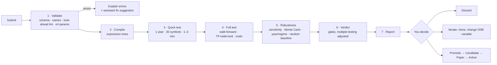

# 11 — Strategy Lab

Submit your own strategy rules at any time; the system validates, tests and reports a verdict — no code
changes, no restart.

## 1. Ways to submit

| Channel | How |
|---------|-----|
| **Rules editor** | React page with Monaco YAML editor, live JSON-Schema validation and autocomplete |
| **Form builder** | Pick indicators, conditions, stops, exits from menus → generates the same YAML |
| **Plain English** | Describe the idea to the assistant → it drafts YAML → **you confirm** |
| **Upload / CLI** | Upload a strategy file in the Lab, or run `xd strategy test file.yaml` — the file is imported into the database |
| **C# plugin** (advanced) | Implement `IStrategy` for logic the DSL can't express; compiled and run in `xd-sandbox` (no network, resource limits) |

All channels produce one validated strategy spec, run by the same engine as built-in strategies.

## 2. Rules language (DSL)

Declarative, safe (parsed and compiled to expression trees, never `eval`), look-ahead-proof (only closed bars;
higher timeframes = last closed bar).

> "Intraday: after 9:45 buy when a 15-min candle closes above VWAP with RSI(14) above 55 and 1-hour EMA20
> above EMA50. Stop below last swing low. Target 1:2, or trail after 1R. Exit by 15:15. Mirror for shorts.
> Test 2022 to today on my MyChoice and Best stocks baskets."

```yaml
strategy:
  id: VWAP_RSI_TREND
  version: 1
  style: intraday
  timeframes: [15m]
  sides: [BUY, SELL]              # SELL auto-mirrored unless a `sell:` block is given
  universe: { baskets: [MyChoice, "Best stocks"] }   # or instruments: [...] or a rule-based basket
  params: { rsi_len: 14, rsi_min: 55, swing_lookback: 5 }
  setup:
    all:
      - time >= "09:45"
      - tf("1h").ema(20) > tf("1h").ema(50)
      - rsi(rsi_len) > rsi_min
  trigger:
    all:
      - crosses_above(close, vwap)
  entry: { type: at_close }       # at_close | stop_above_high | limit_pullback
  stop:  { type: swing_low, lookback: swing_lookback, buffer_atr: 0.1 }
  exits:
    - { policy: FIXED_RR, rr: [2.0] }
    - { policy: PARTIAL_TRAIL, book_pct: 50, t1_rr: 1.0, trail: { type: ATR, mult: 2.0 } }
  time_rules: { last_entry: "14:30", square_off: "15:15" }
  filters: [not_event_day, min_turnover]

test:
  period: { from: 2022-01-01, to: today }
  method: walk_forward            # walk_forward | simple_split | full_period (exploration only)
  compare_with: [baseline_random, ORB]
  robustness: { param_sensitivity: true, monte_carlo: 1000, by_year: true, by_regime: true }
```

| Building blocks | Examples |
|-----------------|----------|
| Price & bars | `open high low close volume`, `close[1]`, `prev_day.high`, `today.open`, `or_high(15)` |
| Indicators | `sma ema rsi atr adx macd bbands vwap supertrend roc highest lowest rel_volume` — all exist now (`macd` and `bbands` are several features each): see *What exists now* below |
| Multi-timeframe | `tf("1h").ema(50)`, `tf("1D").close`, `tf("1W").close` — 1m, 5m, 10m, 15m, 30m, 1h, 1D, 1W and 1M exist now |
| Conditions | `crosses_above/below`, comparisons, `between`, `rising/falling(x,n)`, `all/any/not` |
| Patterns | `inside_bar`, `nr(7)`, `gap_pct`, `engulfing`, `pivot_high/low(n)` (all exist now) |
| Context | `regime()`, `index.trend`, `vix_pct`, `sector_rs(n)`, `day_of_week`, `is_expiry_day` — all exist now except `sector_rs(n)` (P3-01d); breadth exists as a plain field |
| Stops | `fixed_pct`, `atr_mult`, `swing_low/high`, `bar_low/high`, `or_opposite`, `level` |
| Exits | Any policy from [doc 08](08-exits-and-risk.md) |

### What exists now (P3-01, P3-01b and P3-01c, [ADR 0031](../adr/0031-streaming-indicators-and-the-feature-frame.md), [ADR 0032](../adr/0032-frame-history-closed-flags-and-the-remaining-indicators.md), [ADR 0033](../adr/0033-weekly-monthly-timeframes-calendar-features-and-the-market-context.md))

The building blocks are implemented in `XDrishti.Indicators` as streaming code over closed bars; the DSL parser (P3-02) will read them through the `IndicatorCatalog` and the `FeatureFrame`. The **56 names** that exist (every output is a feature of its own, so `macd` is three names and `bbands` four):

| Group | Names | Notes |
|-------|-------|-------|
| Rolling (continuous across sessions) | `sma(n)`, `ema(n)`, `rsi(n)`, `atr(n)`, `highest(n)`, `lowest(n)`, `rel_volume(n)` | `sma ema rsi highest lowest` take a price source (close, open, high, low); `rsi` and `atr` are Wilder; `rel_volume` divides by the mean of the *previous* n bars |
| Trend, momentum, volatility (continuous) | `adx(n)`, `plus_di(n)`, `minus_di(n)`; `macd_line(fast, slow, signal)`, `macd_signal(…)`, `macd_hist(…)`; `bb_upper(n, k)`, `bb_middle(n, k)`, `bb_lower(n, k)`, `bb_width(n, k)`; `supertrend(n, mult)`, `supertrend_dir(n, mult)`; `roc(n)` | defaults: DMI n = 14, MACD 12/26/9, Bollinger n = 20 k = 2, Supertrend n = 10 mult = 3, `roc` n = 10. `adx`/DMI are Wilder (the DIs are ready at bar n+1, `adx` at bar 2n); `macd` and `bb` and `roc` take a price source; the Bollinger deviation is the *population* σ (÷ n, as TradingView) and `bb_width` is (upper − lower)/middle; `supertrend` is the TradingView-style line (final bands that carry over, the direction flips when the close passes the *current* final band, starts up at bar n) and `supertrend_dir` is +1 / −1; `roc` is the percent change over n bars |
| Patterns and structure (continuous, on the closed bars of the timeframe) | `inside_bar`, `nr(n)`, `engulfing`, `pivot_high(n)`, `pivot_low(n)`, `pivot_high_age(n)`, `pivot_low_age(n)` | `inside_bar` and `nr` are 1 / 0 (`nr(7)`: the range is strictly the smallest of the last n bars); `engulfing` is +1 / −1 / 0 judged on the bodies; a pivot is the price of the most recent *confirmed* swing point (strictly above / below the n bars before **and** after), known only n bars after it formed, so it is look-ahead-safe by construction (not ready until the first pivot is confirmed); `*_age` is the number of bars since that pivot (for structure stops) |
| Raw bar | `open`, `high`, `low`, `close`, `volume` | the value of the **last closed bar** of the timeframe (`tf("1D").close` is yesterday's close until today's daily bar closes); with the value history they make `close[1]` |
| Session-anchored (reset per India trading date) | `vwap`, `or_high(m)`, `or_low(m)` | intraday only (refused on 1D, 1W and 1M); `vwap` on the typical price (H+L+C)/3; the opening range is the first *m* minutes and must be a whole number of bars of the timeframe |
| Session context | `prev_day_open`, `prev_day_high`, `prev_day_low`, `prev_day_close`, `prev_day_volume`, `today_open`, `today_high`, `today_low`, `gap_pct` | the previous *session that had bars* (weekends and holidays skipped by the data); the DSL spellings `prev_day.high`, `today.open` map to these flat catalog names; refused on 1W and 1M (a weekly bar has no session; read them on 1m or 1D) |
| Calendar (date-driven, **1m only**) | `day_of_week`, `is_expiry_day` | `day_of_week` is the ISO weekday of the India date of the step (Monday 1 … Sunday 7), ready from the first step and correct at India midnight; `is_expiry_day` is 1 when that date is one of the expiry dates the caller passes in `FrameOptions.ExpiryDays`, else 0 (NSE has changed its expiry weekdays more than once, so the library does not guess; the frame is refused without the set, an empty set is valid) |
| Market context (date-driven, **1m only**, daily, as of the previous session) | `index_trend`, `index_adx`, `index_vol_pct`, `vix`, `vix_pct`, `vix_chg`, `breadth`, `regime_trend`, `regime_vol`, `regime` | read from a `MarketContext` the caller passes in `FrameOptions.Context`; definitions below; the frame is refused without it |

**What the frame gives the DSL.** For every feature the value as of the last closed bar of its timeframe, plus `BarClosed(tf)` (did a bar of that timeframe close at this step? the moment to evaluate a condition),
`At(handle, lag)` (the value `lag` closed bars of the feature's own timeframe ago: `close[1]`, the previous value for `crosses_above` and `rising(x, n)`; the history depth is 1 to 256, default 8, sized by the parser from the
strategy) and the last closed bar of each timeframe. A repeated or out-of-order 1-minute bar is skipped by every timeframe and counted.

**Weekly and monthly timeframes (P3-01c).** A feature reads 1m, 5m, 10m, 15m, 30m, 1h, 1D, **1W or 1M**; the continuous indicators (rolling, trend, momentum, volatility, patterns, raw bars) run on all nine, the warm-up
is counted in weekly or monthly bars (`ema(10)` on 1W needs ten weeks), and the closed flags, the history and the raw bar features work as on any timeframe (`tf("1W").close` is the close of the last week that has closed, at
every minute of the week in progress before its closing step). A week starts at India midnight of its Monday (a Saturday session belongs to the Monday-to-Sunday week it falls in), a month on the 1st, and both are built from the 1D bars of the same rules. **When a
week or month counts as closed:** with a `TradingCalendar` in `FrameOptions`, at the step that closes the *last session of the period* (the Thursday when Friday is a holiday, the last weekday of a month that ends on a
weekend, a known Saturday session) — the same minute at which the 1D lane closes that date; without a calendar the builder cannot know the last session, so it emits the bar at the **first bar of the next period**: later, never
earlier. A bar of a period that has already been emitted is ignored and counted. Where this differs from the stored `1W` / `1M`: [doc 05 §4](05-data-and-brokers.md).

**The market context (P3-01c).** The context is **daily and read as of the previous session**: at the first step of an India date *D* the frame takes the values of the latest context day *strictly before* *D* and keeps them
for the whole date (09:15 and 15:29 read the same number), so a strategy at 10:30 on a Tuesday sees Monday's close and never Tuesday's, even when Tuesday's record is already loaded; a weekend or holiday reads the last day
before it. The caller builds the `MarketContext` once from daily records (`ContextDay`: date, high / low / close of the regime index — Nifty 50 by default —, the VIX close if known, the breadth if known) and shares it between
frames; every day's values are computed from that day and earlier days only. The numbers below are `ContextOptions` (their defaults; later trading configuration in the database, [ADR 0002](../adr/0002-config-and-strategies-in-app.md)).

| Name | Definition | Ready after (context days) |
|------|------------|---------------------------:|
| `index_trend` | +1 up when the index close is above its 50-day average, that average is higher than 5 days ago and ADX(14) ≥ 20; −1 down for the mirror image; else 0 (range) | 55 |
| `index_adx` | Wilder ADX(14) of the index's daily bars (same definition as `adx`) | 28 |
| `index_vol_pct` | percentile rank (0 to 100) of ATR(14) as a percent of the close, over the last 252 days; ties take the middle of their span: `100 × (#below + 0.5 × #equal) / 252` | 265 |
| `vix`, `vix_chg` | the VIX close; its percent change against the previous day of the context | 1, 2 |
| `vix_pct` | the same percentile rank of the VIX close over the last 252 days that have a VIX. *Pending owner confirmation, ADR 0033 Amendments 1 and 2* | 252 |
| `breadth` | the percent (0 to 100) the day record carries — "tracked stocks above their 20-day average" — read, not computed here | 1 |
| `regime_trend`, `regime_vol` | the trend (+1 / 0 / −1, as `index_trend`) and the volatility class: 0 LOW, 1 NORMAL, 2 HIGH from the mean of `vix_pct` and `index_vol_pct` (below 100/3 LOW, from 200/3 HIGH; the index percentile alone when `vix_pct` is not ready). *Pending owner confirmation, ADR 0033 Amendments 1 and 2 (the fallback), and 13 (the exact thirds; the owner's wording was 33.3 and 66.7)* | 55, 265 |
| `regime` | `(1 − regime_trend) × 3 + regime_vol + 1`: 1 `UP_LOW_VOL` … 9 `DOWN_HIGH_VOL` ([doc 07](07-strategies.md) §6); `Regime.Name` / `Regime.Code` convert both ways | 265 |

A value that is not ready is `NaN` (a false condition). That includes the VIX values (`vix`, `vix_pct`, `vix_chg`) on the date that reads a context day without a VIX — nothing is filled from another day, and `regime` keeps
working from the index alone —, `vix_chg` also on the date after that, and `breadth` when its day has none. The warm-up of the context is counted in **days of the context, not bars**, so a test or a simulation needs more than a year of daily index and VIX data before its first date. **Past the last day of the context** a frame keeps that day's values and stays ready (it does not say how old they are; *pending owner confirmation, ADR 0033 Amendment 14*): the caller extends the context as the days pass and checks its age — the data job (P3-01d) and the market gate (P7) must make a stale context visible ([ADR 0033](../adr/0033-weekly-monthly-timeframes-calendar-features-and-the-market-context.md), known risk). The history of these features (`At`) has
one entry per date.

**Not yet built.** `sector_rs(n)` and the **computation of breadth**, both cross-sectional (they need the daily series of many instruments): they belong to the **context data job (P3-01d)** that writes
`market.context_daily` ([doc 05](05-data-and-brokers.md) §9), and until it exists the caller supplies the `ContextDay` records; intraday index features (the index against its own VWAP, its move since the open) and more indices
(Bank Nifty, sector indices) in the regime are not planned for now; the DSL parser and look-ahead lint are P3-02; reading the context from the database is part of P3-01d (it owns the table and the reader that builds the `MarketContext`; the simulator only uses it), and reading bars from the database is the simulator story (P3-03).

**How the closed-bar rule is kept.** A feature on a higher timeframe (`tf("1h").ema(50)`) is computed over bars that a `TimeframeBuilder` emits only once their last minute has arrived, so at 10:30 it reflects the 09:15 hour
(closed at 10:14) and never the 10:15 hour that is still forming. A bar with a missing minute is emitted late and flagged incomplete, and still used; the frame counts those so the simulator can report them. An indicator that is not
ready is `NaN`, and a condition on it is false. The warm-up is counted in bars of the feature's own timeframe (`ema(20)` on 15m needs 20 fifteen-minute bars, `ema(10)` on 1W ten weekly bars; `prev_day.*` and `gap_pct` need 376 one-minute bars, 26 fifteen-minute
bars or 2 daily bars).

## 3. Pipeline



Runs as Hangfire jobs in `xd-worker`; progress streamed to React via SignalR; indicator results cached.
Full walk-forward: ~10–60 min depending on universe, timeframes and exits.

## 4. Report

| Section | Content |
|---------|---------|
| Verdict | PASS / MARGINAL / FAIL with exact reasons (each gate ✓/✗) |
| KPIs | Trades, win rate, avg win/loss R, expectancy, profit factor, max drawdown, net ₹ after costs |
| Best cells | TF × side × exit with OOS expectancy and sample size |
| By basket / instrument | Same metrics per basket and per instrument — where the idea works and where it doesn't |
| Charts | Equity & drawdown, R histogram, MAE/MFE, by year, by regime, parameter heatmap, Monte Carlo fan |
| Comparisons | Random-entry baseline, existing strategies, index buy-and-hold |
| Warnings | Low samples, cost sensitivity, concentration, unstable parameters |
| Trades | Full list with chart replay |
| Summary | Plain English from the assistant, using report numbers only |

## 5. Guarding against "test until it passes"

- Every variant recorded in a per-family **test ledger**; thresholds tighten as variants grow.
- Only walk-forward OOS can PASS; `full_period` is exploration-only.
- Promotion always passes through paper trading.
- The assistant can run tests but **cannot promote**.

## 6. Storage & reproducibility

`lab.strategies` / `lab.strategy_versions` (YAML + hash), `lab.lab_runs` (data snapshot, config version,
engine version), `lab.lab_results`, `lab.test_ledger`. The database is the only home of strategies (no repository
folder); any version can be downloaded as a file and re-imported ([ADR 0002](../adr/0002-config-and-strategies-in-app.md)).
