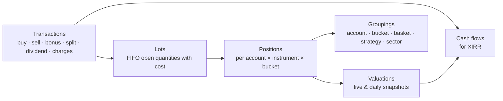

# 12 — Portfolio Monitoring

Add your broker accounts and monitor **every trade and holding**: when it was added, current value, return %,
XIRR, and totals — grouped by basket, account, strategy or sector.

## 1. Data sources

| Source | What it provides | When |
|--------|------------------|------|
| Dhan **holdings** API (`GET /v2/holdings`) | Current holdings (delivery): quantity, average cost, last traded price, ISIN — **no purchase date** (P2-01) | On the first import (saving the account's Portfolio settings), "Sync now" and, per account, the daily automatic refresh (§3); positions API later |
| Dhan **trade history** API | Every trade with date/time, price, quantity, side and full charge breakdown (paginated by date range) | Nightly incremental; one-time backfill |
| Dhan **ledger** API | Cash credits/debits (funds added/withdrawn, dividends, charges) | Nightly |
| **CSV import** | Older trades (before API history / other brokers), contract-note or tradebook exports — **built in P2-03** ([ADR 0023](../adr/0023-trade-import-and-lot-reconstruction.md)): a generic CSV with auto-detected headers, a preview, an import with Undo, and a template (§3 "Trades and the rebuild of lots") | On demand |
| **Manual entry** | Corrections, off-platform transactions — **built in P2-03**: one trade at a time, voided (never edited) when wrong | On demand |
| Corporate actions | Splits, bonuses, dividends | Nightly |
| Prices | Live quotes for open trades & holdings; EOD close for valuation ([doc 05](05-data-and-brokers.md) §5) | Market hours / EOD |

**History depth (decision Q5, amended by [ADR 0012](../adr/0012-holdings-acquisition-dates-and-returns-model.md)):** Dhan's holdings carry no purchase date, so the owner
sets the acquisition date of each holding when the first import happens, in the account's Portfolio settings (§3 "Where acquisition dates come from"). Lots are refined from a tradebook CSV or from trades typed in by hand (P2-03, **built**: §3 "Trades and the rebuild of lots"); a helper that derives dates from Dhan's trade history is a later, separate story.

## 2. Domain model



- **Transaction** — immutable record (source: broker / CSV / manual; charges attached). **Built in P2-03** for CSV and manual trades (`portfolio.transactions`, §9); the broker source follows with the Dhan trade-history sync.
- **Lot** — each buy creates a lot; sells consume lots **FIFO** (matches Indian practice) → realised P&L per lot.
- **Position** — open quantity, average cost (incl. charges), first-added date, linked plan ticket (if any).
- **Valuation** — market value at a time; a daily snapshot after close builds the portfolio value history.
- **Cash flow** — dated money in/out used for XIRR.

## 3. Metrics

### Per position / trade
| Metric | Definition |
|--------|------------|
| Added on | Date/time of first buy (and of each add) |
| Days held | Calendar days since first buy (or until exit) |
| Quantity, avg cost | Open quantity; average cost including charges |
| LTP, market value | Live or last close price × quantity |
| Unrealised P&L (₹, %) | Market value − remaining cost |
| Realised P&L (₹) | From FIFO-closed lots, net of charges |
| Total return % | (Realised + unrealised + dividends) / total invested |
| Day change (₹, %) | vs previous close (**built**, P2-06): ₹ = qty × (last − previous close), % = (last − previous close) / previous close; unavailable (never zero) when there is no previous close. **Known limitation:** `previous_close` comes only from quotes and a holdings sync never touches it, so on a day without a quote (the poll off, failed or outside its window) a sync moves the price while the previous close stays from an earlier session, and the day change then spans sessions; the row exposes `priceAt` and `priceSource` so the screen can say so |
| **XIRR** | Annualised return from dated cash flows (§4) |
| CAGR | For holdings > 1 year |
| Weight % | Share of portfolio (or bucket) value |
| System trade info | Strategy, cell, entry plan, R-multiple, stop/target distance (if from a plan ticket) |

### Where acquisition dates come from

XIRR, % return and absolute return need the **date and size of every cash flow**. Dhan's `GET /v2/holdings` gives quantity, **average cost price**, last traded price
and ISIN, but **no purchase date** (docs read 2026-10-11), so the dates are **set by the owner** ([ADR 0012](../adr/0012-holdings-acquisition-dates-and-returns-model.md),
[P2-01](../specs/P2-01-holdings-import-with-dates-and-auto-refresh.md)). This replaces the earlier idea (P1-16e) of deriving them from Dhan's trade and ledger APIs.

**The first import is part of saving the account's Portfolio settings** ([ADR 0013](../adr/0013-portfolio-import-with-settings-and-daily-refresh.md),
[P2-01a](../specs/P2-01a-portfolio-import-on-save-and-daily-refresh.md)); there is no separate import endpoint or dialog. The settings carry a **first import date**
(`firstImportDate`, default **1 Jan 2025**, between 1990-01-01 and today India). When the account is connected, has the Portfolio role and has **no holdings** in the system,
*Save* (`PUT /api/accounts/{id}/portfolio`) stores the settings and then imports in the same request, **without any per-holding list on the settings screen**: Dhan is fetched
again inside one transaction, one holding with **one lot** (Dhan's quantity and average cost) is created for every holding Dhan lists, in the account's bucket (its own default
bucket or the custom bucket chosen in the settings), dated with the first import date and flagged `uses_default_date` (counted on the Portfolio screen until its date is edited
there). `firstImport.rows` = `[{key, acquiredOn?}]` is an optional API detail: a row's date overrides the default for its key. The run is recorded with the trigger `import`. The answer carries the result:
`import.status` `imported` (counts `imported`, `defaultDated`, `alreadyImported`, `unknown`), `skipped` (the account already has holdings: nothing is imported, Dhan is not called; `redated`/`redateSkipped` say how many lots followed a changed first import date),
`deferred` (not connected, or role off: nothing is called) or `failed` (the **settings are still saved**; `import.errorCode` `portfolio.import_failed`, `import.cause` the reason code
such as `portfolio.not_connected` or `portfolio.sync_running`; retry with Save again or Sync now). Invalid dates or rows are `400 accounts.invalid` (fields `firstImportDate`,
`firstImport.rows[i].key`, `firstImport.rows[i].acquiredOn`) and nothing is saved.
**An account that is not connected** keeps the stored first import date, and its **first sync** — manual or daily — performs the import: every holding
Dhan lists gets one lot dated with the first import date (flagged as default, editable per lot) and the run is recorded as `import`. After that nothing imports again: saving the settings
again imports nothing, and everything else arrives through the refresh below.
**The first import date stays editable** ([ADR 0015](../adr/0015-first-import-date-editable-and-no-bucket-ui-in-accounts.md), [P2-01b](../specs/P2-01b-editable-first-import-date-and-no-buckets-in-accounts.md)):
saving a **changed** date on an account that has holdings **re-dates, in the same unit of work, every lot with `source = import` and `uses_default_date = true`** to the new date (the lots stay flagged;
a closed lot whose `closed_on` is before the new date cannot take it and is skipped). Lots the owner dated by hand, lots found by refreshes and manual lots are never touched; returns and XIRR are computed on
read, so they follow. No Dhan call is made (`import.status` stays `skipped`); the answer's `import` carries `redated` and `redateSkipped` (lot counts, 0 when the date did not change or the account has no
holdings). The same date again changes nothing. The change is audited once (`FirstImportDateChanged`: old and new date and the counts, no per-lot data). Without holdings only the date is stored.

**Lots.** A holding has lots `(acquired_on, qty, unit_cost)`; a closed lot also has `closed_on`, `close_price` and `estimated`. A partial sale splits a lot into a
closed piece and an open remainder with the same date and cost, so every lot has one close price. The open quantities always add up to Dhan's quantity, and the
holding's quantity and average cost are always Dhan's after a sync. Any lot's date can be edited later (`PUT /api/holdings/{id}/lots/{lotId}`); figures are computed on
read, so they follow at once.

**Sync rules** ("Sync now" and the daily refresh run the same command, for an account that already has holdings; one transaction per account, idempotent):

| Dhan says | Result |
|-----------|--------|
| A holding the account does not have (or had closed) | New holding (or reopened) with one lot dated **today (India)**, unit cost = Dhan's average cost, source `added`, not flagged as default date |
| Quantity increased by Δ | A lot dated today for Δ at the **implied cost** `max(0, (newQty × newAvg − oldQty × oldAvg) / Δ)`; when that is not positive, the last price (then the new average) |
| Quantity decreased by Δ | Lots closed **oldest first (FIFO)** for Δ at the **last price**, marked `estimated` |
| Holding missing | Same, for the whole quantity; the holding becomes `closed` (kept, with its realised result) |
| Same quantity | Last price, price time and Dhan's average cost only |

A run that fails leaves every holding untouched and is recorded (`portfolio.holding_syncs`: manual / auto / import, status, counts, a short safe error). One run per
account at a time (advisory lock plus a unique "running" row; `409 portfolio.sync_running`); a run left running by a crashed process is ended when the API starts.
**Safeguard against a false "Dhan lists nothing".** An empty answer (a `200 []` or Dhan's documented `DH-907` "no data") or a broken one can look like a sale of everything, and closing every
holding then reopening it dated today would destroy the owner's acquisition dates. So a sync whose answer would close **all open holdings (empty answer) or more than half of them with at
least 3** (exactly half does not count; fewer than 3 never counts unless the answer is empty) changes nothing unless confirmed:
- a **manual** sync answers `409 portfolio.confirmation_required` with the numbers `listedHoldings`, `openHoldings` and `wouldClose` and a message such as "Dhan listed 0 holdings while 3 are open in
  xDrishti" or "Dhan listed 2 holdings but 4 of your 6 open holdings are missing"; the UI shows them and repeats the request with `{"confirm": true, "expectedOpenHoldings": 6, "expectedWouldClose": 4}`
  (both numbers are required with `confirm`; `400 portfolio.invalid` otherwise), which applies the closes by the rules above;
- if Dhan's answer has changed since (the numbers differ), nothing is applied and the answer is `409 portfolio.confirmation_stale` with the fresh numbers;
- an **automatic** run never confirms — it is recorded as `skipped` with the same reason text ("… — nothing was changed; press Sync now to confirm."), visible as `last` in the sync status, with at
  most one skipped record per account and India day (the latest check replaces the earlier one).

**Records are kept 90 days.** After an automatic run, finished `holding_syncs` rows older than 90 days that did not fail are deleted (at most 500 at a time); failed runs stay.

A token Dhan refuses is `409 portfolio.not_connected` ("sign in to Dhan again"); Dhan being unreachable is `502 accounts.broker_error`. Sells between two syncs are
estimated at the last price of the sync that noticed them; a possible corporate action (split, bonus) shows up as a quantity change.

**Mapping to the instrument master.** By ISIN first (shares and ETFs, series EQ preferred), then by Dhan's security id within the NSE equity segment. Holdings that
cannot be mapped (for example BSE only) are kept, flagged "not in master list" (`mapped = false`), and still get returns from Dhan's price.

**Automatic refresh (per account, off by default, [ADR 0013](../adr/0013-portfolio-import-with-settings-and-daily-refresh.md)).** Portfolio settings: `refreshMode` `off` | `daily`
(the interval mode no longer exists; existing interval settings were switched off by the migration) and `refreshDailyTimeIst` `HH:mm` (default 16:00, after the close). A hosted service
in `xd-api` looks once a minute at every Portfolio-role account whose refresh is on and runs the same sync:

- **daily**: once a day from the configured India time on, weekends included; if the time was missed (the application was down) it runs as soon as possible the same day; a failed or
  skipped automatic attempt counts as that day's run, a manual run does not (the first automatic run of an account without holdings is recorded as `import` and counts too);
- an account that is **not connected** (no token, expired) is not called: one `skipped` record per India day;
- runs never overlap (accounts one after the other, one running row per account); "Sync now" works at any time; the whole mechanism is switched off with
  `Portfolio:AutoRefresh:Enabled = false` ([doc 16](16-configuration.md)). `GET /api/accounts/{id}/holdings/sync-status` returns `refreshMode`, `refreshDailyTimeIst`, `firstImportDate`, `hasHoldings`, the next scheduled run, `running` and the last run.

Not included in v1 (and stated in the UI): dividends, brokerage and taxes.

### Trades and the rebuild of lots (P2-03, [ADR 0023](../adr/0023-trade-import-and-lot-reconstruction.md))

A broker **tradebook (CSV)** or trades **typed in by hand** are stored as **transactions** and, on an explicit and previewed step, rebuild a holding's lots from the real buy and sell dates, so
XIRR, returns, the value history and the benchmark use true dates and real sale prices (a sale closes a lot at its **real** price, `estimated = false`). The broker stays authoritative for
the quantity and the total cost of a holding: trades can only *explain* a holding, never change what Dhan says is held.

**Transactions.** `portfolio.transactions`: account, instrument (when mapped), ISIN, symbol, exchange, `side` buy/sell, India `trade_date` and optional `trade_time`, `qty` (whole shares, `bigint`),
`price`, `charges` (one total, informational — **not** in cost, returns or XIRR yet), `source` csv/manual, `batch_id`, `seq` (the line of the file, 0 for a manual trade), `external_id`, who/when and
`voided_at/by`. A transaction is immutable except for being **voided** — the runtime role has no DELETE. `external_id` is the trade's identity and is **unique per account among the trades that are
not voided** (a partial unique index), so a voided trade (or an undone file) can be imported again: the trade id of the file together with the trade date (`t:yyyyMMdd:` + id — exchanges number trades per day, so the same id on two days is two trades) when it has such a column, else a hash of
(account, date, time, symbol or ISIN, side, quantity, price, order id, how many identical lines came before in the file) (`h:` + 32 hex), so two genuine identical trades are both kept and the same file
read again adds nothing; a manual trade has a random identity (`m:`) and is never deduplicated. **Import batches** (`portfolio.trade_batches`): file name, SHA-256 (the file itself is never stored),
counts (parsed, imported, duplicates, skipped, bad), status imported/undone, who/when; a file that adds nothing new makes no batch. Neither table is ever deleted.

**The file (generic, auto-detected, UTF-8 with or without BOM, comma separated, at most 10 MB and 20,000 data rows).** Headers match without regard to case or punctuation. Required: a date, a symbol or an
ISIN, a side, a quantity, a price (a missing one refuses the file with `400 portfolio.invalid` on field `file`, naming what is missing and the accepted names). Accepted names, among others — date:
`date`, `trade date`, `transaction date`, `order execution time`; symbol: `symbol`, `trading symbol`, `scrip`, `instrument`, `security`, `stock name`; `isin`; side: `trade type`, `side`, `buy/sell`,
`transaction type`; quantity: `quantity`, `qty`, `traded quantity`; price: `price`, `trade price`, `rate`, `avg price`; optional: `exchange`, `trade id`/`trade no` (the identity), `order id` (only part of the
line hash), `time`, `segment`/`instrument type` (to skip non-equity rows), charges. Unknown columns are ignored. Dates: `yyyy-MM-dd`, `dd-MM-yyyy`, `dd/MM/yyyy`, `dd-MMM-yyyy` — day first,
**never** `MM/dd` (13/25/2024 is a bad row) — optionally followed by an India time; a date in the future is a bad row. Numbers take `.` for decimals and `,` only to group thousands (`1,234.50`,
`12,34,567`). Side: buy/sell/b/s/purchase/sale. Symbols are upper-cased and trimmed; `NSE:` and `-EQ` are stripped. Quantity must be a **whole** number above 0, price above 0. **Charges:** a
`total charges`/`charges` column is used as it is, otherwise the component columns (brokerage, STT, stamp duty, GST, taxes, …) are summed, never both. Rows for derivatives, commodity or currency segments
(by the segment/instrument-type/exchange column, or by the shape of the symbol: expiry, strike, `FUT`, `CE`, `PE`) and **BSE** rows are **skipped with a reason** (counts per reason); a bad row (line, reason —
at most 200 listed, all counted) is never imported; a trade id that repeats on the same day with identical details is counted as a duplicate, with different details it is a bad row. A cell longer than 64 characters in a date, time, number or ISIN column makes the row bad (no pattern ever looks at a huge cell). `GET /api/portfolio/trades/template`
downloads a CSV with the canonical headers and two example rows (`Date,Symbol,ISIN,Side,Quantity,Price,Exchange,Trade ID,Time,Charges`).

**Which holding a trade belongs to.** Among the account's **open** holdings: by ISIN; when no holding has the trade's ISIN (or the trade has none), by symbol — but a symbol never joins two different ISINs.
More than one candidate is `ambiguous` (not applied). A security that matches no holding is *not held*: its trades are stored and listed ("12 trades for 4 securities not held"), not applied; if it matches
neither a holding nor an NSE share/ETF of the instrument master it is also counted as *unmatched*. Closed positions are not created from trades.

**Reconstruction** (pure, deterministic, idempotent; `LotReconstructor`). For a holding with the broker's quantity `Q` and average cost `A`, from its non-voided trades:
1. Each trade is converted to **today's share basis** with the instrument's **applied** corporate actions whose ex-date is *after* the trade date (a trade on the ex-date or later is already on the new basis),
   in the direction of the bar adjustment (`AdjustmentFactors`: bars before the ex-date are multiplied by the action's factor): **price × factor, quantity ÷ factor**, cumulative over the actions in
   ex-date order (a 1:5 split has factor 0.2: 10 shares at 1,000 become 50 at 200; a 1:1 bonus has factor 0.5; a split and a bonus multiply). The quantity is computed exactly from the ratio and must come
   out whole (`quantity_mismatch`, reason `fractional_after_adjustment`, otherwise — 3 shares before a 1:2 bonus are 4.5). Suggested and ignored actions are not used. The result says `adjustedFor: n`.
2. `net` = bought − sold; the **opening quantity** `P0 = Q − net`. `P0 < 0`: the trades explain more shares than Dhan holds → `quantity_mismatch` (`negative_opening`), nothing applied.
3. Trades are walked in order: date; on one day **buys before sells**, then time, then the order stored (file order). An **opening lot** of `P0` exists from the start, dated the account's first import
   date or the day before the first trade when that is earlier, `source = import`, flagged **default date** (editable). Each buy opens a lot (`source = trade`, not default; cost = price on today's basis). Each
   sell closes open lots **first in first out — the opening lot first** — into pieces closed on the sale day at the real sale price; a partial sale splits a lot (closed piece + open rest with the same date
   and cost). A sale larger than everything open at that point is a `quantity_mismatch` (`sell_exceeds_open`).
4. The opening lot's unit cost follows from `A`, which Indian brokers keep by the **weighted-average-cost method** (a sale does not change it): `c0 = (A × (P0 + B) − BC) ÷ P0`, with `B` the shares and `BC` the cost of all the buys of the
   file on today's basis, rounded to 4 decimals. It holds whether or not sales used the opening lot up, and the pieces sold from the opening lot cost `c0` too (consistent realised profit). When `c0` is not above 0 the opening lot
   costs `A` and the rebuild says `costNote: opening_cost_fallback`; with `P0 = 0` there is no opening lot. **Invariants:** the open lot quantities add up to `Q`; with no sales in the file and an opening lot, invested = `Q × A` to within
   0.0001 × the opening quantity + 0.01; with sales the first-in first-out cost basis can differ from the broker's average-cost figure by nature (first-in first-out against the average-cost method; without an opening lot the real buy
   costs stand), so the rebuild block carries `openCostAfter`, `brokerCost` and `costDelta` and the screen says "cost basis differs from broker by ₹x" (they are part of the digest).
5. Without trades the result is one lot of `Q` at `A` dated the first import date, flagged default: the state before any import.

**The flow.** *Preview* (`POST /api/portfolio/trades/preview`, multipart `accountId` + `file`) is read-only and returns the file (rows, parsed, skipped by reason, bad rows, duplicates, already imported, new),
each security of the file (symbol, ISIN, matched, holdingId, trade counts and dates, and the **rebuild**: status `ok` | `unchanged` | `quantity_mismatch` | `no_holding` | `ambiguous`, lots before → after, hand-dated
and sync-added lots that would be replaced, realised profit on the real sales, `adjustedFor`, `q`, `net`, opening quantity before → after, a per-holding digest), `notHeld` / `unmatched` counts and an overall
`digest`; the list holds every held or master-listed security and at most 200 unmatched ones (`securitiesTotal`, `unmatchedListed` count them; the digest covers all). *Import* (`POST /api/portfolio/trades/import`, same body plus `rebuild` default true and `digest`) stores the new trades as one batch and, with `rebuild`, replaces the lots of every holding whose
result is `ok` — **all lots of the holding** (hand-dated and sync-added ones too, which is why the preview counts them), deleted and re-inserted in the one unit of work of the whole import, the holding's
`xmin` token guarding a concurrent sync or quote (the work then runs again once). **With `rebuild` the request must carry the preview's `digest`**: if holdings, lots, applied corporate actions or trades
changed since, the answer is `409 portfolio.preview_stale` (extension `report`: the fresh preview) and nothing is applied. `409 portfolio.sync_running` while the account's holdings sync runs.
*Undo* (`POST /api/portfolio/trade-batches/{id}/undo?dryRun=true|false`, default false) voids the batch's trades and rebuilds from the remaining trades the affected holdings **whose lots came from trades** (a holding imported without a
rebuild keeps its lots); undoing twice is a no-op. **Undo derives, it does not snapshot:** it cannot bring back hand-dated or sync-added lots that an earlier rebuild replaced — the holding returns to one default-dated lot of `Q` at `A`
(dated by the first import date) or to the shape of the remaining trades; the dry run returns the same result without changing anything (`handDatedLotsReplaced`, `syncLotsReplaced`, `notRebuilt[{symbol, holdingId, reason}]` for holdings that could
not be rebuilt — a mismatch or ambiguous — and keep their lots). *Void* (`POST /api/portfolio/trades/{id}/void`) and *add* (`POST /api/portfolio/trades`: holding or security, side, date, quantity, price, charges;
validated like a CSV row; the security must be a holding or an NSE share/ETF of the master) change no lots; the owner then rebuilds one holding with `POST /api/holdings/{id}/rebuild-lots?dryRun=true|false`
(dry run by default; the same `rebuild` block). `GET /api/holdings/{id}/trades` lists a holding's trades (voided ones flagged), `GET /api/portfolio/trade-batches` the import history. History, benchmark, groups and
actions caches are dropped by every one of these (the unit of work); the Action center and the notices reconcile on the next tick/read as usual. Audit events record **counts only** (`TradesImported`,
`TradesUndone`, `TradeAdded`, `TradeVoided`, `LotsRebuilt`).

**Lots after a rebuild.** Lots made from buys have `source = trade`, are not flagged default and their dates are read-only (`PUT /api/holdings/{id}/lots/{lotId}` → `409 portfolio.lot_from_trade`); the
**opening lot** stays editable but its date must be before the earliest trade (`400 portfolio.invalid`, field `acquiredOn`); lots a later sync adds are like any other. The first-import-date re-dating
(ADR 0015) **skips holdings that have trade lots** (counted as skipped). A later sync that changes the quantity keeps its behaviour; the next rebuild recomputes `P0 = Q − net`, and its preview shows the
opening quantity before → after, so a change the trades do not explain is visible.

**Not built:** the Dhan trade-history and ledger sync, cash flows and dividends, charges in cost basis or XIRR (stored only), broker-specific CSV profiles (the generic format and the template come first),
editing a trade (void and add again), positions and intraday P&L, creating closed holdings from trades, tax reports. The limits (10 MB, 20,000 rows, 200 listed bad rows) are fixed, not configuration.

### Per group (basket / bucket / account / strategy / sector / total)
Invested · current value · realised · unrealised · total return % · **XIRR** · day change (sum of the holdings' ₹; % = Σ₹ / Σ qty × previous close of the included holdings, not an average of percentages; holdings without a previous close are left out and counted as `dayChangeExcluded`) · number of open
positions · win rate & expectancy of closed trades · **benchmark XIRR** (same cash flows invested in Nifty 50)
and **alpha** (XIRR − benchmark XIRR) · max drawdown of the group's value history. **Built in P2-07** for the total, one account and one bucket: see *Value history, benchmark and drawdown* in §4. **Built in P2-08** ([ADR 0021](../adr/0021-portfolio-grouping-and-allocation-charts.md)): invested, value, unrealised P&L (₹, %), realised, XIRR, day change, counts and weight for groups by account, bucket, sector or basket (below); the group benchmark XIRR / alpha / max drawdown, win rate and expectancy, and grouping by strategy are not built yet.

#### Holding groups (P2-08, [ADR 0021](../adr/0021-portfolio-grouping-and-allocation-charts.md))

`GET /api/holdings/groups?by=account|bucket|sector|basket&accountId&bucketId&status&q&sort&stackBy` partitions the holdings of the scope in memory and applies the same pure calculators as the summary to each group (`Application/Portfolio/Groups`: `HoldingPartitions`, `GroupCalculator`, over `ReturnsCalculator` and `DayChangeCalculator`) — so a group, the summary and a holding agree. Session only, read-only, no table, no job.
- **Scope.** The filters of the holdings list (`q`, `status`: open by default) apply before grouping; without `accountId` only the accounts that count in totals (`includeInTotals`) are read, exactly like the summary — accounts with `includeInTotals = false` are in no group, not in the `total` and not in the children of a group, while the flat holdings list (no `groupBy`) still shows them. An unknown `accountId` gives `200` with no groups (as the list does; the summary answers `404`), so for the **additive** groupings (`account`, `bucket`, `sector`; `additive: true`) Σ group invested / value / P&L equals the summary's for the same filters (`status=all` for the summary, which includes closed holdings). The weight of a group is its value over the scope's total value of priced holdings (`weightPct`, percent number).
- **Per group** `{key, name, holdings, unpriced, invested, value, pnl, pnlPct, realised, xirr, xirrState, dayChange, dayChangePct, dayChangeExcluded, weightPct, parts}` and a `total` row for the whole scope (the same fields without key, name and parts). XIRR is the XIRR of the **union of the group's cash flows**, never an average; `xirrState` is `ok | insufficient | n_m | no_data`, or `no_price`. Unpriced open holdings are left out of invested, value, P&L and XIRR exactly as in the summary and counted in `unpriced`; a group made only of them — and the `total` when the whole scope is unpriced — has `value`, `pnl`, `pnlPct`, `xirr`, `weightPct` null, `invested` 0 and `xirrState: "no_price"` (its worth is unknown, not zero; this is what a holding row shows, whereas the summary of such a scope shows value 0 and `no_data` / `insufficient`). The day change is `DayChangeCalculator` over the group (holdings without a previous close are counted in `dayChangeExcluded`, never taken as zero).
- **Keys.** The key is the account id, bucket id, basket id or the sector name; **`~none`** is reserved for *Unclassified* (a holding not in the master, or whose instrument has no sector — the master's sector, [doc 06](06-instruments-and-baskets.md)) and *No basket*; it cannot clash with a real key (a master sector spelled `~none`, in any case, is deliberately treated as Unclassified). Keys are compared ignoring case; when the master spells one sector two ways (`Banks` / `banks`) they are one group shown under the Ordinal-smallest spelling, whatever order the holdings were read in.
- **Baskets are a lens.** A holding is in **every live basket that holds its instrument today** (archived baskets are left out; the portfolio's system baskets are a view of the buckets, not rows of `market.baskets` ([ADR 0014](../adr/0014-portfolio-buckets-appear-as-system-baskets.md)), so they never count) and in *No basket* otherwise; `additive: false`. The same holding is in each group's figures and once in the `total`; weights can add up to more than 100 %. Membership is read on every request, so a change shows at once.
- **Sort and limit.** `sort` = `value` (default direction: largest first when `sort` is left out), `invested`, `pnl`, `pnlPct`, `xirr`, `dayChange`, `name`; a leading `-` for descending, none for ascending (so an explicit `sort=value` is ascending); groups without a value come last in both directions; ties by name then key; at most 200 groups, cut off without a flag (the `total` always covers the whole scope). Unknown `by` / `sort` / `stackBy` → `400 portfolio.invalid` with the field names.
- **Stacked bar data.** `stackBy=account` (only with `by=sector`) or `stackBy=sector` (only with `by=account`); any other combination is `400`. Each group then has `parts: [{key, name, value}]` — the value of the group's priced holdings in each part, largest first, summing to the group's value — and the response echoes `stackBy`. Without `stackBy`, `parts` is null.
- **Children.** `GET /api/holdings?groupBy=account|bucket|sector|basket&groupKey=…` (both required together; the key as above, URL-encoded; at most 100 characters) lists one group's holdings with the usual filters, sort and paging; an unknown key gives an empty page. With a group and no `accountId` the same accounts are read as for the groups (those that count in totals), so the children of a group are exactly the holdings it counts.
- **Cost.** One read of holdings and lots, one of the sectors of their instruments (sector grouping or `stackBy=sector`) and one of the basket members of live baskets (basket grouping or a basket child list); partitioning and calculators run in memory (a few milliseconds for 500 holdings).

## 4. Returns and XIRR

Computed on read from the lots by pure functions (`XDrishti.Application/Portfolio/Returns`), valued on **today (India)** at the holding's last price:

| Figure | Definition |
|--------|------------|
| Invested | Σ open lot qty × unit cost |
| Value | Σ open lot qty × last price |
| Unrealised P&L ₹ / % | value − invested; P&L / invested × 100 (null when nothing is invested) |
| Realised P&L | Σ closed lot qty × (close price − unit cost); `realisedEstimated` when any sale price is a last-seen price |
| Day change | "—" until a previous-close source exists (P2-07) |
| Group (total / account / bucket) | Sums of the above; the group XIRR comes from the **union of all member cash flows**, never an average |

**XIRR** cash flows: each lot −qty × unit cost on its `acquired_on`; each closed lot also +qty × close price on its `closed_on`; plus +current value on the valuation
date. XIRR is the rate *r* where

```
Σ  CFᵢ / (1 + r)^((dᵢ − d₀) / 365)  =  0
```

- Newton–Raphson from a good first guess (growth of everything paid in into everything received over the money-weighted period); if it does not converge,
  **bisection on [−0.9999, 100]** (when the ends have the same sign, on the sign change nearest the guess); tolerance 1e-9. It follows the definition of a spreadsheet's `XIRR` (days / 365
  from the first date) and agrees to better than 1e-6 with reference values from an independent 60-digit decimal bisection written in Python — not with Excel itself — on the committed sample sets
  ([`XirrTests`](../../backend/tests/XDrishti.Application.Tests/Portfolio/XirrTests.cs)).
- States: `ok`; `no_price` (the holding has no usable price — a last price of 0 — so `priced` is false and value, P&L, P&L % and XIRR are null: its worth is unknown, it is **not** a total loss;
  such holdings are left out of group and summary invested / value / P&L / XIRR and counted in `summary.unpricedCount`; realised results of their closed lots still count); `insufficient` (shown "—": no outflow or no inflow, **less than 30 days** between the first and the last flow, or no solution in the range);
  `n_m` (shown "n/m": the rate is beyond ±1,000 % a year, also when it is above the solver's range); `no_data` (no flows).
- Computed for any set of cash flows: one lot, a holding, a bucket, an account, the total. Percentages in the API are percent numbers (16.1 = 16.1 %).
- Example: buy ₹1,00,000 on 1 Jan; add ₹50,000 on 1 Apr; value ₹1,72,000 on 31 Dec → XIRR ≈ 16.1% (absolute return 14.7%).
- Later (not v1): dividends as inflows, charges in the cost, a stored `valuations_daily` snapshot, grouping the history by basket / strategy / sector, per-holding price charts with buy/sell markers, rolling returns, intraday value. (Benchmark XIRR, alpha and the value history are built, P2-07, below; the lots' quantities are the broker's, so the history uses prices adjusted for splits and bonuses.)

### Value history, benchmark and drawdown (P2-07, [ADR 0020](../adr/0020-portfolio-value-history-benchmark-and-charts.md))

Computed on read, with no snapshot table and no job, by pure functions in `Application/Portfolio/Returns` (`PortfolioHistoryCalculator`, `NavSeries`, `DrawdownCalculator`, `BenchmarkReturns`, `AdjustedCloses`, `HistoryResolutions`) from the lots and the stored `1D` aggregates.

- **Held on a day.** A lot is held on *d* when `acquired_on ≤ d` and (`closed_on` is null or `> d`). Value(d) = Σ qty × adjusted close(d); Invested(d) = Σ qty × unit cost of the same lots. A lot bought and sold before a trading day comes never counts. A day without a close carries the last earlier close forward. The dates are the calendar's trading days from the earliest lot to the last stored close, plus **today's live point** (prices of today from a quote or the last sync, from the session's open, only when such prices exist; it replaces a stored close of the same day).
- **Adjusted prices.** Stored closes are raw; the applied corporate actions of each instrument (one read for all instruments) multiply the closes before an ex-date by their factor ([ADR 0017](../adr/0017-trading-calendar-eod-schedule-quality-adjustments-and-csv-undo.md) §5), so a lot's value is continuous across a split or bonus and an action the owner confirms changes the next read.
- **Coverage.** An open holding without any stored day bar (not tracked, not in the master, bars not fetched) is left out and counted (`coverage.unpriced`), the series is `partial`; it is never valued at zero. A lot acquired before its instrument's first stored close counts from that close (`coverage.lateStart`), not at an invented price. Closed holdings without bars make the series partial without being counted.
- **Benchmark (default master-list Nifty 50, `NSE:NIFTY`; stored in `platform.app_settings`).** The same cash flows go into the index: a purchase (at its cost) buys units at that day's close, a sale (at its proceeds) sells units, at most the units held (the benchmark never goes short); BenchmarkValue = units × close, the index close carried forward. If the index has no close on or before the first flow the benchmark is unavailable (reason given), never zero. **Benchmark XIRR** = XIRR of the flows of the priced holdings (the same set as the portfolio XIRR) with the benchmark's value at the valuation date (last close on or before it) as the closing inflow; **alpha** = XIRR − benchmark XIRR in percentage points. States `ok | unavailable | insufficient | n_m` (summary field `benchmarkState`); alpha only when both rates are `ok`. **The index has no live quote:** on a live day the benchmark lines end at the index's last close (`benchmark.asOf`; the live point has no benchmark value, the benchmark NAV and drawdown use the days the index has), the summary reports `benchmarkAsOf`, and `alphaBasis` is `last_close` or `live_vs_last_close` (the portfolio at prices of a later trading day than that close). Chart and XIRR put a cash flow into the index at the close of the first trading day on or after its date; a lot bought and sold before a trading day comes leaves no flows.
- **NAV (unit method) and max drawdown.** The first NAV is 100. NAV(d) = value of what was held the day before, at d's prices ÷ units issued so far (the previous NAV when no units exist). The day's net flow (purchases − sales, valued at d's close, so it does not move the NAV) issues `flow ÷ NAV(d)` units; all units are cancelled when nothing is held and the NAV carries on from where it was. **Max drawdown** = max over d of `(peak − NAV(d)) / peak` × 100 with the peak and trough dates (`pct` is a fall of pct %; flat or rising gives 0); the benchmark's NAV and drawdown use the same method. A deposit during a drawdown therefore neither hides nor deepens it. The drawdown is measured within the requested range (the peak must lie inside it; `rangeFrom` / `rangeTo` are its first and last day), on daily points whatever the resolution.
- **API.** `GET /api/portfolio/history?accountId&bucketId&from&to&resolution` → points `{date, value, invested, benchmarkValue, nav, benchmarkNav}`, `coverage`, `partial`, `benchmark`, `maxDrawdown`, `benchmarkMaxDrawdown`, `firstDate`, `lastPriceAt`, `resolution`; `week` / `month` keep the last trading day of the period; at most 2,000 points (default: the finest resolution that fits; a given one that does not is `400 portfolio.invalid`); an unknown account or bucket gives an empty history. `GET/PUT /api/portfolio/benchmark` (any listed master-list index; audited as `PortfolioBenchmarkChanged`); `POST /api/portfolio/history/track-holdings` and `/track-benchmark` use the bulk tracking command (idempotent, no job: the next *Update data* builds the bars). `GET /api/holdings/summary` adds `benchmarkXirr`, `alpha`, `benchmarkState`.
- **Cost.** A request that would read more than 2,000,000 daily prices is `400 portfolio.invalid`. Typically about 100 ms server-side (about 90 ms measured for 300 holdings over 521 days). One query for the holdings and lots, one for the day bars of every instrument of the scope and the benchmark, one for their applied actions; the result is cached 60 seconds per scope, range and resolution and dropped by anything that saves lots, holdings, accounts (first import date, Portfolio role, archive), quotes, the benchmark setting or corporate actions. Reference values: [`BenchmarkReturnsTests`](../../backend/tests/XDrishti.Application.Tests/Portfolio/History/BenchmarkReturnsTests.cs) (independent 60-digit bisection in Python, ≤ 1e-6).

## 5. Grouping: baskets vs portfolio buckets

| Concept | Overlap | Use |
|---------|---------|-----|
| **Instrument baskets** ([doc 06](06-instruments-and-baskets.md)) | An instrument can be in many baskets | Analysis lens — totals not additive |
| **Portfolio bucket** | Each position belongs to exactly **one** bucket | Additive view — bucket totals sum to the portfolio |

- **One default bucket per Portfolio account, no presets.** Every account that has the Portfolio role gets a bucket named
  `"{account name} · Portfolio"` (e.g. *Dhan · Main · Portfolio*), created automatically when the role is switched on (or the account is created with it),
  linked to the account (`default_for_account_id`, unique), renamed when the account is renamed, archived with the account (renamed *… · Portfolio (archived)* so the name is free again), and kept — but hidden from
  pickers — while the role is off. A name collision gets a numeric suffix (*… · Portfolio 2*). It is where the account's imported holdings go unless
  another bucket is chosen. There are no predefined buckets (the earlier *Trading / MyLongTerm / MyChoice* presets were removed in P1-16e).
- **Custom buckets:** the buckets API stays (`GET/POST /api/portfolio-buckets`, `defaultBucket` on the settings), but **Accounts no longer offers any bucket choice**
  — no default-bucket select, no Buckets list, no *Add bucket* form, in the Portfolio tab or the add-account wizard; saves leave `defaultBucket` out, so imports go to
  the account's own default bucket and a custom bucket set earlier is kept ([ADR 0015](../adr/0015-first-import-date-editable-and-no-bucket-ui-in-accounts.md)).
- A position's bucket defaults to the account's chosen bucket and can be overridden per trade — e.g. the same stock bought for long-term
  (custom bucket *Long term*) and for a swing trade (the account's own bucket) is tracked as two positions with separate lots, returns and XIRR.
- System-plan trades go to the Trading account's own default bucket unless a custom bucket is configured for plan trades.

Views: **tree** — Total → Account → Bucket → Position → Lots/Transactions; **pivot** — rows by bucket,
basket, account, strategy or sector with the metrics in §3. **Built in P2-08** ([ADR 0021](../adr/0021-portfolio-grouping-and-allocation-charts.md)): the pivot for account, bucket, sector and basket (`GET /api/holdings/groups`, §3) and the holdings of a group as its children (`groupBy` / `groupKey` on `GET /api/holdings`); accounts, buckets and sectors are **additive** (a holding is in exactly one), baskets are the **lens** (`additive: false`, a holding in every live basket that holds it, plus *No basket*). Strategy follows when plans and positions exist.

## 6. Live updates

| What | Update method | Frequency |
|------|---------------|-----------|
| Open intraday & swing positions, armed tickets | Dhan WebSocket (active set) | Real-time |
| Long-term holdings | Dhan quote API (up to 1,000 instruments/request) | Every `holdings_refresh_minutes` (default 5) |
| Portfolio snapshot | EOD official close | Daily after close |

**Built (P2-06, [ADR 0019](../adr/0019-holdings-quotes-day-change-and-the-first-interval-service.md)):** the quote poll of the long-term holdings is the service `holdings-quotes` (the first `interval` service: every 5 min from 09:15 to 15:30 IST on trading days, retries 0, timeout 2 min, catch-up off, a tick that falls while the previous run goes on is dropped with a log line and no run record). It writes `last_price`, `previous_close`, `last_price_at` and `last_price_source = quote` into every open holding of a quoted instrument in one statement; a holdings sync keeps a quote of the same India day. The Portfolio screen re-reads once a minute while the market is open (no SignalR until the live feed exists).

The React Portfolio screen receives updates via SignalR once the live feed exists; values recalculate incrementally.

## 7. Alerts

**Built in P2-09 ([ADR 0022](../adr/0022-action-center-and-price-alerts.md)):** price alerts on NSE shares and ETFs (`/api/portfolio/alerts`; one-shot, checked on the last price of every quotes tick, so up to 5 minutes late — [doc 15](15-smart-insights-and-automation.md) §4) and the bell notices `price_alert_triggered` and `actions_need_decision` (`GET /api/portfolio/notices`). The other alerts below need data that does not exist yet (plans, events).

Price reaches a plan's stop/target level · swing position at max holding (5 sessions) · results date within
N days for a holding · position weight > `max_position_weight_pct` · bucket drawdown > threshold · large day
move on a holding · data or token issue for an account.

## 8. Link to the trading system

- Positions created from plan tickets keep `plan_item_id` → strategy, cell, R-multiple and grading.
- Trades not matching any plan are tagged **discretionary**; their results are reported separately (and in the
  discipline report).
- Long-term holdings are not managed by the system's exits unless you assign a strategy/exit to them.

## 9. Data model (`portfolio` schema)

**Built in P2-01 / P2-05 (migration `AddPortfolioHoldings`):** `portfolio.holdings` (account, bucket, optional instrument id, exchange, security id, ISIN, symbol, name,
qty, avg cost, last price and time, status open/closed, first seen / closed / synced), `portfolio.holding_lots` (holding, acquired on, qty, unit cost, source
import/added/manual, uses default date, closed on, close price, estimated), `portfolio.holding_syncs` (account, trigger manual/auto/import, status
running/succeeded/failed/skipped, counts, error, requested by; one running row per account) and the refresh columns of `accounts.portfolio_settings`
(`refresh_mode` off/daily, `refresh_daily_time_ist`, and `first_import_date` since migration `PortfolioDailyRefreshAndFirstImportDate`, ADR 0013). **Built in P2-06 (migration `AddHoldingQuotes`):** `portfolio.holdings.previous_close` (`numeric(18,4)`, null until a quote gave one; a sync never touches it) and `last_price_source` (`sync` | `quote`, default `sync`, CHECK), next to `last_price` / `last_price_at` — only the latest quote is stored, no price history. **Built in P2-07 (migration `AddPortfolioBenchmarkSetting`):** `platform.app_settings` (`key`, `value`, `updated_by`, `updated_at`; never deleted by the runtime role) holds the benchmark instrument (`portfolio.benchmark_instrument`, an index id); `valuations_daily` is **not** built, the history is computed on read. **Built in P2-09 (migration `AddActionCenterAndPriceAlerts`):** `portfolio.action_states` (`rule`, `key`, `state` snoozed/done/cleared, `snoozed_until`, `updated_by`, `updated_at`; primary key `(rule, key)`) holds the owner's decisions about Action-center items, `portfolio.price_alerts` (id, instrument id, direction `at_or_below`/`at_or_above`, level `numeric(18,4)`, note, status active/triggered/cancelled, created at/by, triggered at, trigger price; index on `(status, instrument_id)`) the one-shot price alerts; neither is ever deleted by the runtime role (a decision is cleared and an alert triggered or cancelled by an update); the thresholds of the rules are one more `platform.app_settings` row (`portfolio.action_thresholds`, JSON). **Built in P2-03 (migration `AddTradeTransactions`, [ADR 0023](../adr/0023-trade-import-and-lot-reconstruction.md)):** `portfolio.transactions` (id, account id, optional instrument id, ISIN, symbol, exchange, `side` buy/sell, `trade_date`, `trade_time`, `qty` `bigint` > 0, `price` `numeric(18,4)` > 0, `charges` ≥ 0, `source` csv/manual, batch id, `seq`, `external_id`, created by/at, `voided_at/by`; a **partial unique index** on `(account_id, external_id)` where `voided_at IS NULL`; indexes on account × symbol / ISIN and on the batch) and `portfolio.trade_batches` (id, account id, file name, SHA-256, parsed / imported / duplicates / skipped / bad counts, status imported/undone, created by/at, `undone_at`); `holding_lots.source` gains `trade` (check constraint widened). The runtime role may read, insert and update the two new tables and can never delete from them (`holding_lots` keeps its DELETE: a rebuild replaces the lots of a holding). The target model's `transactions` row below is realised by the first table; its `lots` and `lot_closures` stay `holding_lots` (a closed piece is a closed lot). The fuller target model below (cash flows, valuations) grows from here.

| Table | Key columns |
|-------|------------|
| `accounts` (in `trading`) | id, broker, mode, profile |
| `transactions` | id, account_id, instrument_id, type, ts, qty, price, charges (JSON), source, external_id, bucket_id, plan_item_id |
| `lots` | id, transaction_id, open_qty, cost_per_unit, opened_at, closed_at |
| `lot_closures` | lot_id, sell_transaction_id, qty, realised_pnl |
| `positions` | account_id, instrument_id, bucket_id, qty, avg_cost, first_added_at, status |
| `buckets` | id, name, default_basket_id |
| `cash_flows` | id, account_id, ts, amount, kind (deposit/withdrawal/dividend/charge/trade) |
| `valuations_daily` | date, account_id, bucket_id, position_id, market_value, invested, realised, unrealised |
| `corporate_action_adjustments` | instrument_id, ex_date, ratio, applied_to_lots |

## 10. Portfolio screen (React)

- **Account tiles (one per Portfolio account + "All accounts"):** value, unrealised P&L (₹, %), day change, XIRR,
  open positions, realised P&L, top holding and its weight, number of open action items — click to focus the
  whole page on that account.
- **Action center:** positions that need a decision, per account — below cost, large gain, overweight, sector
  concentration, max holding exceeded, results due, long-term soon, lagging Nifty, not in a basket — with
  Open / Set alert / Add to basket / Snooze / Done ([doc 15](15-smart-insights-and-automation.md) §3). **P2-09 (API built; card in the frontend part of the story):** seven of the nine rules, evaluated on read by `GET /api/portfolio/actions` (status open/snoozed/done/all, the account and bucket scope, counts per rule and severity, "not evaluated" holdings), decisions by `POST /api/portfolio/actions/{id}/snooze|done|reopen`, thresholds by `GET/PUT /api/portfolio/action-thresholds`; the per-account tiles above are not part of that slice.
- **Header tiles:** total value · invested · total P&L (₹, %) · **XIRR** · day change · benchmark XIRR / alpha / max drawdown (API built in P2-07).
- **Group by:** Bucket · Basket · Account · Strategy · Sector · None — with tree-grid (expand to lots and
  transactions) and column chooser. **P2-08 (API built; screen in the frontend part of the story):** None · Account · Bucket · Sector · Basket, group rows that expand to their holdings (`GET /api/holdings/groups`, `groupBy` / `groupKey` on the holdings list, §3), a total row, and the note "Baskets overlap — totals do not add up to the portfolio" on the basket view; strategy, lots as tree levels and the column chooser come later.
- **Charts:** allocation by group, sector exposure stacked by account, portfolio value vs the same cash flows in
  Nifty 50 (API built in P2-07), XIRR by group. **P2-08:** the data of the allocation donut (the groups' `value` / `weightPct`) and of the sector-by-account stacked bar (`stackBy` → `parts`) is served by `GET /api/holdings/groups`.
- **Price alerts:** create from the Action center or a position; evaluated by the services; list in an Alerts panel. **P2-09 (API built):** `GET/POST /api/portfolio/alerts`, `POST /api/portfolio/alerts/{id}/cancel`; checked by the quotes service every 5 minutes in market hours.
- **Position drawer:** transaction timeline, price chart with buy/sell markers, lots, alerts, linked plan ticket.
- **Filters:** date range (for realised results), account, bucket, basket, status (open/closed), source.
- **Exports:** CSV/Excel of positions, transactions and realised P&L.

Out of scope for now: tax reports (STCG/LTCG statements) — the lot data supports adding them later.
