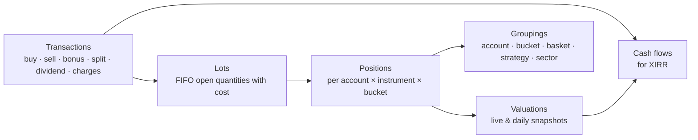

# 12 — Portfolio Monitoring

Add your broker accounts and monitor **every trade and holding**: when it was added, current value, return %,
XIRR, and totals — grouped by basket, account, strategy or sector.

## 1. Data sources

| Source | What it provides | When |
|--------|------------------|------|
| Dhan **holdings** API (`GET /v2/holdings`) | Current holdings (delivery): quantity, average cost, last traded price, ISIN — **no purchase date** (P2-01) | On the first import (saving the account's Portfolio settings), "Sync now" and, per account, the daily automatic refresh (§3); positions API later |
| Dhan **trade history** API (`GET /v2/trades/{from-date}/{to-date}/{page}`) | Every trade with date/time, price, quantity and side, read by path dates and page in windows of at most 30 days; **charges** = the sum of the six charge fields of the row and the **ISIN** are stored (the charges are used by the net returns, P2-14; not by lots, cost or the gross XIRR); the ticker is found through Dhan's `securityId` or the ISIN when `tradingSymbol` is missing; only `NSE_EQ` rows that are not intraday products are kept — **built in P2-13** ([ADR 0025](../adr/0025-dhan-trade-history-and-ledger-sync.md), §3 "Dhan sync (P2-13)") | One-time backfill from the first-import date, then daily at 16:30 IST on trading days (service `portfolio-broker-history`) and "Sync trades & ledger"; since P2-16 a failure that may pass is retried quietly, a renewed login catches up by itself and, when the trades do not explain a holding, one earlier year is read per day ([ADR 0027](../adr/0027-self-healing-sync-and-actionable-notifications.md), §3 "Self-healing and attention items (P2-16)") |
| Dhan **ledger** API (`GET /v2/ledger?from-date=…&to-date=…`) | Cash credits/debits (funds added/withdrawn, charges; a dividend entry is rare — Dhan credits dividends to the bank account, so the owner enters them, P2-14), each entry **classified** (`funds_in`, `funds_out`, `dividend`, `charges`, `other`) — **built in P2-13**; shown in the Cash & dividends panel. In the net returns (P2-14) only entries of class `charges` that name an **account-level** cost count (DP charges, AMC, delayed-payment / DPC interest, penalty, platform fee, pledge / payout / withdrawal charges, call & trade: `LedgerCosts.IsAccountLevel`); trade-related phrases (brokerage, STT, stamp duty, SEBI, transaction charges, settlements, bills) are never summed, because the trade rows already carry the trades' charges; a class `dividend` entry is only a **suggestion** the owner accepts or dismisses | Same run as the trades |
| **Dividends entered by the owner** | Dividends received, per holding or unallocated (an account without a holding) — **built in P2-14** ([ADR 0026](../adr/0026-dividends-entered-by-the-owner-and-charges-in-net-returns.md), §3 "Dividends, charges and net returns (P2-14)"); Dhan credits dividends to the bank account, and no API for its *Money → Dividends* list was found; the owner's dividend payout file (CSV) is recognised by its headers, its scrip names are matched to holdings and it is imported with Undo — **built in P2-15** ([ADR 0028](../adr/0028-dividend-csv-import-with-name-matching.md), §3 "Dividend import (P2-15)") | On demand |
| **CSV import** | Older trades (before API history / other brokers), contract-note or tradebook exports — **built in P2-03** ([ADR 0023](../adr/0023-trade-import-and-lot-reconstruction.md)): a generic CSV with auto-detected headers, a preview, an import with Undo, and a template (§3 "Trades and the rebuild of lots") | On demand |
| **Dhan's downloaded reports** | The **global transaction report** (bill-level trades with side and all charges), the **DP-charges sheets** (depository costs) and the **demat holding statement** (ISINs and the depository's quantities), as CSV, legacy `.xls` or `.xlsx`; recognised by their title and headers, previewed and imported with Undo; the profit-and-loss statements are recognised and not imported — **built in P2-17** ([ADR 0029](../adr/0029-dhan-report-imports-and-source-precedence.md), §3 "Dhan report imports (P2-17)"); Dhan's own trades take precedence over the report's bill rows | On demand (Import files) |
| **Manual entry** | Corrections, off-platform transactions — **built in P2-03**: one trade at a time, voided (never edited) when wrong | On demand |
| Corporate actions | Splits, bonuses, dividends | Nightly |
| Prices | Live quotes for open trades & holdings; EOD close for valuation ([doc 05](05-data-and-brokers.md) §5) | Market hours / EOD |

**History depth (decision Q5, amended by [ADR 0012](../adr/0012-holdings-acquisition-dates-and-returns-model.md)):** Dhan's holdings carry no purchase date, so the owner
sets the acquisition date of each holding when the first import happens, in the account's Portfolio settings (§3 "Where acquisition dates come from"). Lots are refined from a tradebook CSV or from trades typed in by hand (P2-03, **built**: §3 "Trades and the rebuild of lots"); from P2-13 also from Dhan's trade history and ledger, read nightly ([ADR 0025](../adr/0025-dhan-trade-history-and-ledger-sync.md), §3 "Dhan sync (P2-13)"). Since P2-16 the nightly read also reads **one earlier year per day** by itself (up to 8 years) while the trades do not explain a holding, and since P2-17 the owner's downloaded Dhan reports can fill history the API read does not reach (§3 "Self-healing and attention items (P2-16)", "Dhan report imports (P2-17)").

## 2. Domain model



- **Transaction** — immutable record (source: broker / CSV / manual; charges attached: counted in the net returns, not in the cost or the lots, P2-14). **Built in P2-03** for CSV and manual trades (`portfolio.transactions`, §9); the broker source (`source = broker`) is **built in P2-13** with the Dhan trade-history sync (§3).
- **Lot** — each buy creates a lot; sells consume lots **FIFO** (matches Indian practice) → realised P&L per lot.
- **Position** — open quantity, average cost as the broker reports it (charges are a separate line, not part of the cost: [ADR 0026](../adr/0026-dividends-entered-by-the-owner-and-charges-in-net-returns.md)), first-added date, linked plan ticket (if any).
- **Valuation** — market value at a time; a daily snapshot after close builds the portfolio value history.
- **Cash flow** — dated money in/out used for XIRR.

## 3. Metrics

### Per position / trade
| Metric | Definition |
|--------|------------|
| Added on | Date/time of first buy (and of each add) |
| Days held | Calendar days since first buy (or until exit) |
| Quantity, avg cost | Open quantity; average cost as the broker reports it — charges are **not** in it (a separate line, ADR 0026) |
| LTP, market value | Live or last close price × quantity |
| Unrealised P&L (₹, %) | Market value − remaining cost |
| Realised P&L (₹) | From FIFO-closed lots at the real (or last-seen) sale price, **before** charges (charges are a separate line) |
| Total return % (**built in P2-14**) | (Realised + unrealised + dividends) / **invested**, where invested is the cost of what is **still held** (open lots), as in the gross P&L %. Realised profit stays in the numerator, so for a partly sold position the figure can look high (the denominator does not grow with what was sold); it is not a return on all the money ever put in. Null when nothing is invested or the scope has no usable price. With no dividends and nothing realised it equals the gross P&L % |
| Day change (₹, %) | vs previous close (**built**, P2-06): ₹ = qty × (last − previous close), % = (last − previous close) / previous close; unavailable (never zero) when there is no previous close. **Known limitation:** `previous_close` comes only from quotes and a holdings sync never touches it, so on a day without a quote (the poll off, failed or outside its window) a sync moves the price while the previous close stays from an earlier session, and the day change then spans sessions; the row exposes `priceAt` and `priceSource` so the screen can say so |
| **XIRR** | Annualised return from dated cash flows (§4); **gross** (price only) |
| Dividends (**P2-14**) | Σ dividends the owner entered or imported from a file (P2-15) and did not void, in the scope; at account and total scope also the **unallocated** ones. "None entered yet" is not zero |
| Charges (**P2-14**) | Trade charges (Σ `charges` of the scope's non-voided transactions: Dhan, CSV and manual) + at account and total scope the ledger's account-level costs (`ledgerCharges`). Charges are a separate line, never in cost, lots or the gross figures |
| Net total return % (**P2-14**) | (Realised + unrealised + dividends − charges) / invested; with no dividends and no charges there is no net row at all |
| Net XIRR (**P2-14**) | XIRR of the lot flows plus dividends (money in) and charges (money out) on their dates (§4) |
| Coverage dates (**P2-14**) | `dividendsFrom`, `tradeChargesFrom`, `ledgerChargesFrom`, `chargesFrom` and `coverageFrom` say from which date each source is known, so a total is never read as "all there was" (§3 "Dividends, charges and net returns") |
| CAGR | For holdings > 1 year |
| Weight % | Share of portfolio (or bucket) value |
| System trade info | Strategy, cell, entry plan, R-multiple, stop/target distance (if from a plan ticket) |

### Where acquisition dates come from

XIRR, % return and absolute return need the **date and size of every cash flow**. Dhan's `GET /v2/holdings` gives quantity, **average cost price**, last traded price
and ISIN, but **no purchase date** (docs read 2026-10-11), so the dates are **set by the owner** ([ADR 0012](../adr/0012-holdings-acquisition-dates-and-returns-model.md),
[P2-01](../specs/P2-01-holdings-import-with-dates-and-auto-refresh.md)). This replaces the earlier idea (P1-16e) of deriving them from Dhan's trade and ledger APIs; [ADR 0025](../adr/0025-dhan-trade-history-and-ledger-sync.md) (P2-13) reinstates the trade API — as stored trades from which lots are rebuilt where that is safe, not as a replacement for the owner's dates.

**The first import is part of saving the account's Portfolio settings** ([ADR 0013](../adr/0013-portfolio-import-with-settings-and-daily-refresh.md),
[P2-01a](../specs/P2-01a-portfolio-import-on-save-and-daily-refresh.md)); there is no separate import endpoint or dialog. The settings carry a **first import date**
(`firstImportDate`, default **1 Jan 2025**, between 1990-01-01 and today India). When the account is connected, has the Portfolio role and has **no holdings** in the system,
*Save* (`PUT /api/accounts/{id}/portfolio`) stores the settings and then imports in the same request, **without any per-holding list on the settings screen**: Dhan is fetched
again inside one transaction, one holding with **one lot** (Dhan's quantity and average cost) is created for every holding Dhan lists, in the account's bucket (its own default
bucket or the custom bucket chosen in the settings), dated with the first import date and flagged `uses_default_date` (counted on the Portfolio screen until its date is edited
there). `firstImport.rows` = `[{key, acquiredOn?}]` is an optional API detail: a row's date overrides the default for its key. The run is recorded with the trigger `import`. The answer carries the result:
`import.status` `imported` (counts `imported`, `defaultDated`, `alreadyImported`, `unknown`), `skipped` (the account already has holdings: nothing is imported, Dhan is not called; `redated`/`redateSkipped` say how many lots followed a changed first import date),
`deferred` (not connected, or role off: nothing is called) or `failed` (the **settings are still saved**; `import.errorCode` `portfolio.import_failed`, `import.cause` the reason code
such as `portfolio.not_connected` or `portfolio.sync_running`; retry with Save again or Sync now). Invalid dates or rows are `400 accounts.invalid` (fields `firstImportDate`,
`firstImport.rows[i].key`, `firstImport.rows[i].acquiredOn`) and nothing is saved.
**An account that is not connected** keeps the stored first import date, and its **first sync** — manual or daily — performs the import: every holding
Dhan lists gets one lot dated with the first import date (flagged as default, editable per lot) and the run is recorded as `import`. After that nothing imports again: saving the settings
again imports nothing, and everything else arrives through the refresh below.
**The first import date stays editable** ([ADR 0015](../adr/0015-first-import-date-editable-and-no-bucket-ui-in-accounts.md), [P2-01b](../specs/P2-01b-editable-first-import-date-and-no-buckets-in-accounts.md)):
saving a **changed** date on an account that has holdings **re-dates, in the same unit of work, every lot with `source = import` and `uses_default_date = true`** to the new date (the lots stay flagged;
a closed lot whose `closed_on` is before the new date cannot take it and is skipped). Lots the owner dated by hand, lots found by refreshes and manual lots are never touched; returns and XIRR are computed on
read, so they follow. No Dhan call is made (`import.status` stays `skipped`); the answer's `import` carries `redated` and `redateSkipped` (lot counts, 0 when the date did not change or the account has no
holdings). The same date again changes nothing. The change is audited once (`FirstImportDateChanged`: old and new date and the counts, no per-lot data). Without holdings only the date is stored.

**Lots.** A holding has lots `(acquired_on, qty, unit_cost)`; a closed lot also has `closed_on`, `close_price` and `estimated`. A partial sale splits a lot into a
closed piece and an open remainder with the same date and cost, so every lot has one close price. The open quantities always add up to Dhan's quantity, and the
holding's quantity and average cost are always Dhan's after a sync. Any lot's date can be edited later (`PUT /api/holdings/{id}/lots/{lotId}`); figures are computed on
read, so they follow at once.

**Sync rules** ("Sync now" and the daily refresh run the same command, for an account that already has holdings; one transaction per account, idempotent):

| Dhan says | Result |
|-----------|--------|
| A holding the account does not have (or had closed) | New holding (or reopened) with one lot dated **today (India)**, unit cost = Dhan's average cost, source `added`, not flagged as default date |
| Quantity increased by Δ | A lot dated today for Δ at the **implied cost** `max(0, (newQty × newAvg − oldQty × oldAvg) / Δ)`; when that is not positive, the last price (then the new average) |
| Quantity decreased by Δ | Lots closed **oldest first (FIFO)** for Δ at the **last price**, marked `estimated` |
| Holding missing | Same, for the whole quantity; the holding becomes `closed` (kept, with its realised result) |
| Same quantity | Last price, price time and Dhan's average cost only |

A run that fails leaves every holding untouched and is recorded (`portfolio.holding_syncs`: manual / auto / import, status, counts, a short safe error). One run per
account at a time (advisory lock plus a unique "running" row; `409 portfolio.sync_running`); a run left running by a crashed process is ended when the API starts.
**Safeguard against a false "Dhan lists nothing".** An empty answer (a `200 []` or Dhan's documented `DH-907` "no data") or a broken one can look like a sale of everything, and closing every
holding then reopening it dated today would destroy the owner's acquisition dates. So a sync whose answer would close **all open holdings (empty answer) or more than half of them with at
least 3** (exactly half does not count; fewer than 3 never counts unless the answer is empty) changes nothing unless confirmed:
- a **manual** sync answers `409 portfolio.confirmation_required` with the numbers `listedHoldings`, `openHoldings` and `wouldClose` and a message such as "Dhan listed 0 holdings while 3 are open in
  xDrishti" or "Dhan listed 2 holdings but 4 of your 6 open holdings are missing"; the UI shows them and repeats the request with `{"confirm": true, "expectedOpenHoldings": 6, "expectedWouldClose": 4}`
  (both numbers are required with `confirm`; `400 portfolio.invalid` otherwise), which applies the closes by the rules above;
- if Dhan's answer has changed since (the numbers differ), nothing is applied and the answer is `409 portfolio.confirmation_stale` with the fresh numbers;
- an **automatic** run never confirms — it is recorded as `skipped` with the same reason text ("… — nothing was changed; press Sync now to confirm."), visible as `last` in the sync status, with at
  most one skipped record per account and India day (the latest check replaces the earlier one).

**Records are kept 90 days.** After an automatic run, finished `holding_syncs` rows older than 90 days that did not fail are deleted (at most 500 at a time); failed runs stay.

A token Dhan refuses is `409 portfolio.not_connected` ("sign in to Dhan again"); Dhan being unreachable is `502 accounts.broker_error`. Sells between two syncs are
estimated at the last price of the sync that noticed them; a possible corporate action (split, bonus) shows up as a quantity change.

**Mapping to the instrument master.** By ISIN first (shares and ETFs, series EQ preferred), then by Dhan's security id within the NSE equity segment. Holdings that
cannot be mapped (for example BSE only) are kept, flagged "not in master list" (`mapped = false`), and still get returns from Dhan's price.

**Automatic refresh (per account, off by default, [ADR 0013](../adr/0013-portfolio-import-with-settings-and-daily-refresh.md)).** Portfolio settings: `refreshMode` `off` | `daily`
(the interval mode no longer exists; existing interval settings were switched off by the migration) and `refreshDailyTimeIst` `HH:mm` (default 16:00, after the close). A hosted service
in `xd-api` looks once a minute at every Portfolio-role account whose refresh is on and runs the same sync:

- **daily**: once a day from the configured India time on, weekends included; if the time was missed (the application was down) it runs as soon as possible the same day; a failed or
  skipped automatic attempt counts as that day's run, a manual run does not (the first automatic run of an account without holdings is recorded as `import` and counts too);
- an account that is **not connected** (no token, expired) is not called: one `skipped` record per India day;
- runs never overlap (accounts one after the other, one running row per account); "Sync now" works at any time; the whole mechanism is switched off with
  `Portfolio:AutoRefresh:Enabled = false` ([doc 16](16-configuration.md)). `GET /api/accounts/{id}/holdings/sync-status` returns `refreshMode`, `refreshDailyTimeIst`, `firstImportDate`, `hasHoldings`, the next scheduled run, `running` and the last run.

**Gross and net (P2-14, [ADR 0026](../adr/0026-dividends-entered-by-the-owner-and-charges-in-net-returns.md)).** The **gross** figures — P&L, P&L %, XIRR, the value history, the benchmark and alpha — are price returns: they do not include dividends or charges, and the UI says so. Next to them the **net** figures include the dividends the owner entered and the charges paid (the charges of the stored trades, and at account and total scope the ledger's account-level costs), each counted only from the date its source is known (§3 "Dividends, charges and net returns (P2-14)"). Not in any figure: taxes (including TDS on dividends), dividend reinvestment and corporate actions. The rest of the Dhan ledger (funds in and out, anything unrecognised) is shown in the Cash & dividends panel and nowhere counted (§3 "Dhan sync (P2-13)").

### Trades and the rebuild of lots (P2-03, [ADR 0023](../adr/0023-trade-import-and-lot-reconstruction.md))

A broker **tradebook (CSV)**, trades **typed in by hand** or (P2-13) trades **read from Dhan** are stored as **transactions**. For CSV and manual trades a holding's lots are rebuilt from the real buy and sell dates on an explicit and previewed step; the Dhan sync rebuilds automatically where that is safe (below), so the previewed step is no longer the only path. Either way
XIRR, returns, the value history and the benchmark use true dates and real sale prices (a sale closes a lot at its **real** price, `estimated = false`). The broker stays authoritative for
the quantity and the total cost of a holding: trades can only *explain* a holding, never change what Dhan says is held.

**Transactions.** `portfolio.transactions`: account, instrument (when mapped), ISIN, symbol, exchange, `side` buy/sell, India `trade_date` and optional `trade_time`, `qty` (whole shares, `bigint`),
`price` (`numeric(18,6)` since P2-17, so a bill-level price keeps its value to the paisa), `charges` (one total: counted in the **net** returns since P2-14, as a separate line — **not** in the cost, the lots or the gross figures), `source` csv/manual/broker/bill (broker since P2-13, with a nullable `run_id`; `bill` since P2-17: a bill-level row of an imported Dhan report, which the broker's own trades replace — a voided row may carry `superseded_by`, §3 "Dhan report imports (P2-17)"), `batch_id`, `seq` (the line of the file, 0 for a manual trade), `external_id`, who/when and
`voided_at/by`. A transaction is immutable except for being **voided** — the runtime role has no DELETE. `external_id` is the trade's identity and is **unique per account among the trades that are
not voided** (a partial unique index), so a voided trade (or an undone file) can be imported again: the trade id of the file together with the trade date (`t:yyyyMMdd:` + id — exchanges number trades per day, so the same id on two days is two trades) when it has such a column, else a hash of
(account, date, time, symbol or ISIN, side, quantity, price, order id, how many identical lines came before in the file) (`h:` + 32 hex), so two genuine identical trades are both kept and the same file
read again adds nothing; a manual trade has a random identity (`m:`) and is never deduplicated. **Import batches** (`portfolio.trade_batches`): file name, SHA-256 (the file itself is never stored),
counts (parsed, imported, duplicates, skipped, bad), status imported/undone, who/when; a file that adds nothing new makes no batch. Neither table is ever deleted.

**The file (generic, auto-detected, UTF-8 with or without BOM, comma separated, at most 10 MB and 20,000 data rows).** Headers match without regard to case or punctuation. Required: a date, a symbol or an
ISIN, a side, a quantity, a price (a missing one refuses the file with `400 portfolio.invalid` on field `file`, naming what is missing and the accepted names). Accepted names, among others — date:
`date`, `trade date`, `transaction date`, `order execution time`; symbol: `symbol`, `trading symbol`, `scrip`, `instrument`, `security`, `stock name`; `isin`; side: `trade type`, `side`, `buy/sell`,
`transaction type`; quantity: `quantity`, `qty`, `traded quantity`; price: `price`, `trade price`, `rate`, `avg price`; optional: `exchange`, `trade id`/`trade no` (the identity), `order id` (only part of the
line hash), `time`, `segment`/`instrument type` (to skip non-equity rows), charges. Unknown columns are ignored. Dates: `yyyy-MM-dd`, `dd-MM-yyyy`, `dd/MM/yyyy`, `dd-MMM-yyyy` — day first,
**never** `MM/dd` (13/25/2024 is a bad row) — optionally followed by an India time; a date in the future is a bad row. Numbers take `.` for decimals and `,` only to group thousands (`1,234.50`,
`12,34,567`). Side: buy/sell/b/s/purchase/sale. Symbols are upper-cased and trimmed; `NSE:` and `-EQ` are stripped. Quantity must be a **whole** number above 0, price above 0. **Charges:** a
`total charges`/`charges` column is used as it is, otherwise the component columns (brokerage, STT, stamp duty, GST, taxes, …) are summed, never both. Rows for derivatives, commodity or currency segments
(by the segment/instrument-type/exchange column, or by the shape of the symbol: expiry, strike, `FUT`, `CE`, `PE`) and **BSE** rows are **skipped with a reason** (counts per reason); a bad row (line, reason —
at most 200 listed, all counted) is never imported; a trade id that repeats on the same day with identical details is counted as a duplicate, with different details it is a bad row. A cell longer than 64 characters in a date, time, number or ISIN column makes the row bad (no pattern ever looks at a huge cell). `GET /api/portfolio/trades/template`
downloads a CSV with the canonical headers and two example rows (`Date,Symbol,ISIN,Side,Quantity,Price,Exchange,Trade ID,Time,Charges`).

**Which holding a trade belongs to.** Among the account's **open** holdings: by ISIN; when no holding has the trade's ISIN (or the trade has none), by symbol — but a symbol never joins two different ISINs.
More than one candidate is `ambiguous` (not applied). A security that matches no holding is *not held*: its trades are stored and listed ("12 trades for 4 securities not held"), not applied; if it matches
neither a holding nor an NSE share/ETF of the instrument master it is also counted as *unmatched*. Closed positions are not created from trades.

**Reconstruction** (pure, deterministic, idempotent; `LotReconstructor`). For a holding with the broker's quantity `Q` and average cost `A`, from its non-voided trades:
1. Each trade is converted to **today's share basis** with the instrument's **applied** corporate actions whose ex-date is *after* the trade date (a trade on the ex-date or later is already on the new basis),
   in the direction of the bar adjustment (`AdjustmentFactors`: bars before the ex-date are multiplied by the action's factor): **price × factor, quantity ÷ factor**, cumulative over the actions in
   ex-date order (a 1:5 split has factor 0.2: 10 shares at 1,000 become 50 at 200; a 1:1 bonus has factor 0.5; a split and a bonus multiply). The quantity is computed exactly from the ratio and must come
   out whole (`quantity_mismatch`, reason `fractional_after_adjustment`, otherwise — 3 shares before a 1:2 bonus are 4.5). Suggested and ignored actions are not used. The result says `adjustedFor: n`.
2. `net` = bought − sold; the **opening quantity** `P0 = Q − net`. `P0 < 0`: the trades explain more shares than Dhan holds → `quantity_mismatch` (`negative_opening`), nothing applied.
3. Trades are walked in order: date; on one day **buys before sells**, then time, then the order stored (file order). An **opening lot** of `P0` exists from the start, dated the account's first import
   date or the day before the first trade when that is earlier, `source = import`, flagged **default date** (editable). Each buy opens a lot (`source = trade`, not default; cost = price on today's basis). Each
   sell closes open lots **first in first out — the opening lot first** — into pieces closed on the sale day at the real sale price; a partial sale splits a lot (closed piece + open rest with the same date
   and cost). A sale larger than everything open at that point is a `quantity_mismatch` (`sell_exceeds_open`).
4. The opening lot's unit cost follows from `A`, which Indian brokers keep by the **weighted-average-cost method** (a sale does not change it): `c0 = (A × (P0 + B) − BC) ÷ P0`, with `B` the shares and `BC` the cost of all the buys of the
   file on today's basis, rounded to 4 decimals. It holds whether or not sales used the opening lot up, and the pieces sold from the opening lot cost `c0` too (consistent realised profit). When `c0` is not above 0 the opening lot
   costs `A` and the rebuild says `costNote: opening_cost_fallback`; with `P0 = 0` there is no opening lot. **Invariants:** the open lot quantities add up to `Q`; with no sales in the file and an opening lot, invested = `Q × A` to within
   0.0001 × the opening quantity + 0.01; with sales the first-in first-out cost basis can differ from the broker's average-cost figure by nature (first-in first-out against the average-cost method; without an opening lot the real buy
   costs stand), so the rebuild block carries `openCostAfter`, `brokerCost` and `costDelta` and the screen says "cost basis differs from broker by ₹x" (they are part of the digest).
5. Without trades the result is one lot of `Q` at `A` dated the first import date, flagged default: the state before any import.

**The flow.** *Preview* (`POST /api/portfolio/trades/preview`, multipart `accountId` + `file`) is read-only and returns the file (rows, parsed, skipped by reason, bad rows, duplicates, already imported, new),
each security of the file (symbol, ISIN, matched, holdingId, trade counts and dates, and the **rebuild**: status `ok` | `unchanged` | `quantity_mismatch` | `no_holding` | `ambiguous`, lots before → after, hand-dated
and sync-added lots that would be replaced, realised profit on the real sales, `adjustedFor`, `q`, `net`, opening quantity before → after, a per-holding digest), `notHeld` / `unmatched` counts and an overall
`digest`; the list holds every held or master-listed security and at most 200 unmatched ones (`securitiesTotal`, `unmatchedListed` count them; the digest covers all). *Import* (`POST /api/portfolio/trades/import`, same body plus `rebuild` default true and `digest`) stores the new trades as one batch and, with `rebuild`, replaces the lots of every holding whose
result is `ok` — **all lots of the holding** (hand-dated and sync-added ones too, which is why the preview counts them), deleted and re-inserted in the one unit of work of the whole import, the holding's
`xmin` token guarding a concurrent sync or quote (the work then runs again once). **With `rebuild` the request must carry the preview's `digest`**: if holdings, lots, applied corporate actions or trades
changed since, the answer is `409 portfolio.preview_stale` (extension `report`: the fresh preview) and nothing is applied. `409 portfolio.sync_running` while a run that this write would race is running (`SyncGuard`, `Application/Portfolio/SyncGuard.cs`, **kind-aware since P2-18**, [ADR 0030](../adr/0030-read-only-notices-retention-and-structured-failures.md)): a write waits only for the runs that change what it reads and writes (`SyncWaits`, `Application/Portfolio/SyncWaits.cs`). **Trade import (also a Dhan report's bills), Undo of a trade batch and Rebuild of lots** (not their dry runs and previews) wait for the account's **holdings sync and trades runs**; the **DP-charges import** waits for **holdings and ledger runs**; the **demat import** waits for none (it only learns names). So a ledger-only run does not block a trade Undo or Rebuild, and a trades run does. The message says the wait "can take a few minutes - try again then". **Consequence for the owner:** a long backfill (a run is held to be stale only after 30 minutes) blocks the writes that wait for its kind until it ends; a run that hung is released only by the recovery when the API starts or by the next sync (the guard does not look at the age of the run), so the owner waits or restarts.
*Undo* (`POST /api/portfolio/trade-batches/{id}/undo?dryRun=true|false`, default false) voids the batch's trades and rebuilds from the remaining trades the affected holdings **whose lots came from trades** (a holding imported without a
rebuild keeps its lots); undoing twice is a no-op. **Undo derives, it does not snapshot:** it cannot bring back hand-dated or sync-added lots that an earlier rebuild replaced — the holding returns to one default-dated lot of `Q` at `A`
(dated by the first import date) or to the shape of the remaining trades; the dry run returns the same result without changing anything (`handDatedLotsReplaced`, `syncLotsReplaced`, `notRebuilt[{symbol, holdingId, reason}]` for holdings that could
not be rebuilt — a mismatch or ambiguous — and keep their lots). *Void* (`POST /api/portfolio/trades/{id}/void`) and *add* (`POST /api/portfolio/trades`: holding or security, side, date, quantity, price, charges;
validated like a CSV row; the security must be a holding or an NSE share/ETF of the master) change no lots; the owner then rebuilds one holding with `POST /api/holdings/{id}/rebuild-lots?dryRun=true|false`
(dry run by default; the same `rebuild` block). `GET /api/holdings/{id}/trades` lists a holding's trades (voided ones flagged), `GET /api/portfolio/trade-batches` the import history. History, benchmark, groups and
actions caches are dropped by every one of these (the unit of work); the Action center and the notices reconcile on the next tick/read as usual. Audit events record **counts only** (`TradesImported`,
`TradesUndone`, `TradeAdded`, `TradeVoided`, `LotsRebuilt`; since P2-14 also `DividendAdded`, `DividendVoided`, `DividendSuggestionAccepted`, `DividendSuggestionDismissed`, whose text carries ids only, never an amount or a note; since P2-15 also `DividendsImported`, `DividendsUndone`, `DividendAliasSaved`, §3 "Dividend import (P2-15)").

**Lots after a rebuild.** Lots made from buys have `source = trade`, are not flagged default and their dates are read-only (`PUT /api/holdings/{id}/lots/{lotId}` → `409 portfolio.lot_from_trade`); the
**opening lot** stays editable but its date must be before the earliest trade (`400 portfolio.invalid`, field `acquiredOn`); lots a later sync adds are like any other. The first-import-date re-dating
(ADR 0015) **skips holdings that have trade lots** (counted as skipped). A later sync that changes the quantity keeps its behaviour; the next rebuild recomputes `P0 = Q − net`, and its preview shows the
opening quantity before → after, so a change the trades do not explain is visible.

#### Dhan sync (P2-13, [ADR 0025](../adr/0025-dhan-trade-history-and-ledger-sync.md))

The account's trades and ledger are read from Dhan (read-only, header `access-token`; the shapes and limits are in [doc 05](05-data-and-brokers.md) §8.3) so the owner no longer exports a tradebook or types cash movements. Field names come from Dhan's public documentation and its published samples (read 2026-10-14; [ADR 0025](../adr/0025-dhan-trade-history-and-ledger-sync.md) amendment g), not from a real answer of the owner's account (the first real read may force small mapping changes).

- **Windows and watermark.** A run reads the dates from `from` to today (India) in windows of at most **30 days** (a constant, tuned later), oldest first. `from` is the request's `from`, else the account's **watermark** (per account and kind, `trades` | `ledger`: the last date a whole window was stored), else the account's first import date. Trades are read page by page (pages from 0) until the first empty page or 200 pages; the ledger is one call per window. Each window is stored in **one unit of work** together with the run's progress and the watermark move, so a failure part-way leaves the watermark where the last whole window put it and the next run reads the failed window again (the identities make that harmless).
- **A `from` that would leave a gap is refused.** For both kinds a `from` later than the watermark + 1 is `400 portfolio.invalid` (field `from`): it would leave dates that are never read. An earlier `from` is allowed and re-reads (nothing new is stored for what is already there). The check uses the **older** of the two watermarks: a `from` later than the day after it is refused. When exactly one kind was never read, `from` may not be later than the account's first-import date (the other kind's watermark + 1 if that is earlier); an account where neither kind was read may start at any date, and what is older than the first trade read is then the opening lot, as with a tradebook that starts late. Behind this check the pipeline keeps a **defensive guard**: a run whose start would leave a hole after the watermark does not rebuild lots (it cannot happen through the use cases, which refuse such a start first).
- **Windows Dhan refuses or answers "no data" for.** Dhan documents no maximum span and no history depth for either endpoint (an earlier `from` is accepted, floor 1990-01-02; far-back reads mean many 30-day windows). DH-905 ("input exception"; how a too-wide range is expected to be refused, unverified) or 200 pages without an empty one: the window is **halved once** and each half is read; if a half is too large too, the run ends `failed` with the "history too large" text and nothing of the window is stored. **DH-907** ("incorrect parameters or no data") ends the paging as an empty result only for **page ≥ 1**; on **page 0 of a window longer than one day** it is *unclear* (no data, or a bad range): the window is halved once and the halves are used, and a half that also answers DH-907 on page 0 is taken as empty and counted (`emptyByNoData` in the run's counts). On a one-day window DH-907 is an empty result (counted). **The ledger** has no paging (one call per window) and follows the same rule: a multi-day window answering DH-907 is halved once, and a half or a one-day window answering it is empty and counted. The sync line says "Dhan answered \"no data\" for N date ranges" only when more ranges answered no data than windows were read, i.e. windows were halved and still empty. A refused token (401), a rate limit (429), a 5xx or a timeout fail the run and are never read as "no data".
- **What is kept.** Every `NSE_EQ` row whose product is **not** an intraday product becomes a transaction (`source = broker`, `run_id` = the run): delivery (`CNC`, `MTF`), `MARGIN` (on `NSE_EQ` only a position carried overnight; skipping it would cause quantity mismatches) and a row with no product. Other segments (BSE, derivatives, currency, commodity, other) and **intraday products** (`INTRADAY`, `INTRA`, `MIS`, `CO`, `BO`) are skipped and counted per reason (`bse`, `derivatives`, `currency`, `commodity`, `non_equity`, `intraday`: they net out within the day or are not holdings; `no_symbol`: the security could not be told). A row without an id, side, whole positive quantity, positive price or readable date is dropped and counted. **Security.** `tradingSymbol` can be `null` in Dhan's rows (`customSymbol` is a company name, never used as a ticker): the ticker is found through Dhan's `securityId` (`market.instrument_broker_ids`, `dhan`, `NSE_EQ`), else through the ISIN; a row no instrument matches but that has an ISIN is stored **ISIN-only** (like a tradebook CSV line with an ISIN and no symbol) and matched to its holding by ISIN; a row with none of ticker, resolvable id and ISIN is not stored and counted as skip reason `no_symbol`. **Charges and ISIN.** `charges` is the sum of the row's six charge fields (`sebiTax`, `stt`, `brokerageCharges`, `serviceTax`, `exchangeTransactionCharges`, `stampDuty`; rupees, 4 decimals, strings and `"NA"` tolerated) and the ISIN is stored, both on the transaction; the charges are used by the net returns (P2-14) and by nothing else — not by lots, cost or the gross XIRR.
- **Identity and duplicates.** A trade's identity is `t:yyyyMMdd:` + Dhan's exchange trade id, the **same** the CSV reader gives a tradebook's trade-id column, so a trade already imported from a Dhan tradebook is a duplicate and reading the same days twice stores nothing new. Documented limits: a tradebook CSV row **without a trade id** has the hash identity (`h:`), and the same Dhan trade (`t:`) is then stored a second time; and a **voided** broker trade is stored again when its day is read again (its identity is free, as for CSV; the UI help says so).
- **Completing trades stored earlier (enrich step, P2-14).** P2-13 first stored `charges = 0` and no ISIN for broker trades and dropped rows without a `tradingSymbol`, so trades stored by an earlier read can lack an ISIN, a ticker or charges. When a window is read, the rows of it that are stored already are matched to the account's non-voided **broker** transactions that still lack one of these, and `Transaction.EnrichFromBroker` fills in only what is missing: the ISIN when empty, the ticker when empty, the charges when 0 and the read has some. It never touches the identity, side, date, quantity or price and never overwrites a value that is there; CSV and manual trades and voided trades are left alone. The completed trades are counted as `enriched` (a part of `duplicates`) in the run's counts and in the counts-only `BrokerHistorySynced` text, saved in the window's unit of work, and a run that enriched trades re-works the lots like one that stored trades (a trade that gained an ISIN can now be attached to its holding). The nightly read starts at the watermark, so the owner completes older trades once by reading again from the first-import date or earlier (*Read from an earlier date*); a second read finds nothing left to complete.
- **Runs.** `portfolio.broker_sync_runs`: one row per kind per run (`trigger` manual | scheduled | first, `from_date`, `to_date`, status running | succeeded | failed | skipped, `counts`, error). Counts: `windowsDone`, `windowsTotal`, `halved`, `emptyByNoData`, `read`, `stored`, `duplicates`, `enriched`, `dropped`, `droppedByReason`, `droppedRows`, `skipped` and `skippedByReason`, `rereadVersion` and `rereadDone` (which windows were read again after a mapper update: dates only, see "Windows that dropped rows are read again" below), and for trades `rebuilt`, `unchanged`, `needsReview`, `notRebuilt[{symbol, reason}]` (at most 50 listed). **Every exit of a run completes it:** a failure, a crash or a cancellation ends the row as `failed` with a plain, safe error and the counts so far (never Dhan's text, the URL or the token); a run left running by a stopped process counts as interrupted after 30 minutes. A scheduled run that is not attempted because the token has expired is recorded as `skipped` (`token_expired`). The status figures `holdingsRebuilt`, `holdingsNeedingReview` and `needsReviewSymbols` (at most 50 tickers) come from **the latest succeeded trades run and no other** — nothing is carried forward: a quiet night whose rebuild was skipped shows 0 rebuilt, and a skipped, failed or running run neither changes nor erases them. Runs never overlap with each other or with a holdings sync of the same account (one running row per account; `409 portfolio.sync_running`).
- **Trades first, then the ledger.** The ledger run starts only when the trades run succeeded. Both are started by `POST /api/accounts/{id}/sync/broker-history` (optional `{from}`; answers at once with the trades run, a first backfill takes minutes) and followed by `GET /api/accounts/{id}/sync/broker-history/status` (watermarks, latest runs, `windowsDone / windowsTotal`, next scheduled run, `holdingsRebuilt`, `holdingsNeedingReview`, `needsReviewSymbols`). Audit: `BrokerHistorySynced`, counts only; a scheduled run that stored nothing and changed no lots leaves no event.
- **Dropped rows are explained (ISS-03, [roadmap](18-roadmap.md) "Open issues log").** A row is *dropped* when it cannot be used at all and *skipped* when it is not wanted (another segment, intraday, `no_symbol`: a trade whose security cannot be told stays a skip). Every dropped row of a trades or ledger read carries a **reason code** from a closed set, the first problem in this order: `unreadable_row` (not a JSON object), `missing_id` (no trade id), `bad_id` (longer than the store keeps), `missing_side`, `bad_quantity` (missing, not a number, zero or negative, not whole, absurd), `bad_price`, `bad_time` (no exchange, create or update time that reads as a date) for trades; `bad_date`, `missing_amount` (neither debit nor credit), `bad_amount`, `zero_amount` (debit and credit cancel out, typically an opening-balance line) for the ledger; and two that come after the mapping: `failed_checks` (a trade that was read but breaks a rule of the store: a date before 2000 or in the future, a quantity, price or charges the store does not accept) and `store_refused` (the database refused the row even when saved on its own and nobody else had stored it); `other` counts a drop no branch named, so the reasons always add up to `dropped`. The run counts gain **`droppedByReason`** (rows per code, summed over pages, halves and windows) and **`droppedRows`**: the place of the **first five** dropped rows of the run - the dates of the request that returned the row (the half that was asked after a split), the page (0 for the ledger) and the zero-based row index in that answer - with the reason code, so the owner can look the row up in Dhan's own statement. **Counts and places only: never a name, symbol, amount, id or narration.** A run recorded before the reasons existed has both empty. The status of each kind (`BrokerKindStatus` of `GET …/sync/broker-history/status`) carries **`droppedByReason` and `droppedRows` of the latest run** of that kind (the same figures as `lastRun.counts`; empty when it dropped none, when there is no run, or it ran before the reasons). The audit entry and the log line of a finished run say "N dropped (reason×count, …)", the biggest reason first, instead of "N unusable". The Portfolio sync line shows it in plain words (doc 13). Since P2-18 a read whose drops are not only zero amounts also raises the bell item `rows_dropped` ("Self-healing and attention items" below).
- **Automatic lot rebuild (owner's decision, no preview).** After the last window of a trades run, every open holding that has broker trades is worked out by the same pure `LotReconstructor` as the owner's rebuild and applied **only when its result is `ok`**; `unchanged` is counted, `quantity_mismatch`, `ambiguous` and `no_holding` are left alone and counted. A holding with a **hand-dated** lot (an owner edit) is not rebuilt: it is `needs_review` and the owner uses the holding's Trades section (preview, then rebuild). Each holding is rebuilt in its own unit of work that is **not retried**: if the holding changed meanwhile (`xmin`: a sync, a quote or the owner's lot-date edit saved it — `UpdateLotDate` marks the holding as changed for this purpose) that rebuild is skipped as `changed_meanwhile` and the next run retries; the owner's edit is repeated once on what is stored, and a second concurrency conflict answers `409 portfolio.conflict`. Each rebuild writes `LotsRebuilt` with `trigger = broker_sync` (counts only) and the caches are dropped by the unit of work. The rebuild is skipped when the run did not read every window, when its start would leave a hole after the watermark (a defensive guard behind the start check above), and when the run **stored nothing, the previous finished trades run succeeded with nothing left to retry (nothing other than `no_holding`) and no holding of the account appeared, was reopened or gained a lot after that run ended** (`IHoldingStore.AnyAppearedSinceAsync`, read from the holdings themselves, not from the previous run's counts). A run after a failed run always rebuilds.
- **Ledger.** `portfolio.ledger_entries` (immutable): voucher date, number, description, narration (Dhan's free text: capped at 500 characters, shown as plain text), exchange, one **signed amount** (credit − debit), running balance and a **class** from a pure, table-driven classifier over description and narration, in this order: `dividend` (credits), `charges` (debits: brokerage, DP/AMC, stamp duty, GST, STT, payout and withdrawal charges, penalties …), `funds_out` (debits: withdrawal, payout), `funds_in` (credits: deposit, pay-in, UPI, NEFT …); anything else, and any entry whose sign contradicts the phrase, is `other` and keeps its raw text. The phrases come from Dhan's documentation and published sample (`PAYBNK` and `FUNDS WITHDRAWAL` are `funds_out`; `FUNDS ADDED` and `PAYIN` `funds_in`; `DPC Interest` `charges`) and are expected to grow after the first real read. Dhan's published ledger sample is a single object, not a list: an answer of one object (or one under `data`) is read as one row. **Dividends:** Dhan credits them to the bank account, not to the trading ledger, so a `dividend` entry is rare (e.g. rented stocks); the owner enters dividends from P2-14 ([ADR 0026](../adr/0026-dividends-entered-by-the-owner-and-charges-in-net-returns.md)). An entry's identity is a hash of (account, voucher date, voucher number, description, signed amount, occurrence index within the same date and voucher). **In the net returns (P2-14)** the class decides little: an entry of class `charges` counts only when it names an **account-level** cost — a depository (DP) or demat charge, annual maintenance (AMC), delayed-payment interest (`DPC Interest`), a penalty or late-payment charge, a platform or subscription fee, a pledge, unpledge, payout or withdrawal charge, a call & trade fee (`LedgerCosts.IsAccountLevel`, a table of phrases that is expected to grow after the first real read) — and none of the trade-related phrases (brokerage, STT, stamp duty, SEBI, transaction charges, turnover, settlement, bill, contract note), which are never summed because the trade rows already carry the costs of trades (a doubt leaves a cost out, where it stays visible, instead of counting it twice). The class shown for the entry is not changed. A `dividend` entry is only a suggestion (below); dividends are not matched to holdings by narration. Since P2-17 an entry has a `source`: `broker` (read from Dhan's ledger, with its run) or `import` (a cost made from a depository-charges sheet, with its batch, ISIN and quantity; Undo voids it and it then leaves the lists and the net figures); the identity is unique per account among the entries that are not voided (below, "Dhan report imports (P2-17)").
- **Service.** `portfolio-broker-history` ("Portfolio trades & ledger", [ADR 0018](../adr/0018-services-framework-and-editable-schedules.md)): daily at 16:30 IST on trading days, editable on the Services screen, one account after the other (connected Dhan accounts with the Portfolio role); an expired token is reported as `token_expired` (the run fails so the owner is told; the other accounts are still read). `Portfolio:BrokerHistory:Enabled` seeds it on first start ([doc 16](16-configuration.md)). "Sync trades & ledger" works at any time.
- **Cash & dividends.** `GET /api/accounts/{id}/ledger?from&to&class&page&pageSize` lists entries newest first with `totals` (count and signed amount of every class for the period, whatever class is filtered). Read-only; the answer's `coverageFrom` is the earliest ledger date stored for the account, whatever the filters. Shown in a drawer on the Portfolio screen ([doc 13](13-reports-and-ui.md) §4). **P2-14 decided:** the ledger's account-level costs count in the net returns from `coverageFrom` on (above); its funds, dividend and other entries are shown only, and neither the gross figures nor the value history use any of it.

**Not built:** cash flows (deposits and withdrawals) in XIRR, charges in the cost basis, dividends read from Dhan (Dhan credits them to the bank account, not to the trading ledger; entering them is P2-14, importing the owner's dividend payout file is P2-15), matching a ledger dividend to a holding by its narration, TDS on dividends, dividend reinvestment, a total-return index benchmark, broker-specific CSV profiles (the generic format and the template come first),
editing a trade (void and add again), positions and intraday P&L, creating closed holdings from trades, tax reports. The limits (10 MB, 20,000 rows, 200 listed bad rows) are fixed, not configuration.

#### Dividends, charges and net returns (P2-14, [ADR 0026](../adr/0026-dividends-entered-by-the-owner-and-charges-in-net-returns.md))

The gross figures stay as they are; next to them the screen shows what the portfolio received and paid and the **net** return that includes it. Pure calculators in `Application/Portfolio/Income` (`IncomeBook`, `IncomeCalculator`, `LedgerCosts`, `IncomeViews`); the reads are `IIncomeQueries`.

- **Dividends are entered by the owner** ([P2-14](../specs/P2-14-dividends-and-charges-in-returns.md): Dhan credits them to the bank account, and no API for the app's *Money → Dividends* list was found; since P2-15 a dividend payout file can be imported as well, below). `portfolio.dividends` (§9) is immutable except for being voided. `POST /api/portfolio/dividends` takes `{holdingId}` (the account is then the holding's) or `{accountId}` alone (**unallocated**: no holding, e.g. a holding long since sold and removed), `payDate` (1990-01-02 to today, India), `amount` (rupees, above 0, to the paisa), optional `perShare` (above 0) and `note` (plain text, at most 200 characters), and `confirm`. The same account, holding, date and amount as a dividend that is not voided is allowed (two genuine payments) but asks first: `409 portfolio.possible_duplicate`, repeated with `confirm: true`. `POST /api/portfolio/dividends/{id}/void` (a mistake is voided and entered again, never edited; voiding twice is a no-op), `GET /api/holdings/{id}/dividends` and `GET /api/accounts/{id}/dividends` (newest pay date first, voided ones included and flagged, `page`, `pageSize` up to 200). `404 portfolio.not_found`, `409 portfolio.role_off`, `400 portfolio.invalid` with field errors. Session and CSRF token, no step-up (no secret is involved). Audit: `DividendAdded`, `DividendVoided` with the id only.
- **Suggestions.** `GET /api/accounts/{id}/dividends/suggestions` lists the account's ledger entries of class `dividend` with money in that the owner has not decided; `POST …/suggestions/{entryId}/accept` (optional `{holdingId, note}`: one of the account's holdings, or none) creates a dividend with the entry's amount and date and links it; `POST …/suggestions/{entryId}/dismiss` hides it. Both decisions are final (voiding the dividend later does not bring the suggestion back; `409 portfolio.conflict` when decided meanwhile). Nothing is added without the owner and no narration is matched. Dhan's documented ledger has no ordinary dividend entry, so the list is usually empty. Audit: `DividendSuggestionAccepted`, `DividendSuggestionDismissed`, ids only.
- **Where each rupee belongs (`IncomeBook`).** A dividend belongs to the holding it was entered for, else to its account. The charges of trades are summed per account, security and day and belong to the holding of the same account that the security resolves to by the rule trades use (§3 "Which holding a trade belongs to"): by ISIN, else by symbol when either side has no ISIN (an ISIN never joins two different ISINs), among the account's **open** holdings; when more than one open holding fits (an NSE and a BSE row of one ISIN) the trade is ambiguous and attached to none; only when no open holding fits are the account's **closed** holdings tried by the same rule (a holding sold out keeps the charges of its trades); a trade that fits no single holding belongs to the account. The ledger's entries belong to the account, and only the account-level costs of `LedgerCosts` count (above). So every recorded rupee is in exactly one place and the places add up to the total.
- **Figures (`IncomeCalculator`).** For a scope: `dividends` and `charges` are the sums of what its holdings hold plus, for the accounts whose own items belong to it, the account's unallocated dividends, the trade charges of no holding and the ledger's costs; `ledgerCharges` is the ledger part of `charges` and `unallocated` the unallocated part of the dividends (both null when the scope has no account-level items: a holding, a bucket). `totalReturnPct` = (realised + unrealised + dividends) ÷ invested × 100 and `netTotalReturnPct` = the same less the charges, each rounded once to four decimals, null when nothing is invested or the scope has no usable price. `netXirr` and `netXirrState`: §4. **Only what exists is counted**: a scope with no dividend and no charge recorded has `income: null` (no zero row; the screen invites to add one); a trade without charges is *unknown*, not free (CSV, manual and early Dhan rows carry none).
- **Coverage — from which date the figures are known.** Each source says from when it is known, `null` when it has nothing for the scope: `dividendsFrom` = the first dividend entered or imported (what was paid before it is not counted); `tradeChargesFrom` = the first stored trade that carries charges; `ledgerChargesFrom` = the first ledger date stored for the account (the ledger's costs before it are unknown); `chargesFrom` = the later of the last two when both exist, else the one that does. `coverageFrom` is the **later start of the sources that exist** for the scope: the date from which every kind of income that is counted at all is known, so a net figure is never presented as complete from before any of its sources begins. The parts are shown separately (the tiles say "from <date>" under Dividends and under Costs). Older history helps only as far as Dhan's goes, which Dhan does not document (*Read from an earlier date*, [doc 13](13-reports-and-ui.md) §4).
- **The `income` object** (`GET /api/holdings/summary`, each row of `GET /api/holdings`, each group and the `total` of `GET /api/holdings/groups`; null when nothing is recorded): `dividends`, `charges`, `ledgerCharges`, `unallocated`, `totalReturnPct`, `netTotalReturnPct`, `netXirr` (percent number) with `netXirrState` (`ok | insufficient | n_m | no_data | no_price`), `coverageFrom`, `dividendsFrom`, `chargesFrom`, `tradeChargesFrom`, `ledgerChargesFrom`. For the whole portfolio or one account (no bucket narrowing it) the summary's income includes the account-level items; for a bucket only its holdings'. A holding row has the holding's own dividends and trade charges only.
- **Read load.** Income is read in a fixed number of set-based queries whatever the number of dividends and trades (never one per holding): accounts, the holdings' keys (not read again when the caller has handed over the holdings it read), dividends, trade charges summed per account, security and day, and for the summary and the groups the ledger's costs and the first ledger date. A page of `GET /api/holdings` adds three reads (accounts, dividends, trade charges) to the session, holdings and lots statements: 6 in all, 7 when the page's holdings are not all the account's (a filter, status or group) and their keys are read once; it never reads the ledger. The net XIRR of a row is worked out for the rows of the page only, after ordering and paging, never to order by (the sort keys are the cheap sums); `sort=dividends` orders by the dividends entered, holdings with none last.
- **Audit and privacy.** Events carry ids and counts only, never an amount or a note. The dividend `note` and the ledger's description and narration are untrusted text: plain text, length-capped.

##### Dividend import (P2-15, [ADR 0028](../adr/0028-dividend-csv-import-with-name-matching.md))

The owner keeps Dhan's dividend list as a file — `Date, Scrip Name, Dividend Per Share, Quantity, Dividend Paid`: company **names only** (no symbol or ISIN), dates like `13 Jun 2024` (`Sept` for September), amounts with thousands separators, many rows for stocks no longer held. The application recognises such a file by itself, matches the names to the account's holdings (remembering the owner's corrections), shows what would be added, and imports it with Undo, so a whole history needs no typing and the same file again adds nothing ([P2-15](../specs/P2-15-dividend-csv-import.md)). Pure steps in `Application/Portfolio/DividendImport` (`DividendColumns`, `DividendCells`, `DividendCsvReader`, `DividendNames`, `DividendNameIndex`, `DividendIdentity`, `DividendPlanner`) and `Application/Portfolio/Imports/FileKindDetector`; the use cases are `PreviewDividends`, `ImportDividends`, `UndoDividendBatch`, `ListDividendBatches`. The flow is the one of trades (preview, then import with a digest, then Undo), without lots to rebuild.

- **Format detection (`FileKindDetector`).** Judged from the header names alone (case and punctuation ignored), by the trade import and the dividend import alike. A **tradebook** has a date, a symbol or ISIN, a side, a quantity and a price. A **dividend file** has a date, a scrip name (or a symbol or an ISIN) and a paid amount, and **no** side column; when its only amount header is a plain one (`Amount`, `Net amount`, `Total amount`) it must also not be shaped like a tradebook (date, symbol or ISIN, quantity, price), while a header that says dividend, payout or paid (`Dividend Paid`, `Dividend Amount`, `Net Dividend`, `Amount Paid`, `Payout`…) always makes it a dividend file. A file with a date, symbol or ISIN, quantity and price but **no side** is a **tradebook without sides**; anything else is unknown. Accepted names, among others — date: `date`, `pay date`, `payment date`, `payout date`, `dividend date`, `credit date`; name: `scrip name`, `scrip`, `company (name)`, `security (name)`, `stock (name)`, `instrument (name)`, `name`; optional `symbol`/`ticker` and `isin` beside the name; paid amount: `dividend paid`, `dividend amount`, `dividend received`, `net dividend`, `amount paid`, `payout`, `net amount`, `amount`; optional per share: `dividend per share`, `per share`, `DPS`; optional quantity: `quantity`, `qty`, `shares`, `eligible shares`. Unknown columns are ignored.
- **The reader (`DividendCsvReader`, pure).** UTF-8 with or without BOM, comma separated, double quotes around fields with commas (`"1,134.00"`); at most 10 MB and 20,000 data rows (the same limits as a tradebook, fixed; more is `400 portfolio.invalid`, field `file`); empty lines are ignored. Per row the first problem makes it a **bad row** (line and reason — at most 200 listed, all counted in `badTotal`), never imported: the scrip name (not empty, has letters or digits, at most 200 characters), an ISIN (12 characters) or symbol when given, the **date** (`dd MMM yyyy` also written `dd MMMM yyyy` and `23 Sept 2024`, `dd-MMM-yyyy`, `yyyy-MM-dd`, `dd-MM-yyyy`, `dd/MM/yyyy` — day first, never month first; a time after the date is ignored; from 1990-01-02 to today in India, so a **future date is a bad row**), the **paid amount** (above 0, rounded to the paisa, at most ₹1,000,000,000), the optional **per share** (0 or more, four decimals) and **quantity** (a whole number above 0); a date, number or ISIN cell longer than 64 characters is bad. Numbers take `.` for decimals and `,` only to group thousands. **Rows identical to an earlier row** (same date, normalised name, per share, quantity and amount) are **counted once** by the reader and listed in `identicalRepeats` (name, date, amount, occurrences, the first lines, at most 200 payments listed); `parsedAmount` still includes them. A header that is a tradebook's or a tradebook without sides is refused as `portfolio.wrong_file_kind`; one that is nothing known as `400 portfolio.invalid` (field `file`) naming what is missing and the accepted names.
- **Name matching (`DividendNames`, `DividendNameIndex`).** Names are compared by their **key**: lower case, dots and apostrophes removed, other punctuation a word break, `&` read as `and`, and the corporate words `ltd, limited, corporation, corp, india, industries, inc, plc, pvt, private, company` dropped (a name made only of such words keeps them), so `Power Finance Corporation Ltd.` and `POWER FINANCE CORPORATION` are one key. The rules are tried in this order and the first that answers decides; the account's holdings, the master's NSE shares and ETFs and the aliases are read **once per file** into an in-memory index, never per row.
  1. a remembered **alias** of the account (below), pointing to a holding, to an instrument of the master, or to *nothing*;
  2. the file's **ISIN**, then **symbol** column (when it has them) against the account's **open** holdings;
  3. the name's key **equal** to the key of an open holding's name (or of its symbol);
  4. the name's key **contained** in an open holding's name key, or the other way round, as whole consecutive words — only when the shorter key has **at least two significant words** (`of`, `and`, `the`, `for`, `in` do not count), so `Bank of India` never matches `Union Bank of India`; the row then carries the warning `partial_name_match`;
  5. the **instrument master** (NSE shares and ETFs), by ISIN, symbol or name key **equality** only (never containment), when exactly one current instrument fits (a retired one only if it is the only one): the dividend keeps instrument, ISIN and symbol but **no holding**;
  6. otherwise **no match**: the dividend is imported **unallocated with the file's name** as text.
  Where more than one holding fits rules 2 to 4 nothing is guessed: the row is `ambiguous` and lists up to 20 `candidates`. An exact name beats a contained one. Dividends of a stock no longer held (no open holding) stay unallocated or instrument-only, so they count in account and total figures but not in holding, bucket or sector groups.
- **Owner's choices and aliases.** The import takes `choices[{name, holdingId | instrumentId | none, remember}]` — exactly one of the three, applying to every row with that name (compared by key); the holding must be one of the account's (open or closed), the instrument a share or ETF of the master; at most 2,000 choices; a choice naming no row of the file is `400 portfolio.invalid` (field `choices`). With `remember` the choice is saved as an **alias** (`portfolio.dividend_aliases`, one per account and name key; pointing the same name elsewhere retargets it, "none" means "keep unallocated") and the next file with that name needs no question. Saving is explicit, audited (`DividendAliasSaved`, the alias id only) and **never changes dividends already imported**. A choice that makes a row equal to a typed-in dividend turns it into a possible duplicate.
- **Identity and duplicates.** A dividend of a file is stored under `external_id` = `d:` + 32 hex characters of the SHA-256 of *account, pay date, normalised name, per share, quantity, amount*; it is **unique per account among the dividends that are not voided** (a partial unique index, §9), so the same file again stores nothing, a corrected file adds only what is new, and an undone or voided dividend can be imported again. Two payments that differ in any of those are two identities (for example 5 and 4.5 per share of one company on the same day); a *corrected* value (a changed amount) is therefore a **new** payment to the application — the old one is undone or voided by the owner. There is **no occurrence index** in the identity: identical rows of one file never reach it, the reader counted them once (the preview lists them, "add the second by hand if it is real"). A row that equals a dividend the owner **typed in** (source `manual`, not voided: the same holding — or both unallocated —, date and amount) is a **possible duplicate**: listed, skipped by default, imported only when its line is ticked (`includeDuplicates`). Per-row **status**, first that applies: `imported` (identity stored already), `possible_duplicate`, `ambiguous`, `needs_match` (no match at all), `new`; a name the owner or an alias sent to *nothing* is `new` (unallocated by decision). The rows that **would be stored** are `new`, `needs_match` and `ambiguous` — the last two are imported unallocated with the file's name unless the owner chooses — plus ticked duplicates.
- **Checks shown in the preview.** `amount_mismatch` when per share × quantity differs from the paid amount by more than ₹0.01 (**the paid amount wins** and is what is stored); `before_first_lot` when the pay date is earlier than the first lot of any of the account's holdings (the net XIRR would start with money in, §4; the screen offers to read earlier trade history); `partial_name_match` (rule 4). Totals: the count and rupees to be added, by pay year, and `beforeFirstLot {count, amount, firstLotDate}`.
- **Preview, import, Undo.** *Preview* (`POST /api/portfolio/dividends/preview`, multipart `accountId` + `file`) reads and stores nothing and returns `{format: "dividends", file {fileName, rows, parsed, parsedAmount, repeated, distinct, identicalRepeats[], bad[], badTotal, alreadyImported, possibleDuplicates, toAdd, needsMatch, ambiguous}, items[{line, payDate, name, perShare, quantity, amount, status, match {kind: alias | isin | symbol | name | contains | master | none, holdingId, instrumentId, symbol, isin, name, candidates[{holdingId, symbol, name}]}, warnings[]}], totals {count, amount, byYear[{year, count, amount}]}, beforeFirstLot, digest}`; `items` are the distinct rows in file order (all of them: up to 20,000, so the answer can be a few megabytes and the screen shows long tables paged, 50 rows at a time); names are untrusted plain text. *Import* (`POST /api/portfolio/dividends/import`, same body plus `digest` — required —, `choices` and `includeDuplicates` as JSON text or comma-separated line numbers; I5, P2-18: a value longer than 160,000 characters (eight per line number of the 20,000 rows a file may have) is refused, and the reading stops at the first number beyond 20,000, before the rest is parsed - both are a `400` on `includeDuplicates`, because the field is untrusted and the form options do not cut it) stores the rows to be added as **one batch** in one unit of work (all or nothing) and answers `{batch, imported, amount, allocated, instrumentOnly, unallocated, alreadyImported, possibleDuplicatesSkipped, aliasesSaved, report}` (`report` is the confirmed preview, before the choices); a file that adds nothing makes **no batch** (`batch: null`). *Undo* (`POST /api/portfolio/dividend-batches/{id}/undo`) **voids** the batch's dividends (nothing is deleted), marks the batch `undone` and leaves the remembered names alone; twice is a no-op (`alreadyUndone: true`, `voided: 0`); the same file can be imported again afterwards. *History*: `GET /api/portfolio/dividend-batches?accountId&page&pageSize` (newest first, `pageSize` up to 100, default 50) lists `{id, accountId, accountName, fileName, sha256, parsed, imported, duplicates, bad, amount, status: imported | undone, activeDividends, createdBy, createdAt, undoneAt}`. The dividend lists (`GET /api/accounts/{id}/dividends`, `GET /api/holdings/{id}/dividends`) show `source: csv`, the file's `quantity`, the `scripName` of an unallocated one and the `batchId`. Session and CSRF token, no step-up (no secret is involved and an import is undone by voiding). Errors: `404 portfolio.not_found` (account, batch), `409 portfolio.role_off`, `400 portfolio.invalid` (fields `accountId`, `file`, `digest`, `choices`, `includeDuplicates`), `400 portfolio.wrong_file_kind` (below), `409 portfolio.conflict` when a parallel import stored the same payment meanwhile. History, benchmark, groups and income caches are dropped by the unit of work, like every portfolio write. No `portfolio.sync_running`: dividends do not depend on a holdings sync.
- **The digest.** The preview's `digest` fingerprints what the owner saw: the number of bad rows and of repeated rows, the account's first-lot date, and for every distinct row its line, pay date, amount, status and the rule and holding or instrument (and candidates) its name matched. The import reads the file again (it is sent again), plans it against the **current** holdings, aliases and stored dividends, and answers `409 portfolio.preview_stale` — extension `report`: the fresh preview — and stores nothing when the digest differs (a holding closed or added, an alias saved, a dividend typed in or undone since). It does not cover the owner's choices, which are the request itself.
- **Wrong file kind (`portfolio.wrong_file_kind`, a 400 with the extension `detected`).** Both imports send a file to the one it belongs to instead of naming missing columns. *On the trade import* (preview and import): a dividend list → `detected: dividends`, "this looks like a dividend payout list, not a tradebook; import it with Import dividends in the Cash & dividends panel" (the screen shows a button to it); a tradebook **without a buy/sell column** → `detected: tradebook_without_sides`. *On the dividend import*: a tradebook → `detected: trades`, "import it as trades on the Portfolio screen"; a tradebook without sides → `tradebook_without_sides`. **The sideless-tradebook explanation** (a sideless Dhan tradebook export has a date, symbol, quantity, price, `Order Type` and `Segment`, but no Buy/Sell column): the file is not read, because without a side the application cannot tell purchases from sales and would have to guess, which it never does; the message says to export a tradebook that says Buy or Sell for each trade (or add that column), or to use *Sync trades and ledger* on the Portfolio screen to read the history from Dhan. Any other header that is not a tradebook is still `400 portfolio.invalid` (field `file`) with the missing columns and the accepted names. Since P2-17 a **Dhan report** whose title line is intact, dropped on either import (the global transaction report, the DP-charges sheet, the demat holding statement) answers `portfolio.wrong_file_kind` with `detected` set to its kind (`global_transaction_report`, `dp_charges`, `demat_holding`) and a message that sends it to *Import files*, which reads reports of every kind; a profit-and-loss statement says it is a statement of results and is not imported (`detected: pnl_report`).
- **Audit, logs and privacy.** `DividendsImported` (batch id, counts of valid rows, stored, not stored and bad — only when a batch was made), `DividendsUndone` (batch id, number voided), `DividendAliasSaved` (alias id): ids and counts only, never a file name, scrip name or amount. Structured log events 4181–4183 carry the account slug, counts and durations only. The file itself is never stored (name and SHA-256 only); scrip names are untrusted text, rendered as plain text everywhere. The name matching reads the account's holdings, the master's names and the aliases in one query each, so a 20,000-row preview is bounded by memory and the dedupe query, not by rows (an integration test holds it under 5 s).
- **Figures.** A dividend of a file counts exactly like one typed in (P2-14): an allocated one in its holding, bucket, basket and sector groups, an unallocated or instrument-only one at account and total level, `dividendsFrom` is the first stored one; voiding or undoing removes it from every figure. Voiding one dividend of a batch by hand frees its identity, so importing the same file again would add that one back.
- **Not built (this story).** Reading the owner's sideless tradebook, TDS on dividends, dividend reinvestment, splitting a payment across lots, matching by record-date quantity, other brokers' dividend formats beyond the header names above, a column for the account (one upload goes to the account chosen in the panel; several Dhan accounts need one file each).

#### Self-healing and attention items (P2-16, [ADR 0027](../adr/0027-self-healing-sync-and-actionable-notifications.md))

The syncs of an account — holdings, trades, ledger — and the quote poll of the holdings look after themselves: what may pass is retried quietly, a renewed Dhan login makes the missed syncs run again by itself, the trade history is read deeper when the trades do not explain a holding, rows an older mapping had to drop are read again after an update, and only what the owner must do arrives as one **attention item** with a button that goes straight to the fix and disappears when its cause is gone. The rules are pure and small: `Application/Portfolio/Heal` (`SyncFailures`, `RetrySchedule`, `PortfolioHealer`, `SyncHealthRecorder`) and `Application/Portfolio/Attention` (`AttentionDeriver`, `AttentionFactsLoader`, `AttentionReconciler`, `AttentionCommands`); the figures live next to the watermarks (§9). [ADR 0030](../adr/0030-read-only-notices-retention-and-structured-failures.md) (P2-18) hardened it: read-only notices, retention, structured failure kinds, the `rows_dropped` item.

- **Where it runs.** The holdings refresh runner (`PortfolioRefreshRunner`, once a minute) first runs the holdings syncs that are due and then makes one look with `PortfolioHealer` at every active account with the Portfolio role on. The healer starts the ordinary use cases — the holdings sync with trigger `auto`, the trades-and-ledger sync as a scheduled run — as requester `system:portfolio-heal`, so the one-run-per-account rule, the audit and the lot rebuild are the ones of "Sync now" and the nightly service; a retry that finds a run going (`409 portfolio.sync_running`) or the account still settling changes nothing and is tried at the next look. **Healing needs the runner:** with `Portfolio:AutoRefresh:Enabled = false` the runner returns before its loop, so there are no quiet retries and no catch-up (the 16:30 service, "Sync now" and "Retry now" still work). The tick also reconciles the attention items and deletes the resolved ones past their retention (below), so with the runner off neither happens at a tick: the items are then refreshed only at the end of a holdings, trades or ledger attempt and after a Dhan sign-in is stored, and nothing is deleted.
- **Health figures.** `portfolio.broker_sync_state` (primary key account + kind) now holds a row per **kind** `holdings | trades | ledger | quotes` (`quotes` is kept against the primary Data account; only `trades` and `ledger` have a watermark, so `watermark_date` may be null): `consecutive_failed_days`, `attempts`, `last_failure_reason`, `last_failed_at`, `deepened_to`, `deepened_on`, `deepen_exhausted`, `mapper_version`. The rule is written once in SQL (`SyncHealthSql`): the first failure on a new India day adds one to the days in a row and restarts the day's attempts at 1, a later failure the same day only adds an attempt, and a success clears the counters and the reason (the watermark, the deepening state and the mapper version stay). A run left running by a stopped process, or past its limit, is failed as `interrupted` and counted the same way. A scheduled trades run that is not attempted for want of a login records `token_expired` for both trades and ledger. The status endpoints show the figures: `attempts`, `consecutiveFailedDays`, `lastFailureReason` and `retryAt` (when the next quiet retry is due; null when none is) on `GET /api/accounts/{id}/holdings/sync-status` and on each kind of `GET …/sync/broker-history/status`, and the run counts gain `attempts`, `failureReason` and `deepenedTo`. The same status of each kind also carries `droppedByReason` and `droppedRows` of the latest run (why it dropped rows, ISS-03; the codes, among them `failed_checks` and `store_refused`, are listed in §3 "Dropped rows are explained"). Dropped rows are not a failure; they raise the item `rows_dropped` (roadmap ISS-09, closed by P2-18).
- **Failure reason codes** (short and stable: they are stored in the health rows and the run counts and are part of the API — never renamed). *May pass, retried quietly:* `unavailable` (timeout, network failure, 5xx or an unreadable answer), `data_changed` (a local database conflict that collided twice; the next run reads the window again), `rate_limited` (Dhan's rate limit: a **429 is read as DH-904 whether or not the body carries the code** — an empty body included — so it is never mistaken for a refusal), `interrupted`. *Permanent, not retried:* `rejected` (another 4xx: the same input would be refused again), `history_too_large` (a stretch of dates still too large after halving to one day), `unexpected` (anything else inside the application; the log has it). *Only the owner can fix, told at once:* `token_expired`, `token_refused`, `not_connected` (the **login** class, which also triggers the catch-up below) and `role_off` (the code exists; in practice nothing records it, see "Not built"). A quote poll maps `rate_limited` → `rate_limited`, a refused token → `token_refused`, anything else → `unavailable`.
- **Failures carry a kind, never decided by text (F1, [ADR 0030](../adr/0030-read-only-notices-retention-and-structured-failures.md)).** `FailureKind` (`Domain/Common/FailureKind.cs`: `Transient`, `RateLimited`, `Rejected`, `TokenExpired`, `TokenRefused`, `NotConnected`, `HistoryTooLarge`, `DataChanged`, `Unexpected`) is carried by `Error.Cause` and is set **where the HTTP status and Dhan's code are read**: `BrokerHttp` turns the answer into a `BrokerFailureKind` (a 401 or 403, or a 4xx with DH-901, on a call that sends the token → `Unauthorized`; **a 429, or a 4xx with DH-904 → `RateLimited`**, an empty body included; another 4xx → `Rejected`; a 5xx, a timeout, a network failure or an unreadable answer → `Unavailable`) and `ConnectionErrors.Broker` maps it to the cause (`Unavailable` → `Transient`, `RateLimited` → `RateLimited`, `Unauthorized` → `TokenRefused`, `Rejected` → `Rejected`); the portfolio errors that already know their cause carry it (`NotConnected`, `TokenRefused`, `TokenExpired`, `HistoryTooLarge`, `SyncFailed` = `Unexpected`, and `HoldingChanged` = `Transient`). `SyncFailures.Of(error)` maps the cause to the stored code above (`Transient` → `unavailable`, `RateLimited` → `rate_limited`, `Rejected` → `rejected`, the three login kinds to their own codes, `HistoryTooLarge` → `history_too_large`, `Unexpected` → `unexpected`); an error without a cause is `unexpected`, except the one whose code is `portfolio.role_off`. `interrupted` is set directly by whoever ends an interrupted run. **No code matches the text of a message** (`SyncFailures.OfMessage` is gone); a message is for the owner and rewording it cannot turn a retry into a permanent failure (a test rewrites every message and the decisions stay). The kind is not shown by the API.
- **Results of units of work are checked (F2).** `IPortfolioUnitOfWork.RunAsync` ends a second concurrency conflict as a failed result, `PortfolioErrors.DataChanged` - a neutral text for manual flows ("The data changed while you were working; try again.") - and every caller handles it: the broker history run fails the window when the row-by-row save or `FinishAsync` fails (reported as `HoldingChanged`, a transient kind: the window is read again by the next run, so a manual flow's "try again" never reaches a run), and `PriceAlertChecker` reports 0 triggered alerts and leaves them active, to be found again by the next tick.
- **Quiet retries.** Only a transient reason is retried, inside the day of the failure, at the waits of `Portfolio:Heal:RetryBackoffMinutes` (default `1,5,15`): the first retry is due one minute after the first failure, the second five minutes after the second, the third fifteen minutes after the third — at most **three retries per occurrence**; a retry that would fall on the next India day is not made (the next scheduled run is the retry). Nothing is shown while one remains (`RetrySchedule.RetriesRemain`); the Portfolio screen says "retrying in 5 minutes (attempt 2 of 3)" on the sync lines. Trades and ledger are retried together as one trades-and-ledger run (trades first; the ledger only after the trades succeeded). A retry that is refused before it begins (not connected after all) is noted as the failure of the attempt so that the same thing is not started every minute. **The quote poll has no retry of its own:** the 5-minute poll of the service `holdings-quotes` is the retry; a poll that fails for a transient reason is recorded as *skipped* (not failed) and counted against the Data account's health, and only when the polls have failed on `PersistDays` days in a row does the run fail (and the bell's failed-service notice appear); a refused token fails the run at once.
- **When the owner is told.** A kind that is failing becomes the item `sync_failing` (below) when no quiet retry remains **and** it has failed on `Portfolio:Heal:PersistDays` days in a row (default **2**), or at once for a reason only the owner can fix. The missing or expired login has its own item, `reconnect_dhan`, and `sync_failing` never repeats it. The counter resets on a success, and the item resolves on its own.
- **Catch-up after reconnect.** When an account's login is valid again and it was renewed *after* the latest failure of a kind whose reason was a login one, the healer runs by itself, within a minute, the missed **holdings** sync first and then the **trades and ledger** reads (the order of the nightly work) — no button press; "Reconnect Dhan" resolves when the token is valid.
- **Deepening the history.** The first-import date (default 2025-01-01) is where the trade read starts, while the owner may have traded earlier. When a scheduled trades run's rebuild leaves a holding as `quantity_mismatch` with detail `negative_opening` (the trades explain more shares than are held) or `sell_exceeds_open` (a sale is larger than what was open) — the two a longer history could mend — and `Portfolio:Heal:DeepenMaxYears` is above 0 (default **8**; 0 switches it off), the run reads **one earlier year** and works the lots out again: **at most one year per India day** (`deepened_on`), the year before the earliest date read so far (`deepened_to`, else the first-import date), in the usual 30-day windows, never further back than today minus `DeepenMaxYears`. It stops for good (`deepen_exhausted`) at the first year with **no trade at all**, at a year Dhan **refuses** for a reason trying again cannot change, and at the limit; a failure that may pass (or an unexpected one) leaves the state alone and the year is tried again tomorrow. How far it reached is `deepenedTo` of the run counts and of the status ("History read back to 3 Mar 2023", "No earlier history found" on the sync bar). **Honest note:** in this reconstruction model the opening quantity is whatever remains after the trades (`P0 = Q − net`, "Trades and the rebuild of lots"), so an earlier year enters the same net; it can supply the buys a sale needs, but it **rarely changes a mismatch verdict** — a mismatch caused by a transfer, an IPO allotment, a demerger or trades outside the account's reach stays. Deepening is cheap insurance, not a cure; the item says how far the history was read.
- **Windows that dropped rows are read again after an update (`MapperVersion`).** `IBrokerTrades` and `IBrokerLedger` each carry a `MapperVersion` (today the `Version` constant of `DhanTradeMapper` and `DhanLedgerMapper`, both 1). **Whoever changes a mapper so that rows an older one had to drop could now be read must raise its `Version`.** Every stored window notes in `portfolio.broker_sync_windows` (account, kind, from, to, `dropped`, `needs_reread`) whether it dropped rows for a data reason (dropped rows of any reason code, `no_symbol` skips, rows the database refused; the note does not yet say which reason, roadmap ISS-10); a window read again clears the older notes inside it. When a run starts and the account's stored `mapper_version` for the kind is older than the reader's, the windows with `needs_reread` are read again **before** the run's own windows (merged where they touch; windows inside the run's dates are read anyway), identity dedupe makes it safe, and the version is stored **after the re-read windows have been read** (or at once when there are none) - not after the run succeeded, so a failure later in the run does not read the same windows again; when some noted windows lie **inside the run's own dates** (a manual run from an earlier date) they are left to the run and the version is stored after the run's last window. An account that has never been stamped (version 0) also gets the dates of its earlier succeeded runs that dropped rows, because windows were not noted before. So a run can never leave dropped rows behind for good (observed: a first real read dropped nearly all rows to a mapping gap that was fixed the same day). **Progress of the re-read (F4, P2-18, [ADR 0030](../adr/0030-read-only-notices-retention-and-structured-failures.md)):** a run that fails late no longer reads the same noted windows again on every retry. Each window read again is added, as dates only, to the **run's counts** (`BrokerSyncCounts.RereadDone`, with the `RereadVersion` of the mapping it was read with) in the unit of work that stores the window, so the mark is saved together with the window or not at all. The next run, when the run before it **failed** and has the same `RereadVersion` as the reader's current `MapperVersion`, starts from that list and leaves those dates out of the noted windows (a range that a done window covers in part keeps what is left); a changed version, or a run that succeeded, starts afresh. The progress is kept in the run's counts JSON, not in `broker_sync_windows` (no column or table for it).
- **Attention items.** `GET /api/portfolio/notices` carries them besides the alert and Action-center notices; derived by the pure `AttentionDeriver` from facts read set-based for all accounts at once (a fixed number of reads however many accounts: accounts, logins, health, the latest succeeded trades and ledger run of each Portfolio account, the current flags of the holdings the trades run names, pending ledger dividends, unmatched securities), remembered by `AttentionReconciler` and **only read** by the notices ("Memory, resolution, order" below). An item's **id includes the situation**, so a changed situation is a new, unread item and the old one resolves. Severity: `error` for what stops data (login, a sync that keeps failing), `warning` for decisions that affect figures, `info` for suggestions. **At most two actions** per item: a `route` (an in-app path with its query) or a `command` (an *existing* endpoint as `METHOD /api/path`, which the browser calls with its session and CSRF token and the usual re-entry rules — no new mutation surface). **The browser runs only a `POST` to one of the whole-path patterns of the one list of commands** - `/api/accounts/{guid}/sync/broker-history`, `/api/accounts/{guid}/holdings/sync` and `/api/services/{id}/run` (N4, P2-18): `AttentionCommands.Allowed` (`Application/Portfolio/Attention/AttentionCommands.cs`) lists them once, the deriver builds its targets only through that class, the contract document publishes the list as the extension `x-xdrishti-attention-commands`, and `npm run gen:api` (`scripts/gen-api.sh`; `frontend/scripts/gen-attention-commands.mjs`) writes it into `frontend/src/shared/api/attentionCommands.generated.ts`, from which `shared/api/commands.ts` builds its allow-list; the hand-copied fixture is gone, tests fail when the generated list and the deriver diverge, and anything else than these patterns is dropped. A holdings *Retry now* **cannot confirm** a sync that would close all or most holdings (`portfolio.confirmation_required` / `confirmation_stale`): it answers a message that points to *Sync now* on the account's Portfolio tab.

  | `kind` | Raised when | Severity | Id (`attention:…`) | Actions |
  |--------|-------------|----------|--------------------|---------|
  | `reconnect_dhan` | an **active** account (any role) has a login that is expired, was never connected or runs out within 2 hours | error (expired), warning (missing, expiring) | `reconnect:{account}:{expired\|missing\|expiring}:{stamp}` — the stamp is the expiry or the last connection, so a renewed login that expires again is a new item | *Reconnect Dhan* (*Connect to Dhan* when missing) → `/accounts?account={id}&tab=connection` |
  | `sync_failing` | holdings, trades or ledger of a Portfolio account, or the quote poll (the primary Data account), is failing, no retry remains, and it failed on `PersistDays` days or for an owner-only reason (never for `token_expired`/`not_connected`) | error | `sync:{account}:{holdings\|trades\|ledger\|quotes}:{reason}` | *Retry now* (command `POST /api/accounts/{id}/holdings/sync`, `POST /api/accounts/{id}/sync/broker-history` for trades and ledger, `POST /api/services/holdings-quotes/run` for prices) and *Open* (`/accounts?account={id}&tab=portfolio`, `/services` for prices); a refused login has the single action *Reconnect Dhan* |
  | `holdings_need_review` | the latest succeeded trades run left holdings alone as `needs_review` (hand-dated lots) and they are still open and still hand-dated | warning | `review:{account}:{fingerprint}` (8 hex digits of a hash of the holdings named, so the id changes with the set) | *Review* → `/portfolio?holding={id}&section=trades&rebuild=preview` (the first one by ticker); the text says how many and names up to 3 |
  | `trades_unexplained` | the latest succeeded trades run left a holding as `quantity_mismatch` that deepening cannot mend, or that it could not mend (deepening exhausted or off) | warning | `mismatch:{account}:{fingerprint}` | *Open trades* → `/portfolio?holding={id}&section=trades`; the text names up to 3 tickers and how far back the history was read |
  | `dividends_pending` | ledger credits of class `dividend` that wait for the owner's decision | info | `dividends:{account}:{first 8 hex digits of the newest entry id}` | *Review* → `/portfolio?cash=suggestions&account={id}` |
  | `securities_unmatched` | open holdings with no instrument-master match, and securities of the trades read from Dhan **in the last 90 days** with none | warning | `unmatched:{account}:{holdings}-{tradedSecurities}` | *Open* → `/portfolio?unmatched=1&account={id}` (that list shows holdings only; a security traded and no longer held is counted in the text and not listed there) |
  | `rows_dropped` (P2-18, ISS-09) | the **latest succeeded** trades run, or the latest succeeded ledger run, of a Portfolio account dropped rows (`counts.dropped` above 0); one item per account and kind. A run that is running, skipped or failed neither raises nor resolves it (only succeeded runs are looked at), and it resolves when the latest succeeded run of that kind drops nothing | info when every reason is `zero_amount` (no money moved), warning otherwise | `dropped:{account}:{trades\|ledger}:{8 hex digits of a hash of the set of reason codes}` - a changed set of reasons is a new item | *Open* → `/portfolio?focus=sync`; the title is "Rows with no amount were left out" (info), "Some trades could not be read" or "Some ledger lines could not be read", and the text "The latest trades read of {account} dropped 15 rows: 9 quantity missing or not a whole positive number, 4 no trade id, 2 time unreadable. Open the sync line to see where they were." - the counts and the plain words of at most three reasons, biggest first, then "+n more" (`DropReasonWords`: a fixed table of the 14 codes of §3 "Dropped rows are explained", "other" for a code this version does not know; a run recorded before the reasons existed counts as "other") |

  Items never carry a token, a narration, an amount or a quantity: account names, at most three tickers, counts, dates and (for `rows_dropped`) the words of the reason codes only.
- **Memory, resolution, order.** `portfolio.attention_items` (id, kind, severity, title, text, `actions` jsonb, `since`, `resolved_at`, account id, `updated_at`) remembers the items. **The notices only read; the reconciler writes (N1, P2-18, [ADR 0030](../adr/0030-read-only-notices-retention-and-structured-failures.md)).** The one writer is `AttentionReconciler`: it loads the facts of all accounts, derives the items and calls `AttentionStore.ReconcileAsync`, **one statement** however many items there are - an upsert of the items that hold now (a known one keeps its `since` and is written only if something about it changed; one that had resolved and holds again starts anew) together with the update that resolves every remembered item that no longer holds. It runs (1) at the end of every healer tick (`PortfolioHealer.TickAsync`, once a minute), (2) at the end of every holdings, trades or ledger attempt, succeeded or failed (`SyncHealthRecorder`), and (3) after a Dhan sign-in is stored, first connect or renewal (`CompleteConnect`), so the "reconnect" item resolves at once; one reconcile runs at a time in the process (a slower one that worked from older facts cannot overwrite a newer one), and a failure is logged and never fails the sync, tick or sign-in that asked - the next call tries again. `GET /api/portfolio/notices` calls `AttentionStore.ListAsync`, one read of the unresolved items plus those resolved **less than 24 hours ago**, and issues no INSERT, UPDATE or DELETE (a statement-recording test proves it): two tabs reading cannot change the stored state or make an item flicker. A cause that is new can show up to one tick (a minute) late, except right after a sync attempt or a sign-in. **Retention (N2).** The same tick then calls `ApplyRetentionAsync`, which deletes the resolved items older than `Portfolio:Heal:AttentionRetentionDays` (default 30) in one statement that touches only rows with `resolved_at` set - an unresolved item is never deleted. The table is working memory (it remembers `since` and the 24-hour resolved window), not a record, so it is the one portfolio table whose DELETE the runtime role gets (migration `AttentionRetentionGrant`, grant test); every other table keeps its `NeverDelete`. A resolved item is not returned after 24 hours and is deleted after the retention. The ids and `since` values of the existing six kinds are unchanged. The order is unresolved first, then error, warning, info, newest `since` first, then id. A failure to read the items is logged and the notices are returned without them. The notice itself is `{id, kind, severity, title, text, actions[{label, kind: route|command, target}], since, resolved, accountId}` beside the older alert (`price_alert_triggered`, severity `warn`) and Action-center (`actions_need_decision`, `info`) notices, which get a title and an *Open* action too; `at` is `since` for an item. Resolved items are not counted in the bell's badge; read state stays per browser ([doc 13](13-reports-and-ui.md) "Notifications and pop-ups"). **Recurrence key:** a condition that clears and returns is re-raised under the same id with a new `since`, so the browser keys its read set and pop-up memory on `id|since` (`stateKey`): the returning item is unread again and pops up again, an unchanged one stays read, and what is stored for an id is dropped once the item has arrived resolved. The three follow-ups of the review of [P2-16](../specs/P2-16-self-healing-sync-and-actionable-notifications.md) named here before - the GET's write, the missing retention and transient versus permanent failures told apart by the error text - were closed by [P2-18](../specs/P2-18-sync-and-import-hardening.md).
- **Settings.** `Portfolio:Heal:RetryBackoffMinutes` (default `1,5,15`; empty switches the retries off), `Portfolio:Heal:PersistDays` (default `2`) and `Portfolio:Heal:DeepenMaxYears` (default `8`; `0` off) and `Portfolio:Heal:AttentionRetentionDays` (default `30`: how long a resolved item is kept before the tick deletes it) — [doc 16](16-configuration.md). Audit: unchanged (`BrokerHistorySynced`, counts only, now with "earlier history read back to …" when a year was read); no secret, token, narration or amount is logged or put into a notice.

**Not built:** the Dhan login also failing for a role switched off (`role_off` is a code, nothing records it: the healer and the items only look at accounts that have the role on) and the API-key expiry on the server (the bell still derives `key_expiring` / `key_expired` in the browser from the account list, [doc 13](13-reports-and-ui.md)); e-mail or push channels; snoozing an item; alert sounds; a completeness check of the synced trades against the owner's own tradebook export; changing the Dhan login flow.

#### Dhan report imports (P2-17, [ADR 0029](../adr/0029-dhan-report-imports-and-source-precedence.md))

The owner drops the reports Dhan lets them download on one screen, **Import files** ([doc 13](13-reports-and-ui.md)); each file is recognised by its title line and headers (never by its name), previewed with what importing it would do, and imported with Undo — trades with true dates, sides and charges from the global transaction report, depository charges from the DP-charges sheets, and the demat holding statement as a check and a source of ISINs for names — without double counting what the Dhan sync read ([P2-17](../specs/P2-17-dhan-report-imports.md)). Code: `Application/Portfolio/Reports` (readers `GlobalTransactionReader`, `DpChargesReader`, `DematHoldingReader`; planners `BillPlanner`, `DpPlanner`, `DematChecker`; `SecurityIndex`; the use cases `PreviewImportFile`, `ImportFile`, `ListCostBatches`, `UndoCostBatch`), `Application/Portfolio/Imports/FileKindDetector` and, for the trades, the tradebook's own `TradeImporter`.

- **Kinds and detection (`FileKindDetector.DetectSheet`).** Judged from the title line first, else from the header names of the first 20 non-blank rows, else by the tradebook/dividend header rule of P2-15. `global_transaction_report` (title "Global transaction report" — Dhan spells it "transction" and both are accepted — or the headers Scrip Name, Bill No., Buy Value, Sell Value), `dp_charges` (title "DP Charges", or ISIN, Security Name, Type of Transaction, Charges), `demat_holding` (title "Holding summary", or Scrip Name, ISIN Code, Free Holding, Closing Price), `pnl_report` (Realised PnL / PnL report), plus the P2-15 kinds `trades` (a tradebook with a buy/sell column, imported as in ADR 0023 through the same screen), `dividends` (answered with `routeTo: dividends`: the dividend import has it), `tradebook_without_sides` and `statement` (recognised, not imported, with the explanation). A **profit-and-loss report is recognised and not imported** ("a statement of results, not trades"); any other shape is `400 portfolio.wrong_file_kind` naming the accepted kinds. The format is judged from the first bytes, not the name: the compound-document signature (legacy `.xls`, BIFF8) or a zip (`.xlsx`) is read by `ISpreadsheetReader`, anything else as UTF-8 CSV with the tradebook's quoting rules. **ExcelDataReader 3.7.0 (MIT)** is pinned in `Directory.Packages.props` and used only by `Infrastructure/Portfolio/SpreadsheetReader` behind the port, so the Application layer never references it: the first sheet only, text kept as it is, numbers written with an invariant point, dates as `yyyy-MM-dd`, the runtime's code-page provider for the Windows code pages of old `.xls` files; a corrupt or password-protected file is `portfolio.invalid` on `file`, never an exception, and its content is never logged. **A decompression-bomb guard (I4, P2-18, [ADR 0030](../adr/0030-read-only-notices-retention-and-structured-failures.md))** looks at an `.xlsx` before it is parsed (`SpreadsheetPackageGuard`, `Infrastructure/Portfolio`; it reads only the zip's central directory and unpacks nothing): a package with more than 50 entries, more than 100 MB declared in all, or an entry of at least 1 MiB that expands more than 200 times is that file's error (`portfolio.invalid` on `file`: "The spreadsheet is too large to read (…). Download the report again with a shorter date range."), before any XML is read; a stream that is not a zip is none of the guard's business. **The personal lines of a report (name, client code, mobile, e-mail) are never read into the model**: only the client code is read, to be compared (below), and it is never stored, logged, audited or returned.
- **Global transaction report → bill-level trades.** The file has a title, personal lines, a header (Date, Scrip Name, Exchange, Bill No., Buy Qty., Buy Value, Sell Qty., Sell Value, the seven charges — Brokerage, GST, STT, SEBI Fees, Stamp Duty, Txn. Charges, Oth. Charges — and Gross Amount), one row per bill, scrip and day, a footer ("Net P&L … Total Charges") and a note; dates like `07 Apr 2026 00:00:00` (`Sept` too). A **row** is a *bad row* (line and reason, the first 200 listed, all counted) for the first problem: a date that is not one, in the future or before 1990-01-02, no name or bill number, quantities that are not whole non-negative numbers, negative values, a quantity without a value above 0 (or a value without quantity) or a price that cannot be kept, a charge that is not a number or out of range. A bill that appears again for the same scrip and day with identical details is a *repeat* (counted once; its charges are still in the file total), with different details a bad row. Each side of a valid row becomes a trade of its own:
  - **Side and price.** A buy quantity gives a buy and a sell quantity a sell, so a **mixed row (a same-day round trip) is two trades**, the buy first. The **price is value ÷ quantity rounded to 6 decimals** (a global change of this story: `portfolio.transactions.price` is `numeric(18,6)` for every source, so on the trade row quantity × price gives the bill's value back to the paisa; when it does not, the warning `value_not_reproduced` counts the trades; a **lot** built from the row keeps the unit cost at 4 decimals, so its cost can differ from the bill's value by up to quantity × ₹0.00005, about ₹0.50 per 10,000 shares). Time is empty; the exchange stored is NSE or BSE; `source = bill`.
  - **Charges** = the sum of the seven charge columns on the row, rounded to 4 decimals, split between the two legs of a mixed row by value (the first leg rounded, the second takes the rest, so they add up). A row whose charges are a **net refund (negative) is imported with 0 charges** and the warning `negative_charges` counts such rows; the reader still keeps the negative amount in the file's charge total, which is checked against the report's own **Total Charges** (the warning `charges_differ_from_footer` when they are more than ₹0.01 apart; the total counts every row, whatever becomes of it).
  - **Identity** `g:` + 32 hex digits of the SHA-256 of *bill number, day, the scrip's normalised name, side* (the name is reduced by the same key rule as the dividend import, `DividendNames.Key`, without the ticker in brackets). The exchange is **not** part of it either, except on a collision: when the same bill number, scrip, day and side appear on two exchanges in one import, the **NSE row keeps the plain identity** and every other exchange is **salted with its exchange name** (a blank exchange with `unknown`), whatever the order of the rows (`BillPlanner.Identify`, `BillTrades.CollisionSalt`); the reader's repeat check, by contrast, includes the exchange (an NSE and a BSE bill may share a number). **Siblings (I3, P2-18, [ADR 0030](../adr/0030-read-only-notices-retention-and-structured-failures.md)):** every equity leg of the file counts as a sibling for the exchange salt whatever becomes of it - a leg covered by Dhan's own trades or a BSE row left out as `bse` still counts - so a trade has the same identity whether or not its sibling is imported (`BillPlanner` counts the legs per plain identity before it drops any). This changes one identity: a BSE trade whose same-bill NSE sibling is left out now carries the exchange salt (it kept the plain identity before), so the same report imported before this change and again after it can store such a BSE row a second time; Undo the older batch first. The ISIN is **not** part of it, so choosing or remembering a match later never changes what was imported, and the same bill read from another report (or again) is the same trade: the unique-among-non-voided index of §3 stores nothing twice, a corrected file adds only what is new, and a file imported again after Undo stores again. **Changing the name rules changes identities**; the golden test `BillIdentityGoldenTests` pins them.
  - **Rows that are not imported, counted per reason** (never silently): `derivatives` (a name starting `FUT ` or `OPT `, a contract-shaped name, or the exchange NFO / BFO / FO), `commodity` (MCX, NCDEX), `currency` (CDS and the like), `non_equity` (any other exchange), `bse` (below), `covered_by_dhan` (precedence, below). A name that cannot be tied to one security is **not** skipped: its trades are stored without an ISIN, like a tradebook line with a symbol only, and shown as `needs_match` (they do not join a holding until the owner chooses).
  - **BSE.** The same ISIN trades on both exchanges and the lot is the same, so a BSE row is imported when its name resolves to an ISIN the account holds or held (open or closed holding); otherwise the existing rule applies and the row is skipped as `bse`. The trade keeps the exchange BSE.
  - **Names → security (`SecurityIndex`, read once per file into memory, never per row).** The first rule that answers decides: (1) the owner's choice in the request; (2) a remembered **alias** of the account (`portfolio.dividend_aliases` of ADR 0028, to a holding or a master instrument; "none" says nothing about a trade); (3) the **ticker in brackets** after the name (`Some Gold ETF (SOMEGLD)`, a hint) against the account's open holdings, then closed, then the instrument master; (4) the name's key **equal** to that of an open holding, a closed holding, a share or ETF of the master, then the **names learned from files** (below); (5) the same tiers again with a spelling that differs in one word being a prefix of at least 3 letters of the other (`chem` / `chemicals`, `system` / `systems`; the same number of words, two or more) — kind `partial`, with the warning `partial_name_match`. Where more than one security fits a tier the name is **ambiguous**, lists up to 10 candidates and nothing is guessed. The preview lists every name that is a share or ETF (at most 500; the total is counted) with its status `resolved | ambiguous | needs_match`, the rule that decided and how many rows and trades it has.
  - **Choices and remembered names.** The request may carry `choices[{name, holdingId | instrumentId | isin, remember}]` — exactly one of the three, naming the scrip as written or by its `nameKey`, applying to every file of the request; at most 2,000; a choice that names no row, contradicts another for the same name or points at nothing valid is `400 portfolio.invalid` (field `choices`). With `remember`, a holding or instrument is saved as an **alias** (`dividend_aliases`, unchanged) and an **ISIN** as a learned name (`portfolio.security_aliases`, source `choice`); a choice changes nothing already imported. `portfolio.security_aliases` also receives the names a **demat statement** and a **DP-charges sheet** teach (below), keyed by ISIN (`name key + ISIN`, unique per account, immutable): once a statement has been imported, a transaction report with names only finds ISINs.
  - **Preview and import** use the tradebook's flow: the preview's `trades` block is the tradebook preview (lots after the rebuild, hand-dated lots that would be replaced, realised profit, a digest salted with a fingerprint of how the names were decided) and the `bill` block holds the names, the coverage by Dhan's trades and the charges check. The import takes `rebuild` (default true) and the digest (required with `rebuild`), stores the new trades as **one batch** in one unit of work and rebuilds the lots of the holdings whose result is `ok`; hand-dated lots are replaced only on the digest-confirmed preview, as in §3 "Trades and the rebuild of lots" (the *automatic* rebuild of the Dhan sync is not involved); `LotsRebuilt` is audited. Undo is the trade batch's (`POST /api/portfolio/trade-batches/{id}/undo`).
- **Source precedence with Dhan's own trades (ADR 0029).** Per **(account, India trade date, ISIN, side)** a group of trades read from Dhan's API (`source = broker`, execution level, not voided) beats the bill rows of an imported report; neither is ever counted twice. *Importing a report* skips a leg whose group already exists (`covered_by_dhan`, counted; the days on which the total quantities differ are listed, at most 50, with the warning `totals_differ` — Dhan's are used). *When the API sync later stores a group*, the same unit of work **voids the account's bill rows of that group as superseded** (judged against the group **as stored** — earlier runs and this one together — not against the rows of one run, so a group completed over several runs still supersedes; an import is refused with `409 portfolio.sync_running` while a holdings sync or a broker history run of the account runs, so the two cannot race) (`voided_by = superseded`, `superseded_by` = the run; a check says only a bill row can be superseded), counted in the run's `superseded` and `supersededDiffering` and named in the `BrokerHistorySynced` text. **Limits to know:** the comparison needs the ISIN on both sides — a broker trade stored without one (until it is completed, §3 "Dhan sync") has no group, and a bill row of an unresolved name is never covered or superseded; and a **CSV tradebook** (`source = csv`) or a manual trade is not part of the rule, so importing a tradebook *and* the report for the same days can count a trade twice (the identities `t:`/`h:` and `g:` differ). Import one source for a period, or leave the rest to the Dhan sync.
- **DP charges → account costs.** The sheet (legacy `.xls`, `.xlsx` or CSV) has a title ("DP Charges | From … to …"), personal cells, a header (Date, ISIN, Security Name, Quantity, Buy/Sell, Type of Transaction, Charges …) and lines; the *Total* row, the system note and the *Generated on* row have no date and are ignored. A line needs a date (not future), an ISIN of 12 characters, a whole quantity (empty is 0) and a charge of 0 or more. Every line gets a status, in this order: **`zero`** (₹0 — "DP Fees" lines — listed, not stored), **`buy_side`** (the depository charges on sells; listed, not stored), **`already_imported`** (its identity is stored), **`already_in_ledger`** (Dhan's ledger API already has a charge of class `charges` of **the same account, day and amount**; each ledger charge excuses one line, and depository-labelled charges are preferred: `LedgerSupersession.OpenCharges` uses, for a day, only the entries whose description or narration names a depository charge - `DepositoryCharges`, the phrases of the table `LedgerText.Phrases` that have the flag `Depository`: *dp charge*, *demat charge*, *dp fee*, *demat fee*, *depository* - if the day has any, otherwise any `charges` entry of that day as a fallback), else **`new`**. **The other order (supersede):** when the Dhan ledger read later stores a `charges` entry, an imported (`source = import`) cost entry of the same account, day and amount is **voided** (the ledger's own void columns), and **one broker entry covers one import line** — two identical imported lines need two ledger entries — so the cost is counted once whichever source came first ([ADR 0029](../adr/0029-dhan-report-imports-and-source-precedence.md) amendment k). **The day is decided from the whole stored day (I2, P2-18):** "the ledger has a depository charge on this day" looks at every charge stored for the day - the charges of earlier saves of the run (`ILedgerStore.ListBrokerChargesAsync`, passed to `SupersedeImportedChargesAsync` as `storedBefore`) together with those of the save - in the supersede and in the sheet's plan (`DpPlanner`, which sees the whole stored day) alike, through the one `LedgerSupersession.OpenCharges`; before, the supersede saw only the entries the save added, so a day whose depository charge arrived in an earlier save was judged differently. **Unverified against a real ledger:** how Dhan labels its depository charge and that it is booked on the same day as the sheet's line are assumptions - the first real-data check must confirm both. **One phrase table (I1, P2-18).** `LedgerText.Phrases` (`Application/Portfolio/BrokerHistory/LedgerText.cs`) is the only list of the phrases about charges; each phrase is listed once with its flags `Charge`, `Depository`, `AccountLevel` and `TradeRelated`. `LedgerClassifier` (class `charges` = a debit entry with a `Charge` phrase), `LedgerCosts.IsAccountLevel` (an `AccountLevel` phrase and no `TradeRelated` one) and `DepositoryCharges.Is` (a `Depository` phrase) all read it, so the three cannot disagree and no phrase is dead; tests pin the matched phrases. **Four phrases are qualifiers only** - *depository*, *dp fee*, *demat fee* (`Depository`) and *subscription fee* (`AccountLevel`) have no `Charge` flag - so they qualify only an entry that another phrase has made a charge; an entry that says only "DP fee" is not made a charge by it (the behaviour before the table existed, kept on purpose). A `new` line becomes a `portfolio.ledger_entries` row with `source = import`, class `charges`, the **negative** amount, description "DP charges", narration "DP charges - <type>" (kept only while the net figures still count the entry as an account-level cost, `LedgerCosts.IsAccountLevel`), the ISIN, the quantity, the batch and an identity `d:` + 32 hex digits of the SHA-256 of *account, day, ISIN, quantity, side, type, amount, how many identical lines came before* (two genuine identical lines are both kept). The net figures of P2-14 therefore count it **once**, as an account-level cost on its own date. **Coverage caveat:** the date "from which the ledger's costs are known" (`ledgerChargesFrom`, §3 "Dividends, charges and net returns") is still the first entry read **from Dhan** (`source = broker`); imported entries add their rupees to the costs but do not move that date, so a sheet that reaches back before the first Dhan ledger date is counted in full while the tile still says "from" the later date. The import takes the preview's digest (required; a changed plan is `409 portfolio.preview_stale` with the fresh preview), stores one batch (`portfolio.cost_batches`) and teaches the sheet's names (source `dp`). **Undo** (`POST /api/portfolio/cost-batches/{id}/undo`, history `GET /api/portfolio/cost-batches`) **voids** the batch's entries — nothing is deleted; voided entries leave the ledger lists and the net figures — marks the batch undone and leaves the learned names; twice is a no-op; the same sheet can be imported again. The ledger list shows the entry's `source` (`broker` | `import`).
- **Demat holding → check and names, informational only.** The statement (title "Holding summary, For <date>") has one row per security: Scrip Name, ISIN Code, Free Holding, Locked In, Safe Keep, MTF / Margin / CUSA Pledge, Closing Price, Valuation; the depository quantity is the sum of all quantity columns; the valuation footer is ignored. It **never creates or changes a holding** — the broker's holdings API stays authoritative (ADR 0012). The preview compares it with the account's open holdings by ISIN (a holding without one by its name key; a holding listed per exchange counts as the sum): how many securities **match**, the **quantity differences**, the securities **held at Dhan but not synced** and the synced holdings **missing from the statement** (each list at most 200, the totals count all), with the warning `holdings_differ`; the import remembers the statement's names (source `demat`). **No attention item or notice is raised for these differences** (the items are derived from stored facts, and the comparison is not one): they are shown in the preview and the result only.
- **Client-code check.** A Dhan report prints the owner's client code (UCC), which is not the Dhan client id the app holds, so it cannot be compared with it. The account therefore **remembers a salted SHA-256 of the first code it imported** (`accounts.report_client_codes`: account, hash, when; the code is trimmed and upper-cased, salted with a fixed application constant, hashed; the plain code is never stored, returned, audited or logged). A later report whose hash differs gets the warning `other_account`, and its import is *rejected* (`portfolio.other_account`) unless the owner ticks it (`acceptOtherAccount`, per file). An account that remembers none, and a report without a code, never warn; the hash is written in the unit of work of the first successful import (so a failed import remembers nothing), is never replaced and the runtime role cannot change or delete it. The hash keeps the code out of the database and the logs; it is not a secret against someone who can read the database and try codes.
- **Endpoints.** Session and CSRF token, no step-up (no secret is involved and every import is undone by voiding). `POST /api/portfolio/imports/preview` — multipart `accountId` (an account with the Portfolio role), `files` (one or more, **at most 20, 10 MB each, 40 MB together, 20,000 data rows each**) and optional `choices` (JSON) — answers one result per file in order: `{fileName, kind, supported, routeTo, message, error, summary {rows, valid, toAdd, alreadyImported, skipped, bad, from, to}, warnings[{code, message, count}], trades, bill, costs, demat, digest}` (only the block of the kind is set; the warning codes are `other_account`, `bad_rows`, `needs_match`, `partial_name_match`, `charges_differ_from_footer`, `negative_charges`, `value_not_reproduced`, `covered_by_dhan`, `totals_differ`, `holdings_differ`, `notice_only`); a file that cannot be read or is too large is that file's `error`, not a failed request. `POST /api/portfolio/imports/import` — the same body plus `digests` (a JSON array, one per file in order; required for DP and demat files and for trade files with `rebuild`), `rebuild` (default true) and `acceptOtherAccount` (indexes of files) — imports each file on its own, all or nothing, and answers per file `{status: imported | nothing_new | not_supported | rejected, error, preview (the fresh one when the digest went stale: `portfolio.preview_stale`, nothing stored), trades, costs {batch, imported, amount, alreadyImported, alreadyInLedger, namesLearned}, demat {namesLearned, namesKnown}, aliasesSaved}`. History and Undo reuse the batch endpoints of trades (`/api/portfolio/trade-batches`), dividends and costs. `404 portfolio.not_found`, `409 portfolio.role_off`; as a file's own error (`rejected`): `portfolio.sync_running` (a run the file's kind would race is running - `SyncGuard`, kind-aware (§3 "Trades and the rebuild of lots"): a transaction report waits for holdings and trades runs, DP charges for holdings and ledger runs, a demat statement for none; the message says it can take a few minutes; the files are imported after it; previews are not refused), `portfolio.preview_stale`, `portfolio.other_account`, `portfolio.conflict` (a parallel import stored the same thing meanwhile).
- **Audit, logs, privacy.** Counts and ids only, never a file name, scrip name, amount or client code: `TradesImported` ("Trades imported from a Dhan report: …"), `LotsRebuilt`, `CostsImported`, `CostsUndone`, `SecurityNamesLearned` (how many new), `DividendAliasSaved`; the log line of an import carries the account slug, the kind, the stored count and the time. Scrip names are untrusted text, shown as plain text everywhere. The file itself is never stored (name and SHA-256 only on the batch).
- **Migrations.** `AddReportImports` (price to `numeric(18,6)`, `transactions.source` gains `bill` and `superseded_by`, `ledger_entries` gains `source`, `batch_id`, `isin`, `quantity`, `voided_at/by`, new tables `cost_batches` and `security_aliases`; §9) and `AddReportClientCodeHash` (`accounts.report_client_codes`). **`Down` deletes the bill-level trades (`source = bill`) and the imported ledger entries (`source = import`)** before the shapes change back, because they have no place in the old shape; lots rebuilt from such trades keep their shape.

**Not built:** futures, options and commodity positions and their P&L; the reconciliation of the lot reconstruction against Dhan's realised-P&L statements (the detector already recognises them; a follow-up with its own story); per-execution trades from the sideless tradebook file; splitting a bill line across lots by execution (lot costs on a day with several fills are the day's average price: quantity and the value of the trade row are exact, and a lot's unit cost is kept to 4 decimals where a price has 6, an error of up to quantity × ₹0.00005 per lot, about ₹0.50 per 10,000 shares); the demat comparison as an attention item; the client code compared with the Dhan client id; precedence against CSV and manual trades.

### Per group (basket / bucket / account / strategy / sector / total)
Invested · current value · realised · unrealised · total return % (with dividends, P2-14) · **XIRR** · **dividends · charges · net total return % · net XIRR** (P2-14, the `income` object below) · day change (sum of the holdings' ₹; % = Σ₹ / Σ qty × previous close of the included holdings, not an average of percentages; holdings without a previous close are left out and counted as `dayChangeExcluded`) · number of open
positions · win rate & expectancy of closed trades · **benchmark XIRR** (same cash flows invested in Nifty 50)
and **alpha** (XIRR − benchmark XIRR) · max drawdown of the group's value history. **Built in P2-07** for the total, one account and one bucket: see *Value history, benchmark and drawdown* in §4. **Built in P2-08** ([ADR 0021](../adr/0021-portfolio-grouping-and-allocation-charts.md)): invested, value, unrealised P&L (₹, %), realised, XIRR, day change, counts and weight for groups by account, bucket, sector or basket (below); the group benchmark XIRR / alpha / max drawdown, win rate and expectancy, and grouping by strategy are not built yet.

#### Holding groups (P2-08, [ADR 0021](../adr/0021-portfolio-grouping-and-allocation-charts.md))

`GET /api/holdings/groups?by=account|bucket|sector|basket&accountId&bucketId&status&q&sort&stackBy` partitions the holdings of the scope in memory and applies the same pure calculators as the summary to each group (`Application/Portfolio/Groups`: `HoldingPartitions`, `GroupCalculator`, over `ReturnsCalculator` and `DayChangeCalculator`) — so a group, the summary and a holding agree. Session only, read-only, no table, no job.
- **Scope.** The filters of the holdings list (`q`, `status`: open by default) apply before grouping; without `accountId` only the accounts that count in totals (`includeInTotals`) are read, exactly like the summary — accounts with `includeInTotals = false` are in no group, not in the `total` and not in the children of a group, while the flat holdings list (no `groupBy`) still shows them. An unknown `accountId` gives `200` with no groups (as the list does; the summary answers `404`), so for the **additive** groupings (`account`, `bucket`, `sector`; `additive: true`) Σ group invested / value / P&L equals the summary's for the same filters (`status=all` for the summary, which includes closed holdings). The weight of a group is its value over the scope's total value of priced holdings (`weightPct`, percent number).
- **Per group** `{key, name, holdings, unpriced, invested, value, pnl, pnlPct, realised, xirr, xirrState, dayChange, dayChangePct, dayChangeExcluded, weightPct, parts, income}` and a `total` row for the whole scope (the same fields without key, name and parts). `income` (P2-14) is the object of §3 "Dividends, charges and net returns", null when nothing is recorded for the group. XIRR is the XIRR of the **union of the group's cash flows**, never an average; `xirrState` is `ok | insufficient | n_m | no_data`, or `no_price`. Unpriced open holdings are left out of invested, value, P&L and XIRR exactly as in the summary and counted in `unpriced`; a group made only of them — and the `total` when the whole scope is unpriced — has `value`, `pnl`, `pnlPct`, `xirr`, `weightPct` null, `invested` 0 and `xirrState: "no_price"` (its worth is unknown, not zero; this is what a holding row shows, whereas the summary of such a scope shows value 0 and `no_data` / `insufficient`). The day change is `DayChangeCalculator` over the group (holdings without a previous close are counted in `dayChangeExcluded`, never taken as zero).
- **Keys.** The key is the account id, bucket id, basket id or the sector name; **`~none`** is reserved for *Unclassified* (a holding not in the master, or whose instrument has no sector — the master's sector, [doc 06](06-instruments-and-baskets.md)) and *No basket*; it cannot clash with a real key (a master sector spelled `~none`, in any case, is deliberately treated as Unclassified). Keys are compared ignoring case; when the master spells one sector two ways (`Banks` / `banks`) they are one group shown under the Ordinal-smallest spelling, whatever order the holdings were read in.
- **Baskets are a lens.** A holding is in **every live basket that holds its instrument today** (archived baskets are left out; the portfolio's system baskets are a view of the buckets, not rows of `market.baskets` ([ADR 0014](../adr/0014-portfolio-buckets-appear-as-system-baskets.md)), so they never count) and in *No basket* otherwise; `additive: false`. The same holding is in each group's figures and once in the `total`; weights can add up to more than 100 %. Membership is read on every request, so a change shows at once.
- **Sort and limit.** `sort` = `value` (default direction: largest first when `sort` is left out), `invested`, `pnl`, `pnlPct`, `xirr`, `dividends` (the dividends entered; a group with none last, not zero), `dayChange`, `name`; a leading `-` for descending, none for ascending (so an explicit `sort=value` is ascending); groups without a value come last in both directions; ties by name then key; at most 200 groups, cut off without a flag (the `total` always covers the whole scope). Unknown `by` / `sort` / `stackBy` → `400 portfolio.invalid` with the field names.
- **Stacked bar data.** `stackBy=account` (only with `by=sector`) or `stackBy=sector` (only with `by=account`); any other combination is `400`. Each group then has `parts: [{key, name, value}]` — the value of the group's priced holdings in each part, largest first, summing to the group's value — and the response echoes `stackBy`. Without `stackBy`, `parts` is null.
- **Children.** `GET /api/holdings?groupBy=account|bucket|sector|basket&groupKey=…` (both required together; the key as above, URL-encoded; at most 100 characters) lists one group's holdings with the usual filters, sort and paging; an unknown key gives an empty page. With a group and no `accountId` the same accounts are read as for the groups (those that count in totals), so the children of a group are exactly the holdings it counts.
- **Income per group (P2-14).** Each group's `income` holds the dividends and trade charges of **its holdings** and the net returns that include them. The dividends and costs that belong to **no holding** (unallocated dividends, trade charges of no holding, the ledger's account-level costs) are part of the `total`; they appear in the account's own group when grouping by account, and otherwise as an extra last group with the key **`~unallocated`** (name *Unallocated*, no holdings, no value, `xirrState: no_data`, its `income` carrying the amounts and no percentages), so the Dividends column adds up to the total. They are part of the scope only when neither a bucket nor a text search narrows it (those belong to an account, not to a bucket or a match). **At the default `status=open` the group figures and the `total` leave out the dividends and the trade charges of closed holdings, while the summary tiles (which read every holding, closed ones too) include them**, so the two can differ until `status=all` is chosen. Rows of `GET /api/holdings` (also as the children of a group) carry the holding's own `income` and sort by `dividends`.
- **Cost.** One read of holdings and lots, one of the sectors of their instruments (sector grouping or `stackBy=sector`), one of the basket members of live baskets (basket grouping or a basket child list) and the income reads (§3 "Dividends, charges and net returns"); partitioning and calculators run in memory (a few milliseconds for 500 holdings).

## 4. Returns and XIRR

Computed on read from the lots by pure functions (`XDrishti.Application/Portfolio/Returns`), valued on **today (India)** at the holding's last price:

| Figure | Definition |
|--------|------------|
| Invested | Σ open lot qty × unit cost |
| Value | Σ open lot qty × last price |
| Unrealised P&L ₹ / % | value − invested; P&L / invested × 100 (null when nothing is invested) |
| Realised P&L | Σ closed lot qty × (close price − unit cost); `realisedEstimated` when any sale price is a last-seen price |
| Day change | "—" until a previous-close source exists (P2-07) |
| Group (total / account / bucket) | Sums of the above; the group XIRR comes from the **union of all member cash flows**, never an average |
| Total return % (P2-14) | (realised + unrealised + dividends) ÷ invested × 100; invested is the cost of the open lots (§3), realised profit is in the numerator |
| Net total return % (P2-14) | the same with the charges subtracted in the numerator |

**XIRR** cash flows: each lot −qty × unit cost on its `acquired_on`; each closed lot also +qty × close price on its `closed_on`; plus +current value on the valuation
date. XIRR is the rate *r* where

```
Σ  CFᵢ / (1 + r)^((dᵢ − d₀) / 365)  =  0
```

- Newton–Raphson from a good first guess (growth of everything paid in into everything received over the money-weighted period); if it does not converge,
  **bisection on [−0.9999, 100]** (when the ends have the same sign, on the sign change nearest the guess); tolerance 1e-9. It follows the definition of a spreadsheet's `XIRR` (days / 365
  from the first date) and agrees to better than 1e-6 with reference values from an independent 60-digit decimal bisection written in Python — not with Excel itself — on the committed sample sets
  ([`XirrTests`](../../backend/tests/XDrishti.Application.Tests/Portfolio/XirrTests.cs)).
- States: `ok`; `no_price` (the holding has no usable price — a last price of 0 — so `priced` is false and value, P&L, P&L % and XIRR are null: its worth is unknown, it is **not** a total loss;
  such holdings are left out of group and summary invested / value / P&L / XIRR and counted in `summary.unpricedCount`; realised results of their closed lots still count); `insufficient` (shown "—": no outflow or no inflow, **less than 30 days** between the first and the last flow, or no solution in the range);
  `n_m` (shown "n/m": the rate is beyond ±1,000 % a year, also when it is above the solver's range); `no_data` (no flows).
- Computed for any set of cash flows: one lot, a holding, a bucket, an account, the total. Percentages in the API are percent numbers (16.1 = 16.1 %).
- Example: buy ₹1,00,000 on 1 Jan; add ₹50,000 on 1 Apr; value ₹1,72,000 on 31 Dec → XIRR ≈ 16.1% (absolute return 14.7%).
- **Net XIRR (P2-14, [ADR 0026](../adr/0026-dividends-entered-by-the-owner-and-charges-in-net-returns.md)).** The XIRR of the same lot cash flows as above **plus** each dividend as money in on its pay date and each charge as money out on its date (a refund, a negative charge, as money in), with the terminal value — today's value of what is held — **as for the gross XIRR** (the valuation date, at the holding's last price). Same states and rules as the gross XIRR (`insufficient`, `n_m`, `no_data`, `no_price`; less than 30 days or no flow in one direction is `insufficient`). Only the flows of **priced** holdings are used: a holding without a usable price leaves out its lot flows, its dividends and its trade charges alike (the gross XIRR already leaves it out; they still count in the `dividends` and `charges` sums), while the account-level items (unallocated dividends, trade charges of no holding, ledger costs) of a scope that includes them are always part of it; a scope whose holdings are all unpriced is `no_price`. A holding's net XIRR uses its own dividends and trade charges. **A scope that mixes priced and unpriced holdings (R4, P2-18):** the dividends and charges of an unpriced holding are in the `dividends` and `charges` sums and in the total-return and net-total-return percentages, but **not in the net XIRR**: its lots have no value to put on the other side of the flows, so its income would lift the rate of the holdings that do have one (`IncomeCalculatorTests` pins it). A dividend dated before the first lot or a charge dated after the last flow is just another flow on its date. With nothing recorded there is no net figure at all (`income: null`).
- **Alpha is a price return.** The benchmark XIRR, alpha and the value history are unchanged: the Nifty 50 price index has no dividends, so alpha stays the gross XIRR minus the benchmark XIRR, and its basis text says "price return, before dividends and charges".
- Later (not built): a total-return index benchmark, TDS and dividend reinvestment, charges in the cost basis, a stored `valuations_daily` snapshot, grouping the history by basket / strategy / sector, per-holding price charts with buy/sell markers, rolling returns, intraday value. (Dividends as inflows and charges as outflows are built in the net XIRR, P2-14, above; benchmark XIRR, alpha and the value history are built, P2-07, below; the lots' quantities are the broker's, so the history uses prices adjusted for splits and bonuses.)

### Value history, benchmark and drawdown (P2-07, [ADR 0020](../adr/0020-portfolio-value-history-benchmark-and-charts.md))

Computed on read, with no snapshot table and no job, by pure functions in `Application/Portfolio/Returns` (`PortfolioHistoryCalculator`, `NavSeries`, `DrawdownCalculator`, `BenchmarkReturns`, `AdjustedCloses`, `HistoryResolutions`) from the lots and the stored `1D` aggregates.

- **Held on a day.** A lot is held on *d* when `acquired_on ≤ d` and (`closed_on` is null or `> d`). Value(d) = Σ qty × adjusted close(d); Invested(d) = Σ qty × unit cost of the same lots. A lot bought and sold before a trading day comes never counts. A day without a close carries the last earlier close forward. The dates are the calendar's trading days from the earliest lot to the last stored close, plus **today's live point** (prices of today from a quote or the last sync, from the session's open, only when such prices exist; it replaces a stored close of the same day).
- **Adjusted prices.** Stored closes are raw; the applied corporate actions of each instrument (one read for all instruments) multiply the closes before an ex-date by their factor ([ADR 0017](../adr/0017-trading-calendar-eod-schedule-quality-adjustments-and-csv-undo.md) §5), so a lot's value is continuous across a split or bonus and an action the owner confirms changes the next read.
- **Coverage.** An open holding without any stored day bar (not tracked, not in the master, bars not fetched) is left out and counted (`coverage.unpriced`), the series is `partial`; it is never valued at zero. A lot acquired before its instrument's first stored close counts from that close (`coverage.lateStart`), not at an invented price. Closed holdings without bars make the series partial without being counted.
- **Benchmark (default master-list Nifty 50, `NSE:NIFTY`; stored in `platform.app_settings`).** The same cash flows go into the index: a purchase (at its cost) buys units at that day's close, a sale (at its proceeds) sells units, at most the units held (the benchmark never goes short); BenchmarkValue = units × close, the index close carried forward. If the index has no close on or before the first flow the benchmark is unavailable (reason given), never zero. **Benchmark XIRR** = XIRR of the flows of the priced holdings (the same set as the portfolio XIRR) with the benchmark's value at the valuation date (last close on or before it) as the closing inflow; **alpha** = XIRR − benchmark XIRR in percentage points. States `ok | unavailable | insufficient | n_m` (summary field `benchmarkState`); alpha only when both rates are `ok`. **The index has no live quote:** on a live day the benchmark lines end at the index's last close (`benchmark.asOf`; the live point has no benchmark value, the benchmark NAV and drawdown use the days the index has), the summary reports `benchmarkAsOf`, and `alphaBasis` is `last_close` or `live_vs_last_close` (the portfolio at prices of a later trading day than that close). Chart and XIRR put a cash flow into the index at the close of the first trading day on or after its date; a lot bought and sold before a trading day comes leaves no flows.
- **NAV (unit method) and max drawdown.** The first NAV is 100. NAV(d) = value of what was held the day before, at d's prices ÷ units issued so far (the previous NAV when no units exist). The day's net flow (purchases − sales, valued at d's close, so it does not move the NAV) issues `flow ÷ NAV(d)` units; all units are cancelled when nothing is held and the NAV carries on from where it was. **Max drawdown** = max over d of `(peak − NAV(d)) / peak` × 100 with the peak and trough dates (`pct` is a fall of pct %; flat or rising gives 0); the benchmark's NAV and drawdown use the same method. A deposit during a drawdown therefore neither hides nor deepens it. The drawdown is measured within the requested range (the peak must lie inside it; `rangeFrom` / `rangeTo` are its first and last day), on daily points whatever the resolution.
- **API.** `GET /api/portfolio/history?accountId&bucketId&from&to&resolution` → points `{date, value, invested, benchmarkValue, nav, benchmarkNav}`, `coverage`, `partial`, `benchmark`, `maxDrawdown`, `benchmarkMaxDrawdown`, `firstDate`, `lastPriceAt`, `resolution`; `week` / `month` keep the last trading day of the period; at most 2,000 points (default: the finest resolution that fits; a given one that does not is `400 portfolio.invalid`); an unknown account or bucket gives an empty history. `GET/PUT /api/portfolio/benchmark` (any listed master-list index; audited as `PortfolioBenchmarkChanged`); `POST /api/portfolio/history/track-holdings` and `/track-benchmark` use the bulk tracking command (idempotent, no job: the next *Update data* builds the bars). `GET /api/holdings/summary` adds `benchmarkXirr`, `alpha`, `benchmarkState`.
- **Cost.** A request that would read more than 2,000,000 daily prices is `400 portfolio.invalid`. Typically about 100 ms server-side (about 90 ms measured for 300 holdings over 521 days). One query for the holdings and lots, one for the day bars of every instrument of the scope and the benchmark, one for their applied actions; the result is cached 60 seconds per scope, range and resolution and dropped by anything that saves lots, holdings, accounts (first import date, Portfolio role, archive), quotes, the benchmark setting or corporate actions. Reference values: [`BenchmarkReturnsTests`](../../backend/tests/XDrishti.Application.Tests/Portfolio/History/BenchmarkReturnsTests.cs) (independent 60-digit bisection in Python, ≤ 1e-6).

## 5. Grouping: baskets vs portfolio buckets

| Concept | Overlap | Use |
|---------|---------|-----|
| **Instrument baskets** ([doc 06](06-instruments-and-baskets.md)) | An instrument can be in many baskets | Analysis lens — totals not additive |
| **Portfolio bucket** | Each position belongs to exactly **one** bucket | Additive view — bucket totals sum to the portfolio |

- **One default bucket per Portfolio account, no presets.** Every account that has the Portfolio role gets a bucket named
  `"{account name} · Portfolio"` (e.g. *Dhan · Main · Portfolio*), created automatically when the role is switched on (or the account is created with it),
  linked to the account (`default_for_account_id`, unique), renamed when the account is renamed, archived with the account (renamed *… · Portfolio (archived)* so the name is free again), and kept — but hidden from
  pickers — while the role is off. A name collision gets a numeric suffix (*… · Portfolio 2*). It is where the account's imported holdings go unless
  another bucket is chosen. There are no predefined buckets (the earlier *Trading / MyLongTerm / MyChoice* presets were removed in P1-16e).
- **Custom buckets:** the buckets API stays (`GET/POST /api/portfolio-buckets`, `defaultBucket` on the settings), but **Accounts no longer offers any bucket choice**
  — no default-bucket select, no Buckets list, no *Add bucket* form, in the Portfolio tab or the add-account wizard; saves leave `defaultBucket` out, so imports go to
  the account's own default bucket and a custom bucket set earlier is kept ([ADR 0015](../adr/0015-first-import-date-editable-and-no-bucket-ui-in-accounts.md)).
- A position's bucket defaults to the account's chosen bucket and can be overridden per trade — e.g. the same stock bought for long-term
  (custom bucket *Long term*) and for a swing trade (the account's own bucket) is tracked as two positions with separate lots, returns and XIRR.
- System-plan trades go to the Trading account's own default bucket unless a custom bucket is configured for plan trades.

Views: **tree** — Total → Account → Bucket → Position → Lots/Transactions; **pivot** — rows by bucket,
basket, account, strategy or sector with the metrics in §3. **Built in P2-08** ([ADR 0021](../adr/0021-portfolio-grouping-and-allocation-charts.md)): the pivot for account, bucket, sector and basket (`GET /api/holdings/groups`, §3) and the holdings of a group as its children (`groupBy` / `groupKey` on `GET /api/holdings`); accounts, buckets and sectors are **additive** (a holding is in exactly one), baskets are the **lens** (`additive: false`, a holding in every live basket that holds it, plus *No basket*). Strategy follows when plans and positions exist.

## 6. Live updates

| What | Update method | Frequency |
|------|---------------|-----------|
| Open intraday & swing positions, armed tickets | Dhan WebSocket (active set) | Real-time |
| Long-term holdings | Dhan quote API (up to 1,000 instruments/request) | Every `holdings_refresh_minutes` (default 5) |
| Portfolio snapshot | EOD official close | Daily after close |

**Built (P2-06, [ADR 0019](../adr/0019-holdings-quotes-day-change-and-the-first-interval-service.md)):** the quote poll of the long-term holdings is the service `holdings-quotes` (the first `interval` service: every 5 min from 09:15 to 15:30 IST on trading days, retries 0, timeout 2 min, catch-up off, a tick that falls while the previous run goes on is dropped with a log line and no run record). It writes `last_price`, `previous_close`, `last_price_at` and `last_price_source = quote` into every open holding of a quoted instrument in one statement; a holdings sync keeps a quote of the same India day. The Portfolio screen re-reads once a minute while the market is open (with the live feed and the hub of P2-10a it re-reads every 5 minutes and on reconnect, and once a minute while the hub is not connected).

**Built (P2-10, [ADR 0024](../adr/0024-live-feed-xd-feed-and-live-prices.md)):** the live feed (`xd-feed`, doc 05 §5) writes the last live price of every open holding into the same price columns every 2 seconds in market hours (`last_price_source = live`, price time = tick time), so value, P&L, XIRR, day change, the Action center and the price alerts need no change; the 5-minute quote poll stays and still owns `previous_close`. `GET /api/holdings` rows report `priceSource = live`. Source precedence: a holdings sync keeps a quote or live price of the same India day; a live price replaces a price only when it is newer (and not a pre-open tick over a same-day quote); a quote does not overwrite a newer live price but still writes the previous close. The live table `market.live_quotes` holds the last price of the indices and alert-only instruments. **Day change on a live price** counts only when the previous close was written (by a quote, `previous_close_at`) on the same India day as the price time; otherwise the holding is left out of day change and counted in `dayChangeExcluded`, so a live price is never set against a two-session-old close (first minutes of the day, or a failed quote poll). Ticks carry whole-second times: a tick with the same time and another price replaces the older one. The screen part is P2-10a (below).

The React Portfolio screen receives updates via SignalR (`/hubs/events`, P2-10a); values recalculate incrementally.

**Income on a live price (P2-14, [ADR 0026](../adr/0026-dividends-entered-by-the-owner-and-charges-in-net-returns.md)).** Dividends, charges and the coverage dates do not change with a price, so the browser's pure twins (`incomeAt` in `liveFigures.ts`, the twin of `IncomeCalculator`) move **only the two return percentages** with a pushed price: `totalReturnPct` = (realised + live profit + dividends) ÷ invested and `netTotalReturnPct` = the same less the charges, rounded once like the server. **The net XIRR stays as the last read gave it** (like the gross XIRR, benchmark and counts) and is exact again at the 5-minute read. The golden fixtures (from the real calculators, now schema 3: they carry `income` on rows, tiles, groups and totals, including `ledgerCharges`, the `~unallocated` group and dividends, trade charges and ledger costs) and the 150-seed property test compare the twins with the server by exact equality (`toBe`).

**Built (P2-10a, backend; [ADR 0024](../adr/0024-live-feed-xd-feed-and-live-prices.md) §7):** the hub pushes, to a screen that subscribed with its scope, the changed prices of exactly the instruments of that scope - the open holdings of the accounts and bucket the summary is made of, plus the holdings the screen shows - as `pricesChanged` (instrument id, last price, price time, source `live` / `quote` / `sync`), within about a second of the feed's flush (a burst is coalesced to one message a second), and the feed's state as `feedStatus` (`GET /api/live/status` is its REST twin for when the hub is not connected). The price time lets the screen apply the same rules as the server: the day change of a live price counts only against a previous close written the same India day, and a holding whose source is not `live` is shown as "not live". Quote and sync prices reach the screen too (read at least every 30 seconds). Holdings with no instrument (unmapped) get no pushes; neither do instruments beyond the 1,000 a connection may follow (`truncated`). 

**Built (P2-10a, the screen):** the Portfolio screen opens the hub while the page is visible and the market is on (pre-open to the close), and moves rows, group rows and tiles with each `pricesChanged` using the same arithmetic as the server (golden fixtures from the real calculators keep the two equal). The prices line shows the chip **Live / Pre-open / Delayed / Quotes / Closed**; a changed price flashes for a second with an arrow (not under reduced motion); holdings with no live tick are counted in a "not live" note. While the hub follows the screen the page reads its figures exactly every 5 minutes; without the hub it keeps the once-a-minute read and says so. The live totals are made of every open holding of the scope, read in pages of 100 with at most four requests in flight; that read is heavy for the API (a full XIRR per page), so it runs on the 5-minute timer and after real changes only, not on every quote or reconnect. A slimmer read endpoint is a follow-up ([ADR 0024](../adr/0024-live-feed-xd-feed-and-live-prices.md), P2-10a amendments).

## 7. Alerts

**Built in P2-09 ([ADR 0022](../adr/0022-action-center-and-price-alerts.md)):** price alerts on NSE shares and ETFs (`/api/portfolio/alerts`; one-shot, checked on the last price of every quotes tick, so up to 5 minutes late — [doc 15](15-smart-insights-and-automation.md) §4) and the bell notices `price_alert_triggered` and `actions_need_decision` (`GET /api/portfolio/notices`). The other alerts below need data that does not exist yet (plans, events).

Price reaches a plan's stop/target level · swing position at max holding (5 sessions) · results date within
N days for a holding · position weight > `max_position_weight_pct` · bucket drawdown > threshold · large day
move on a holding · data or token issue for an account.

## 8. Link to the trading system

- Positions created from plan tickets keep `plan_item_id` → strategy, cell, R-multiple and grading.
- Trades not matching any plan are tagged **discretionary**; their results are reported separately (and in the
  discipline report).
- **Built in P7-14 ([ADR 0093](../adr/0093-auto-journal-reads-the-stored-fills-matches-them-to-approved-tickets-by-account-instrument-side-and-day-and-stores-a-fill-grade-beside-the-plan-grade.md)):** `portfolio.transactions` has no `plan_item_id`; the link lives in the journal's own insert-only tables (`trading.journal_entries`, `journal_fills`, `fill_grades`), so the portfolio is only read. `xd plan journal` and `GET /api/plans/{id}/journal`.
- Long-term holdings are not managed by the system's exits unless you assign a strategy/exit to them.

## 9. Data model (`portfolio` schema)

**Built in P2-01 / P2-05 (migration `AddPortfolioHoldings`):** `portfolio.holdings` (account, bucket, optional instrument id, exchange, security id, ISIN, symbol, name,
qty, avg cost, last price and time, status open/closed, first seen / closed / synced), `portfolio.holding_lots` (holding, acquired on, qty, unit cost, source
import/added/manual, uses default date, closed on, close price, estimated), `portfolio.holding_syncs` (account, trigger manual/auto/import, status
running/succeeded/failed/skipped, counts, error, requested by; one running row per account) and the refresh columns of `accounts.portfolio_settings`
(`refresh_mode` off/daily, `refresh_daily_time_ist`, and `first_import_date` since migration `PortfolioDailyRefreshAndFirstImportDate`, ADR 0013). **Built in P2-06 (migration `AddHoldingQuotes`):** `portfolio.holdings.previous_close` (`numeric(18,4)`, null until a quote gave one; a sync never touches it) and `last_price_source` (`sync` | `quote`, default `sync`, CHECK), next to `last_price` / `last_price_at` — only the latest quote is stored, no price history. **Built in P2-07 (migration `AddPortfolioBenchmarkSetting`):** `platform.app_settings` (`key`, `value`, `updated_by`, `updated_at`; never deleted by the runtime role) holds the benchmark instrument (`portfolio.benchmark_instrument`, an index id); `valuations_daily` is **not** built, the history is computed on read. **Built in P2-09 (migration `AddActionCenterAndPriceAlerts`):** `portfolio.action_states` (`rule`, `key`, `state` snoozed/done/cleared, `snoozed_until`, `updated_by`, `updated_at`; primary key `(rule, key)`) holds the owner's decisions about Action-center items, `portfolio.price_alerts` (id, instrument id, direction `at_or_below`/`at_or_above`, level `numeric(18,4)`, note, status active/triggered/cancelled, created at/by, triggered at, trigger price; index on `(status, instrument_id)`) the one-shot price alerts; neither is ever deleted by the runtime role (a decision is cleared and an alert triggered or cancelled by an update); the thresholds of the rules are one more `platform.app_settings` row (`portfolio.action_thresholds`, JSON). **Built in P2-03 (migration `AddTradeTransactions`, [ADR 0023](../adr/0023-trade-import-and-lot-reconstruction.md)):** `portfolio.transactions` (id, account id, optional instrument id, ISIN, symbol, exchange, `side` buy/sell, `trade_date`, `trade_time`, `qty` `bigint` > 0, `price` `numeric(18,4)` > 0, `charges` ≥ 0, `source` csv/manual, batch id, `seq`, `external_id`, created by/at, `voided_at/by`; a **partial unique index** on `(account_id, external_id)` where `voided_at IS NULL`; indexes on account × symbol / ISIN and on the batch) and `portfolio.trade_batches` (id, account id, file name, SHA-256, parsed / imported / duplicates / skipped / bad counts, status imported/undone, created by/at, `undone_at`); `holding_lots.source` gains `trade` (check constraint widened). The runtime role may read, insert and update the two new tables and can never delete from them (`holding_lots` keeps its DELETE: a rebuild replaces the lots of a holding). The target model's `transactions` row below is realised by the first table; its `lots` and `lot_closures` stay `holding_lots` (a closed piece is a closed lot). **Built in P2-13 (migration `AddDhanTradeAndLedgerSync`, [ADR 0025](../adr/0025-dhan-trade-history-and-ledger-sync.md)):** `portfolio.transactions.source` gains `broker` (check constraint widened) and a nullable `run_id` (foreign key to the run, partial index); `portfolio.broker_sync_runs` (id, account id, `kind` trades/ledger, `trigger` manual/scheduled/first, `from_date`, `to_date`, `status` running/succeeded/failed/skipped, `counts` jsonb, `started_by/at`, `finished_at`, `error`; a **unique partial index** allows one `running` row per account across both kinds), `portfolio.broker_sync_state` (account id, `kind`, `watermark_date`, `updated_at`; primary key `(account_id, kind)`) and `portfolio.ledger_entries` (id, account id, `entry_date`, `voucher_no`, `description`, `narration` ≤ 500, `exchange`, `amount` `numeric(18,2)` signed, `class` funds_in/funds_out/dividend/charges/other, `running_balance`, `external_id` **unique per account**, run id, `created_at`). The runtime role may read, insert and update the three new tables and has **no DELETE** on them (nor on `transactions`). The fuller target model below (cash flows, valuations) grows from here; `ledger_entries` is the first stored cash data; since P2-14 its account-level costs count in the net returns (§3). **Built in P2-14 (migration `AddDividends`, [ADR 0026](../adr/0026-dividends-entered-by-the-owner-and-charges-in-net-returns.md)):** `portfolio.dividends` (id, `account_id` → accounts, nullable `holding_id` → holdings, optional `instrument_id`, `isin` ≤ 16 and `trading_symbol` ≤ 64 copied from the holding when the dividend is created, India `pay_date`, `amount` `numeric(18,2)` with CHECK `amount > 0`, optional `per_share` `numeric(18,4)` with CHECK `per_share IS NULL OR per_share > 0`, `note` ≤ 200, `source` with CHECK `source IN ('manual')` (room for an import later), `created_by/at`, `voided_at/by` with CHECK that both are set or both null; indexes on `(account_id, pay_date)` and, where a holding is set, `(holding_id, pay_date)`) and `portfolio.dividend_suggestions` (the owner's decision about a ledger entry of class `dividend`: `id` = the ledger entry's id as primary key and foreign key to `ledger_entries`, `account_id`, `state` accepted/dismissed, `dividend_id` → dividends with CHECK that it is set exactly when the state is `accepted`, `decided_by/at`; indexes on the account and on the dividend). The runtime role may read, insert and update both tables (a dividend is voided by an update) and has **no DELETE** on them; foreign keys restrict deletes. **Built in P2-15 (migration `AddDividendImport`, [ADR 0028](../adr/0028-dividend-csv-import-with-name-matching.md)):** `portfolio.dividend_batches` (id, `account_id`, `file_name` ≤ 255 without any path, `sha256`, `parsed` / `imported` / `duplicates` / `bad` counts and `amount` `numeric(18,2)`, `status` imported/undone, `created_by/at`, `undone_at`; CHECKs: counts and amount ≥ 0, status in the two values, `undone_at` set exactly when undone; index on `(account_id, created_at)`; the file itself is never stored) and `portfolio.dividend_aliases` (id, `account_id`, `name_key` ≤ 200, nullable `holding_id` → holdings, nullable `instrument_id` — a plain reference into the instrument master, no foreign key —, `created_by/at`, `updated_at`; CHECK that it does not point to a holding and an instrument at once, none of them meaning "keep unallocated"; **unique** `(account_id, name_key)`). `portfolio.dividends` gains `batch_id` → `dividend_batches`, `external_id` ≤ 64 (the identity), `quantity` `bigint` (CHECK null or > 0) and `scrip_name` ≤ 200 (the file's text, kept only for a dividend with no holding); `source` is now `manual` or `csv` (CHECK widened) and a CHECK says `source = 'csv'` exactly when `external_id` and `batch_id` are set; a **partial unique index** `ux_dividends_account_external_active` on `(account_id, external_id)` where `voided_at IS NULL AND external_id IS NOT NULL` keeps a payment once per account (a voided one can be imported again), and a partial index on `batch_id` serves Undo. The runtime role may read, insert and update the two new tables (undo marks a batch; an alias is retargeted by an update) and has **no DELETE** on them; the dividends keep the grants of `AddDividends`. `Down` deletes the dividends of source `csv` before dropping the new tables and columns (dividends typed in are kept).

**Built in P2-16 (migration `AddSyncHealCounters`, [ADR 0027](../adr/0027-self-healing-sync-and-actionable-notifications.md)):** `portfolio.broker_sync_state` (primary key `(account_id, kind)`) is widened from the two watermarks to the health of four kinds: `kind` (`varchar(8)`, CHECK `holdings | trades | ledger | quotes`), `watermark_date` becomes **nullable** (only `trades` and `ledger` have one), and it gains `consecutive_failed_days`, `attempts` (the failed attempts of the day of the latest failure), `last_failure_reason` (`varchar(40)`, a code of §3 "Self-healing and attention items"), `last_failed_at`, `deepened_to`, `deepened_on`, `deepen_exhausted` and `mapper_version` (all with defaults, so old rows are valid). `portfolio.broker_sync_windows` (account, `kind` trades/ledger, `from_date`, `to_date`, `dropped`, `needs_reread`, `noted_at`; primary key `(account_id, kind, from_date)`; a partial index on the windows that need a new read) notes which stored windows dropped rows for a data reason. `portfolio.attention_items` (id `varchar(200)` — the item's id with its situation —, `kind`, `severity` CHECK `error | warning | info`, `title` ≤ 160, `text` ≤ 500, `actions` jsonb, `since`, `resolved_at`, nullable `account_id`, `updated_at`; an index on `resolved_at`) is the memory of the attention items. The runtime role may read, insert and update both new tables and has **no DELETE** on them (nor on the state table) - **except** that migration `AttentionRetentionGrant` (P2-18, [ADR 0030](../adr/0030-read-only-notices-retention-and-structured-failures.md)) gives it DELETE on `portfolio.attention_items` alone, for the retention of resolved items (`Down` takes it away again); `Down` of `AddSyncHealCounters` drops the two tables and the new columns and deletes the state rows that have no place in the old shape (a kind other than trades/ledger, or without a watermark). The run counts (`counts` jsonb of `broker_sync_runs`) gain `attempts`, `failureReason` and `deepenedTo`; no other table changes.

**Built in P2-17 (migrations `AddReportImports` and `AddReportClientCodeHash`, [ADR 0029](../adr/0029-dhan-report-imports-and-source-precedence.md)):** `portfolio.transactions.price` becomes `numeric(18,6)` for **every** source (a bill-level price is value ÷ quantity to 6 decimals; lot costs stay `numeric(18,4)`); `transactions.source` gains `bill` (CHECK `csv | manual | broker | bill`) and a nullable `superseded_by` → `broker_sync_runs` (CHECK: set only on a voided `bill` row; an index). `portfolio.ledger_entries` gains `source` (`varchar(6)`, CHECK `broker | import`, default `broker`), nullable `batch_id` → `cost_batches`, `isin` (≤ 16), `quantity` (`bigint`, CHECK null or > 0) and `voided_at/by` (CHECK both set or both null, and only on an `import` entry); `run_id` becomes nullable and a CHECK ties the origin (`source = 'broker'` exactly when `run_id` is set, `source = 'import'` exactly when `batch_id` is set); the unique index on `(account_id, external_id)` now applies **where `voided_at IS NULL`**, so an undone cost can be imported again. `portfolio.cost_batches` (id, `account_id`, `file_name` ≤ 255, `sha256`, `parsed` / `imported` / `duplicates` / `bad`, `amount` `numeric(18,2)`, `status` imported/undone with `undone_at` set exactly when undone, `created_by/at`, `xmin` concurrency token; an index on `(account_id, created_at)`; the file itself is never stored) and `portfolio.security_aliases` (id, `account_id`, `name_key` ≤ 200, `isin` ≤ 16, `name` ≤ 200, `source` CHECK `demat | dp | choice`, `created_by/at`; **unique** `(account_id, name_key, isin)` and an index on `(account_id, isin)`) are new; `dividend_aliases` is unchanged. `accounts.report_client_codes` (`account_id` primary key → `broker_accounts`, `hash` ≤ 64 with CHECK length 64, `remembered_at`) holds the salted hash of the client code of the first report imported into the account. The runtime role may read, insert and update `cost_batches` (Undo marks a batch) and has no DELETE on it; `security_aliases` and `report_client_codes` are **append-only** (read and insert only). `Down` deletes the `bill` trades and the `import` ledger entries before dropping the new columns and tables, and sets `price` back to 4 decimals (a price with more decimals is rounded).

The table below is the **target model** the design started from; it is not what is built. What exists is described above: `transactions` is `portfolio.transactions` (one total `charges` number, not JSON; counted in the net returns, P2-14), `lots` and `lot_closures` are `portfolio.holding_lots` (a closed piece is a closed lot), `positions` are `portfolio.holdings`, buckets are `accounts.portfolio_buckets`, and the `dividend` and `charge` kinds of `cash_flows` are `portfolio.dividends` (entered by the owner or imported from a file, P2-15) and the account-level costs of `portfolio.ledger_entries` (read from Dhan, or imported from a DP-charges sheet, P2-17); the `bill` trades, the attention items and the sync health are described above. A stored `cash_flows` table (deposits and withdrawals in XIRR) and `valuations_daily` are not built; `positions` with plan links come with the trading system.

| Target table | Key columns |
|-------|------------|
| `accounts` (in `trading`) | id, broker, mode, profile |
| `transactions` | id, account_id, instrument_id, type, ts, qty, price, charges (JSON), source, external_id, bucket_id, plan_item_id |
| `lots` | id, transaction_id, open_qty, cost_per_unit, opened_at, closed_at |
| `lot_closures` | lot_id, sell_transaction_id, qty, realised_pnl |
| `positions` | account_id, instrument_id, bucket_id, qty, avg_cost, first_added_at, status |
| `buckets` | id, name, default_basket_id |
| `cash_flows` | id, account_id, ts, amount, kind (deposit/withdrawal/dividend/charge/trade) |
| `valuations_daily` | date, account_id, bucket_id, position_id, market_value, invested, realised, unrealised |
| `corporate_action_adjustments` | instrument_id, ex_date, ratio, applied_to_lots |

## 10. Portfolio screen (React)

- **Account tiles (one per Portfolio account + "All accounts"):** value, unrealised P&L (₹, %), day change, XIRR,
  open positions, realised P&L, top holding and its weight, number of open action items — click to focus the
  whole page on that account.
- **Action center:** positions that need a decision, per account — below cost, large gain, overweight, sector
  concentration, max holding exceeded, results due, long-term soon, lagging Nifty, not in a basket — with
  Open / Set alert / Add to basket / Snooze / Done ([doc 15](15-smart-insights-and-automation.md) §3). **P2-09 (API built; card in the frontend part of the story):** seven of the nine rules, evaluated on read by `GET /api/portfolio/actions` (status open/snoozed/done/all, the account and bucket scope, counts per rule and severity, "not evaluated" holdings), decisions by `POST /api/portfolio/actions/{id}/snooze|done|reopen`, thresholds by `GET/PUT /api/portfolio/action-thresholds`; the per-account tiles above are not part of that slice.
- **Header tiles:** total value · invested · total P&L (₹, %) · **XIRR** · day change · benchmark XIRR / alpha / max drawdown (API built in P2-07). **Live (P2-10a):** value, P&L, day change and the weights of rows, group rows and tiles move with `pricesChanged` of the hub (§6); the prices line says *Live*, *Pre-open*, *Delayed*, *Quotes* or *Closed* from the hub's `feedStatus` and the times of the prices, and the summary notes how many holdings are not live. The numbers are re-read exactly every 5 minutes and after a reconnect. **Income tiles (P2-14, built):** under the gross tiles a second row shows **Dividends** (with "from <date>" and, when there are any, the unallocated part), **Costs** (trade charges and the ledger's account-level costs, "from <date>"), **Net total return** (with the figure before costs) and **Net XIRR**, each saying from which date it is complete (§3 "Dividends, charges and net returns"). While nothing is recorded (`income` null) there are no zeros: the tiles are replaced by an invitation — *Add a dividend* and *Read the ledger* — and the note under the tiles says the figures are price returns. Alpha, the benchmark and the value history stay price returns and say so.
- **Group by:** Bucket · Basket · Account · Strategy · Sector · None — with tree-grid (expand to lots and
  transactions) and column chooser. **P2-14 (built):** a sortable **Dividends** column in the group table and the holdings grid (hidden below `md`; "—" when nothing was entered, not zero), and, for the dividends and costs that belong to no holding, an **Unallocated** row (key `~unallocated`, last, not expandable) so the column adds up to the total; at the default open-only status the groups leave out the dividends and trade charges of closed holdings, which the summary tiles include. **P2-08 (API built; screen in the frontend part of the story):** None · Account · Bucket · Sector · Basket, group rows that expand to their holdings (`GET /api/holdings/groups`, `groupBy` / `groupKey` on the holdings list, §3), a total row, and the note "Baskets overlap — totals do not add up to the portfolio" on the basket view; strategy, lots as tree levels and the column chooser come later.
- **Charts:** allocation by group, sector exposure stacked by account, portfolio value vs the same cash flows in
  Nifty 50 (API built in P2-07), XIRR by group. **P2-08:** the data of the allocation donut (the groups' `value` / `weightPct`) and of the sector-by-account stacked bar (`stackBy` → `parts`) is served by `GET /api/holdings/groups`.
- **Price alerts:** create from the Action center or a position; evaluated by the services; list in an Alerts panel. **P2-09 (API built):** `GET/POST /api/portfolio/alerts`, `POST /api/portfolio/alerts/{id}/cancel`; checked by the quotes service every 5 minutes in market hours.
- **Position drawer:** the holding's income facts (dividends and charges with their dates, total return with dividends, net total return, net XIRR) and a **Dividends** section (**P2-14, built**: the dividends entered for the holding, newest first, *Add dividend*, *Void* after asking; a voided dividend stays in the list and stops counting); transaction timeline, price chart with buy/sell markers, lots, alerts, linked plan ticket.
- **Self-healing and Import files (P2-16 / P2-17, built):** the sync lines say when a sync is being retried or has failed for days; the bell and pop-ups carry the attention items with their buttons (§3 "Self-healing and attention items (P2-16)"); **Import files** takes Dhan's downloaded reports with a preview, remembered name matches and Undo (§3 "Dhan report imports (P2-17)"); the screens are in [doc 13](13-reports-and-ui.md).
- **Filters:** date range (for realised results), account, bucket, basket, status (open/closed), source.
- **Exports:** CSV/Excel of positions, transactions and realised P&L.

Out of scope for now: tax reports (STCG/LTCG statements) — the lot data supports adding them later.
