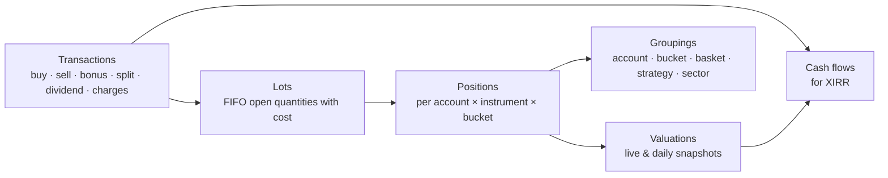

# 12 — Portfolio Monitoring

Add your broker accounts and monitor **every trade and holding**: when it was added, current value, return %,
XIRR, and totals — grouped by basket, account, strategy or sector.

## 1. Data sources

| Source | What it provides | When |
|--------|------------------|------|
| Dhan **holdings** API (`GET /v2/holdings`) | Current holdings (delivery): quantity, average cost, last traded price, ISIN — **no purchase date** (P2-01) | On the first import (saving the account's Portfolio settings), "Sync now" and, per account, the daily automatic refresh (§3); positions API later |
| Dhan **trade history** API | Every trade with date/time, price, quantity, side and full charge breakdown (paginated by date range) | Nightly incremental; one-time backfill |
| Dhan **ledger** API | Cash credits/debits (funds added/withdrawn, dividends, charges) | Nightly |
| **CSV import** | Older trades (before API history / other brokers), contract-note or tradebook exports | On demand |
| **Manual entry** | Corrections, off-platform transactions | On demand |
| Corporate actions | Splits, bonuses, dividends | Nightly |
| Prices | Live quotes for open trades & holdings; EOD close for valuation ([doc 05](05-data-and-brokers.md) §5) | Market hours / EOD |

**History depth (decision Q5, amended by [ADR 0012](../adr/0012-holdings-acquisition-dates-and-returns-model.md)):** Dhan's holdings carry no purchase date, so the owner
sets the acquisition date of each holding when the first import happens, in the account's Portfolio settings (§3 "Where acquisition dates come from"). Older lots can still be refined by CSV / contract-note
import (P2-03) and a helper that derives dates from Dhan's trade history is a later, separate story.

## 2. Domain model



- **Transaction** — immutable record (source: broker / CSV / manual; charges attached).
- **Lot** — each buy creates a lot; sells consume lots **FIFO** (matches Indian practice) → realised P&L per lot.
- **Position** — open quantity, average cost (incl. charges), first-added date, linked plan ticket (if any).
- **Valuation** — market value at a time; a daily snapshot after close builds the portfolio value history.
- **Cash flow** — dated money in/out used for XIRR.

## 3. Metrics

### Per position / trade
| Metric | Definition |
|--------|------------|
| Added on | Date/time of first buy (and of each add) |
| Days held | Calendar days since first buy (or until exit) |
| Quantity, avg cost | Open quantity; average cost including charges |
| LTP, market value | Live or last close price × quantity |
| Unrealised P&L (₹, %) | Market value − remaining cost |
| Realised P&L (₹) | From FIFO-closed lots, net of charges |
| Total return % | (Realised + unrealised + dividends) / total invested |
| Day change (₹, %) | vs previous close (**built**, P2-06): ₹ = qty × (last − previous close), % = (last − previous close) / previous close; unavailable (never zero) when there is no previous close. **Known limitation:** `previous_close` comes only from quotes and a holdings sync never touches it, so on a day without a quote (the poll off, failed or outside its window) a sync moves the price while the previous close stays from an earlier session, and the day change then spans sessions; the row exposes `priceAt` and `priceSource` so the screen can say so |
| **XIRR** | Annualised return from dated cash flows (§4) |
| CAGR | For holdings > 1 year |
| Weight % | Share of portfolio (or bucket) value |
| System trade info | Strategy, cell, entry plan, R-multiple, stop/target distance (if from a plan ticket) |

### Where acquisition dates come from

XIRR, % return and absolute return need the **date and size of every cash flow**. Dhan's `GET /v2/holdings` gives quantity, **average cost price**, last traded price
and ISIN, but **no purchase date** (docs read 2026-10-11), so the dates are **set by the owner** ([ADR 0012](../adr/0012-holdings-acquisition-dates-and-returns-model.md),
[P2-01](../specs/P2-01-holdings-import-with-dates-and-auto-refresh.md)). This replaces the earlier idea (P1-16e) of deriving them from Dhan's trade and ledger APIs.

**The first import is part of saving the account's Portfolio settings** ([ADR 0013](../adr/0013-portfolio-import-with-settings-and-daily-refresh.md),
[P2-01a](../specs/P2-01a-portfolio-import-on-save-and-daily-refresh.md)); there is no separate import endpoint or dialog. The settings carry a **first import date**
(`firstImportDate`, default **1 Jan 2025**, between 1990-01-01 and today India). When the account is connected, has the Portfolio role and has **no holdings** in the system,
*Save* (`PUT /api/accounts/{id}/portfolio`) stores the settings and then imports in the same request, **without any per-holding list on the settings screen**: Dhan is fetched
again inside one transaction, one holding with **one lot** (Dhan's quantity and average cost) is created for every holding Dhan lists, in the account's bucket (its own default
bucket or the custom bucket chosen in the settings), dated with the first import date and flagged `uses_default_date` (counted on the Portfolio screen until its date is edited
there). `firstImport.rows` = `[{key, acquiredOn?}]` is an optional API detail: a row's date overrides the default for its key. The run is recorded with the trigger `import`. The answer carries the result:
`import.status` `imported` (counts `imported`, `defaultDated`, `alreadyImported`, `unknown`), `skipped` (the account already has holdings: nothing is imported, Dhan is not called; `redated`/`redateSkipped` say how many lots followed a changed first import date),
`deferred` (not connected, or role off: nothing is called) or `failed` (the **settings are still saved**; `import.errorCode` `portfolio.import_failed`, `import.cause` the reason code
such as `portfolio.not_connected` or `portfolio.sync_running`; retry with Save again or Sync now). Invalid dates or rows are `400 accounts.invalid` (fields `firstImportDate`,
`firstImport.rows[i].key`, `firstImport.rows[i].acquiredOn`) and nothing is saved.
**An account that is not connected** keeps the stored first import date, and its **first sync** — manual or daily — performs the import: every holding
Dhan lists gets one lot dated with the first import date (flagged as default, editable per lot) and the run is recorded as `import`. After that nothing imports again: saving the settings
again imports nothing, and everything else arrives through the refresh below.
**The first import date stays editable** ([ADR 0015](../adr/0015-first-import-date-editable-and-no-bucket-ui-in-accounts.md), [P2-01b](../specs/P2-01b-editable-first-import-date-and-no-buckets-in-accounts.md)):
saving a **changed** date on an account that has holdings **re-dates, in the same unit of work, every lot with `source = import` and `uses_default_date = true`** to the new date (the lots stay flagged;
a closed lot whose `closed_on` is before the new date cannot take it and is skipped). Lots the owner dated by hand, lots found by refreshes and manual lots are never touched; returns and XIRR are computed on
read, so they follow. No Dhan call is made (`import.status` stays `skipped`); the answer's `import` carries `redated` and `redateSkipped` (lot counts, 0 when the date did not change or the account has no
holdings). The same date again changes nothing. The change is audited once (`FirstImportDateChanged`: old and new date and the counts, no per-lot data). Without holdings only the date is stored.

**Lots.** A holding has lots `(acquired_on, qty, unit_cost)`; a closed lot also has `closed_on`, `close_price` and `estimated`. A partial sale splits a lot into a
closed piece and an open remainder with the same date and cost, so every lot has one close price. The open quantities always add up to Dhan's quantity, and the
holding's quantity and average cost are always Dhan's after a sync. Any lot's date can be edited later (`PUT /api/holdings/{id}/lots/{lotId}`); figures are computed on
read, so they follow at once.

**Sync rules** ("Sync now" and the daily refresh run the same command, for an account that already has holdings; one transaction per account, idempotent):

| Dhan says | Result |
|-----------|--------|
| A holding the account does not have (or had closed) | New holding (or reopened) with one lot dated **today (India)**, unit cost = Dhan's average cost, source `added`, not flagged as default date |
| Quantity increased by Δ | A lot dated today for Δ at the **implied cost** `max(0, (newQty × newAvg − oldQty × oldAvg) / Δ)`; when that is not positive, the last price (then the new average) |
| Quantity decreased by Δ | Lots closed **oldest first (FIFO)** for Δ at the **last price**, marked `estimated` |
| Holding missing | Same, for the whole quantity; the holding becomes `closed` (kept, with its realised result) |
| Same quantity | Last price, price time and Dhan's average cost only |

A run that fails leaves every holding untouched and is recorded (`portfolio.holding_syncs`: manual / auto / import, status, counts, a short safe error). One run per
account at a time (advisory lock plus a unique "running" row; `409 portfolio.sync_running`); a run left running by a crashed process is ended when the API starts.
**Safeguard against a false "Dhan lists nothing".** An empty answer (a `200 []` or Dhan's documented `DH-907` "no data") or a broken one can look like a sale of everything, and closing every
holding then reopening it dated today would destroy the owner's acquisition dates. So a sync whose answer would close **all open holdings (empty answer) or more than half of them with at
least 3** (exactly half does not count; fewer than 3 never counts unless the answer is empty) changes nothing unless confirmed:
- a **manual** sync answers `409 portfolio.confirmation_required` with the numbers `listedHoldings`, `openHoldings` and `wouldClose` and a message such as "Dhan listed 0 holdings while 3 are open in
  xDrishti" or "Dhan listed 2 holdings but 4 of your 6 open holdings are missing"; the UI shows them and repeats the request with `{"confirm": true, "expectedOpenHoldings": 6, "expectedWouldClose": 4}`
  (both numbers are required with `confirm`; `400 portfolio.invalid` otherwise), which applies the closes by the rules above;
- if Dhan's answer has changed since (the numbers differ), nothing is applied and the answer is `409 portfolio.confirmation_stale` with the fresh numbers;
- an **automatic** run never confirms — it is recorded as `skipped` with the same reason text ("… — nothing was changed; press Sync now to confirm."), visible as `last` in the sync status, with at
  most one skipped record per account and India day (the latest check replaces the earlier one).

**Records are kept 90 days.** After an automatic run, finished `holding_syncs` rows older than 90 days that did not fail are deleted (at most 500 at a time); failed runs stay.

A token Dhan refuses is `409 portfolio.not_connected` ("sign in to Dhan again"); Dhan being unreachable is `502 accounts.broker_error`. Sells between two syncs are
estimated at the last price of the sync that noticed them; a possible corporate action (split, bonus) shows up as a quantity change.

**Mapping to the instrument master.** By ISIN first (shares and ETFs, series EQ preferred), then by Dhan's security id within the NSE equity segment. Holdings that
cannot be mapped (for example BSE only) are kept, flagged "not in master list" (`mapped = false`), and still get returns from Dhan's price.

**Automatic refresh (per account, off by default, [ADR 0013](../adr/0013-portfolio-import-with-settings-and-daily-refresh.md)).** Portfolio settings: `refreshMode` `off` | `daily`
(the interval mode no longer exists; existing interval settings were switched off by the migration) and `refreshDailyTimeIst` `HH:mm` (default 16:00, after the close). A hosted service
in `xd-api` looks once a minute at every Portfolio-role account whose refresh is on and runs the same sync:

- **daily**: once a day from the configured India time on, weekends included; if the time was missed (the application was down) it runs as soon as possible the same day; a failed or
  skipped automatic attempt counts as that day's run, a manual run does not (the first automatic run of an account without holdings is recorded as `import` and counts too);
- an account that is **not connected** (no token, expired) is not called: one `skipped` record per India day;
- runs never overlap (accounts one after the other, one running row per account); "Sync now" works at any time; the whole mechanism is switched off with
  `Portfolio:AutoRefresh:Enabled = false` ([doc 16](16-configuration.md)). `GET /api/accounts/{id}/holdings/sync-status` returns `refreshMode`, `refreshDailyTimeIst`, `firstImportDate`, `hasHoldings`, the next scheduled run, `running` and the last run.

Not included in v1 (and stated in the UI): dividends, brokerage and taxes, corporate-action adjustments, a "day change" (needs the previous close, P2-07).

### Per group (basket / bucket / account / strategy / sector / total)
Invested · current value · realised · unrealised · total return % · **XIRR** · day change (sum of the holdings' ₹; % = Σ₹ / Σ qty × previous close of the included holdings, not an average of percentages; holdings without a previous close are left out and counted as `dayChangeExcluded`) · number of open
positions · win rate & expectancy of closed trades · **benchmark XIRR** (same cash flows invested in Nifty 50)
and **alpha** (XIRR − benchmark XIRR) · max drawdown of the group's value history.

## 4. Returns and XIRR

Computed on read from the lots by pure functions (`XDrishti.Application/Portfolio/Returns`), valued on **today (India)** at the holding's last price:

| Figure | Definition |
|--------|------------|
| Invested | Σ open lot qty × unit cost |
| Value | Σ open lot qty × last price |
| Unrealised P&L ₹ / % | value − invested; P&L / invested × 100 (null when nothing is invested) |
| Realised P&L | Σ closed lot qty × (close price − unit cost); `realisedEstimated` when any sale price is a last-seen price |
| Day change | "—" until a previous-close source exists (P2-07) |
| Group (total / account / bucket) | Sums of the above; the group XIRR comes from the **union of all member cash flows**, never an average |

**XIRR** cash flows: each lot −qty × unit cost on its `acquired_on`; each closed lot also +qty × close price on its `closed_on`; plus +current value on the valuation
date. XIRR is the rate *r* where

```
Σ  CFᵢ / (1 + r)^((dᵢ − d₀) / 365)  =  0
```

- Newton–Raphson from a good first guess (growth of everything paid in into everything received over the money-weighted period); if it does not converge,
  **bisection on [−0.9999, 100]** (when the ends have the same sign, on the sign change nearest the guess); tolerance 1e-9. It follows the definition of a spreadsheet's `XIRR` (days / 365
  from the first date) and agrees to better than 1e-6 with reference values from an independent 60-digit decimal bisection written in Python — not with Excel itself — on the committed sample sets
  ([`XirrTests`](../../backend/tests/XDrishti.Application.Tests/Portfolio/XirrTests.cs)).
- States: `ok`; `no_price` (the holding has no usable price — a last price of 0 — so `priced` is false and value, P&L, P&L % and XIRR are null: its worth is unknown, it is **not** a total loss;
  such holdings are left out of group and summary invested / value / P&L / XIRR and counted in `summary.unpricedCount`; realised results of their closed lots still count); `insufficient` (shown "—": no outflow or no inflow, **less than 30 days** between the first and the last flow, or no solution in the range);
  `n_m` (shown "n/m": the rate is beyond ±1,000 % a year, also when it is above the solver's range); `no_data` (no flows).
- Computed for any set of cash flows: one lot, a holding, a bucket, an account, the total. Percentages in the API are percent numbers (16.1 = 16.1 %).
- Example: buy ₹1,00,000 on 1 Jan; add ₹50,000 on 1 Apr; value ₹1,72,000 on 31 Dec → XIRR ≈ 16.1% (absolute return 14.7%).
- Later (not v1): dividends as inflows, charges in the cost, corporate-action adjustments, benchmark XIRR and alpha.

## 5. Grouping: baskets vs portfolio buckets

| Concept | Overlap | Use |
|---------|---------|-----|
| **Instrument baskets** ([doc 06](06-instruments-and-baskets.md)) | An instrument can be in many baskets | Analysis lens — totals not additive |
| **Portfolio bucket** | Each position belongs to exactly **one** bucket | Additive view — bucket totals sum to the portfolio |

- **One default bucket per Portfolio account, no presets.** Every account that has the Portfolio role gets a bucket named
  `"{account name} · Portfolio"` (e.g. *Dhan · Main · Portfolio*), created automatically when the role is switched on (or the account is created with it),
  linked to the account (`default_for_account_id`, unique), renamed when the account is renamed, archived with the account (renamed *… · Portfolio (archived)* so the name is free again), and kept — but hidden from
  pickers — while the role is off. A name collision gets a numeric suffix (*… · Portfolio 2*). It is where the account's imported holdings go unless
  another bucket is chosen. There are no predefined buckets (the earlier *Trading / MyLongTerm / MyChoice* presets were removed in P1-16e).
- **Custom buckets:** the buckets API stays (`GET/POST /api/portfolio-buckets`, `defaultBucket` on the settings), but **Accounts no longer offers any bucket choice**
  — no default-bucket select, no Buckets list, no *Add bucket* form, in the Portfolio tab or the add-account wizard; saves leave `defaultBucket` out, so imports go to
  the account's own default bucket and a custom bucket set earlier is kept ([ADR 0015](../adr/0015-first-import-date-editable-and-no-bucket-ui-in-accounts.md)).
- A position's bucket defaults to the account's chosen bucket and can be overridden per trade — e.g. the same stock bought for long-term
  (custom bucket *Long term*) and for a swing trade (the account's own bucket) is tracked as two positions with separate lots, returns and XIRR.
- System-plan trades go to the Trading account's own default bucket unless a custom bucket is configured for plan trades.

Views: **tree** — Total → Account → Bucket → Position → Lots/Transactions; **pivot** — rows by bucket,
basket, account, strategy or sector with the metrics in §3.

## 6. Live updates

| What | Update method | Frequency |
|------|---------------|-----------|
| Open intraday & swing positions, armed tickets | Dhan WebSocket (active set) | Real-time |
| Long-term holdings | Dhan quote API (up to 1,000 instruments/request) | Every `holdings_refresh_minutes` (default 5) |
| Portfolio snapshot | EOD official close | Daily after close |

**Built (P2-06, [ADR 0019](../adr/0019-holdings-quotes-day-change-and-the-first-interval-service.md)):** the quote poll of the long-term holdings is the service `holdings-quotes` (the first `interval` service: every 5 min from 09:15 to 15:30 IST on trading days, retries 0, timeout 2 min, catch-up off, a tick that falls while the previous run goes on is dropped with a log line and no run record). It writes `last_price`, `previous_close`, `last_price_at` and `last_price_source = quote` into every open holding of a quoted instrument in one statement; a holdings sync keeps a quote of the same India day. The Portfolio screen re-reads once a minute while the market is open (no SignalR until the live feed exists).

The React Portfolio screen receives updates via SignalR once the live feed exists; values recalculate incrementally.

## 7. Alerts

Price reaches a plan's stop/target level · swing position at max holding (5 sessions) · results date within
N days for a holding · position weight > `max_position_weight_pct` · bucket drawdown > threshold · large day
move on a holding · data or token issue for an account.

## 8. Link to the trading system

- Positions created from plan tickets keep `plan_item_id` → strategy, cell, R-multiple and grading.
- Trades not matching any plan are tagged **discretionary**; their results are reported separately (and in the
  discipline report).
- Long-term holdings are not managed by the system's exits unless you assign a strategy/exit to them.

## 9. Data model (`portfolio` schema)

**Built in P2-01 / P2-05 (migration `AddPortfolioHoldings`):** `portfolio.holdings` (account, bucket, optional instrument id, exchange, security id, ISIN, symbol, name,
qty, avg cost, last price and time, status open/closed, first seen / closed / synced), `portfolio.holding_lots` (holding, acquired on, qty, unit cost, source
import/added/manual, uses default date, closed on, close price, estimated), `portfolio.holding_syncs` (account, trigger manual/auto/import, status
running/succeeded/failed/skipped, counts, error, requested by; one running row per account) and the refresh columns of `accounts.portfolio_settings`
(`refresh_mode` off/daily, `refresh_daily_time_ist`, and `first_import_date` since migration `PortfolioDailyRefreshAndFirstImportDate`, ADR 0013). **Built in P2-06 (migration `AddHoldingQuotes`):** `portfolio.holdings.previous_close` (`numeric(18,4)`, null until a quote gave one; a sync never touches it) and `last_price_source` (`sync` | `quote`, default `sync`, CHECK), next to `last_price` / `last_price_at` — only the latest quote is stored, no price history. The fuller target model below (transactions, cash flows, valuations) grows from here.

| Table | Key columns |
|-------|------------|
| `accounts` (in `trading`) | id, broker, mode, profile |
| `transactions` | id, account_id, instrument_id, type, ts, qty, price, charges (JSON), source, external_id, bucket_id, plan_item_id |
| `lots` | id, transaction_id, open_qty, cost_per_unit, opened_at, closed_at |
| `lot_closures` | lot_id, sell_transaction_id, qty, realised_pnl |
| `positions` | account_id, instrument_id, bucket_id, qty, avg_cost, first_added_at, status |
| `buckets` | id, name, default_basket_id |
| `cash_flows` | id, account_id, ts, amount, kind (deposit/withdrawal/dividend/charge/trade) |
| `valuations_daily` | date, account_id, bucket_id, position_id, market_value, invested, realised, unrealised |
| `corporate_action_adjustments` | instrument_id, ex_date, ratio, applied_to_lots |

## 10. Portfolio screen (React)

- **Account tiles (one per Portfolio account + "All accounts"):** value, unrealised P&L (₹, %), day change, XIRR,
  open positions, realised P&L, top holding and its weight, number of open action items — click to focus the
  whole page on that account.
- **Action center:** positions that need a decision, per account — below cost, large gain, overweight, sector
  concentration, max holding exceeded, results due, long-term soon, lagging Nifty, not in a basket — with
  Open / Set alert / Add to basket / Snooze / Done ([doc 15](15-smart-insights-and-automation.md) §3).
- **Header tiles:** total value · invested · total P&L (₹, %) · **XIRR** · day change · benchmark XIRR / alpha.
- **Group by:** Bucket · Basket · Account · Strategy · Sector · None — with tree-grid (expand to lots and
  transactions) and column chooser.
- **Charts:** allocation by group, sector exposure stacked by account, portfolio value vs the same cash flows in
  Nifty 50, XIRR by group.
- **Price alerts:** create from the Action center or a position; evaluated by the services; list in an Alerts panel.
- **Position drawer:** transaction timeline, price chart with buy/sell markers, lots, alerts, linked plan ticket.
- **Filters:** date range (for realised results), account, bucket, basket, status (open/closed), source.
- **Exports:** CSV/Excel of positions, transactions and realised P&L.

Out of scope for now: tax reports (STCG/LTCG statements) — the lot data supports adding them later.
