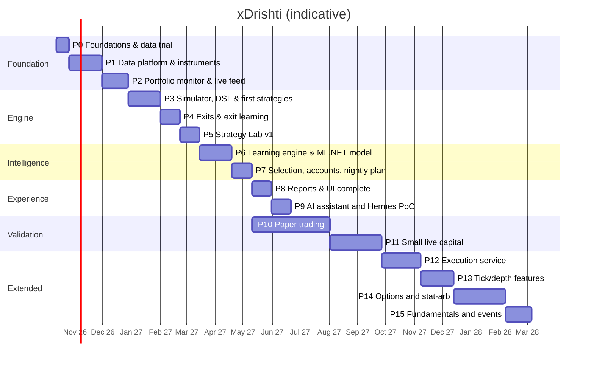

# 18 — Roadmap

Part-time (~10–12 h/week) with an AI coding assistant. Each phase ends with an exit criterion. Portfolio
monitoring comes early because it is useful on its own while the trading engine is being built.

| Phase | Deliverables | Exit criterion |
|-------|--------------|----------------|
| **P0 Foundations** (2w) | Answer open questions (doc 01 §5); review the **clickable prototype** (`docs/prototype/`); Podman machine (libkrun); repo skeleton: .NET solution, React (Vite) app, `compose.yaml` with `xd-db`; Keychain→secrets script; Dhan trial (Data API, API key/secret token flow, 1-minute history for 20 symbols); **CSV profile for your files** + sample import; `xd-llm` GPU benchmark; ML.NET spike on linux/arm64 | Data-quality note written; stack starts with one command |
| **P1 Data platform & instruments** (5w) | Dhan adapter (instrument master, history, accounts); **CSV import** (profiles, preview, validation, upsert, undo, folder watch, CLI); Timescale hypertables + continuous aggregates (5m…1h, 1D/1W/1M); corporate actions; calendar; context data; **master list, tracked instruments, baskets** (manual, rule-based, system); EOD fetch + backfill jobs; quality checks; **Data quality window** (validation service, stored-vs-recomputed aggregates, repair); React shell with **login (password; re-entry for sensitive actions), Accounts (list/detail tabs, role matrix, risk profiles, wizard), Services screen with schedule configuration & dependency checks**, Instruments, Baskets and Data/Import screens; commands/desired-state + audit | Your CSV history imported; 5 unattended EOD fetches; all timeframes match a hand-check on 10 samples |
| **P2 Portfolio monitor & live feed** (4w) | Account sync (holdings, positions, trade history, ledger — **trade history and ledger sync built in P2-13** ([ADR 0025](../adr/0025-dhan-trade-history-and-ledger-sync.md)); dividends entered by the owner and charges in **net** returns and net XIRR are **built in P2-14** ([ADR 0026](../adr/0026-dividends-entered-by-the-owner-and-charges-in-net-returns.md)); a **dividend payout file (CSV) is recognised by its headers, matched to holdings by scrip name with remembered corrections, previewed and imported with Undo — built in P2-15** ([ADR 0028](../adr/0028-dividend-csv-import-with-name-matching.md)); positions are not built); **self-healing syncs and actionable notifications are built in P2-16** ([ADR 0027](../adr/0027-self-healing-sync-and-actionable-notifications.md): quiet retries with back-off, catch-up after a reconnect, one earlier year of trade history read per day, attention items with buttons in the bell and as pop-ups); **Dhan's downloaded reports — the global transaction report (bill-level trades with charges), DP-charges sheets and the demat holding statement, as CSV, `.xls` or `.xlsx` — are previewed and imported with Undo in P2-17** ([ADR 0029](../adr/0029-dhan-report-imports-and-source-precedence.md); Dhan's own trades take precedence over the report's bill rows); **the review follow-ups of P2-13 … P2-17 are closed in P2-18** ([ADR 0030](../adr/0030-read-only-notices-retention-and-structured-failures.md): read-only notices, 30-day retention of resolved items, a bell item for dropped rows, structured failure kinds, a kind-aware sync guard, one phrase table, an `.xlsx` guard); transactions, FIFO lots, positions, buckets; CSV/manual trade import; **XIRR**, returns, benchmark; daily valuations; `xd-feed` live feed for the active set + quote polling for holdings; Portfolio screen (per-account tiles, **Action center**, price alerts, group by bucket/basket/account/sector, tree-grid, charts) | Portfolio values and XIRR match a spreadsheet check for 3 accounts/buckets; live P&L updates during market hours |
| **P3 Simulator, DSL & first strategies** (5w) | Streaming indicators/features; DSL parser → expression trees + look-ahead lint; event-driven simulator (conditional entries, stops, square-off, max hold, gaps, costs, slippage, MAE/MFE); `ORB`, `VWAP_PULLBACK`, `BASE_BREAKOUT`; scans scoped by basket | 20 random trades hand-verified against charts |
| **P4 Exits & exit learning** (3w) | All exit policies incl. pyramiding; same-entries comparison; per-cell exit choice (walk-forward); MAE/MFE diagnostics | Chosen exits stable across folds |
| **P5 Strategy Lab v1** (3w) | Lab API + Hangfire runs + SignalR progress; verdict & report; test ledger; `xd` CLI; Strategy Lab page (Monaco + schema); basket as test universe; `xd-sandbox` for C# plugins | 3 of your own ideas tested end-to-end without code changes |
| **P6 Learning engine & ML.NET model** (5w) | Regime labels; cell stats (Bayesian, recency); triple-barrier labels; ML.NET LightGBM/FastTree + PAV calibration + feature contributions; model registry; drift, lifecycle, changelog, hypothesis loop; **lessons** (monitors → problem/fix/result), **experiments** (tweak & re-run replay with honest comparison rules), frozen-model counterfactual; **meta-labelling model, learned entry windows, automatic loss tags**; remaining strategies | Meta-model beats baselines OOS; calibration error ≤ 5 pp; a knob change can be replayed and compared in < 10 min |
| **P7 Selection, accounts & nightly plan** (3w) | Filters, merge, ranking, portfolio fill; per-account allocation (Trading-role accounts); **plan review & approval workflow with pre-trade checklist, suggestions inbox, review cutoff**; auto-journal; grading (primary/reserve/rejected); pre-open check; **autonomy levels with auto-approval at the cutoff**; **smart rules in the nightly plan** (market gate, equity-curve throttle, correlation-aware selection); **weekly learning digest**; fail-closed nightly pipeline; plan tickets join the live active set; **start depth recording** | Plans published 10 consecutive sessions unattended |
| **P8 Reports & UI** (3w) | All screens & reports: **Learning screen** (journey, lessons, plan vs actual, setups, tweak & re-run, autonomy), Overview with auto-insights, multi-basket comparison, pivot builder, lenses, filters, drill-down, exports, PWA; responsive 360 px → 4K | "What works, in which basket, on which TF, with which exit" answered in < 2 min |
| **P9 AI assistant** (3w) | `xd-llm`, `xd-mcp`, assistant endpoint & chat; briefing; data Q&A (incl. portfolio & baskets); strategy drafting; eval set; Hermes PoC (doc 14 §6) | Eval set passes; Hermes adopt/reject decided |
| **P10 Paper trading** (≥ 12w, from P7) | Follow plans on paper/minimal size; weekly review; config changes only via hypothesis loop | ≥ 60 graded trades; positive expectancy after costs within backtest band; drawdown within Monte Carlo 90th pct |
| **P11 Small live** (≥ 8w) | 25–50% of intended risk; live vs paper slippage; **execution feedback** (grade on fills, slippage per liquidity bucket, capacity score) | Live within expectations ⇒ scale gradually |
| **P12 Execution service** (6w) | `xd-exec`: state machine, pre-trade checks, broker-side stops, kill switch, reconciliation; Dhan sandbox → assisted → semi-auto → auto; ISP static IP | 30 semi-auto sessions with zero reconciliation breaks |
| **P13 Tick/depth features** (5w) | Microstructure features from ≥ 6 months recorded data; depth-based slippage | Kept only if OOS intraday expectancy improves |
| **P14 Options & stat-arb** (8w) | Option-chain archive, expired-options backtests, instrument-expression dimension, defined-risk structures; `PAIRS`/`BASIS` | An option expression beats cash/futures OOS after costs, else stays disabled |
| **P15 Fundamentals & events** (4w) | Point-in-time filings, quality filters, earnings features, `PEAD`, LLM extraction with validation | Features/filters improve OOS or are dropped |

## Open issues log

Findings from the first real runs that are not fixed yet. Each entry says what was seen, why it matters and the direction to take; none blocks the current work. New entries go at the bottom with the next number; closed ones are marked **Closed** with the story that fixed them, never deleted. Figures from the owner's own accounts are kept out of this file (they live in the local, uncommitted analysis under `data/dhan/`).

| # | Issue | Seen | Why it matters | Direction | Status |
|---|-------|------|----------------|-----------|--------|
| ISS-01 | **Dhan's trade-history API misses whole days.** Several multi-stock "bulk" days that Dhan's own transaction report lists are absent from the API answer (only some trades of the period come back). | First scheduled trades run after the mapper fix (2026-10-15). | Lots cannot be rebuilt for the holdings whose buys or sells fall on those days; dates and returns stay approximate. | Fill the gaps from the downloaded reports (P2-17 *Import files*); find out whether the API pages, filters or time limits explain it (compare an API day with its report day) and record the finding in ADR 0025. | Open |
| ISS-02 | **Many holdings cannot be rebuilt** (`quantity_mismatch` / `negative_opening`: the stored sells are larger than the buys the app knows). | Same run; the holdings are listed in the run counts. | Their lots keep the single default-dated lot, so XIRR and net returns for them are approximate; the bell item "trades don't explain a holding" will show. | Import the transaction reports first (ISS-01), then re-run the rebuild; for IPO allotments, demergers and transfers (shares with no trade at all) decide how to record an *opening position* by hand. | Open |
| ISS-03 | **Dropped rows are not explained.** A run reports how many rows it dropped but not why (no symbol, unmapped product, bad number…). | Same run; a handful of rows dropped. | The owner cannot tell whether the loss matters; the mapper-version re-read cannot be judged. | **Done (2026-10-15):** every trade or ledger row a mapper drops carries a reason code from a closed set (`BrokerDropReasons`: `unreadable_row`, `missing_id`, `bad_id`, `missing_side`, `bad_quantity`, `bad_price`, `bad_time`, `bad_date`, `missing_amount`, `bad_amount`, `zero_amount`, `failed_checks`, `store_refused`, `other`). The run counts carry `droppedByReason` (rows per code, adding up to `dropped`) and `droppedRows` (at most five locations: request window, page, row index, reason - never a name, amount, id or narration); the status of each kind shows the latest run's two fields; the Portfolio sync line says how many rows could not be read and why, with a *Details* disclosure for the locations; the audit entry and the log list the reasons as `reason×count`. `missing_symbol_unresolved` stays a *skip* (`no_symbol`), not a drop. Not done there: the bell item for drops (ISS-09, closed later by P2-18) and the reason on `needs_reread` (ISS-10). See [doc 12](12-portfolio-monitoring.md) §3 and [ADR 0025](../adr/0025-dhan-trade-history-and-ledger-sync.md) / [0027](../adr/0027-self-healing-sync-and-actionable-notifications.md) amendments. | **Closed** |
| ISS-04 | **Deepening history rarely changes a verdict.** In the reconstruction model a sell fits or not mainly by what is held now, so reading an earlier year seldom fixes `negative_opening`. | Review of P2-16; confirmed by the first run (the earlier years returned no equity trades). | Nightly calls with little benefit. | Keep (bounded, harmless) but stop deepening once a year returns no equity trades; revisit whether the rule helps at all after ISS-01/02 are solved. | Open |
| ISS-05 | **Derivatives, commodity and intraday trading is not modelled.** The sync and the importers count and skip those rows (a large share of all rows). | Skip counts of the first run. | Realised results of that trading (and its charges) are outside every figure in the app. | Decide whether the app should track it (positions and intraday P&L story, P&L reconciliation against Dhan's statements); until then the Portfolio screen says what is left out. | Open |
| ISS-06 | **Report matching rules are unverified against real files.** DP charges are matched to ledger charges by account, day and amount (and a depository label); the client-code check learns the code from the first accepted report; ISIN-less rows rely on name matching. | Design of P2-17; no real upload yet. | A wrong assumption silently double-counts or undercounts a cost, or blocks a file. | First real uploads: check the preview counts (covered by Dhan, already in the ledger, other account); adjust the one phrase table `LedgerText.Phrases` (read by `DepositoryCharges`, `LedgerClassifier` and `LedgerCosts` since P2-18; before that the three lists differed). | Open |
| ISS-07 | **Time-dependent tests.** Tests whose fixtures use fixed dates against the real clock failed depending on the time of day or the date (relative times such as "2 days ago", forms that refuse future dates, API-key expiry warnings). | Final checks of P2-16/P2-17; found again by the review. | A green check could turn red overnight or on a given future date. | **Done (2026-10-15):** `XD_TEST_NOW=<ISO instant>` is a diagnostic that fakes `Date` for every test that does not pin it; `npm run test:clock` (manual, about 15 minutes, not part of `check.sh`) runs the suite at several instants, including after the old fixture expiry; the `pinClock` helper (`frontend/src/test/pinClock.ts`) pins `Date` for a file or `describe`; `src/test/clockGuard.test.ts` fails a test file that asserts relative-time wording without pinning (it covers wording only; `test:clock` covers the rest); the fixtures' API keys now never expire (2099) so no test depends on an expiry date; the rule is in `frontend/CLAUDE.md`. The diagnostic found the pinned-test list; the review found the 2027 expiry bomb, fixed at its source. | **Closed** |
| ISS-08 | **Review follow-ups are scattered in the specs.** Minor findings of the reviews (GET `/notices` writes attention rows, attention-items retention, message-text matching for transient errors, guard granularity, phrase-list mismatch, command-target fixture drift…) sit in the *Follow-ups* section of P2-13 … P2-17. | Reviews of P2-13 … P2-17. | Easy to lose. | Pick them up as one hardening story before P3; this entry points to the specs: P2-14, P2-15, P2-16 and P2-17. **Done (2026-10-15, [P2-18](../specs/P2-18-sync-and-import-hardening.md), [ADR 0030](../adr/0030-read-only-notices-retention-and-structured-failures.md)):** GET `/notices` only reads (the attention items are reconciled by the healer tick, at the end of every holdings, trades or ledger attempt and after a Dhan sign-in); resolved items are deleted after 30 days (`Portfolio:Heal:AttentionRetentionDays`; DELETE granted on that one table); failures carry a structured kind and no code matches a message; every `RunAsync` result is checked and manual flows get a neutral text; `SyncGuard` is kind-aware; a late failure keeps the progress of its re-read windows; the command list is generated from the server's; one phrase table; the supersede and the sheet's plan decide a day from the whole stored day; bill identities count every equity leg as a sibling; an `.xlsx` decompression-bomb guard; capped `includeDuplicates`; and the screen items (Cash drawer wording, suggestion refresh, per-share decimals, toast focus, the mixed priced/unpriced rule, the database test for "holding appeared since"). What stays open from those lists is named in them (quote items, the mapper-version fallback, the DP date assumption, the other first-real-read checks). | **Closed** |
| ISS-09 | **Dropped rows raise no bell item.** ISS-03 explains the drops on the sync line and in the audit text, but the owner is only told if they open the Portfolio screen. | Closing ISS-03. | A run that drops many rows (for example after a Dhan format change) goes unnoticed. | Add an attention item (e.g. `sync_dropping`) derived from the latest run of a kind whose dropped share is high or whose dominant reason is not a known benign one (`zero_amount`); its text names the dominant reason and count, with an action that opens the sync line's Details. Raise and resolve like the other items of [doc 12](12-portfolio-monitoring.md) §3 "Self-healing and attention items". **Done (2026-10-15, [P2-18](../specs/P2-18-sync-and-import-hardening.md)):** the attention kind is `rows_dropped` (not `sync_dropping`): one item per Portfolio account and kind (trades, ledger) derived from the latest **succeeded** run of that kind; information when the only reason is `zero_amount`, a warning otherwise (not by a dropped share: any dropped row raises it); the text names the counts and the plain words of at most three reasons, biggest first; the action *Open* goes to `/portfolio?focus=sync`, which focuses **Sync trades & ledger** (the *Details* disclosure of the sync line holds the places of the first rows); it resolves when the latest succeeded run of that kind drops nothing, and a running, skipped or failed latest run neither raises nor resolves it. | **Closed** |
| ISS-10 | **`needs_reread` does not say why.** A stored window that dropped rows is noted for a re-read after a mapper update, but not with the reason, so the re-read cannot be limited to windows whose reason a new mapper could mend, and the owner cannot see why a window is waiting. | Closing ISS-03. | Re-reads cover windows whose drops could never be mended (a row without an id). | Store the dominant drop reason on `portfolio.broker_sync_windows` (a nullable column: a migration) and read again only windows whose reason is one a mapper change can fix; show the reason where the window is listed. P2-18 (F4) did not touch this: it kept the progress of a failed run's re-read windows in the run's counts JSON (`rereadDone`, `rereadVersion`), not on the window rows, so the migration of `broker_sync_windows` is still to do. | Open |
