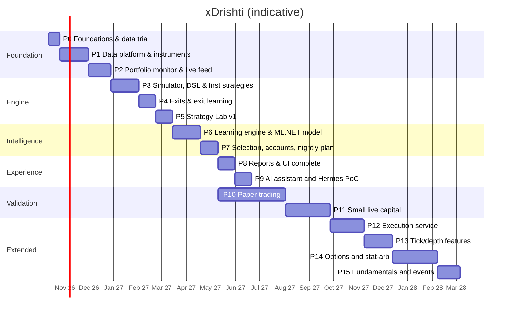

# 18 — Roadmap

Part-time (~10–12 h/week) with an AI coding assistant. Each phase ends with an exit criterion. Portfolio
monitoring comes early because it is useful on its own while the trading engine is being built.

| Phase | Deliverables | Exit criterion |
|-------|--------------|----------------|
| **P0 Foundations** (2w) | Answer open questions (doc 01 §5); review the **clickable prototype** (`docs/prototype/`); Podman machine (libkrun); repo skeleton: .NET solution, React (Vite) app, `compose.yaml` with `xd-db`; Keychain→secrets script; Dhan trial (Data API, API key/secret token flow, 1-minute history for 20 symbols); **CSV profile for your files** + sample import; `xd-llm` GPU benchmark; ML.NET spike on linux/arm64 | Data-quality note written; stack starts with one command |
| **P1 Data platform & instruments** (5w) | Dhan adapter (instrument master, history, accounts); **CSV import** (profiles, preview, validation, upsert, undo, folder watch, CLI); Timescale hypertables + continuous aggregates (5m…1h, 1D/1W/1M); corporate actions; calendar; *(the daily **context data** — index, VIX, breadth — is not part of P1: it moved to **P3-01d**, see the P3 slices)*; **master list, tracked instruments, baskets** (manual, rule-based, system); EOD fetch + backfill jobs; quality checks; **Data quality window** (validation service, stored-vs-recomputed aggregates, repair); React shell with **login (password; re-entry for sensitive actions), Accounts (list/detail tabs, role matrix, risk profiles, wizard), Services screen with schedule configuration & dependency checks**, Instruments, Baskets and Data/Import screens; commands/desired-state + audit | Your CSV history imported; 5 unattended EOD fetches; all timeframes match a hand-check on 10 samples |
| **P2 Portfolio monitor & live feed** (4w) | Account sync (holdings, positions, trade history, ledger — **trade history and ledger sync built in P2-13** ([ADR 0025](../adr/0025-dhan-trade-history-and-ledger-sync.md)); dividends entered by the owner and charges in **net** returns and net XIRR are **built in P2-14** ([ADR 0026](../adr/0026-dividends-entered-by-the-owner-and-charges-in-net-returns.md)); a **dividend payout file (CSV) is recognised by its headers, matched to holdings by scrip name with remembered corrections, previewed and imported with Undo — built in P2-15** ([ADR 0028](../adr/0028-dividend-csv-import-with-name-matching.md)); positions are not built); **self-healing syncs and actionable notifications are built in P2-16** ([ADR 0027](../adr/0027-self-healing-sync-and-actionable-notifications.md): quiet retries with back-off, catch-up after a reconnect, one earlier year of trade history read per day, attention items with buttons in the bell and as pop-ups); **Dhan's downloaded reports — the global transaction report (bill-level trades with charges), DP-charges sheets and the demat holding statement, as CSV, `.xls` or `.xlsx` — are previewed and imported with Undo in P2-17** ([ADR 0029](../adr/0029-dhan-report-imports-and-source-precedence.md); Dhan's own trades take precedence over the report's bill rows); **the review follow-ups of P2-13 … P2-17 are closed in P2-18** ([ADR 0030](../adr/0030-read-only-notices-retention-and-structured-failures.md): read-only notices, 30-day retention of resolved items, a bell item for dropped rows, structured failure kinds, a kind-aware sync guard, one phrase table, an `.xlsx` guard); transactions, FIFO lots, positions, buckets; CSV/manual trade import; **XIRR**, returns, benchmark; daily valuations; `xd-feed` live feed for the active set + quote polling for holdings; Portfolio screen (per-account tiles, **Action center**, price alerts, group by bucket/basket/account/sector, tree-grid, charts) | Portfolio values and XIRR match a spreadsheet check for 3 accounts/buckets; live P&L updates during market hours |
| **P3 Simulator, DSL & first strategies** (5w) | Streaming indicators and the feature frame, and the rules expression language with its compiler (**built**: P3-01 to P3-02); then a typed strategy model, an event-driven simulator at signal level (conditional entries, stops, square-off, max hold, gaps, slippage, costs, MAE/MFE; runs from the stored bars, scoped by instruments or a basket) and the first strategies `ORB`, `VWAP_PULLBACK`, `BASE_BREAKOUT`. What is built, what is next and the check of each slice: [P3 slices](#p3-slices). P3 numbers are *signal-level* (per instrument; the portfolio limits of [doc 08](08-exits-and-risk.md) §7 are P7), *in-sample* (the rules were looked at on the same data; there is no hold-out) and *gross* (before costs) until the charge sheet is in. If the schedule runs late, `BASE_BREAKOUT` slides to P4 and the exit criterion is then met with the two intraday strategies (the owner's call) | 20 trades drawn at random (a seeded draw balanced over strategies, instruments and years) plus one trade of each unusual case that occurs (a SELL, a gap through a stop, a special session ...), all hand-verified against charts, at least 5 of the 20 compared with an external chart, a new draw after any fix; P3 passes when the owner has signed every trade in `docs/research/p3-hand-check.md` and says so in chat (the protocol is slice P3-09) |
| **P4 Exits & exit learning** (3w) | All exit policies incl. pyramiding; same-entries comparison; per-cell exit choice (walk-forward); MAE/MFE diagnostics | Chosen exits stable across folds |
| **P5 Strategy Lab v1** (3w) | Lab API + Hangfire runs + SignalR progress; verdict & report; test ledger; `xd` CLI; Strategy Lab page (Monaco + schema); basket as test universe; `xd-sandbox` for C# plugins | 3 of your own ideas tested end-to-end without code changes |
| **P6 Learning engine & ML.NET model** (5w) | Regime labels; cell stats (Bayesian, recency); triple-barrier labels; ML.NET LightGBM/FastTree + PAV calibration + feature contributions; model registry; drift, lifecycle, changelog, hypothesis loop; **lessons** (monitors → problem/fix/result), **experiments** (tweak & re-run replay with honest comparison rules), frozen-model counterfactual; **meta-labelling model, learned entry windows, automatic loss tags**; remaining strategies | Meta-model beats baselines OOS; calibration error ≤ 5 pp; a knob change can be replayed and compared in < 10 min |
| **P7 Selection, accounts & nightly plan** (3w) | Filters, merge, ranking, portfolio fill; per-account allocation (Trading-role accounts); **plan review & approval workflow with pre-trade checklist, suggestions inbox, review cutoff**; auto-journal; grading (primary/reserve/rejected); pre-open check; **autonomy levels with auto-approval at the cutoff**; **smart rules in the nightly plan** (market gate, equity-curve throttle, correlation-aware selection); **weekly learning digest**; fail-closed nightly pipeline; plan tickets join the live active set; **start depth recording** | Plans published 10 consecutive sessions unattended |
| **P8 Reports & UI** (3w) | All screens & reports: **Learning screen** (journey, lessons, plan vs actual, setups, tweak & re-run, autonomy), Overview with auto-insights, multi-basket comparison, pivot builder, lenses, filters, drill-down, exports, PWA; responsive 360 px → 4K | "What works, in which basket, on which TF, with which exit" answered in < 2 min |
| **P9 AI assistant** (3w) | `xd-llm`, `xd-mcp`, assistant endpoint & chat; briefing; data Q&A (incl. portfolio & baskets); strategy drafting; eval set; Hermes PoC (doc 14 §6) | Eval set passes; Hermes adopt/reject decided |
| **P10 Paper trading** (≥ 12w, from P7) | Follow plans on paper/minimal size; weekly review; config changes only via hypothesis loop | ≥ 60 graded trades; positive expectancy after costs within backtest band; drawdown within Monte Carlo 90th pct |
| **P11 Small live** (≥ 8w) | 25–50% of intended risk; live vs paper slippage; **execution feedback** (grade on fills, slippage per liquidity bucket, capacity score) | Live within expectations ⇒ scale gradually |
| **P12 Execution service** (6w) | `xd-exec`: state machine, pre-trade checks, broker-side stops, kill switch, reconciliation; Dhan sandbox → assisted → semi-auto → auto; ISP static IP | 30 semi-auto sessions with zero reconciliation breaks |
| **P13 Tick/depth features** (5w) | Microstructure features from ≥ 6 months recorded data; depth-based slippage | Kept only if OOS intraday expectancy improves |
| **P14 Options & stat-arb** (8w) | Option-chain archive, expired-options backtests, instrument-expression dimension, defined-risk structures; `PAIRS`/`BASIS` | An option expression beats cash/futures OOS after costs, else stays disabled |
| **P15 Fundamentals & events** (4w) | Point-in-time filings, quality filters, earnings features, `PEAD`, LLM extraction with validation | Features/filters improve OOS or are dropped |

## P3 slices

**Where we are (2026-10-18).** Built: the 56 features and the frame (P3-01 to P3-01c) and the rules language for one condition (P3-02), closed out on 2026-10-17. The owner approved the specs P3-02b, P3-03, P3-03b and P3-04 on 2026-10-18 ("yes to all recommendations"), which settles plan questions Q1, Q2 and Q5 and the questions inside those specs. Next to build: P3-02b, the typed strategy model, then P3-03. Still open: your charge sheet (Q3; best in hand by agent-day 7.5), Q4, Q6 and Q7 (none blocks the first slices), and the specs P3-03a and P3-04a, which are drafted while wave 1 runs. What you get, in order: a first run of the opening-range strategy on invented days at agent-day 5.5; its first trades on your own data, with modelled fills, at about agent-day 11.5; the 20-trade check against charts, which closes P3, at about agent-day 14.5 plus your time. Passing that check says the mechanics are right, not that any strategy has an edge.

P3 is built in slices. Each slice has a spec in [`docs/specs`](../specs/README.md) (Draft, Approved, Done) and, where it decides something, an ADR; the build history of the *Built* slices is in their ADRs. The *Wave* column says when a slice can start (the waves are described under *Order and size*) and the *Status* column where it stands: *Built*; *Spec Approved* (the owner approved it; agents may build it); *Spec Draft* (written, not yet approved); *Spec to be drafted* (on the path to the exit criterion above, no spec yet); *Later* (off that path, needed by P4 to P7; order below). Sizes are agent-days (see *Order and size*). The rules named in the rows that are not built (fills, exits, the first rule sets) are **proposals until their specs are Approved** (the specs of P3-02b, P3-03, P3-03b and P3-04 were approved on 2026-10-18 with plan questions Q1, Q2 and Q5 and the questions inside them; the others wait for their specs).

**Words used here.** *Exit path*: the slices that must be done before the 20-trade check. *Critical path*: the longest chain of them, which sets the earliest finish. *Wave* and *track*: slices that can be built at the same time; a track is a series of slices built one after another in a git worktree of its own. *Walking skeleton*: the thinnest version that runs from end to end. *Seam*: the one value passed between the entry scanner and the trade walker (an entry candidate), so that P4 can replay the same entries under other exits. *Oracle*: a second, plain implementation written without reading the first, to compare against. *Negative control*: a deliberately wrong version that a test must catch, to show that the test can fail. *R*: profit measured in units of the risk taken on the trade ([doc 08](08-exits-and-risk.md) §1); *MAE* and *MFE*: the worst and the best price the trade saw before it closed. *NFR-3*: runs are reproducible, any plan or test can be regenerated from a data snapshot, a config version and a model version ([doc 02](02-requirements.md)).

| Id | What | Wave | Size | Status | Spec / ADR | Exit check |
|----|------|------|------|--------|------------|------------|
| P3-01 | 19 streaming indicators and session fields, a `TimeframeBuilder` and a `FeatureFrame` over closed bars only (the frame never shows the forming bar) | - | - | Built | [spec](../specs/P3-01-streaming-indicators-and-feature-frame.md) · [ADR 0031](../adr/0031-streaming-indicators-and-the-feature-frame.md) | Each indicator equals an independent batch reference; `sma`, `ema`, `rsi` and `atr` agree with Skender; a prefix property proves no look-ahead and no hidden state |
| P3-01b | The frame API the DSL needs (closed flags per timeframe, value history for `close[1]`, crossings and `rising`, raw `open high low close volume`, an ordering guard) and 25 more features (ADX/DMI, MACD, Bollinger, Supertrend, ROC, `inside_bar`, `nr`, `engulfing`, `pivot_high/low` with ages), 44 in all | - | - | Built | [spec](../specs/P3-01b-frame-api-for-the-dsl-and-more-indicators.md) · [ADR 0032](../adr/0032-frame-history-closed-flags-and-the-remaining-indicators.md) | Every new indicator equals an independent batch reference and, where Skender has it, its cross-check; the prefix property (200 seeds) covers every new feature; steady state allocates 0 bytes |
| P3-01c | Weekly and monthly timeframes (a 1W / 1M bar closes at the last session of its period with a calendar, at the first bar of the next period without one), the `day_of_week` and `is_expiry_day` features and a daily `MarketContext` read as of the previous session (index trend / ADX / volatility percentile, VIX level / percentile / change, breadth, the nine-value regime); 12 new names, 56 in all | - | - | Built | [spec](../specs/P3-01c-weekly-monthly-timeframes-and-market-context.md) · [ADR 0033](../adr/0033-weekly-monthly-timeframes-calendar-features-and-the-market-context.md) | 1W / 1M buckets equal an independent batch grouping; a day's context never uses that day or later (prefix property); every context value equals an independent reference. The six build deviations of ADR 0033 (open question 8) wait for the owner |
| P3-02 | The rules expression language for one condition: parser (Superpower), binder against the 56 names, look-ahead lint (16 codes) and a compiler to expression trees; three-valued logic (a condition on data that is not ready is unknown, not false), `time` as the close time of the evaluated bar, lagged builtins refused across timeframes, errors as data with codes, spans and suggestions. Close-out 2026-10-17: the seven build deviations (ADR 0034 Amendments 1, 2, 3, 4, 7, 14 and 18) were decided on research under the owner's delegation (2026-10-16/17), the owner may revert; Amendment 2 was closed by ISS-12 (the *compiler warm-up*); per-session features keep the history of the session only (ISS-13) | - | - | Built | [spec](../specs/P3-02-rules-expression-language-lint-and-compiler.md) · [ADR 0034](../adr/0034-the-rules-expression-language-lint-and-compiler.md) · [ADR 0035](../adr/0035-per-session-features-keep-the-history-of-the-session-only.md) | A compiled condition equals an independent tree-walking interpreter on every test condition (the counts are in ADR 0034 and 0035); a look-ahead truncation and future-perturbation property with negative controls; 0 bytes per evaluation; warm compile 2.5–2.7 ms, first compile after the compiler warm-up 3–4.5 ms. Last `scripts/check.sh`: 20,225 tests, 0 failed, 15 skipped (the explicit benchmarks among them) |
| P3-02b | **Typed strategy model and the compile of its sections (no YAML).** Records in `XDrishti.Strategies.Model` (schema 1; at most four numeric `params`; per side `setup`, `trigger` and `invalidate` lists of `all`/`any` conditions, entry and stop kinds, exits, `time_rules`, an explicit sell block, filters as names) and `StrategyCompiler.Compile(definition, timeframe, side)`: one compiled side with the feature list a frame is created from, or problems located by path (`buy.trigger[1]`). Lists are decided at list level, so the 60-condition limit is not reached. Setup and trigger are evaluated together at every closed bar of the evaluation timeframe (settles doc 07 §1, "evaluated tonight", against doc 11's example). Kinds the simulator cannot run yet are accepted and refused by name later. | 1 | 2.5 d | Spec Approved (2026-10-18) | [spec](../specs/P3-02b-typed-strategy-model-and-compile-of-its-sections.md) · ADR for the model, expected 0036 | Builders for the BUY side of doc 11's `VWAP_RSI_TREND` and for a bare ORB compile with the expected feature list; five params, a misspelt word in `buy.trigger[1]` (path and item-relative span), `[BUY, SELL]` without a sell block (names P3-02e), swing SELL and filters with no data are reported; list-level `all`/`any` equals the joined text on 200 seeded cases; the architecture tests stay green |
| P3-03 | **Simulator walking skeleton.** New pure project `XDrishti.Simulation` (Domain, Indicators, Strategies only) with a two-stage seam: `EntryScanner` (1-minute bars through the frame; at each closed bar of the evaluation timeframe it emits a candidate with the trigger bar, the stop level, a decision-time trace and per-condition true/false/unknown counters) and `TradeWalker` (candidate, later bars and an exit policy give a `SimTrade`; no frame in its namespace). Proposed rules: fill at the open of the first minute after the triggering bar, stop first when one minute holds stop and target, FIXED_RR and SESSION_EXIT, one trade per instrument, side and day, R / MAE / MFE, fills exact and no costs (the trade says so). The only strategy is a draft ORB v1 (15m, 15-minute opening range, close above `or_high` with `close[1]` at or below it, stop at the opposite side, FIXED_RR 2.0, entries 09:30 to 11:30, square-off 15:15, SELL written out). `SimTrade` lives in `Domain/Research`. The same change adds `StrategyWarmupService` to `XDrishti.Api` (ISS-12). | 1 | 3 d | Spec Approved (2026-10-18) | [spec](../specs/P3-03-simulator-walking-skeleton-scan-walk-and-orb.md) · ADR for the simulation conventions, expected 0037 | Hand-calculated ORB days (target, stop, square-off, no trigger, trigger after the last entry, a second break, a SELL, the first evaluation of a session, a fill through the stop); two runs give identical bytes; look-ahead through the simulator's own loop (100 seeded days, a random cut; a scanner that reads the next bar fails the property); candidates are identical whatever exit policy the walker gets; the architecture suite is green; steady-state scanning allocates 0 bytes. First end-to-end run at agent-day 5.5 |
| P3-03b | **Fill realism.** One rule table in the walker: entry limit = trigger close + 0.1 % (doc 07 §2) rounded to the tick (fill at the open within it, at the limit, or a counted miss, never filled later); a stop gapped through fills at the bar's open; a target fills at the target; a minute holding stop and target is the stop; square-off at the first existing bar at or after the time; slippage from a typed config with the doc 16 defaults, stored in the run record; tick size from the instrument master (0.05, flagged, when missing). `SimTrade` gains `RExact`, `RFilled`, `SlippageR`. Entry kinds that need a ticket across bars (`stop_above_high`, `limit_pullback`) are refused by name. | 2 (A) | 2 d | Spec Approved (2026-10-18) | [spec](../specs/P3-03b-fill-realism-gaps-slippage-ticks-and-minute-order.md) · dated amendment of the simulation ADR | At least 12 hand-calculated fills equal to the paisa (gaps through stop and target, stop and target in one minute, a missing minute, square-off minute missing, limit hit and missed, tick rounding); slippage never improves a fill (500 seeded days) and zero slippage reproduces P3-03. What is not modelled is ISS-18 |
| P3-04 | **Run from stored bars.** Port `ISimulationRunner` (the spec settles where it and its value types live; the adapter is in Infrastructure). Per instrument, one at a time: `IBarStore.ReadAsync` (raw prices), applied corporate actions, `ITradingCalendar`, then scanner and walker. Replay starts at the instrument's first stored session and entries are taken in `[from, to]` only, so a trade does not depend on the window. Universe: instruments, or a basket's current members labelled "members as of today" (what "scans scoped by basket" means in P3), with a skip list and a reason per instrument. The run record (NFR-3): strategy JSON and SHA-256, params, engine version, data range per instrument, SHA-256 of the bar stream, `IgnoredBars`, `IncompleteBarsConsumed`, lost decisions, counters. Data notes: non-regular sessions and sessions under 90 % of the expected minutes are skipped and counted; an overnight open beyond ±20 % with no applied action is flagged, gets no entry and restarts the indicators from that day, as a fresh frame (ISS-20; the cost is that a strategy reading a daily average such as `tf("1D").ema(50)` takes no entry for about 50 sessions after it, spec question 3); a plan that needs a context or expiry days is refused with a stable code. | 2 (B) | 3 d | Spec Approved (2026-10-18) | [spec](../specs/P3-04-run-from-stored-bars-window-independent-replay.md) | Testcontainers: three merged sessions give the trades of the in-memory run; run `[d2, d3]` equals run `[d1, d3]` restricted, byte for byte; a CSV-sourced series is not adjusted twice (doc 05 §4.2); a Muhurat-like 60-bar date, a Saturday session and a 2× jump are skipped or flagged and counted; the bar-stream hash is stable and changes with one tick; a removed basket member and an instrument without bars show in the skip list |
| P3-04b | **The `simulate` verb, trade export and trade cards.** A one-shot verb in the Api host next to `migrate` and `owner-reset`, with `scripts/simulate.sh` (strategy from a built-in registry, symbols or a basket, from, to). It writes `data/exports/sim/<run-id>/`: `trades.csv`, `run.json` and one self-contained HTML card per trade (inline SVG 1-minute candles with entry, stop, target and exit, the rule text, the truth and values of every condition at the decision bar, the R arithmetic, the stored 09:15 bar), capped at 200 by default, and prints a banner: exploration, in-sample, fills modelled, costs none or the sheet id, engine not yet verified (until P3-08). The handler is host-agnostic and moves behind the Lab API in P5. | 2 (B) | 3 d | Spec to be drafted | Spec to be drafted | Golden-file test on the fixture database (two runs give identical files); an unknown strategy id returns the problem list and exit code 1; no token, password or key in any output; a card has no script and no network reference. The owner runs 5 to 10 instruments and looks at 3 to 5 ORB cards: an early look at rule intent, not the exit criterion (first real-data trades at about agent-day 11.5) |
| P3-03c | **Costs and sizing.** Pure `CostSheet`, `CostModel` and sizing: from a simulated capital and a risk profile (`standard`: 0.5 % risk, 25 % max capital) the quantity is `floor(min(risk amount / stop distance, max capital / fill))`; a trade is skipped, and counted, when the quantity is below 1 or cost in R is above `max_cost_R` (doc 08 §6). Charges per doc 08 §8 (brokerage with its cap, STT/CTT, exchange transaction, SEBI fee, stamp duty on the buy leg, GST), intraday and delivery, effective-dated; `RNet = RFilled − CostR`. Fail closed: a null rate refuses the run. The sheet is one validated JSON row in `platform.app_settings` (the pattern of ADR 0022), loaded by a one-shot command. Needs the owner's charge sheet (ISS-25) | 2 (C) | 2 d | Spec to be drafted | Spec to be drafted | At least six worked examples from the owner's sheet equal to the paisa; a local comparison with the charges of his own Dhan bills imported by P2-17 within 0.05 rupee per bill (delivery rows); cost is monotone in quantity and price; `RNet <= RFilled <= RExact` on every trade; a trade on each side of an effective date uses its own rates; a run without a sheet is refused, never zero-cost |
| P3-03d | **Swing positions.** Style swing stays open across sessions: stop and target keep working, a bar that opens beyond the stop fills at its open, `MAX_HOLD` N sessions (N up to 5, counted with the trading calendar) exits at the close of session N; intraday trades are flat at square-off; delivery cost rates by style. A candidate that starts before the previous accepted exit on the same instrument and side is skipped and counted (applied after walking, so the P4 seam stays intact). BUY only: swing SELL is futures-only (doc 07 §7) and refused. A 1D signal is evaluated at the step that closes the daily bar and fills at the next session's open within the limit. | 2 (A) | 2 d | Spec to be drafted | Spec to be drafted | A three-session hand fixture (held two nights, target on day 3; a gap through the stop on day 2; `MAX_HOLD` across a holiday); a missing 15:29 minute makes the daily bar late, flagged and counted; a skipped overlap is counted; an intraday trade exits on its entry date (property) |
| P3-05 | **`VWAP_PULLBACK`**, the second built-in strategy, as a C# builder; a draft for the owner (doc 07 §3 names it, nothing defines it). 15m, intraday, BUY with an explicit sell block, at most four params; setup on `tf("1h")` and `tf("1D")` trend; trigger two closes above `vwap`, a dip to within `pull_atr` × `atr(14)` of it, then a close above `vwap` and `open`; stop below the bar low; FIXED_RR; entries 10:00 to 14:30 (the lagged reads are unknown until bar 3), square-off 15:15. | 3 | 2 d | Spec to be drafted | Spec to be drafted | A hand-calculated two-day fixture with three triggers (one fires, one blocked by the setup, one before the first entry); no trade fires on the first evaluations of a session (ADR 0035); a plain reference loop written from the rule text before the engine is read reproduces 50 seeded random days exactly; the owner looks at 3 to 5 cards |
| P3-06 | **`BASE_BREAKOUT`**, the third built-in strategy, swing, BUY only; a draft (nothing in `docs/` defines it). Evaluated on 1D at the step that closes the daily bar, filled at the next session's open within the limit; setup on `tf("1W")` and a 1D trend, a tight base (`(highest − lowest) / lowest × 100 <= base_pct`) and `rel_volume(20) >= vol_x`; trigger `close >= highest(base_len, source=close)` (a new closing high, the spelling that exists, ISS-24); stop `lowest(base_len)`; FIXED_RR 2.0 plus `MAX_HOLD` 5. Variant B (a buy-stop above the signal day's high) needs cross-session tickets and is not in P3. May slide to the first slice of P4: the exit criterion is then met with two intraday strategies (the owner's call) | 3 | 2 d | Spec to be drafted | Spec to be drafted | A fixture where today's high exceeds the 20-day high but the level stays the last closed day's; a 3-session hold with a `MAX_HOLD` exit; a gap above the entry limit is a counted miss; params at most 4; a plain reference loop reproduces 50 seeded multi-day series exactly; the weekly bars use the calendar fixture of ADR 0033 |
| P3-08 | **Independent walker oracle and leak properties** (test code in `XDrishti.Simulation.Tests`). A plain reference walker (loops over 1-minute arrays, no frame, no compiler) written by a second agent from the rule tables only, without reading the engine, compared on seeded adversarial series (gaps, holes, ties, zero volume, a special session, a missing 15:29 minute, unknown features); and properties through the simulator's own loop, each with a negative control: truncation and perturbation, independence (instrument order, a fresh frame versus `Reset`), determinism, scale invariance, `RNet <= RFilled <= RExact`. When green, the banner clause "engine not yet verified" is removed. | 3 | 3 d | Spec to be drafted | Spec to be drafted | The oracle reproduces every hand-calculated table of the specs and agrees with the engine on at least 500 seeded series per edge category; at least 20 deliberate faults in the oracle (fill on the signal minute, stop after target, a gap filled at the stop price, an off-by-one minute, a cost sign) are caught by the hand tables; every negative control (a filler that fills in the signal minute, a stop checker that peeks at the next bar, a universe-dependent fill, a scanner that reads the next bar) fails its property while the honest run reports none |
| P3-09 | **Verification pack and the 20-trade check.** A seeded, stratified sampler (outside the engine; the seed is written down; *stratified* means balanced over strategy, instrument and year) draws 20 trades across the strategies, instruments and years plus one trade of each edge category that occurs (SELL, gap exit, a hole through a stop, a stop in the entry minute, the first evaluation of a session, a special session, `MAX_HOLD`, `end_of_data`, an incomplete bar) and writes their cards with a recompute sheet. The protocol, approved by the owner before the pack is built, fixes the bar labels (start of the bar, India time), the comparison view (a 1-minute chart resampled with 09:15 anchoring, not official daily candles), the tolerances (price to the tick, charges to the paisa, R to 0.01), the defect classes (data, model, implementation), at least 5 of the 20 against an external chart, and a new random 20 after any fix. | 4 | 2 d | Spec to be drafted | Spec to be drafted · protocol in `docs/research/p3-hand-check.md` | Automated: the same seed gives a byte-identical pack. Manual, and the P3 exit criterion: every trade in the pack signed by the owner against charts (the 20 drawn at random in strata of strategy, instrument and year, and one trade of each edge category that occurs, so at most 29), with trade ids, seed, run id and bar-stream hashes recorded in `docs/research/p3-hand-check.md`, zero open model or implementation defects, and the owner says in chat that P3 passes. Passing says the mechanics are right, not that any strategy has an edge |
| P3-10 | **Result store**: migration for the `research` schema (doc 03 §5) with `research.sim_runs` (the reproducibility facts of doc 11 §6) and `research.sim_trades` (every `SimTrade` field), insert-only for `xd_app`, idempotent by run key. Needed by P4 (same-entries comparison across exit policies) and P5; may slide to the first slice of P4. | free capacity | 2 d | Later | Spec to be drafted | The migration applies on a clean database; a round trip equals the in-memory run; storing the same run key twice is idempotent; a grants test as `xd_app`; `trades.csv` from the store equals the one from memory |
| P3-01d | **Context data job**, off the exit path: none of the three first strategies reads a context name. A 0.5-day probe first, run early so that a surprise comes early: can INDIA VIX and NIFTY 50 1-minute histories be had through the allow-listed `/v2/charts/intraday` (the only chart endpoint on the allow-list; a daily endpoint would be the owner's security decision), and how far back? Then `market.context_daily` ([doc 05](05-data-and-brokers.md) §9) with raw point-in-time inputs only (index high, low, close, VIX close), a reader that builds the `MarketContext`, and the age of the last day with an attention item when it is stale (ADR 0033 known risk). Regime is computed on read. Before P5 (`by_regime` in the Lab robustness block) and P6 (regime cells). Breadth and `sector_rs(n)` split to P3-01e. | free capacity | 3.5 d | Later | Spec to be drafted · [ADR 0033](../adr/0033-weekly-monthly-timeframes-calendar-features-and-the-market-context.md) | A `MarketContext` built from the table equals one built from the same `ContextDay` records (all ten context values at every date of a fixture); restating a stored close does not change earlier days; a partial day is never written; a stale context raises the attention item; coverage is reported (regime needs 265 context days, `vix_pct` 252 VIX days, so for CSVs that start on 2024-04-01 the index series must start about March 2023); the probe result is written down |
| P3-02c | **Strategy file**: read the YAML sections of doc 11 §2 into the P3-02b model with located problems (untrusted YAML is parsed to a generic tree first; the package lives outside `XDrishti.Strategies`, which allows Superpower only), generate the JSON Schema from the model types (ADR 0002), canonical text and SHA-256 taken from the plan, not from the printed text. Needed by P5 (Lab editor, upload, `xd` CLI). | free capacity | 3 d | Later | Spec to be drafted | The doc 11 §2 example parses verbatim and round-trips; the schema accepts it and rejects 10 mutations with located messages; alias and anchor bombs and oversize input are refused; the hash is stable under white space and key order; the run records of P3 can be re-keyed without losing their meaning |
| P3-02d | **Strategy storage and seeding**: `lab.strategies` and `lab.strategy_versions` (text and hash, doc 11 §6), migration, store port, and the embedded seed of ORB, VWAP_PULLBACK and BASE_BREAKOUT written on first start (ADR 0002; until then the built-ins are C# builders). Needed by P5 and by the nightly scanner (P7). | free capacity | 2 d | Later | Spec to be drafted | The migration applies on a clean database; seeding is idempotent and versions are immutable (`xd_app` has no UPDATE on a version row); the seeded text compiles with no errors and equals the C# builder's definition; a grants test as `xd_app` |
| P3-02e | **BUY to SELL mirror**: rewrite a BUY side into its SELL side on the syntax tree and print it (comparison direction, `crosses_above/below`, `rising/falling`, `highest/lowest`, `or_high/or_low`, previous-day high/low, `rsi(n)` to `100 − n`, signed features) from a closed rewrite table; anything without a defined mirror (`day_of_week`, `regime()`, several context names) is an error that tells the author to write a sell block. The three built-ins carry hand-written sell blocks, so this is for user strategies (doc 11 §2). | free capacity | 3 d | Later | Spec to be drafted | `mirror(mirror(x))` equals `x` on a 500-condition corpus; a metamorphic test on an inverted price series (`p' = K − p`) gives the same decisions as the original for every mirrored feature; the refusal list is pinned with codes and suggestions |
| P3-01e | **Breadth** (percent of tracked stocks above their 20-day average) computed point-in-time from `market.bars_agg` 1D and stored in `market.context_daily`; labelled as the breadth of the owner's tracked set. `sector_rs(n)` stays unplanned until a strategy needs it (`RS_ROTATION`). Before P7 (market gate). | free capacity | 2 d | Later | Spec to be drafted | Breadth of a fixture universe equals a hand computation on three dates; the value of date D uses closes up to D only (truncation test); an instrument without a bar on D is excluded and counted |
| P3-02f | **Optional**: a k-bar lag on a catalog feature written as a call (`highest(20)[1]`) with the meaning of `x[k]` on a reference, and a warning for comparisons that cannot be true by construction (`close > highest(n)`, `low < lowest(n)`) with the working spelling as the suggestion (ISS-24). Only if asked for: it supersedes an approved restriction (spec P3-02 criterion 1, ADR 0034 Amendment 8), so it needs the owner's decision and an ADR. | free capacity | 2 d | Later (optional) | Spec to be drafted if wanted | The pinned invalid sources `rsi(14)[1]` and `tf("1h").ema(20)[1]` become valid with hand-calculated values; the interpreter oracle, the tree audit and the compiler warm-up coverage tests include the new shape; at least 10 failing and 10 near-miss lint examples |

There is no slice P3-07: the number is not used.

**Order and size.** A size is in *agent-days*: a day of an AI coding agent's work on a slice, the unit of the 1 to 3 days that the [specs README](../specs/README.md) allows one slice; the owner's reading, decisions and checks are not in it. The sizes are estimates; how they were derived is not written down, and they were not calibrated. For scale: the four slices P3-01 to P3-02 were committed between 2026-10-15 23:29 and 2026-10-16 21:50, and the close-out of P3-02 ran until 2026-10-17 06:32. The exit path (P3-02b, P3-03, P3-03b, P3-04, P3-04b, P3-03c, P3-03d, P3-05, P3-06, P3-08, P3-09) is 26.5 agent-days, of which the critical path is about 14.5 (P3-02b, P3-03, P3-03b, P3-03d, P3-08, P3-09); the *Later* slices add 17.5, 44 in all. The 5 weeks of the chart above are indicative and were not recalculated. The owner's time (10 to 12 hours a week) is the real constraint and is **not estimated here (an open item)**. It is Wave 0 (reading the Goal and the Open questions of four specs of about 30,000 words in all, and answering), the early look at 3 to 5 trade cards, and the 20-trade check (at most 29 cards, at least 5 of the 20 against an external chart). Up to four slices (P3-04b, P3-05, P3-06 and P3-08) are built at once between agent-days 9.5 and 11.5, each in its own worktree, and merged by hand one at a time.

- **Wave 0** (one owner sitting, no code; **done 2026-10-18**): approve the Draft specs P3-02b, P3-03, P3-03b and P3-04. Read only the Goal and the Open questions of each; the rest is the contract for the agents. Answer plan questions Q1 to Q5 and the questions inside the specs (P3-02b 1 to 5, P3-03b 2, P3-04 1 to 3; questions 1 and 2 of P3-03 and question 1 of P3-03b are Q1 and Q2 again). P3-02b 1 to 5, Q1 and Q2 block the first two slices. The specs of wave 2 are drafted while wave 1 runs.
- **Wave 1:** P3-02b, then P3-03. The first end-to-end run (ORB on fixtures, hand-calculated trades) is at agent-day 5.5.
- **Wave 2** (parallel worktrees, merged one by one with `scripts/check.sh` green after each, [engineering README](../engineering/README.md#5-agentic-development-workflow)): track A, P3-03b then P3-03d; track B, P3-04 (when P3-03 has merged) then P3-04b (needs P3-04 and P3-03b), which gives the first real-data trades with modelled fills at about agent-day 11.5 and the owner's early look at 3 to 5 ORB cards; track C, P3-03c (after P3-03b). Its code is planned to be built against a test sheet (its spec is not drafted, so this is UNVERIFIED); its exit check, the worked examples from your own sheet, needs the real one, so **the sheet is best in hand when P3-03c starts, at agent-day 7.5, and is needed before it can pass its check, at about agent-day 9.5**. If it is late, P3-03c stays open and so do the cost property of P3-08 and P3-09; nothing else waits. The 0.5-day probe of P3-01d fits any free day (it needs the owner's Dhan token at run time).
- **Wave 3** (agent-days 9.5 to 12.5): P3-05 (after P3-03b), P3-06 (after P3-03d), P3-08 (after P3-03d; its cost property after P3-03c).
- **Wave 4:** P3-09, then the owner's 20-trade check, which is the exit criterion, at about agent-day 14.5 plus the owner's time.
- **Later slices**, in free capacity and in the order they are needed: P3-10 (before P4), P3-01d (probe, then job; before P5), P3-02c, then P3-02d and P3-02e (before P5), P3-01e (before P7), P3-02f only if asked for.
- **Cut line** if time runs short, first to last: the explicit benchmarks; the cap on trade cards; P3-06 slides to the first slice of P4; the scale-invariance property of P3-08. **Never cut:** the two-stage seam, the look-ahead property through the simulator's own loop, the independent walker oracle, the external-chart comparison, the flags in the run record.

**What "conditional entries" means in P3.** A trigger plus a window plus an invalidation. The entry is a fill at the open of the first 1-minute bar after the bar that triggered, within the +0.1 % limit of doc 07 §2; a miss is counted and never filled later. That is more pessimistic than "Entry: at trigger-candle close" in doc 07 §2 (plan question Q1). Tickets that live across bars (`stop_above_high`, `limit_pullback`), cross-session buy-stops and BASE_BREAKOUT variant B come later: the strategy model accepts them and the simulator refuses them by name. P3 implements the exits FIXED_RR, SESSION_EXIT and `MAX_HOLD`; the scanner knows nothing of exits, so that P4 can replay the same entries under every exit policy (doc 08 §3).

**Not in P3** (considered and left out): interactive Replay, Validate and report screens (about 8 agent-days; the owner reads static HTML trade cards and a CSV instead); YAML, schema, storage and hash inside P3-02b; the subscript on a feature call and a value-expression entry point as prerequisites (typed stops and the closing-high spelling are enough, ISS-24); a separate basket-scan slice and parallel workers (a basket universe is about 0.25 day inside P3-04); a fill at the close of the trigger bar (the bar has just closed, an order cannot be filled in it); `sector_rs(n)` (no slice until a strategy needs it, see P3-01e).

**What a P3 number means.** The exit criterion says the mechanics are right (entries, stops, exits and arithmetic match a chart), not that a strategy has an edge. Every run record and trade card says: fills modelled (ISS-18), costs none until the charge sheet is in (ISS-25), portfolio limits not simulated, in-sample, members as of today (ISS-22), about 2.1 years of data and no hold-out (ISS-19), and, until P3-08 is green, engine not yet verified. No number from a real-data run is quoted outside its run folder before then.

**Costs of this plan**, stated so that the owner can choose differently:

- No interactive screens in P3, and the strategy file leaves it: the owner reads cards and a CSV, cannot type an own strategy idea before P3-02c and the Lab (P5), and the built-ins are C# builders until P3-02d ("seeded in the database", ADR 0002, is untrue until then). Two forms of strategy text, canonical JSON in the run records and YAML later, are reconciled by a hash-equality test.
- P3-01d moves behind the exit check: P3 trades carry no regime tag, `by_regime` waits for P5 and regime cells for P6, and the probe may find that index and VIX history cannot be had through the allow-listed endpoint (an allow-list change is the owner's security decision).
- The fill rule is pessimistic and differs from the wording of doc 07 §2: results will be lower than a fill at the trigger close, and a gap-up beyond the limit is a counted miss.
- The scanner/walker seam may not survive P4 unchanged: ATR, structure and EMA trails and pyramids need features after the entry, and the P3 walker has no frame. The likely fix, a per-bar feature series emitted by the scanner, is left to the P4 spec.
- The oracle of P3-08 is written by an agent of the same model family and can share a misreading; the external-chart comparison (at least 5 of the 20) breaks the circle, and it costs the owner's scarce hours.
- The exit path is 26.5 agent-days against 5 indicative weeks; 5 of them (P3-08, P3-09) are test and procedure work, kept because they decide whether the 20 trades mean anything. P3-03 at 3 days is dense; if it overruns, the explicit benchmark and the allocation test are cut first, never the seam, the property or the warm-up service.
- Costs depend on the owner's charge sheet (ISS-25). If it arrives after agent-day 7.5, P3-03c cannot pass its check, the cost property of P3-08 cannot finish and P3-09 waits (net R cannot be recomputed by hand); the first runs are gross.
- Replay from the first stored session costs the full history in every run (about 15 s of one core per variant for the 214 files by the per-step timings of ADR 0031 and 0034, with I/O and the walker extra; UNVERIFIED end to end), which also makes sweeping variants cheap before the test ledger of P5 exists.
- Two rules of the design are suspended in P3. Costs are not in every simulation ([doc 08](08-exits-and-risk.md) §8, [doc 19](19-risks-and-compliance.md) §1) until P3-03c: earlier runs are gross and say so. Variants are not recorded in a test ledger ([doc 11](11-strategy-lab.md) §5) until P5: every run record keeps the strategy hash, so the variants tried can be counted afterwards, and an edit made after the early look at the cards is a variant.
- P3-03b, P3-03c and P3-03d are expected to change `SimTrade` (the spec of P3-03b raises its schema version and regenerates the golden bytes; the specs of P3-03c and P3-03d are not drafted, so that part is UNVERIFIED), so tracks A and C of Wave 2 will conflict in that file: merge in the order P3-03b, P3-03d, P3-03c.
- The entry kind keeps the name `at_close` of doc 11 although the fill is at the open of the next minute; the trade records the real fill minute (`EntryEpochSeconds`).
- Two of the three rule sets are proposals (`VWAP_PULLBACK` and `BASE_BREAKOUT` have no definition in `docs/`); if the owner changes them after the early look, P3-05 and P3-06 reopen (half a day each).

## Open owner decisions

Nothing below blocks work that is already built. Decisions marked *delegated* were taken on research and stand until the owner reverts them; the others wait for an answer. The questions of the plan are numbered Q1 to Q7 here; the questions inside a spec are numbered in that spec and answered as "P3-02b 3: yes".

1. **ADR 0033, open question 8: the six flagged deviations of the market context** (the `vix_pct` window, the `regime_vol` fallback, the cursor of the context read, the first partial week, the exact thirds, the reading past the end of the context). Not answered, and not part of the close-out; the answer may change definitions in [doc 11](11-strategy-lab.md) §2.
2. **Delegated, the owner may revert.** Decided on research under the owner's delegation (2026-10-16/17; the owner said "use your research and fix them as of now"). Two choices change text the owner approved earlier ([ADR 0035](../adr/0035-per-session-features-keep-the-history-of-the-session-only.md) decisions 3 and 5): (a) on a 5m strategy `tf("1h").prev_day_close` is unknown until the first hourly bar of the day has closed (up to an hour), instead of showing a stale value; (b) a lag of yesterday's levels and of `gap_pct` (`prev_day_close[1]`) is unknown on the first bar of a day, instead of meaning "the day before yesterday" there and "yesterday" elsewhere. Six smaller choices about the rules language ([ADR 0034](../adr/0034-the-rules-expression-language-lint-and-compiler.md) Amendments): 1 `x[0]` stays refused (a subscript asks for the past, and refusing later what was accepted would break stored strategies); 3 the 64-level limit stays (about 60 conditions joined by `and` in one condition; the lists of a strategy are not joined, P3-02b); 4 calendar and context features are a clock of their own in the lag rule, with no exception for 1D; 7 the parser lists at most 100 problems, recovery after the first is best effort; 14 the look-ahead test keeps its three wrong feeders as negative controls and adds a compiler-mutant control; 18 "constant time" is restated as an upper bound and type-error messages name the wrong operand. Also criterion 12 (the cold start) became "warm compile at most 3 ms, first compile after the compiler warm-up at most 20 ms" (ISS-12, Amendment 2).
3. **Plan questions Q1 to Q7.** The owner answered "yes to all recommendations" on 2026-10-18: Q1, Q2 and Q5 are settled as recommended, the questions inside the specs P3-02b, P3-03, P3-03b and P3-04 too (so are those specs Approved). Q4 was taken as its first option (the seeded `standard` profile with a simulated capital of 10,00,000; results stay in R) and the owner may revert it. Q3, Q6 and Q7 have no recommendation to say yes to and stay open.
   - **Q1 Fills and exits — answered yes (2026-10-18).** An entry fills at the open of the first minute after the trigger bar has closed, within the +0.1 % limit of doc 07 §2 (a miss is counted, never filled later); a stop gapped through fills at the bar's open; a target gapped through fills at the target (no gift); a minute that holds stop and target is a stop. This is more pessimistic than "Entry: at trigger-candle close" in doc 07 §2. Recommendation: yes.
   - **Q2 The first rule set — answered yes (2026-10-18).** ORB v1 as a bare breakout (15m, opening range 15 minutes, close above `or_high` with the previous close at or below it, window 09:30 to 11:30 on the close time of the bar, stop at the opposite side, FIXED_RR 2.0, square-off 15:15, SELL written out by hand); the doc 07 filters (NR7, relative volume, 1h and 1D trend) are added one at a time after the first hand check. `VWAP_PULLBACK` and `BASE_BREAKOUT` are only names in doc 07 §3: their drafts arrive with the P3-05 and P3-06 specs for the owner to approve or edit.
   - **Q3 The charges (blocks P3-03c, and so P3-09).** The current Dhan sheet with effective dates, or permission to derive the rates from the owner's own imported bills (ISS-25).
   - **Q4 Capital and risk for the rupee side.** The seeded `standard` profile (0.5 % risk, 25 % max capital) with a simulated capital of 10,00,000 (the example cap of doc 16), or the owner's own numbers? Results stay in R; only cost in R depends on this.
   - **Q5 Re-sequencing of the P3 row — answered yes (2026-10-18).** P3-01d moves behind the exit check and before P5; the strategy file (YAML, schema, storage, mirror) follows the exit check; no interactive Replay or Lab screens in P3 (static HTML cards and a CSV instead); entry kinds that need a ticket across bars and BASE_BREAKOUT variant B are not in P3; P3-06 may slide to the first slice of P4 if the schedule is late. Recommendation: yes to all.
   - **Q6 The verification protocol (before the P3-09 spec is approved).** The owner personally checks 20 seeded random trades plus one trade of each edge category that occurs; at least 5 against an external 1-minute chart (which one: TradingView, Dhan, Kite?); a new random 20 after any fix; and which instruments or basket the first real runs use. The owner's time (10 to 12 hours a week) is the real constraint.
   - **Q7 Data (before P4 and P5; does not block P3).** May the Dhan allow-list gain the daily-history endpoint for index and VIX, or must the daily context be built from 1-minute index data? Should the Dhan backfill run toward about 5 years (ISS-19)? Should the last months be kept as a hold-out that no tuning sees until the P5 verdict?
4. **Questions inside the specs** (numbered per spec; each spec gives its recommendation; answer "P3-02b 3: yes", or "yes to all recommendations" in one line). *P3-02b (blocks the first slice):* 1 setup is evaluated together with the trigger at every closed bar (this rewords doc 07 §1, "evaluated tonight"); 2 `time_rules` is the one place for entry windows and square-off; 3 an optional `invalidate` list; 4 the filters `not_event_day` and `min_turnover` compile with a warning and a run that uses one is refused; 5 a swing stop is the lowest low or highest high of the last N bars, not a confirmed pivot. *P3-03b:* 2 resting limit orders (targets, limit entries) do not slip (its question 1 is Q1). *P3-04:* 1 sessions under 90 % of their 375 minutes are skipped; 2 an overnight open more than 20 % from the previous close with no applied action is flagged; 3 a flagged day restarts the indicators. Questions 1 and 2 of P3-03 are Q1 and Q2.

## Open issues log

Findings from the first real runs that are not fixed yet. Each entry says what was seen, why it matters and the direction to take; none blocks the current work. New entries go at the bottom with the next number; closed ones are marked **Closed** with the story that fixed them, never deleted. Figures from the owner's own accounts are kept out of this file (they live in the local, uncommitted analysis under `data/dhan/`).

| # | Issue | Seen | Why it matters | Direction | Status |
|---|-------|------|----------------|-----------|--------|
| ISS-01 | **Dhan's trade-history API misses whole days.** Several multi-stock "bulk" days that Dhan's own transaction report lists are absent from the API answer (only some trades of the period come back). | First scheduled trades run after the mapper fix (2026-10-15). | Lots cannot be rebuilt for the holdings whose buys or sells fall on those days; dates and returns stay approximate. | Fill the gaps from the downloaded reports (P2-17 *Import files*); find out whether the API pages, filters or time limits explain it (compare an API day with its report day) and record the finding in ADR 0025. | Open |
| ISS-02 | **Many holdings cannot be rebuilt** (`quantity_mismatch` / `negative_opening`: the stored sells are larger than the buys the app knows). | Same run; the holdings are listed in the run counts. | Their lots keep the single default-dated lot, so XIRR and net returns for them are approximate; the bell item "trades don't explain a holding" will show. | Import the transaction reports first (ISS-01), then re-run the rebuild; for IPO allotments, demergers and transfers (shares with no trade at all) decide how to record an *opening position* by hand. | Open |
| ISS-03 | **Dropped rows are not explained.** A run reports how many rows it dropped but not why (no symbol, unmapped product, bad number…). | Same run; a handful of rows dropped. | The owner cannot tell whether the loss matters; the mapper-version re-read cannot be judged. | **Done (2026-10-15):** every trade or ledger row a mapper drops carries a reason code from a closed set (`BrokerDropReasons`: `unreadable_row`, `missing_id`, `bad_id`, `missing_side`, `bad_quantity`, `bad_price`, `bad_time`, `bad_date`, `missing_amount`, `bad_amount`, `zero_amount`, `failed_checks`, `store_refused`, `other`). The run counts carry `droppedByReason` (rows per code, adding up to `dropped`) and `droppedRows` (at most five locations: request window, page, row index, reason - never a name, amount, id or narration); the status of each kind shows the latest run's two fields; the Portfolio sync line says how many rows could not be read and why, with a *Details* disclosure for the locations; the audit entry and the log list the reasons as `reason×count`. `missing_symbol_unresolved` stays a *skip* (`no_symbol`), not a drop. Not done there: the bell item for drops (ISS-09, closed later by P2-18) and the reason on `needs_reread` (ISS-10). See [doc 12](12-portfolio-monitoring.md) §3 and [ADR 0025](../adr/0025-dhan-trade-history-and-ledger-sync.md) / [0027](../adr/0027-self-healing-sync-and-actionable-notifications.md) amendments. | **Closed** |
| ISS-04 | **Deepening history rarely changes a verdict.** In the reconstruction model a sell fits or not mainly by what is held now, so reading an earlier year seldom fixes `negative_opening`. | Review of P2-16; confirmed by the first run (the earlier years returned no equity trades). | Nightly calls with little benefit. | Keep (bounded, harmless) but stop deepening once a year returns no equity trades; revisit whether the rule helps at all after ISS-01/02 are solved. | Open |
| ISS-05 | **Derivatives, commodity and intraday trading is not modelled.** The sync and the importers count and skip those rows (a large share of all rows). | Skip counts of the first run. | Realised results of that trading (and its charges) are outside every figure in the app. | Decide whether the app should track it (positions and intraday P&L story, P&L reconciliation against Dhan's statements); until then the Portfolio screen says what is left out. | Open |
| ISS-06 | **Report matching rules are unverified against real files.** DP charges are matched to ledger charges by account, day and amount (and a depository label); the client-code check learns the code from the first accepted report; ISIN-less rows rely on name matching. | Design of P2-17; no real upload yet. | A wrong assumption silently double-counts or undercounts a cost, or blocks a file. | First real uploads: check the preview counts (covered by Dhan, already in the ledger, other account); adjust the one phrase table `LedgerText.Phrases` (read by `DepositoryCharges`, `LedgerClassifier` and `LedgerCosts` since P2-18; before that the three lists differed). | Open |
| ISS-07 | **Time-dependent tests.** Tests whose fixtures use fixed dates against the real clock failed depending on the time of day or the date (relative times such as "2 days ago", forms that refuse future dates, API-key expiry warnings). | Final checks of P2-16/P2-17; found again by the review. | A green check could turn red overnight or on a given future date. | **Done (2026-10-15):** `XD_TEST_NOW=<ISO instant>` is a diagnostic that fakes `Date` for every test that does not pin it; `npm run test:clock` (manual, about 15 minutes, not part of `check.sh`) runs the suite at several instants, including after the old fixture expiry; the `pinClock` helper (`frontend/src/test/pinClock.ts`) pins `Date` for a file or `describe`; `src/test/clockGuard.test.ts` fails a test file that asserts relative-time wording without pinning (it covers wording only; `test:clock` covers the rest); the fixtures' API keys now never expire (2099) so no test depends on an expiry date; the rule is in `frontend/CLAUDE.md`. The diagnostic found the pinned-test list; the review found the 2027 expiry bomb, fixed at its source. | **Closed** |
| ISS-08 | **Review follow-ups are scattered in the specs.** Minor findings of the reviews (GET `/notices` writes attention rows, attention-items retention, message-text matching for transient errors, guard granularity, phrase-list mismatch, command-target fixture drift…) sit in the *Follow-ups* section of P2-13 … P2-17. | Reviews of P2-13 … P2-17. | Easy to lose. | Pick them up as one hardening story before P3; this entry points to the specs: P2-14, P2-15, P2-16 and P2-17. **Done (2026-10-15, [P2-18](../specs/P2-18-sync-and-import-hardening.md), [ADR 0030](../adr/0030-read-only-notices-retention-and-structured-failures.md)):** GET `/notices` only reads (the attention items are reconciled by the healer tick, at the end of every holdings, trades or ledger attempt and after a Dhan sign-in); resolved items are deleted after 30 days (`Portfolio:Heal:AttentionRetentionDays`; DELETE granted on that one table); failures carry a structured kind and no code matches a message; every `RunAsync` result is checked and manual flows get a neutral text; `SyncGuard` is kind-aware; a late failure keeps the progress of its re-read windows; the command list is generated from the server's; one phrase table; the supersede and the sheet's plan decide a day from the whole stored day; bill identities count every equity leg as a sibling; an `.xlsx` decompression-bomb guard; capped `includeDuplicates`; and the screen items (Cash drawer wording, suggestion refresh, per-share decimals, toast focus, the mixed priced/unpriced rule, the database test for "holding appeared since"). What stays open from those lists is named in them (quote items, the mapper-version fallback, the DP date assumption, the other first-real-read checks). | **Closed** |
| ISS-09 | **Dropped rows raise no bell item.** ISS-03 explains the drops on the sync line and in the audit text, but the owner is only told if they open the Portfolio screen. | Closing ISS-03. | A run that drops many rows (for example after a Dhan format change) goes unnoticed. | Add an attention item (e.g. `sync_dropping`) derived from the latest run of a kind whose dropped share is high or whose dominant reason is not a known benign one (`zero_amount`); its text names the dominant reason and count, with an action that opens the sync line's Details. Raise and resolve like the other items of [doc 12](12-portfolio-monitoring.md) §3 "Self-healing and attention items". **Done (2026-10-15, [P2-18](../specs/P2-18-sync-and-import-hardening.md)):** the attention kind is `rows_dropped` (not `sync_dropping`): one item per Portfolio account and kind (trades, ledger) derived from the latest **succeeded** run of that kind; information when the only reason is `zero_amount`, a warning otherwise (not by a dropped share: any dropped row raises it); the text names the counts and the plain words of at most three reasons, biggest first; the action *Open* goes to `/portfolio?focus=sync`, which focuses **Sync trades & ledger** (the *Details* disclosure of the sync line holds the places of the first rows); it resolves when the latest succeeded run of that kind drops nothing, and a running, skipped or failed latest run neither raises nor resolves it. | **Closed** |
| ISS-10 | **`needs_reread` does not say why.** A stored window that dropped rows is noted for a re-read after a mapper update, but not with the reason, so the re-read cannot be limited to windows whose reason a new mapper could mend, and the owner cannot see why a window is waiting. | Closing ISS-03. | Re-reads cover windows whose drops could never be mended (a row without an id). | Store the dominant drop reason on `portfolio.broker_sync_windows` (a nullable column: a migration) and read again only windows whose reason is one a mapper change can fix; show the reason where the window is listed. P2-18 (F4) did not touch this: it kept the progress of a failed run's re-read windows in the run's counts JSON (`rereadDone`, `rereadVersion`), not on the window rows, so the migration of `broker_sync_windows` is still to do. | Open |
| ISS-11 | **Throughput of the 1W and 1M builders swings by a factor of 3 or more between runs of the same binary.** | P3-01c review (2026-10-16): seven runs of the explicit benchmark `Timeframe_builders_bars_per_second` on one Release build gave 1W 34–44 M bars/s in six runs and 106 M in one, and 1M 108–111 M in four and 62 M and 31 M in two. | The benchmark has no assertion (it is explicit and only reports; the recorded figures are all above 10 M bars/s), so a builder far slower than the figures — three times slower, or more — would still pass, and the figures quoted in ADR 0033 are not reproducible. The frame step (0.06–0.09 µs against a target of 1 µs) is not at risk. | Find the cause — a change of tier in the JIT (tiered compilation or PGO; run with `DOTNET_TieredPGO=0` and `DOTNET_TieredCompilation=0` to see), or the zeroing of the `out ClosedBar` results through the three `Push` layers (`TimeframeBuilder`, `WeekMonthBuilder`, the inner day builder; see the follow-up on the shape of `TimeframeBuilder` in the P3-01c spec) — then add an assertion with a lower bound near the slow mode to the benchmark. | Open |
| ISS-12 | **The first compile of a process takes about 40 ms against a target of 20 ms.** `ConditionCompiler.Compile` of ten conditions plus the ten delegates, the first time in a fresh process, measured 39–41 ms in three runs (30–31 ms parse + bind + lint, 8–9.5 ms building the delegates) and 37 ms in the build's own run; warm it is a median of 2.5–2.7 ms (target 3 ms). | P3-02 build and documentation pass (2026-10-16), explicit benchmark `Compile_bind_and_build_ten_conditions_cold_and_warm`, Release, Apple-silicon Mac. | The approved target of P3-02 (criterion 12, ADR 0034 Amendment 2) is missed once per process: a host that compiles conditions on request (the Lab API, a worker) pays it on its first request. The likely cause is the first-use JIT of Superpower's generic tokenizer, the binder and the expression compiler (the stage timings point there; no profile was taken). | **Done (2026-10-17, commit `5e289cf`, [ADR 0034](../adr/0034-the-rules-expression-language-lint-and-compiler.md) Amendment 2; criterion 12 redefined, decided on research under the owner's delegation (2026-10-16/17); the owner may revert).** The cause is confirmed: the JIT compiles about 1,000 methods of the parser, the binder and the expression compiler, and the very first compile of a process takes 37.6–41.1 ms (median 38.1; Apple M4 Pro, Release, fresh processes); no runtime setting changes that. *Not shipped:* ReadyToRun of our assemblies (about 32 ms, not under 20; +27–34 MB per image, unverified in images); the recipe is in the ADR. *Shipped:* the **compiler warm-up**, `CompilerWarmup.Run()`, started once in the background by the host: 28 valid and 31 invalid fixed sources through the public compile path (27 valid when built; ISS-13 added `rising(vwap, 75)`), 59.7–62.9 ms of one core (76–90 ms on a loaded machine), once per process. After it the first compile of ten conditions takes 2.99–4.52 ms (median 3.28). **Criterion 12 is now:** (a) warm compile at most 3 ms; (b) first compile after the warm-up at most 20 ms, with the warm-up at most 150 ms (both asserted by explicit benchmarks); (c) process-cold reported, not asserted. An architecture rule (Architecture tests 132 → 134) fails when a `src` project other than the library references `XDrishti.Strategies` and no source file outside it calls `CompilerWarmup.Run`; it is vacuous today, so the first project that references the library, `XDrishti.Simulation` in P3-03, must land the `StrategyWarmupService` (a hosted service in `XDrishti.Api`) in the same change. `scripts/bench-coldstart.sh` is not part of `scripts/check.sh`. The open minor findings and the missing automated guard are ISS-16. | **Closed** |
| ISS-13 | **A lagged read of a per-session feature crosses the session open.** `vwap[1]`, `today_open[1]`, `prev_day_*[1]`, `gap_pct[1]` — and so `crosses_above(close, vwap)`, `rising(vwap, 1)` and `crosses_above(close, today_open)` — read the *previous session's* last value on the first bar of a session, because the history of the frame runs on across sessions (ADR 0031, decision 4) while these features start again at the open. | P3-02 final review (2026-10-16): a seeded random walk of 500 sessions had `crosses_above(close, vwap)` true on the first bar of about a quarter of the sessions on 1m and 15m, against about 9 percent at the other bars (8.75 % on 15m in a later scratch run); `SessionBoundaryExamplesTests` pins a hand-calculated two-session case. | A simulator or live engine that uses such a trigger without a `time` guard takes spurious opening trades; `prev_day_*` lags compare "yesterday" with "the day before" there. | **Done (2026-10-17, commit `f1f2824`, [ADR 0035](../adr/0035-per-session-features-keep-the-history-of-the-session-only.md); supersedes ADR 0034 Amendment 19).** The twelve per-session names (`vwap`, `or_high`, `or_low`, `today_open/high/low`, `prev_day_open/high/low/close/volume`, `gap_pct`) now keep the history of the current session only on 1m to 1h: a lag that would reach into the day before is *unknown*, and unknown never fires an entry. So `crosses_above(close, vwap)` is unknown on the first bar of a session and can first be true on the second, and a `time >= "HH:MM"` check is a trading window, no longer a guard. 1D restarts nothing; 1W and 1M refuse the names. The earlier note that the rule "needs a new member of `FeatureFrame`" was wrong: no member was added and the architecture test is unchanged. `lag_across_session` stays (16 lint codes) with a narrower meaning, a read that no session can hold (`lag · T ≥ 375` minutes, for example `vwap[75]` on 5m). **Two decisions change text the owner approved earlier and were decided on research under the owner's delegation (2026-10-16/17); the owner may revert (ADR 0035 decisions 3 and 5):** a per-session feature read on a coarser timeframe is unknown until that timeframe has closed its first bar of the day, and `prev_day_*` and `gap_pct` get no exemption. *Evidence:* hand-calculated two-session examples, an independent reference behind the interpreter oracle, a negative control that fails when the rule is removed, 28 of 30 mutations caught (the two survivors are equivalent) and 480 adversarial tests by a second agent; details in the ADR. *Cost:* the frame step 0.066 → 0.068 µs (12 features) against a budget of 1 µs, and still 0 bytes per evaluation. What stays open is ISS-15 (the cost of the first bar of a session), ISS-16 (no automated guard for the budgets) and ISS-17 (known limits and minor findings). | **Closed** |
| ISS-14 | **`FeedConnectionManagerTests.A_packet_now_and_then_keeps_the_connection_alive` fails when it is run alone and failed once inside a full `scripts/check.sh`.** Run alone (`dotnet test --project tests/XDrishti.Application.Tests --filter-method *A_packet_now_and_then_keeps_the_connection_alive*`) it fails every time at `FeedWorld.UntilAsync` (the tick of the first loop is never added, also after 10 s of real time), at the committed HEAD as well; run with its class (32 tests) or with the whole project (3,936 tests, three runs) it passes. | P3-02 final check (2026-10-16 21:36): 1 failure in 18,384 tests, in `XDrishti.Application.Tests`, none of whose code the change touched; a copy of HEAD behaves the same. | A test that depends on what ran before it is a flake in waiting: it can turn a green check red for no reason connected to the change, and it hides whether the feed's keep-alive is really correct when nothing else has warmed the process. | **Closed (2026-10-17, commit `6d0c7d1`; test code only).** *Root cause, measured:* the test world moved the fake clock in fixed steps with a fixed 20 `Task.Yield` turns (`FeedWorld.RunClockUntilAsync`, open loop). In a cold process the manager's first turns take milliseconds, so the clock ran ahead, the `PeriodicTimer` folded several moves into one tick, "seven flushes" took far more than 14 s of fake time, the 30 s silence watchdog fired, the manager reconnected and the test pushed into a disposed connection. It was not a production bug. The same cause made `More_than_ten_reconnects_in_five_minutes_end_the_session_as_flapping` fail in 40 of 40 namespace-filtered runs and in 6 of 20 full-project runs (the five-minute reconnect window slid and a twelfth attempt came). *Fix:* `SettableClock` keeps books of its timers (created, fired, next due) under a gate shared with `Advance`, `MoveTo` and `Jump`; `FeedWorld.RunClockUntilAsync(condition)` is closed-loop (it moves to the next due timer and waits for a sign of life, a flush, an attempt or a timer of the manager, before it moves again; the `step` argument is gone); `UntilAsync` is bounded by 30 s of real time instead of 1,000,000 turns; guard tests `FeedWorldTests` and `SettableClockTests`. *Evidence:* the test alone 10 of 10 (was 0 of 5); 80 full-project runs, quiet and loaded, 0 failures (the flapping test failed in 6 of 20 before); about 4,000 runs of the three Live and clock classes under 14 busy loops and 8 parallel workers, 0 failures. Two more flakes of the same gate were fixed: assertions such as `ShouldNotContain("1234")` on text that holds a random GUID (`DividendTests` twice, `DividendSuggestionTests`; a GUID contains a short digit run about once in a few thousand runs) and `Messages_are_spaced_by_the_throttle`, which could wait for a timer that did not exist yet. The rules learnt are in [`docs/engineering/README.md`](../engineering/README.md) §3. *Known, not fixed:* a failing `FeedWorld` test now takes up to 30 s instead of a few seconds; the driver cannot see a manager in the middle of a turn (the guard test allows at most 2 flush intervals and held in about 3,600 extreme-load runs; one earlier overshoot of 6 s was seen once in about 470 runs, before the stale-due-time race was fixed, and has not recurred). | **Closed** |
| ISS-15 | **The first bar of a session costs more since ISS-13.** At the first accepted bar of a new India date the frame wipes the history of every restarting handle (`ClearRestartHistory` fills every ring slot): O(handles × depth), once per date change. | ISS-13 performance review (2026-10-17), explicit benchmarks, Apple M4 Pro, Release: about 0.24 µs at history depth 8 (about 0.10 before) and about 2.8 µs at depth 256 on the 81-handle frame (the twelve names on six intraday timeframes and the nine that 1D supports); a whole-replay benchmark of that frame ran 16.1 % slower when dense, over the 15 % the review allowed. | Everything stays inside the 1 µs budget of a step and the cost is paid once a date, so nothing is slow today. It would matter to a frame with many handles and a deep history replayed over many dates, or over a series with one bar per date. | A per-lane dirty count (wipe only the entries written since the last wipe): a prototype of about 25 lines brought the 81-handle, depth-256, one-bar-per-date case from 3.2 µs to 0.54 µs; not applied. Apply it if a simulator benchmark (P3-03) shows the date change in the profile, and add that case to the explicit benchmarks. | Open |
| ISS-16 | **The frame-step, evaluation and cold-start budgets have no automated guard.** A frame step at most 1 µs, evaluation at most 0.3 µs per set, warm compile at most 3 ms, first compile after the compiler warm-up at most 20 ms and the warm-up at most 150 ms are asserted only by explicit benchmarks and `scripts/bench-coldstart.sh`, which `scripts/check.sh` skips because they need a quiet machine. Only the allocation tests (0 bytes) stand guard in the gates. | Closing ISS-12 and ISS-13 (2026-10-17). | A slowdown, or a regression of the cold start, passes every normal gate. The 300 ns of the evaluation share is the difference of two separately minimised timings, a guide and not a regression gate. Open minor findings of the ISS-12 review: the 20 ms gate is about six times the measured 3.3 ms, so a regression to 15 ms would pass; no test shows that `CompilerWarmup.Run()` itself does the work (the tests call the internal `Warm()`; one calls `Run()` only to show that it does not throw); the warm-up covers compile and bind but not the first frame `Step` and `Evaluate` (about 106 methods, about 2.3 ms), which the library may not step by an architecture rule. | Run the explicit benchmarks before a release on a quiet machine, as [engineering README](../engineering/README.md) §3 already does for the cold start, with a lower bound near the measured values; tighten the 20 ms gate toward the measured value; add a test that shows that `Run()` does the work; let the host that steps frames (the simulator) warm the first step. Or the owner accepts the gap. | Open |
| ISS-17 | **Known limits and minor findings left by ISS-13** ([ADR 0035](../adr/0035-per-session-features-keep-the-history-of-the-session-only.md)). (1) Pending on a coarser timeframe is conservative: `tf("1h").prev_day_close` is unknown for up to 60 minutes although the value is known. (2) A lag that fits a session but is large (`rising(vwap, 60)` on 1m) is silently unknown for the first 60 minutes and not warned. (3) A late-closed previous-session bucket (the 15:29 minute missing) is evaluated with its restarting features unknown. (4) `lag_across_session` ignores the warm-up of a multi-bar opening range, so it can under-warn: `rising(or_high(30), 24)` on 15m is never known and not warned. (5) A morning and an evening block on one date are one session. (6) The readiness of four indicators depends on a flag the frame sets (hidden state; covered by `Reset`, the determinism tests and the mutations). (7) The bars-per-session formula `(375 + T - 1) / T` exists twice (the lint and `IndicatorCatalog`). (8) Some test files are named Adversarial and several suites overlap (`XDrishti.Indicators.Tests` takes about 40 s). (9) The date-only advice replaces "Compare on one timeframe" even when a call also mixes two bar timeframes. (10) A lag-0 problem span can overlap another problem's suggestion span when the target carries a warning. | ISS-13 design, attack and review (2026-10-17); ADR 0035, *Consequences*. | None gives a wrong value (unknown is never true). Items 1 to 4 can make a rule fire later, or never, without saying so; items 5 to 10 are hygiene. | Take each where the area is touched. (4): warn when `lag + WarmUp(spec) − 1` reaches the bars of a session. (7): one `SessionClock.BarsPerSession` in Domain. (3), with the older hazard that a 1D evaluation of Monday's bar can run at Tuesday's first minute while `tf("1m")` is already Tuesday's: stated in the P3-03 spec. (1) and (2) follow the owner's answer on decision 3 of ADR 0035. | Open |
| ISS-18 | **Fills in the simulator are idealised, and some effects are not modelled.** (a) The first 1-minute open is not the official auction open ([doc 05](05-data-and-brokers.md) §4). (b) Locked circuits: [doc 19](19-risks-and-compliance.md) §1 says "no fills at locked circuits", but no price-band data is stored (none in the code or the schema). (c) The owner's CSV prices are adjusted at the source and so lie off the tick grid on old data, so tick rounding is approximate. (d) The path inside one minute is unknowable: stop first is the only ambiguity rule. (e) An exit at the session close is an idealisation (no closing-auction model). (f) A resting order that the price only touches counts as filled (`touch_is_fill`), so targets and limit entries are optimistic; the model gives them no slippage (P3-03b question 2). The full list of eight limits is *Limits that stay* in the P3-03b spec. | P3 re-plan (2026-10-18): design of P3-03b and P3-03d against doc 05, doc 19 and the data; not measured on real data. | A trade that a real order would have missed, or filled worse (at the auction, at a locked circuit, off the tick grid), still counts as a fill, and the size of the error is not known. | Measure on real data once P3-04b runs (how often the first 1-minute open differs from the official open where both exist, how far adjusted prices sit off the tick grid; the circuit effect needs band data that does not exist yet) and quote the figures in the run header. Until then every run record and trade card says "fills modelled" and tick rounding "approximate". | Open |
| ISS-19 | **The history is about 2.1 years, shorter than the design assumes.** The owner's 214 one-minute CSV files start between 2024-04-01 and 2024-12-18 and end with a bar at 2026-04-30 15:29 IST in every file (about 40.9 million rows). [Doc 11](11-strategy-lab.md) tests "2022 to today" in its examples and [doc 16](16-configuration.md) sets `walk_forward` `train_years: 3`. | P3 re-plan (2026-10-18): a read-only scan of `data/Stocks_CSV`; the 214 files, the first and last bar of 360ONE and the row count (40,946,344 data rows) were re-checked. | A walk-forward with 3 training years cannot fit; a regime needs 265 context days before the first test date; a hold-out of the last months leaves little to tune on. | Decide (plan question Q7) whether the Dhan backfill runs toward about 5 years and whether the last months are kept as a hold-out that no tuning sees until the P5 verdict. Until then every run record prints the data range per instrument and the P5 defaults are read against it. | Open |
| ISS-20 | **Unadjusted discontinuities are left in the owner's series, and a bar has no "excluded" status next to "ignored".** Overnight opens beyond ±10 % of the previous close: 74; beyond ±20 %: 3 — SIEMENS 2025-04-07 (opens at 0.656 of the previous close, 3,736.65 to 2,450.00), TMPV 2025-10-14 (1.229, 457.15 to 561.65) and VEDL 2026-04-30 (0.413, 775.00 to 320.00, the last day of the data). Special sessions are in the files: in 360ONE a Saturday session 2024-05-18 (105 bars, 09:15–12:29) and Muhurat sessions on 2024-11-01 (60 bars, 18:00–18:59) and 2025-10-21 (60 bars, 13:45–14:44). | P3 re-plan (2026-10-18): a read-only scan of `data/Stocks_CSV`; the three jumps and the three special sessions were re-checked, the counts 74 and 3 were not re-run. The cause (a missing adjustment or a real gap) was not checked against the corporate actions. | The CSVs are adjusted at the source, so applied corporate actions change nothing before 2026-04-30 and double adjustment is the risk ([doc 05](05-data-and-brokers.md) §4.2). A trade that holds through such a night shows a profit or loss that is not a price move; an opening range or a gap feature on such a day, or on a special session with few bars, is not meaningful. The frame counts `IgnoredBars`, but nothing marks a bar or a day that the simulator skips on purpose. | Not repaired. P3-04 skips sessions that are not regular and regular sessions with less than 90 % of the expected minutes, flags an overnight open beyond ±20 % with no applied action, gives that day no entry, restarts the indicators from that day (P3-04 question 3), excludes a trade holding through the night and counts all of it; the run record gets an "excluded" status next to "ignored". | Open |
| ISS-21 | **The CSV importer widens an inconsistent opening bar.** When the open of the 09:15 bar is the pre-open price, the bar is repaired (high = max, low = min of open, high, low and close) and counted ([doc 05](05-data-and-brokers.md) §3). | P3 re-plan (2026-10-18): reading doc 05 §3 against the design of the opening-range features. | `or_high` and `or_low`, the first `today_high` and `today_low` and every bar that contains the opening minute use the stored bar, so a repaired 09:15 bar can move a breakout level away from the level on a vendor chart, and an ORB trade can differ from the chart check of P3-09. | The trade cards print the stored 09:15 bar and the P3-09 protocol lists the repair among the chart differences. Quote the repaired-row counts of the import runs of the owner's files, and decide after the first chart comparison whether the repair should stay. | Open |
| ISS-22 | **Survivorship is bounded and disclosed, not avoided.** [Doc 19](19-risks-and-compliance.md) §1 ("historical constituents incl. delisted stocks") and [doc 05](05-data-and-brokers.md) §11 ("historical index membership incl. delisted stocks") list it as avoided, but no table of historical index membership is built (`catalog.index_membership` appears only in [doc 03](03-target-architecture.md) §5), a basket is dated from the day the owner built it ([doc 06](06-instruments-and-baskets.md) §3.4) and the tracked set is the owner's picks. | P3 re-plan (2026-10-18): a search of the code against docs 03, 05, 06 and 19. | A basket-scoped run tests today's members over the past: stocks that left an index or were delisted are missing, which flatters the result; breadth over the tracked set is not market breadth. | P3-04 prints "members as of today" in every header and trade list; docs 19 §1 and 05 §11 are to be corrected to say bounded and disclosed. Point-in-time membership is not planned in P3. | Open |
| ISS-23 | **There is no time-of-day relative volume.** `rel_volume(n)` divides by the previous n bars of the feature's own timeframe, not by the same time of day, while [doc 07](07-strategies.md) §5 (the Volume row) and the ticket example in §2 ("rel-volume 1.8×") promise a same-time-of-day measure. On 15m the 09:30 bar is compared with yesterday's afternoon bars. | P3 re-plan (2026-10-18): reading the catalog against doc 07. | A volume filter on an intraday timeframe does not mean what doc 07 says, and the ORB filter "relative volume" of doc 07 would be read wrongly. | The first strategies use `tf("1D").rel_volume(20)` (yesterday against the 20 days before it, as doc 07 §1 wants) or evaluate on 1D; doc 07 §5 is reworded; a time-of-day catalog name is not planned until a strategy needs one. | Open |
| ISS-24 | **Traps of the rules language.** (1) A lag on a feature call is refused: `highest(20)[1]`, `ema(20)[1]`, `rsi(14)[1]` give the syntax problem `subscript_on_non_reference` (the approved restriction; spec P3-02 criterion 1, ADR 0034 Amendment 8). `highest(n)` includes the current bar, so "close above the previous N-bar high" has no spelling on one timeframe and `crosses_above(close, highest(20))` is never true. The spellings that exist are `close >= highest(n, source=close)` (a new n-bar closing high, ties count) and `tf("1D").highest(n)` read from an intraday strategy (the last closed day, today excluded). (2) Comparisons that cannot be true by construction are not linted (`close > highest(n)`, `crosses_above(close, highest(n))`, `low < lowest(n)`, `rsi(14) > 100`): constant detection sees literals and parameters only. (3) Smaller gaps: a condition is boolean only, so a stop, target or level cannot be written in the language (stops are typed kinds in P3-02b); `or_high(m)` needs m to be a whole number of bars of the evaluation timeframe (`or_high(15)` is `bad_arguments` on 30m); a time of day or a lag cannot be a parameter (windows live in `time_rules`); there is no average volume, turnover or event calendar, so the filters `min_turnover` and `not_event_day` cannot be evaluated and results days are not excluded; the BUY to SELL mirror is defined nowhere (P3-02e). | P3 re-plan (2026-10-18): the review of the plan found that [doc 11](11-strategy-lab.md) §2 writes `ema(20)[1]` in its "A lag counts bars" paragraph, which the parser refuses; `InvalidSources.cs` pins `rsi(14)[1]` and `tf("1h").ema(20)[1]`. | A rule that never fires gives zero trades and zero losses and looks safe; an example in the documentation that does not compile misleads the author. | The example in doc 11 §2 is reworded (done in the documentation pass of 2026-10-18). The dynamic guard is built in P3-03 and P3-04: per-condition true, false, unknown and not-ready counters in every result and run record, and a rule in each spec that the strategy's fixtures show at least one true. The static lint and the grammar change are the optional slice P3-02f (an owner decision and an ADR). The P3-02b model accepts the filter names and the simulator refuses a run that uses one (`filter_not_available`); liquidity belongs to the universe layer ([doc 10](10-trade-selection.md) §2) and events to P15. | Open |
| ISS-25 | **The charge sheet is not filled in.** [Doc 16](16-configuration.md) §2 `costs` leaves `stt_ctt`, `exchange_txn_pct`, `stamp_duty_buy_pct` and `sebi_fee_per_cr` null (brokerage and GST have values), nothing will be invented, and costs are always on ([doc 08](08-exits-and-risk.md) §8, [doc 19](19-risks-and-compliance.md)). | P3 re-plan (2026-10-18): reading doc 16 §2 against the design of P3-03c. | Net R cannot be computed, nor recomputed by hand, so P3-09 cannot be completed on net figures; until the sheet exists every run is gross and says so. Rates change with budgets and apply from an effective date. | The owner gives the current Dhan sheet (brokerage and cap, STT/CTT, exchange transaction, SEBI fee, stamp duty, GST; intraday and delivery; effective dates) or allows the rates to be derived from his own imported bills (P2-17; delivery rows only, because the importers skip intraday and derivative rows, ISS-05, so whether his bills cover intraday is UNVERIFIED). P3-03c keeps it as one validated, effective-dated row in `platform.app_settings` and fails closed: a null rate refuses the run. | Open |
