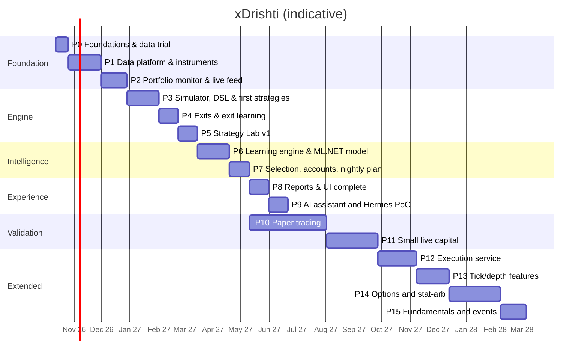

# 18 — Roadmap

Part-time (~10–12 h/week) with an AI coding assistant. Each phase ends with an exit criterion. Portfolio
monitoring comes early because it is useful on its own while the trading engine is being built.

| Phase | Deliverables | Exit criterion |
|-------|--------------|----------------|
| **P0 Foundations** (2w) | Answer open questions (doc 01 §5); review the **clickable prototype** (`docs/prototype/`); Podman machine (libkrun); repo skeleton: .NET solution, React (Vite) app, `compose.yaml` with `xd-db`; Keychain→secrets script; Dhan trial (Data API, API key/secret token flow, 1-minute history for 20 symbols); **CSV profile for your files** + sample import; `xd-llm` GPU benchmark; ML.NET spike on linux/arm64 | Data-quality note written; stack starts with one command |
| **P1 Data platform & instruments** (5w) | Dhan adapter (instrument master, history, accounts); **CSV import** (profiles, preview, validation, upsert, undo, folder watch, CLI); Timescale hypertables + continuous aggregates (5m…1h, 1D/1W/1M); corporate actions; calendar; *(the daily **context data** — index, VIX, breadth — is not part of P1: it moved to **P3-01d**, see the P3 slices)*; **master list, tracked instruments, baskets** (manual, rule-based, system); EOD fetch + backfill jobs; quality checks; **Data quality window** (validation service, stored-vs-recomputed aggregates, repair); React shell with **login (password; re-entry for sensitive actions), Accounts (list/detail tabs, role matrix, risk profiles, wizard), Services screen with schedule configuration & dependency checks**, Instruments, Baskets and Data/Import screens; commands/desired-state + audit | Your CSV history imported; 5 unattended EOD fetches; all timeframes match a hand-check on 10 samples |
| **P2 Portfolio monitor & live feed** (4w) | Account sync (holdings, positions, trade history, ledger — **trade history and ledger sync built in P2-13** ([ADR 0025](../adr/0025-dhan-trade-history-and-ledger-sync.md)); dividends entered by the owner and charges in **net** returns and net XIRR are **built in P2-14** ([ADR 0026](../adr/0026-dividends-entered-by-the-owner-and-charges-in-net-returns.md)); a **dividend payout file (CSV) is recognised by its headers, matched to holdings by scrip name with remembered corrections, previewed and imported with Undo — built in P2-15** ([ADR 0028](../adr/0028-dividend-csv-import-with-name-matching.md)); positions are not built); **self-healing syncs and actionable notifications are built in P2-16** ([ADR 0027](../adr/0027-self-healing-sync-and-actionable-notifications.md): quiet retries with back-off, catch-up after a reconnect, one earlier year of trade history read per day, attention items with buttons in the bell and as pop-ups); **Dhan's downloaded reports — the global transaction report (bill-level trades with charges), DP-charges sheets and the demat holding statement, as CSV, `.xls` or `.xlsx` — are previewed and imported with Undo in P2-17** ([ADR 0029](../adr/0029-dhan-report-imports-and-source-precedence.md); Dhan's own trades take precedence over the report's bill rows); **the review follow-ups of P2-13 … P2-17 are closed in P2-18** ([ADR 0030](../adr/0030-read-only-notices-retention-and-structured-failures.md): read-only notices, 30-day retention of resolved items, a bell item for dropped rows, structured failure kinds, a kind-aware sync guard, one phrase table, an `.xlsx` guard); transactions, FIFO lots, positions, buckets; CSV/manual trade import; **XIRR**, returns, benchmark; daily valuations; `xd-feed` live feed for the active set + quote polling for holdings; Portfolio screen (per-account tiles, **Action center**, price alerts, group by bucket/basket/account/sector, tree-grid, charts) | Portfolio values and XIRR match a spreadsheet check for 3 accounts/buckets; live P&L updates during market hours |
| **P3 Simulator, DSL & first strategies** (5w) | Streaming indicators and the feature frame, and the rules expression language with its compiler (**built**: P3-01 to P3-02, and by 2026-10-18 the strategy model, the walker, the scanner with ORB v1, fill realism, the pure replay with its run record and the run from stored bars over the ports, P3-02b to P3-04a; the export, the cards, the costs and the swing positions have Approved specs); then a typed strategy model, an event-driven simulator at signal level (conditional entries, stops, square-off, max hold, gaps, slippage, costs, MAE/MFE; runs from the stored bars, scoped by instruments or a basket) and the first strategies `ORB`, `VWAP_PULLBACK`, `BASE_BREAKOUT`. What is built, what is next and the check of each slice: [P3 slices](#p3-slices). P3 numbers are *signal-level* (per instrument; the portfolio limits of [doc 08](08-exits-and-risk.md) §7 are P7), *in-sample* (the rules were looked at on the same data; there is no hold-out) and *gross* (before costs) until the charge sheet is in. If the schedule runs late, `BASE_BREAKOUT` slides to P4 and the exit criterion is then met with the two intraday strategies (the owner's call) | 20 trades drawn at random (a seeded draw balanced over strategies, instruments and years) plus one trade of each unusual case that occurs (a SELL, a gap through a stop, a special session ...), each read by the project on the stored bars and on a second source and judged by explicit rules, a new draw after any fix; **P3 passes when `verify-pack --gate` gives `PASS` or `PASS_WITH_DATA_FINDINGS` on a pack drawn with the owner's seed and `scripts/check.sh` is green** (slice P3-09d, [ADR 0048](../adr/0048-the-automated-gate-replaces-the-owners-chart-check-as-the-p3-exit.md), which amends ADR 0046; decided by the owner on 2026-10-21). The owner's chart check against an external chart (the manual protocol in `docs/research/p3-hand-check.md`) stays valid as optional extra evidence and blocks nothing; the gate is not a chart-by-eye check |
| **P4 Exits & exit learning** (3w) | All exit policies incl. pyramiding; same-entries comparison; per-cell exit choice (walk-forward); MAE/MFE diagnostics | Chosen exits stable across folds |
| **P5 Strategy Lab v1** (3w) | Lab API + Hangfire runs + SignalR progress; verdict & report; test ledger; `xd` CLI; Strategy Lab page (Monaco + schema); basket as test universe; `xd-sandbox` for C# plugins | 3 of your own ideas tested end-to-end without code changes |
| **P6 Learning engine & ML.NET model** (5w) | Regime labels; cell stats (Bayesian, recency); triple-barrier labels; ML.NET LightGBM/FastTree + PAV calibration + feature contributions; model registry; drift, lifecycle, changelog, hypothesis loop; **lessons** (monitors → problem/fix/result), **experiments** (tweak & re-run replay with honest comparison rules), frozen-model counterfactual; **meta-labelling model, learned entry windows, automatic loss tags**; remaining strategies | Meta-model beats baselines OOS; calibration error ≤ 5 pp; a knob change can be replayed and compared in < 10 min |
| **P7 Selection, accounts & nightly plan** (3w) | Filters, merge, ranking, portfolio fill; per-account allocation (Trading-role accounts); **plan review & approval workflow with pre-trade checklist, suggestions inbox, review cutoff**; auto-journal; grading (primary/reserve/rejected); pre-open check; **autonomy levels with auto-approval at the cutoff**; **smart rules in the nightly plan** (market gate, equity-curve throttle, correlation-aware selection); **weekly learning digest**; fail-closed nightly pipeline; plan tickets join the live active set; **start depth recording** | Plans published 10 consecutive sessions unattended |
| **P8 Reports & UI** (3w) | All screens & reports: **Learning screen** (journey, lessons, plan vs actual, setups, tweak & re-run, autonomy), Overview with auto-insights, multi-basket comparison, pivot builder, lenses, filters, drill-down, exports, PWA; responsive 360 px → 4K | "What works, in which basket, on which TF, with which exit" answered in < 2 min |
| **P9 AI assistant** (3w) | `xd-llm`, `xd-mcp`, assistant endpoint & chat; briefing; data Q&A (incl. portfolio & baskets); strategy drafting; eval set; Hermes PoC (doc 14 §6) | Eval set passes; Hermes adopt/reject decided |
| **P10 Paper trading** (≥ 12w, from P7) | Follow plans on paper/minimal size; weekly review; config changes only via hypothesis loop | ≥ 60 graded trades; positive expectancy after costs within backtest band; drawdown within Monte Carlo 90th pct |
| **P11 Small live** (≥ 8w) | 25–50% of intended risk; live vs paper slippage; **execution feedback** (grade on fills, slippage per liquidity bucket, capacity score) | Live within expectations ⇒ scale gradually |
| **P12 Execution service** (6w) | `xd-exec`: state machine, pre-trade checks, broker-side stops, kill switch, reconciliation; Dhan sandbox → assisted → semi-auto → auto; ISP static IP | 30 semi-auto sessions with zero reconciliation breaks |
| **P13 Tick/depth features** (5w) | Microstructure features from ≥ 6 months recorded data; depth-based slippage | Kept only if OOS intraday expectancy improves |
| **P14 Options & stat-arb** (8w) | Option-chain archive, expired-options backtests, instrument-expression dimension, defined-risk structures; `PAIRS`/`BASIS` | An option expression beats cash/futures OOS after costs, else stays disabled |
| **P15 Fundamentals & events** (4w) | Point-in-time filings, quality filters, earnings features, `PEAD`, LLM extraction with validation | Features/filters improve OOS or are dropped |

## P3 slices

**P4-01 was built early (2026-10-21).** At the owner's request the exit tape and trades with legs ([P4-01](../specs/P4-01-the-exit-tape-and-trades-with-legs.md), [ADR 0049](../adr/0049-the-exit-tape-trades-with-legs-and-sim-6.md)) were built before the P3 exit check: engine `sim-6`, so a pack drawn under `sim-5` is void and the pack for the gate is drawn from a `sim-6` run. No exit policy was added and no production run makes a leg; see its row.

**Where we are (2026-10-19).** Built: the 56 features and the frame (P3-01 to P3-01c) and the rules language for one condition (P3-02), closed out on 2026-10-17; and, on 2026-10-18, the typed strategy model (P3-02b, ADR 0036), the trade walker (P3-03), the entry scanner, the `Simulator` and ORB v1 (P3-03a), fill realism (P3-03b, ADR 0038), the window-independent replay with its run record (P3-04), the run from stored bars over the ports (P3-04a, ADR 0039), all merged; the full `scripts/check.sh` after the merge of P3-04 ran 21,444 tests, 0 failed; and, on 2026-10-19, the swing positions held across sessions (P3-03d, ADR 0040, `sim-3`), the export library (P3-04b1: `XDrishti.SimExport`, the labels and the folder writer), the `simulate` verb (P3-04b2, ADR 0041, ADR 0037 Amendment 5) costs and sizing, the pure half (P3-03c, ADR 0042, ADR 0037 Amendment 6, `SimTrade` schema 4, `sim-4`), the daily evaluation and the overnight entry order (P3-03e, ADR 0043, ADR 0037 Amendment 7, `sim-5`, run-record schema 5) and the trade cards (P3-04c, built: `--cards 0..500`, default 200, export format `xd-sim-export-2`, the card rules in Amendment 1 of ADR 0041), and, on the same day, the cost choice in the request, the stored charge sheet, the `cost-sheet` verbs and the bill check (P3-03f, ADR 0044, ADR 0037 Amendment 8; migration `WidenAppSettingValue` applied to your database), all merged and deployed; the full `scripts/check.sh` before the merge of P3-03f ran 22,807 backend tests (22,779 passed, 28 explicit benchmarks skipped, 0 failed) and 3,415 frontend tests. Only the exit check of P3-03f is open: it needs your real charge sheet and bills. Until it passes, every real run must use `--gross` and says `costs: none`. The tick unit of the master list is verified: paise, read on the owner's own local database on 2026-10-19 (ADR 0038 item 6); a first run of the verb over three instruments was done as a script smoke, for data-quality facts only, and no trading numbers are quoted. The owner approved the specs P3-02b, P3-03, P3-03b and P3-04 on 2026-10-18 ("yes to all recommendations"), which settles plan questions Q1, Q2 and Q5 and the questions inside those specs, and the specs P3-03a and P3-04a the same day ("approve P3-03a and P3-04a"). The same day seven further specs were drafted and approved ("yes to all recommendations", which accepts their splits and recommended answers): the former row P3-04b in three parts (P3-04b1, P3-04b2, P3-04c; a fourth part, P3-04d, is only proposed, with no spec), the former rows P3-03c and P3-03d in two parts each (P3-03c and P3-03f; P3-03d and P3-03e). Also built and deployed on 2026-10-19: the exit policy tables (P3-02b2, ADR 0036 Amendment 1), `VWAP_PULLBACK` (P3-05, ADR 0041 Amendment 2), `BASE_BREAKOUT` (P3-06, ADR 0041 Amendment 3), the result store (P3-10, ADR 0045, ADR 0037 Amendment 9, migration `AddResearchResultStore` applied to your database), the verification pack and its `--check` (P3-09 parts A and B, ADR 0046, ADR 0041 Amendment 4; no pack has been drawn, because the seed is yours) and the independent oracle in its three parts (P3-08, ADR 0047). The full check at the last merge: 24,257 backend tests (24,224 passed, 33 explicit benchmarks skipped, 0 failed) and 3,415 frontend tests. **What is left of P3 is yours:** the real pack of P3-09 (your seed, Q6 and Q7, an external chart; about 7.5 to 12 hours of your time by the spec's estimate), the charge sheet that closes the exit check of P3-03f, the timed run of the 214 instruments, and the decisions of *Open owner decisions*, item 6. P3-04d (the conditions on the cards) is still only proposed. Still open: item 6 of *Open owner decisions* (your items only), Q4, Q6 and Q7. What you get, in order: a first run of the opening-range strategy on invented days (done, with P3-03a, at agent-day 7.2 by the sizes below); its first trades on your own data, with modelled fills and costs none, as files and a banner (P3-04b2, built; about agent-day 15.6 by the sizes below); the trade cards, so the early look at 3 to 5 ORB cards (P3-04c, built; about agent-day 18.1 by the sizes below); the 20-trade check against charts, which closes P3: all the slices it needs are built, and it waits for your time (the sizes put it at about agent-day 24.65 with the pack builder). Passing that check says the mechanics are right, not that any strategy has an edge. **Update 2026-10-21:** the owner chose a fully automated exit; the check is now the gate of P3-09d (ADR 0048), and the owner's chart check is optional.

P3 is built in slices. Each slice has a spec in [`docs/specs`](../specs/README.md) (Draft, Approved, Done) and, where it decides something, an ADR; the build history of the *Built* slices is in their ADRs. The *Wave* column says when a slice can start (the waves are described under *Order and size*) and the *Status* column where it stands: *Built*; *Spec Approved* (the owner approved it; agents may build it); *Approved, in build* (an agent is building it); *Proposed* (named by a spec as its next part, no spec file yet); *Spec Draft* (written, not yet approved); *Spec to be drafted* (on the path to the exit criterion above, no spec yet); *Later* (off that path, needed by P4 to P7; order below). Sizes are agent-days (see *Order and size*). The rules named in the rows that are not built (fills, exits, the first rule sets) are **proposals until their specs are Approved** (the specs of P3-02b, P3-03, P3-03b and P3-04 were approved on 2026-10-18 with plan questions Q1, Q2 and Q5 and the questions inside them, and those of P3-03a and P3-04a the same day; the seven specs of 2026-10-18 (P3-04b1, P3-04b2, P3-04c, P3-03c, P3-03f, P3-03d, P3-03e) were approved the same day with the splits and the recommended answers; P3-04d is proposed and has no spec; the others wait for their specs).

**Words used here.** *Exit path*: the slices that must be done before the 20-trade check. *Critical path*: the longest chain of them, which sets the earliest finish. *Wave* and *track*: slices that can be built at the same time; a track is a series of slices built one after another in a git worktree of its own. *Walking skeleton*: the thinnest version that runs from end to end. *Seam*: the one value passed between the entry scanner and the trade walker (an entry candidate), so that P4 can replay the same entries under other exits. *Oracle*: a second, plain implementation written without reading the first, to compare against. *Negative control*: a deliberately wrong version that a test must catch, to show that the test can fail. *R*: profit measured in units of the risk taken on the trade ([doc 08](08-exits-and-risk.md) §1); *MAE* and *MFE*: the worst and the best price the trade saw before it closed. *NFR-3*: runs are reproducible, any plan or test can be regenerated from a data snapshot, a config version and a model version ([doc 02](02-requirements.md)).

| Id | What | Wave | Size | Status | Spec / ADR | Exit check |
|----|------|------|------|--------|------------|------------|
| P3-01 | 19 streaming indicators and session fields, a `TimeframeBuilder` and a `FeatureFrame` over closed bars only (the frame never shows the forming bar) | - | - | Built | [spec](../specs/P3-01-streaming-indicators-and-feature-frame.md) · [ADR 0031](../adr/0031-streaming-indicators-and-the-feature-frame.md) | Each indicator equals an independent batch reference; `sma`, `ema`, `rsi` and `atr` agree with Skender; a prefix property proves no look-ahead and no hidden state |
| P3-01b | The frame API the DSL needs (closed flags per timeframe, value history for `close[1]`, crossings and `rising`, raw `open high low close volume`, an ordering guard) and 25 more features (ADX/DMI, MACD, Bollinger, Supertrend, ROC, `inside_bar`, `nr`, `engulfing`, `pivot_high/low` with ages), 44 in all | - | - | Built | [spec](../specs/P3-01b-frame-api-for-the-dsl-and-more-indicators.md) · [ADR 0032](../adr/0032-frame-history-closed-flags-and-the-remaining-indicators.md) | Every new indicator equals an independent batch reference and, where Skender has it, its cross-check; the prefix property (200 seeds) covers every new feature; steady state allocates 0 bytes |
| P3-01c | Weekly and monthly timeframes (a 1W / 1M bar closes at the last session of its period with a calendar, at the first bar of the next period without one), the `day_of_week` and `is_expiry_day` features and a daily `MarketContext` read as of the previous session (index trend / ADX / volatility percentile, VIX level / percentile / change, breadth, the nine-value regime); 12 new names, 56 in all | - | - | Built | [spec](../specs/P3-01c-weekly-monthly-timeframes-and-market-context.md) · [ADR 0033](../adr/0033-weekly-monthly-timeframes-calendar-features-and-the-market-context.md) | 1W / 1M buckets equal an independent batch grouping; a day's context never uses that day or later (prefix property); every context value equals an independent reference. The six build deviations of ADR 0033 (open question 8) wait for the owner |
| P3-02 | The rules expression language for one condition: parser (Superpower), binder against the 56 names, look-ahead lint (16 codes) and a compiler to expression trees; three-valued logic (a condition on data that is not ready is unknown, not false), `time` as the close time of the evaluated bar, lagged builtins refused across timeframes, errors as data with codes, spans and suggestions. Close-out 2026-10-17: the seven build deviations (ADR 0034 Amendments 1, 2, 3, 4, 7, 14 and 18) were decided on research under the owner's delegation (2026-10-16/17), the owner may revert; Amendment 2 was closed by ISS-12 (the *compiler warm-up*); per-session features keep the history of the session only (ISS-13) | - | - | Built | [spec](../specs/P3-02-rules-expression-language-lint-and-compiler.md) · [ADR 0034](../adr/0034-the-rules-expression-language-lint-and-compiler.md) · [ADR 0035](../adr/0035-per-session-features-keep-the-history-of-the-session-only.md) | A compiled condition equals an independent tree-walking interpreter on every test condition (the counts are in ADR 0034 and 0035); a look-ahead truncation and future-perturbation property with negative controls; 0 bytes per evaluation; warm compile 2.5–2.7 ms, first compile after the compiler warm-up 3–4.5 ms. Last `scripts/check.sh`: 20,225 tests, 0 failed, 15 skipped (the explicit benchmarks among them) |
| P3-02b | **Typed strategy model and the compile of its sections (no YAML).** Records in `XDrishti.Strategies.Model` (schema 1; at most four numeric `params`; per side `setup`, `trigger` and `invalidate` lists of `all`/`any` conditions, entry and stop kinds, exits, `time_rules`, an explicit sell block, filters as names) and `StrategyCompiler.Compile(definition, timeframe, side)`: one compiled side with the feature list a frame is created from, or problems located by path (`buy.trigger[1]`). Lists are decided at list level, so the 60-condition limit is not reached. Setup and trigger are evaluated together at every closed bar of the evaluation timeframe (settles doc 07 §1, "evaluated tonight", against doc 11's example). Kinds the simulator cannot run yet are accepted and refused by name later. The full parameter tables of the exit policies other than `FIXED_RR` and `PARTIAL_TRAIL` are cut into P3-02b2. | 1 | 3 d | Built (2026-10-18) | [spec](../specs/P3-02b-typed-strategy-model-and-compile-of-its-sections.md) · [ADR 0036](../adr/0036-the-typed-strategy-model-and-the-compile-of-its-sections.md) | Builders for the BUY side of doc 11's `VWAP_RSI_TREND` and for a bare ORB compile with the expected feature list; five params, a misspelt word in `buy.trigger[1]` (path and item-relative span), `[BUY, SELL]` without a sell block (names P3-02e), swing SELL and filters with no data are reported; list-level `all`/`any` equals the joined text on 200 seeded cases; the architecture tests stay green. Warm compile of the example side 0.19 ms, first compile after the warm-up 0.5 ms, side evaluation 31 ns, 0 bytes; the compiler warm-up now 92–95 ms. Last `scripts/check.sh`: 20,670 tests, 0 failed, 19 skipped (the explicit benchmarks among them) |
| P3-02b2 | **Exit policy tables of schema 1** (1.6 agent-days against the 1 of the first row, before P4; accepted as provisional until the spec of P4, which confirms or renames the names): the full parameter tables (names, required, ranges, the features each reads on E) of `PARTIAL_BE`, `ATR_TRAIL`, `STRUCTURE_TRAIL`, `EMA_TRAIL`, `PYRAMID` and the overlays `time_stop` and `event_exit`, each with a failing row and a near miss; the doc 08 and doc 16 wording. Settles at least the doc 16 names the draft tables do not carry (`cap_total_risk_to_initial` and `trail` of `PYRAMID`; `intraday_bars` and `swing_sessions` of the time stop; `EMA_TRAIL` and `PARTIAL_TRAIL` are in doc 08 §2 only) against doc 11's `trail: { type, mult }`, `PYRAMID` (`initial_pct` plus the sum of `add_pct` at most 100; `max_adds` at most the length of `add_at_rr`) and the time stop (`intraday_bars` from 1 to `(375 + T − 1) / T`, T the minutes of E); a non-whole value gives `feature_invalid` in `atr_period`, `lookback_bars` and `length` (they feed a catalog feature) and `field_shape` in the other four whole-number fields (spec question 5). The model may describe exits the simulator cannot run: a correct table compiles, the simulator refuses by name, and one new warning, `exit_not_evaluated`, tells the author (`ModelCodes` 46 to 47). Spec question 4 (drop `cap_total_risk_to_initial` and `trail` of `PYRAMID`, a change to written names in doc 16) is a precondition of approving it. | before P4 (first in the central build order) | 1.6 d | Built (2026-10-19) | [spec](../specs/P3-02b2-exit-policy-tables-of-schema-1.md) · [ADR 0036](../adr/0036-the-typed-strategy-model-and-the-compile-of-its-sections.md) Amendment 1 | Every policy and overlay has a table, a failing row and a near miss per parameter; the provisional names of ADR 0036 are final or renamed before any stored strategy uses them |
| P3-03 | **Simulator walking skeleton, part 1: the trade walker.** New pure project `XDrishti.Simulation` (Domain only at this stage) with the one value the two stages share, `EntryCandidate` (trigger bar, stop level, decision-time trace; no exit), and `TradeWalker` (candidate, later bars and an exit policy give a `SimTrade`, or the reason there is none; no frame in its namespace): the second stage of the two-stage seam. Rules of this slice: fill at the open of the first minute after the triggering bar within a bounded delay (5 minutes), stop first when one minute holds stop and target, a gapped stop at the open, FIXED_RR with square-off, R / MAE / MFE, fills exact and no costs (the trade says so). `SimTrade` (schema 1), `ExitReason`, `NoTradeReason` and `WalkCounters` live in `Domain/Research`. The entry scanner, the `Simulator` and ORB v1 were split off as P3-03a on 2026-10-18; the entry, exit, R and schema decisions were superseded by P3-03b (ADR 0038). | 1 | 1.2 d | Built (2026-10-18) | [spec](../specs/P3-03-simulator-walking-skeleton-scan-walk-and-orb.md) · [ADR 0037](../adr/0037-simulation-conventions-and-the-two-stage-seam.md) | Hand-calculated walker days and a table of walker rows equal field by field (target, stop, square-off, a fill through the stop, a missing minute, a fill delay of 0, 1 and 5 minutes against 6); two runs give identical bytes; a closed trade does not change when the minutes after it are removed or replaced (100 seeded series, with a negative control); the same candidate walked under different reward-to-risk values keeps its entry (the seam); the architecture suite is green; a walk allocates the same bytes however long the position lives |
| P3-03a | **Simulator walking skeleton, part 2: entry scanner, `Simulator` and ORB v1.** `EntryScanner` (1-minute bars through the frame; at each closed bar of the evaluation timeframe it emits a candidate with the trigger bar, the stop level, a decision-time trace and per-condition true/false/unknown counters; the entry window, the invalidation latch, one candidate per side and day, stale and late buckets counted), `Simulator` (compiles each side through P3-02b, refuses by name what it cannot run, scans and walks per side, returns `Trades`, `OpenAtEnd`, outcomes, counters and the header labels), `OrbV1` in `XDrishti.Strategies.BuiltIn` as a C# builder (15m, 15-minute opening range, close above `or_high` with `close[1]` at or below it, stop at the opposite side, FIXED_RR 2.0, entries 09:30 to 11:30, square-off 15:15, SELL written out; Q2), `ScanCounters` in `Domain/Research`, and `StrategyWarmupService` in `XDrishti.Api` (ISS-12). Entry kinds that need a ticket across bars, other stop kinds, a market context and filters are refused by name. | 1 | 3 d | Built (2026-10-18) | [spec](../specs/P3-03a-entry-scanner-simulator-and-orb-v1.md) · [ADR 0037](../adr/0037-simulation-conventions-and-the-two-stage-seam.md) Amendment 1 | The candidates equal the hand-made candidates of P3-03's tables on the invented ORB days (trace included); the window, the one-candidate rule, the invalidation order and the counters equal the hand count; a look-ahead property through the scanner and through `Simulator.Run` (100 seeded series, both sides; a peeking feed fails it); candidates are identical whatever the reward-to-risk; two runs give identical bytes; steady-state scanning allocates 0 bytes; the warm-up service returns before the warm-up is done. This is the first end-to-end run of the plan (ORB on invented days, hand-calculated trades) |
| P3-03b | **Fill realism.** One rule table in the walker: entry limit = trigger close + 0.1 % (doc 07 §2) rounded to the tick (fill at the open within it, at the limit, or a counted miss, never filled later); a stop gapped through fills at the bar's open; a target fills at the target; a minute holding stop and target is the stop; square-off at the first existing bar at or after the time; slippage from a typed config with the doc 16 defaults, stored in the run record; tick size from the instrument master, which gives paise and is converted once (0.05, flagged, when missing; the stored column holds paise, verified on the owner's database on 2026-10-19, ISS-18). `SimTrade` schema 2 gains `RExact`, `RFilled`, `SlippageR`, the filled prices, `EntryFill` and `TickFallback`; `SimulationEngine.Version` is `sim-2`. Entry kinds that need a ticket across bars (`stop_above_high`, `limit_pullback`) are refused by name. | 2 (A) | 2 d | Built (2026-10-18) | [spec](../specs/P3-03b-fill-realism-gaps-slippage-ticks-and-minute-order.md) · [ADR 0038](../adr/0038-fill-realism-the-entry-limit-gaps-slippage-ticks-and-the-order-inside-a-minute.md) (supersedes ADR 0037 D3, D4, D5 and D7; D1, D6, D8 and D9 stand) | At least 12 hand-calculated fills equal to the paisa (gaps through stop and target, stop and target in one minute, a missing minute, square-off minute missing, limit hit and missed, tick rounding); slippage never improves a fill (500 seeded days) and zero slippage reproduces P3-03. What is not modelled is ISS-18 |
| P3-04 | **Window-independent replay, data notes and the run record (pure: bars in, record out, no I/O).** `InstrumentReplayer.Replay` (namespace `XDrishti.Simulation.Replay`) runs a prepared strategy over the raw 1-minute bars of one instrument, from its first stored session, with adjustment factors and a calendar given as values; entries are taken from that session on and only the trades are cut to `[from, to]` (`TradesBeforeWindow` counts the rest), so a trade does not depend on the window. The run record (NFR-3) lives in `Domain/Research` with `BarStreamHash` and `RunAssembler`: strategy JSON and SHA-256, params, engine version, data range per instrument, SHA-256 of the bar stream, `IgnoredBars`, `IncompleteBarsConsumed`, lost decisions, counters, a run key. Data notes: non-regular sessions and sessions under 90 % of the expected minutes are skipped and counted; an overnight open beyond ±20 % with no applied action is flagged, gets no entry and restarts the indicators from that day, as a fresh frame (ISS-20; the cost is that a strategy reading a daily average such as `tf("1D").ema(50)` takes no entry for about 50 sessions after it, spec question 3); an `EndOfData` trade is listed apart from `Trades`. Reading the bars, the universe, the skip list of the runner and the guard against adjusting a CSV-adjusted series twice are P3-04a. | 2 (B) | 1.5 d | Built (2026-10-18) | [spec](../specs/P3-04-run-from-stored-bars-window-independent-replay.md) · [ADR 0037](../adr/0037-simulation-conventions-and-the-two-stage-seam.md) Amendment 2 | A replay for `[d2, d3]` gives the trades of the replay for `[d1, d3]` that fall in its window, with equal counters; an `EndOfData` trade is in `OpenAtEnd`, not in `Trades`; a table of 18 session cases (a Muhurat-like 60-bar date, a Saturday session) and one of 14 discontinuity cases (a 2× jump, a split) give the stated notes; an applied action is applied once; the bar-stream hash has known answers and changes with one tick; the run record is a golden text, and a look-ahead property (100 seeded series) holds. Last `scripts/check.sh` after the merge: 21,444 tests, 0 failed |
| P3-04a | **Run from stored bars over the ports.** The use case `RunSimulationHandler` in Application (request: built-in strategy id and parameters, timeframe, window, instruments or a manual basket, fill rules, an acknowledgement for CSV-adjusted series), with validation and refusals before any read (an unknown strategy or parameter, a definition the compiler refuses, a plan that needs a context or expiry days: `simulation.invalid`, `simulation.strategy_invalid`, `simulation.basket_not_found`). The engine sits behind the port `ISimulationEngine` (with an opaque `IPreparedStrategy`) in `Application/Abstractions/Research`; its adapter `SimulationEngineAdapter` is in Infrastructure, the one project that references `XDrishti.Simulation`; the layering rule (an engine module is reached from an adapter, never from Application) is ADR 0039 with an architecture test. Per instrument, one at a time: `IBarStore.ReadAsync` (raw prices from the first stored bar), the applied corporate actions, the tick size read with the instrument (`TickSpec.FromMasterPaise`; an invalid tick is a skip), the guard against adjusting a CSV-adjusted series twice (`csv_adjusted_twice`: a skip unless the request acknowledges it), then the replay of P3-04 and the record of its assembler. Universe: instruments as listed, or a manual basket's current members labelled "members as of today" (a portfolio basket is not a universe in P3); the skip list gives a reason per instrument. Nothing is written to a table; no API change. | 2 (B), after P3-04 | 2.5 d | Built (2026-10-18) | [spec](../specs/P3-04a-run-from-stored-bars-over-the-ports.md) · [ADR 0039](../adr/0039-an-engine-module-is-reached-from-an-adapter-in-infrastructure-never-from-application.md) · [ADR 0037](../adr/0037-simulation-conventions-and-the-two-stage-seam.md) Amendment 3 | Testcontainers, through the real ports: a split applied in the database halves every price exactly once; a CSV-adjusted series is skipped as `csv_adjusted_twice` unless acknowledged; an id with no row, an instrument without bars and an invalid tick are in the skip list and the run goes on; the read window runs from 2000-01-01 to the end of `To`; reads are one at a time in the order of the universe; the record equals the assembler's on direct replays; an end-to-end run of an F1-shaped day, an F2-shaped day and a basket of three equals the walker tables of P3-03; Application references Domain only; the log lines carry no price, bar or strategy text |
| P3-04b1 | **Export library: the files, the labels and the folder writer** (first of the four parts of the former row P3-04b). A new pure project `XDrishti.SimExport` (Domain only; no database, no verb, no I/O) turns a finished `SimulationRun` into the bytes of `trades.csv`, `open_at_end.csv`, `run.json` and `README.txt`, with a `manifest.json` that lets a reader check them, an export key and a run id; one spelling per enum value for the CSV and the JSON; spreadsheet-formula safe cells; the labels that say what a P3 number means (`RunLabels`, `RunBanner`: exploration, in-sample, fills modelled, costs none, the engine line, the nine not-modelled limits of `FillLimits` with the reworded `touch_is_fill`) and no performance statistic in any file. A host-side folder writer puts `data/exports/sim/<run-id>/` in place atomically, with owner-only permissions at creation, a path guard and a safe overwrite policy (`--force` keeps one `.previous`). Also `TickUnitCheck` (flags a share stored as 0.05, which would be 0.0005 rupee) and a shared `GoldenFile` test helper. The same record gives identical bytes. Needs P3-04a and P3-03b (both built). | 2 (B), after P3-04a | 2.4 d | Built (2026-10-19) | [spec](../specs/P3-04b1-the-export-library-files-labels-and-folder-writer.md) · [ADR 0041](../adr/0041-the-simulate-verb-the-export-library-and-the-pipeline-in-the-host.md) (the export, the verb and the cards) | Every enum reachable from the run has one spelling used by both writers; `trades.csv` and `run.json` equal golden files byte for byte (UTF-8, no byte order mark, round-trip numbers) and `run.json` parses back to the record; a cell that a spreadsheet would read as a formula gets a leading `'`, also after zero-width or control characters; no text of `FillLimits` or of the labels holds a performance word (a whole-word list); the tick check flags only the share stored as 0.05; manifest and export key are known answers; the folder is `0700` / `0600` at creation, the same input again is `Unchanged`, another input is refused without `--force`, a symbolic link or `..` in a path is refused; rendering 200,000 trades allocates a bounded amount; `XDrishti.SimExport` references Domain only (an IL scan with a sentinel) |
| P3-04b2 | **The `simulate` verb** (second part of the former row P3-04b). A one-shot verb in the Api host next to `migrate` and `owner-reset` (dispatch only on `args[0] == "simulate"`), with `scripts/simulate.sh` (`--list-strategies`; strategy from a table-driven registry that starts with ORB; symbols, an ISIN or a manual basket; from, to; `--fills no-slippage`): it resolves the universe, runs `RunSimulationHandler` of P3-04a, writes the files of P3-04b1 and prints the banner and a summary (counts and the timing of the phases, no performance statistic). The tick unit of the master list is checked before the first real run and before any bar is read; a failing gate exits 1. Exit codes and located problems on stderr; no API, no table, no migration; the handler stays host-agnostic and moves behind the Lab API in P5. Needs P3-04b1, P3-04a and P3-03b. | 2 (B), after P3-04b1 | 2.0 d | Built (2026-10-19) | [spec](../specs/P3-04b2-the-simulate-verb.md) · [ADR 0041](../adr/0041-the-simulate-verb-the-export-library-and-the-pipeline-in-the-host.md) · [ADR 0037](../adr/0037-simulation-conventions-and-the-two-stage-seam.md) Amendment 5 | The dispatch selects the verb only on `args[0]`; a table of 30 and more command lines parses as stated; an unknown strategy, parameter, symbol or basket exits 1 with located problems and writes nothing; the tick gate exits 1 before any bar is read when a share is stored as 0.05; the banner equals the `labels` of `run.json` and `README.txt`; no performance statistic in stdout or stderr; a byte scan of stdout, stderr, the logs and the files finds no password or key; the end-to-end run (an F1-shaped day, an F2-shaped day, a split, a basket) with an empty vault key equals the table of P3-04a and changes no table. The tick unit was read on the owner's own database on 2026-10-19 and written into ADR 0038 item 6 (paise); a first run over three instruments was a script smoke (data-quality facts only, no trading numbers quoted); the timed run of his 214 instruments is still open. This is the first real-data run with modelled fills |
| P3-04c | **Trade cards: the selection, the chart and the static HTML** (third part of the former row P3-04b). `--cards <0..500>` on the verb (built; default 200, the cap of the old row; the owner passes 5 for the early look): a deterministic, capped sample (seeded by the run key, equal-weight round-robin over the strata, `CardSelection` and `SeededRank`) and, per chosen trade, one self-contained HTML card plus `index.html`: banner, title, inline SVG 1-minute candles of the trade day with entry, stop, target and exit, the timeline, the R arithmetic with every operand printed, the rule text from the recorded definition, the stored 09:15 bar and the data notes of the instrument. A second read of the bars of the instruments with a chosen trade, one at a time, with a guard against a changed database (`simulation.cards_stale`, exit 1, nothing written). A card has no script and no network reference and escapes everything; no statistic anywhere. It prints one line where the conditions at the decision bar would be (they are P3-04d). Extends P3-04b1 and P3-04b2 without modifying them; its extension point for P3-09 is `BuildTradeCardsQuery(Run, TradeKeys)`. | 2 (B), after P3-04b2 | 2.5 d | Built (2026-10-19) | [spec](../specs/P3-04c-trade-cards-selection-chart-and-static-html.md) · [ADR 0041](../adr/0041-the-simulate-verb-the-export-library-and-the-pipeline-in-the-host.md) Amendment 1 (the card rules; export format `xd-sim-export-2`; log event ids 4410 and 4411) | The selection equals hand-calculated examples and is the whole list when it fits; only the instruments with a chosen trade are read; a changed database refuses the cards; a card equals a golden file (a BUY at the target and a SELL at the stop, one on a split instrument and one on a day with a missing minute); injection strings in a symbol, a rule item or a note come out escaped and inert; no statistic in a card or the index; two runs give identical bytes; the end-to-end run with `--cards 3` has the right trades and the split instrument's chart halved once. The owner looks at 3 to 5 cards of a real run: an early look at rule intent, not the exit criterion |
| P3-04d | **Proposed, no spec file: the decision trace and the "conditions at the decision bar" section of a card** (fourth part of the former row P3-04b): `ISimulationEngine.Explain`, `TradeExplanation` and the extraction of the full input reader. The replay keeps no trace today (`SimTrade.EntrySnapshotJson` is always null and `InstrumentReplay` holds only trades), so the truth and values of every condition need a replay; the chart does not. P3-04c prints one line saying so. Whether the 20-trade check needs it is the owner's choice (P3-09 has no spec yet: UNVERIFIED). | 2 (B), after P3-04c | 1.3 d | Proposed | Spec to be drafted (the size is the one P3-04c and P3-04b2 state) | Spec to be drafted |
| P3-03d | **Swing positions, part A** (the former row, with its daily evaluation split off as P3-03e). A swing strategy evaluated inside the session (30m or 1h, BUY only: swing SELL is refused already by the compile of P3-02b) is held across sessions: stop and target keep working, a stop gapped through overnight fills at the next open and a target gives no improvement (it fills at the target, ADR 0038); `MAX_HOLD` N sessions (1 to 5, counted with the trading calendar; the entry session is session 1, spec question 1) exits at the close of the last 1-minute bar of session N, with the base slippage; an intraday trade is still flat at square-off. A position gate in `Simulator.Run`: per instrument and side, a candidate decided before the previous exit ends is not walked and is counted (`PositionOpen`); it is applied between walks, because it needs the previous exit, and the seam of P4 stays intact. `SimTrade` schema 3 (`SessionsHeld`, `SessionsUnseen`, `ExitReason.MaxHold`, 32 fields), `sim-3`, run-record schema 3 and the replay rules (a position open across a flagged day is excluded and counted, strict at `To`: a position still open there is `OpenAtEnd`); `FillLimits` gets one more code, `dividends_not_modelled`, and the `auction_open` text is corrected for gap exits. A decision at the close of the session (15:30) is still a counted `NoFillBar` here. The clause "delivery cost rates by style" of the old row belongs to P3-03c. Needs P3-03a, P3-03b, P3-04 and P3-04a (built); merges first of the three. | 2 (A) | 3.5 d (3.2 priced; the old row said 2) | Built (2026-10-18) | [spec](../specs/P3-03d-swing-positions-held-across-sessions.md) · [ADR 0040](../adr/0040-swing-positions-held-across-sessions-the-maximum-hold-the-position-gate-and-simtrade-schema-3.md) (supersedes decision 8 of ADR 0038; the number is the next free one at the time of the build and is assigned again at merge if another ADR took it) · [ADR 0037](../adr/0037-simulation-conventions-and-the-two-stage-seam.md) Amendment 4 | Hand-calculated rows equal the table (a hold over two nights with the same stop level, an overnight stop gap at the open, a target gapped over giving the target, `MAX_HOLD` across a holiday by the calendar, the end of the data, a session the walker never sees); the intraday trades are byte-identical in the schema-2 view; the gate equals a ten-line reference loop on 500 seeded multi-day series; a closed trade does not depend on the minutes after it (500 series, with three negative controls that fail); window properties for `From` and for `To`; the five golden files are regenerated and differ only where the spec lists; the counter identities hold on every fixture. Built: the rows M, K, G, J and Q equal the spec to the figure; the three negative controls of the leak property fail on 233, 113 and 18 of 500 series (the real walker on none) and the two window controls on 57 and 75 of 100. Last `scripts/check.sh` (on the worktree, before the merge): 21,781 tests, 0 failed |
| P3-03c | **Costs and sizing, the pure half** (the former row, split; the half that needs the owner's sheet is P3-03f). No request field: every run through the handler stays gross and says `costs: none`. A pure `CostSheet` (validated and fail closed: a missing or null rate makes a sheet impossible; effective-dated schedules; canonical JSON and hashes; a depository charge per delivery sale, `dp_charge_per_sell`, 0 allowed), `CostModel` (brokerage with its cap and minimum, STT/CTT, exchange transaction, SEBI fee, stamp duty on the buy leg, GST, intraday and delivery; decimal, rounded per line and per leg), sizing from a simulated capital and a risk profile (`standard`: 0.5 % risk, 25 % max capital; `floor(min(risk amount / stop distance, max capital / entry))`), and `TradeCostApplier`: a trade is skipped, and counted, when the quantity is below 1 or cost in R is above `max_cost_R` (0.10, doc 08 §6); `RNet = RFilled − CostR`, with the 16 charge lines on the trade. `SimTrade` schema 4 (`Costing` is the 33rd field), `sim-4`, run-record schema 4, two skip fates, the run key and the labels (the sizing line reads "a trade under 1 share or whose charge is above <z> of its risk taken is skipped and counted"; the first wording was refused by the performance-word scan of the export). Built against a TEST sheet that only the test projects hold (id prefix `test-`). The skip of a swing trade still blocks the position gate of P3-03d (named limit `swing_gate_before_costing`, owner question 2). Needs P3-03b, P3-04 and P3-04a (built); merged after P3-03d. | 2 (C), after P3-03d | 2.3 d (the old row said 2) | Built (2026-10-19) | [spec](../specs/P3-03c-costs-and-sizing-the-charge-sheet-the-quantity-and-net-r.md) · [ADR 0042](../adr/0042-costs-and-sizing-the-charge-sheet-the-quantity-net-r-and-simtrade-schema-4.md) (supersedes the statements `Costs = None` and the constant label `costs: none` of ADR 0037) · [ADR 0037](../adr/0037-simulation-conventions-and-the-two-stage-seam.md) Amendment 6 | Eight worked trades equal the printed figures to the paisa, line by line; the rounding rules and the brokerage branches by table; properties on 2,000 seeded legs and 500 seeded days (`RNet <= RFilled <= RExact`, cost monotone in turnover, the quantity never above the risk or capital budget, doubling the capital gives 2q or 2q + 1); a trade on each side of an effective date uses its own schedule; five deliberate faults (stamp duty on sells, GST on STT, ignoring the cap, rounding the quantity instead of flooring it, rounding the total once) each fail a test; a date before the first schedule fails closed; the handler is unchanged and gross; the seeded `standard` profile equals the code's |
| P3-03f | **Costs, second half: the cost choice in the request, the stored charge sheet, the verbs and the bill check.** The request names its cost choice in its type (`CostChoice`: a stored sheet with a capital and a profile, or gross by name; there is no zero-cost run by omission); an unknown sheet, a `test-` sheet or one that begins after the window refuses the run before any bar is read. The sheet is one row of `platform.app_settings` (`research.cost_sheet.<id>`; a migration widens the value column from 500 to 8,000), versioned by id and embedded in every run record. The one-shot verb `cost-sheet` (`load`, `show`, `check`, with `scripts/cost-sheet.sh`) shares the verb host and dispatcher of P3-04b2: whichever of the two merges second adopts the other's. `check` reads the owner's original Dhan global transaction report files line by line (the stored bills hold one charge total each, so the lines cannot be derived from them), compares each charge with the model within 0.05 rupee per bill, proposes implied rates and never stores them or writes `checked`. Nothing in `src/` holds a rate. Built: the request type, the store, the migration `WidenAppSettingValue` (applied to the owner's database: `platform.app_settings.value` varchar(500) to varchar(8000), verified), the verbs `cost-sheet load|show|check` with `scripts/cost-sheet.sh`, and the `simulate` flags `--gross`, `--costs`, `--capital`, `--profile` and `--max-cost-r`; the exit check below is open. Needs P3-03c, P3-04a and P2-17 (built) and the verb host of P3-04b2; **needs the owner's charge sheet (Q3, ISS-25).** | 2 (C), after P3-03c and P3-04b2 | 1.6 d | Built except the exit check (2026-10-19) | [spec](../specs/P3-03f-the-cost-choice-the-stored-charge-sheet-the-verbs-and-the-bill-check.md) · [ADR 0044](../adr/0044-the-cost-choice-the-stored-charge-sheet-the-cost-sheet-verbs-and-the-bill-check.md) · [ADR 0037](../adr/0037-simulation-conventions-and-the-two-stage-seam.md) Amendment 8 (log event ids 4412 to 4414) | With the owner's sheet loaded: at least six worked examples from his sheet (three intraday, three delivery, one each side of an effective date if the sheet has two) equal `CostModel` to the paisa; `cost-sheet check` on his original report files has every classified row within 0.05 rupee or lists the rows beyond it with a reason found; then `checked` is written and the labels stop saying "not checked against bills". Until then every real run is `--gross` and says `costs: none`. Without the sheet: a run with no cost choice is `simulation.invalid`, an unknown or `test-` sheet is refused before any bar, a run with a stored sheet equals P3-03c's hand figures through the real ports, and the migration leaves the other settings untouched |
| P3-03e | **The daily evaluation and the overnight entry order** (part B of the former P3-03d, split off; the owner confirms). A 1D strategy is accepted (1W and 1M stay refused): the decision is taken at the step that closes the daily bar, and a bar closed late by a missing 15:29 minute is stale and counted. A decision that ends the session (a 1D bar, or the last 30m or 1h bar at 15:30, owner question 2) places an order that rests overnight and fills at the next trading session's open within the +0.1 % limit (a miss is counted, never retried); an order still pending when the data ends is its own outcome (`OrderPendingAtEnd`), not a missed fill, so that window independence holds. The four level stop kinds (`swing_low`, `swing_high`, `bar_low`, `bar_high`; zero buffer, read on the evaluation timeframe) are accepted; ATR stops and buffers stay refused for P3-05 (owner question 3). The trade key follows the decision date. `SimTrade` gains no field; the engine is `sim-5` and the run-record schema 5. Needs P3-03d; built after P3-03c; serves only P3-06 and slides with it. | 2 (A), after P3-03c | 1.5 d | Built (2026-10-19) | [spec](../specs/P3-03e-the-daily-evaluation-and-the-overnight-entry-order.md) · [ADR 0043](../adr/0043-the-daily-evaluation-and-the-overnight-entry-order-sim-5-and-run-record-schema-5.md) (engine `sim-5`, run-record schema 5; `SimTrade` stays schema 4) · [ADR 0037](../adr/0037-simulation-conventions-and-the-two-stage-seam.md) Amendment 7 | Hand rows O1 to O8 equal the table in both fill modes; a daily strategy over 12 invented sessions through the replay gives decisions at 15:30, entries at the next 09:15, one `MAX_HOLD` exit at session 5, a gap-through-stop exit, a counted miss and a pending order at the end; the prefix property for the last day of a window over 100 seeded daily series; look-ahead over 500 seeded daily series, with a negative control that fails; the frozen sim-4 view of every earlier output is byte-identical under the new version; 1W and 1M are still refused |
| P3-05 | **`VWAP_PULLBACK`**, the second built-in strategy, as a C# builder; a draft for the owner (doc 07 §3 names it, nothing defines it; the rule set is a proposal until the owner approves its spec). 15m, intraday, BUY with an explicit sell block, setup on `tf("1h")` and `tf("1D")` trend; trigger two closes above `vwap`, a dip bar that makes a lower low and whose low is within `pull_atr` × `atr(14)` above `vwap` (the lower low is added by the draft, question 1), then a close above `vwap` and `open`; stop `swing_low` over 2 bars, the pullback low, with no buffer (not the row's `bar_low`: question 3); FIXED_RR; two parameters, `pull_atr` and `rr`; entries 10:00 to 14:30 (the lagged reads are unknown until bar 3), square-off 15:15. The level stop kinds are accepted (P3-03e, built); ATR stops and buffers are not needed by this rule set and are a separate optional slice of about 1.5 agent-days (spec question 3). This slice owns the registry range mechanism for built-in parameters (`Min`, `Max` and `MinExclusive` on `BuiltInParameterInfo`, `simulation.parameter_out_of_range`, shown by `--list-strategies`), which P3-06 uses. | 3, after P3-02b2 in the central order | 2.7 d (the row said 2) | Built (2026-10-19) | [spec](../specs/P3-05-vwap-pullback-the-second-built-in-strategy.md) · [ADR 0041](../adr/0041-the-simulate-verb-the-export-library-and-the-pipeline-in-the-host.md) Amendment 2 | A hand-calculated two-day fixture with three triggers (one fires, one blocked by the setup, one before the first entry); no trade fires on the first evaluations of a session (ADR 0035); a plain reference loop written from the rule text before the engine is read reproduces 50 seeded random days exactly; the owner looks at 3 to 5 cards |
| P3-06 | **`BASE_BREAKOUT`**, the third built-in strategy, swing, BUY only; a draft (nothing in `docs/` defines it). Evaluated on 1D at the step that closes the daily bar, filled at the next session's open within the limit; setup on `tf("1W")` and a 1D trend, a tight base (`(highest − lowest) / lowest × 100 <= base_pct`) and `rel_volume(20) >= vol_x`; trigger `close >= highest(base_len, source=close)` (a new closing high, the spelling that exists, ISS-24); stop `lowest(base_len)`; FIXED_RR 2.0 plus `MAX_HOLD` 5. Needs the daily evaluation, the overnight entry order and the level stops of P3-03e and the swing walk of P3-03d (both built) and the range mechanism of P3-05. The draft differs from this row in places the owner decides: the base is read on daily closes with today included, not on weekly highs and lows (question 2); the weekly trend gate is kept though it depends on the weekday (question 4); the four parameters get ranges (question 5); the `--timeframe` check of the verb is lifted for a daily strategy (question 6); the daily close and volume come from the minutes (question 10). Its own 20-trade check is blocked until P3-04d exists or a hand recompute is chosen (question 7). Variant B (a buy-stop above the signal day's high) needs cross-session tickets and is not in P3. May slide to the first slice of P4: the exit criterion is then met with two intraday strategies (the owner's call) | 3, after P3-05 | 2 d | Built (2026-10-19) | [spec](../specs/P3-06-base-breakout-the-third-built-in-strategy.md) · [ADR 0041](../adr/0041-the-simulate-verb-the-export-library-and-the-pipeline-in-the-host.md) Amendment 3 (the `trades.csv` key now follows the decision date) | A fixture where today's high exceeds the 20-day high but the level stays the last closed day's; a 3-session hold with a `MAX_HOLD` exit; a gap above the entry limit is a counted miss; params at most 4; a plain reference loop reproduces 50 seeded multi-day series exactly; the weekly bars use the calendar fixture of ADR 0033 |
| P3-08 | **Independent walker oracle and leak properties.** A plain reference walker and gate, the oracle, in a separate test library `tests/XDrishti.SimOracle` that references nothing (loops over 1-minute arrays, no frame, no compiler), written by a second agent from the rule tables only; the hand tables of the specs are entered as its data; compared with the engine through an adapter in `XDrishti.Simulation.Tests` on seeded adversarial series (gaps, holes, ties, zero volume, a special session, a missing 15:29 minute), with a log and a triage of every difference. Proposed split, to be confirmed at approval (question 1): P3-08 the walker and gate oracle (2.9 d), P3-08c the cost oracle, the cost chain and the label (1.3 d; it does not wait for the owner's charge sheet), P3-08b the added leak and invariance properties (0.85 d): truncation and perturbation, independence (instrument order, a fresh frame versus `Reset`), determinism, scale invariance, `RNet <= RFilled <= RExact`, each with a negative control. Built in the three parts (P3-08 body, P3-08b, P3-08c; ADR 0047): the oracle was written by an independent author in a clean room and compared with the engine by the engine owner; it agrees on every compared field (no disagreement over about 18,500 walk series and 14,400 cost cases; the five ratio fields were bit-equal, so no tolerance is used), and the evidence is rated moderate, not strong. The disagreement log holds three class A entries (D-01 to D-03, for the owner's eye) and one open class B entry, Q3-MFE (ISS-28). The engine line of every run now reads "engine: agrees with a separately written reference implementation of the rule tables (P3-08, sim-5); not checked against charts or the owner's charge sheet", bound to the run's engine version, with a fallback line, which says that the engine is not verified for its version, for a run of another engine version. | 3, after P3-03d and P3-03c (both built) | 5.05 d (the row said 3; 2.9 + 1.3 + 0.85) | Built (2026-10-19) | [spec](../specs/P3-08-independent-walker-oracle-and-leak-properties.md) · [ADR 0047](../adr/0047-the-oracle-and-the-rule-table-gaps.md) · [disagreement log](../research/p3-08-disagreements.md) | The oracle reproduces every hand-calculated table of the specs and agrees with the engine on at least 500 seeded series per edge category; at least 20 deliberate faults in the oracle (fill on the signal minute, stop after target, a gap filled at the stop price, an off-by-one minute, a cost sign) are caught by the hand tables; every negative control (a filler that fills in the signal minute, a stop checker that peeks at the next bar, a universe-dependent fill, a scanner that reads the next bar) fails its property while the honest run reports none |
| P3-09 | **Verification pack and the 20-trade check.** A seeded, stratified sampler (outside the engine; the seed is written down; *stratified* means balanced over strategy, instrument and year) draws 20 trades across the strategies, instruments and years plus one trade of each edge category that occurs (SELL, gap exit, a hole through a stop, a stop in the entry minute, the first evaluation of a session, a special session, `MAX_HOLD`, `end_of_data`, an incomplete bar) and writes their cards with a recompute sheet. The protocol, approved by the owner before the pack is built, fixes the bar labels (start of the bar, India time), the comparison view (a 1-minute chart resampled with 09:15 anchoring, not official daily candles), the tolerances (price to the tick, charges to the paisa, R to 0.01), the defect classes (data, model, implementation), at least 5 of the 20 against an external chart, and a new random 20 after any fix. Needs the owner's verification protocol (Q6 and Q7), the cards of P3-04c (its `BuildTradeCardsQuery` renders any set of trade keys), the conditions of P3-04d only if the owner wants them (P3-06's own check needs P3-04d or a hand recompute), the stored cost sheet of P3-03f for net R (the net addendum comes after the sheet and the bill check; the first pack is gross), P3-08, P3-05 and P3-06. The draft is a verb of its own (`verify-pack`) that writes the pack with a blind log and `pack.json`, and a `--check` mode that compares the owner's log with the engine values; proposed split, question 10: Part A the pack builder (2.85 d) and Part B `--check` (0.6 d). It recommends two rounds, A on ORB and B on the other two strategies; closing P3 on ORB alone is not a reading of the exit criterion but an explicit amendment of it by the owner (question 5). | 4, last in the central order | 3.45 d (the row said 2; 2.85 + 0.6) | Built, no pack drawn (2026-10-19) | [spec](../specs/P3-09-verification-pack-and-the-20-trade-check.md) · protocol in `docs/research/p3-hand-check.md` · [ADR 0046](../adr/0046-the-verification-pack-and-the-20-trade-check.md) · [ADR 0041](../adr/0041-the-simulate-verb-the-export-library-and-the-pipeline-in-the-host.md) Amendment 4; log event ids 4419 to 4422 | Automated: the same seed gives a byte-identical pack. The P3 exit criterion is now the automated gate of P3-09d (2026-10-21, ADR 0048): the status `PASS` or `PASS_WITH_DATA_FINDINGS` and a green `scripts/check.sh`, with the seed, the pack id, the run keys and the gate's input hashes recorded. The owner's manual check of the pack (every trade signed against charts, at most 29 trades) is optional extra evidence. Passing says the mechanics follow the rules on an independent reading of the bars, not that the rules match a chart by eye and not that any strategy has an edge |
| P3-10 | **Result store**: migration for the `research` schema (doc 03 §5) with `research.sim_runs` (the reproducibility facts of doc 11 §6) and `research.sim_trades` (every `SimTrade` field), insert-only for `xd_app`, idempotent by run key. The draft stores a run only on request (`--store` on the verb, default off), in typed columns (about 65 for a trade, a migration) and in plain tables, not hypertables; the record travels as text, the labels are not stored, a run costed by a `test-` sheet is refused. Needed by P4 (same-entries comparison across exit policies) and P5; the central build order puts it before P3-09, but nothing on the exit path needs it, so it may slide to the first slice of P4 (cut line 2.4 d, spec Size). | Later, before P4 (built before P3-09 in the central order) | 3.0 d (the row said 2) | Built (2026-10-19) | [spec](../specs/P3-10-the-result-store-sim-runs-and-sim-trades.md) · [ADR 0045](../adr/0045-the-result-store-sim-runs-and-sim-trades.md) · [ADR 0037](../adr/0037-simulation-conventions-and-the-two-stage-seam.md) Amendment 9 · log event ids 4415 to 4418 · migration `AddResearchResultStore` (applied to the owner's database: schema `research`, `sim_runs`, `sim_trades`; `xd_app` has SELECT and INSERT only) | The migration applies on a clean database; a round trip equals the in-memory run; storing the same run key twice is idempotent; a grants test as `xd_app`; `trades.csv` from the store equals the one from memory |
| P3-09c | **The assisted check**: `verify-pack --assist` reads each pack row's day from a second source (Dhan `charts/intraday` or a TradingView export folder), compares the stored bars, reads each trade blind with an independent chart reader (`XDrishti.SimReader`, no reference to the engine) and writes `assist-log.csv` and a report; the owner reads the exceptions and at least 5 rows on a real chart and signs. Amends the exit rule of the check (an auto-read row does not count as one of the 5 external ones); the owner's part is superseded as the exit by P3-09d. | 4, before P3-09's real check | 2 d | Approved, built; open: the owner's real run (AC 8) | [spec](../specs/P3-09c-the-assisted-check.md) | Reader equals the real engine on 6,000 seeded invented opening-range days, both sides (the oracle's series are not days a reader can read, so this replaces the 5,000 oracle series; met, no disagreement); planted bar differences reported exactly; `check-log.csv` never overwritten |
| P3-09d | **The automated gate**: `verify-pack --gate <pack-folder> [--second-source-folder <dir>]` runs the assisted read, applies written first-match rules (`BLOCKED_DEFECT` 12, `DATA_REPAIR_NEEDED` 11 for gross problems other than holes; a missing minute is a data finding, ISS-29, `RERUN_NEEDED` 10, `PASS_WITH_DATA_FINDINGS` 0, `PASS` 0) over independent counts, checks the spot lines of the pack by machine (and reports what it cannot check), and writes `gate-decision.json` and `.md` with numbered next actions and the input hashes. It is the P3 exit (the owner's choice of 2026-10-21, "fully automated"); the owner's chart check becomes optional. | 4, after P3-09c | 1 d (an estimate, not calibrated) | Approved (the owner chose the design in chat; the spec text itself not read by the owner), built; open: the real run on the owner's pack (needs the stack and the token) | [spec](../specs/P3-09d-the-automated-gate.md) · [ADR 0048](../adr/0048-the-automated-gate-replaces-the-owners-chart-check-as-the-p3-exit.md) · log event id 4424 | Every status and the precedence by unit tests; the spot-line rules by unit tests; a pack fixture through the runner (in memory and on disk) gives each status and byte-identical files; `check-log.csv` untouched |
| P4-01 | **The exit tape and trades with legs, built 2026-10-21 ahead of the P3 exit check** (the owner pulled P4 forward; [ADR 0049](../adr/0049-the-exit-tape-trades-with-legs-and-sim-6.md), engine `sim-6`, `SimTrade` schema 5, run-record schema 6, export `xd-sim-export-3`; spec [P4-01](../specs/P4-01-the-exit-tape-and-trades-with-legs.md)). The scanner's exit tape read only as of the closed bar, the internal `IExitRule`, a trade with legs (R in the unit of the first risk, one order per leg in the costs, the gate held to the last leg), proved by a rule that lives only in the test project; no exit policy yet and no production trade has a leg. The oracle is extended for legs (19,000 series), Q3-MFE (ISS-28) is decided in the same version change, the old goldens differ in the version lines only. Cut, with the spec's leave: the leg marks on the chart and the store column (`simulate --store` refuses a trade with legs). | - | 2.5 to 3 agent-days (estimate) | Built | [spec](../specs/P4-01-the-exit-tape-and-trades-with-legs.md) · [ADR 0049](../adr/0049-the-exit-tape-trades-with-legs-and-sim-6.md) | Old trades equal their sim-5 form (the golden files differ in the version lines only); the tape equals the frame stepped alone; look-ahead, stop-never-loosens and leg invariants hold over 11,100 seeded series; 13 trades with legs worked by hand, costs to the paisa; the oracle agrees on 19,000 series; no production path makes a leg |
| P4-02 | **`PARTIAL_BE`, `PARTIAL_TRAIL` and the `time_stop` overlay, built 2026-10-21 ahead of the P3 exit check** (the owner pulled P4 forward; [ADR 0050](../adr/0050-partial-exits-the-trail-from-t1-and-the-time-stop.md), engine `sim-6` kept; spec [P4-02](../specs/P4-02-partial-exits-and-the-time-stop.md)). The first production runs that make legs: book part at T1 and the stop to break-even with the rest at T2, or the rest trailed by the ATR from the highest high since T1, with or without the time stop (intraday in bars, swing in sessions); one exit set at a time (`Simulator.Create` refuses two candidates and lists of two values by name). `ExitReason.TimeStop` with migration `AddTimeStopExitReason`; the oracle is extended for the three rules (19,000 series each). Cut, with the spec's leave: the legs are not stored (`simulate --store` refuses a run that books T1; they are persisted when P4-05, the comparison of candidates, needs them: P4-05 is the trigger to store legs, and `AddTimeStopExitReason` then `AddEmaExitReason` are the two migrations of the exit reason), the verbs cannot choose an exit yet, the assisted check does not read these exits. | - | about 2 agent-days (estimate) | Built | [spec](../specs/P4-02-partial-exits-and-the-time-stop.md) · [ADR 0050](../adr/0050-partial-exits-the-trail-from-t1-and-the-time-stop.md) | 61 trades worked by hand, two costed to the paisa; the oracle agrees on 19,000 series for each family; look-ahead holds over 11,100 series for each family and a leaking tape is caught; T1 never shares a minute with T2 or the break-even stop; the `FIXED_RR` runs differ from sim-6 by two zero counters only |
| P4-03 | **The trails, built 2026-10-21 ahead of the P3 exit check** ([ADR 0051](../adr/0051-the-trails-atr-structure-and-ema.md), spec [P4-03](../specs/P4-03-the-trails-atr-structure-and-ema.md)). `ATR_TRAIL` (chandelier anchored at the entry, activated on a close), `STRUCTURE_TRAIL` and `EMA_TRAIL` (leaves at the next open as the new exit reason `EmaExit`) run in the simulator, one exit per strategy, in one fill (no legs); migration `AddEmaExitReason`; 23 + 16 + 16 hand rows (23 with the `TimeStop` after a level of P4-02), an oracle that agrees on 19,000 series per rule, the leak property for each rule with a sentinel. Verbs choose built-in strategies by id and none carries a trail, so no verb runs one yet. | done | see spec | Built | `AtrTrailHandTableTests`, `StructureTrailHandTableTests`, `EmaTrailHandTableTests`, `TrailComparisonTests`, `TrailPropertyTests` | per spec |
| P4-04 | **The pyramid, built 2026-10-22 ahead of the P3 exit check** ([ADR 0052](../adr/0052-the-pyramid.md), spec [P4-04](../specs/P4-04-the-pyramid.md)). `PYRAMID` runs in the simulator, one exit set per strategy: the first fill of `initial_pct`, adds filled at the next open within the entry limit when a bar closes at a level, the open-risk rule, the ATR trail of the combined position, one exit leg; R of several entry legs, one order per leg in the costs, four new counters, the named limit `pyramid_capital_cap`. Cut or changed with the spec's leave (ADR 0052): the skip-by-risk branch cannot be reached (a property, no hand row), a pyramid is always written with legs, no verb runs it, the store refuses its legs. | done | see spec | Built | `PyramidHandTableTests`, `PyramidCostTests`, `PyramidComparisonTests`, `PyramidPropertyTests`, `PyramidAllocationTests`, `PyramidSimulatorTests` | per spec |
| P4-05 | **The same-entries comparison and the MAE/MFE diagnostics, built 2026-10-22** ([ADR 0053](../adr/0053-the-same-entries-comparison-and-the-mae-mfe-diagnostics.md), spec [P4-05](../specs/P4-05-same-entries-comparison-and-mae-mfe-diagnostics.md)). `simulate` and `verify-pack` take `--exit` (repeatable, `a|b` lists candidates) and `--time-stop`: the first way to run a partial, a trail or a pyramid from the command line. Two candidates or more are one scan and one walk of each on the same entries (the swing comparison is ungated, the gated count printed), a table on each candidate's own trades and on the common set with the paired difference and the downside deviation, and the MAE/MFE table with its censor levels. The result store holds legs (`AddSimTradeLegs`) and a comparison (`AddSimComparisons`: member runs, the entries key, the text of the tables). Cut or changed with the spec's leave (ADR 0053): `--diagnose` (the walk without a target) is not built; the run record keeps schema 6 and a single run is byte-identical (the comparison is a record of its own, folder format `xd-sim-export-4`); no trade cards for a comparison; the legs are two child tables; the 8-candidate throughput is not timed. | - | 2 to 2.5 agent-days (estimate) | Built | [spec](../specs/P4-05-same-entries-comparison-and-mae-mfe-diagnostics.md) · [ADR 0053](../adr/0053-the-same-entries-comparison-and-the-mae-mfe-diagnostics.md) | Alone equals together over 5,000 seeded series for the seven policies and a control is caught; the table and the diagnostics equal a hand table (gross and costed) and the independent oracle on 300 instruments; a run with legs and a comparison round-trip through the store; every refusal of the flags is exit 2 |
| P4-06 | **Per-cell exit choice by walk-forward, built 2026-10-22** ([ADR 0054](../adr/0054-the-per-cell-exit-choice-by-walk-forward.md), spec [P4-06](../specs/P4-06-per-cell-exit-choice-walk-forward.md)). `simulate --exit ...|... --select-exit` chooses among the candidates of a comparison for one cell: expanding folds with a 5-session embargo and a purge of open swing trades, the score `mean_R - lambda * downside_dev_R`, a minimum of 30 trades, "no choice" with the default exit, the plateau rule, a stability verdict with the exact chance of passing by luck, the record (`exit-selection.json`, `.csv`) and, with `--store`, `research.exit_selections` and `exit_selection_folds` (`AddExitSelections`). Changed with the spec's leave (ADR 0054): a plateau candidate must score within one error of the best (the literal rule picks the worst of a line); the sessions come from the trading calendar. Measured, not assumed: on a profitable series where the exit does not matter the verdict is "stable" on 946 to 1,000 of 1,000 seeds, so the chance-pass line is the guard and a stricter verdict is an open owner decision; applying a choice to a strategy waits for stored strategies. | - | 2.5 to 3 agent-days (estimate) | Built | [spec](../specs/P4-06-per-cell-exit-choice-walk-forward.md) · [ADR 0054](../adr/0054-the-per-cell-exit-choice-by-walk-forward.md) | A planted exit wins every fold on 20 seeds, intraday and swing; a zero-edge noise series is unstable on 1,000 of 1,000; the independent oracle agrees on every field over 5,000 seeded comparisons; a chooser that scores on the test window is caught; a choice round-trips through the store, the same again is already stored, a conflict and an unstored comparison are refused; the 22 hand cases of the plateau rule hold |
| P4-00 | **Exits and exit learning, the plan** ([P4-00](../specs/P4-00-exits-and-exit-learning-plan.md), Approved 2026-10-19): the split of P4 into slices and the cut line; P4-01 to P4-06 are built, P4-07 onward are not. | after P3 | see spec | Spec Approved | the P4-0x specs | per spec |
| P3-01d | **Context data job**, off the exit path: none of the three first strategies reads a context name. A 0.5-day probe first, run early so that a surprise comes early: can INDIA VIX and NIFTY 50 1-minute histories be had through the allow-listed `/v2/charts/intraday` (the only chart endpoint on the allow-list; a daily endpoint would be the owner's security decision), and how far back? Then `market.context_daily` ([doc 05](05-data-and-brokers.md) §9) with raw point-in-time inputs only (index high, low, close, VIX close), a reader that builds the `MarketContext`, and the age of the last day with an attention item when it is stale (ADR 0033 known risk). Regime is computed on read. Before P5 (`by_regime` in the Lab robustness block) and P6 (regime cells). Breadth and `sector_rs(n)` split to P3-01e. | free capacity | 3.5 d | Later | Spec to be drafted · [ADR 0033](../adr/0033-weekly-monthly-timeframes-calendar-features-and-the-market-context.md) | A `MarketContext` built from the table equals one built from the same `ContextDay` records (all ten context values at every date of a fixture); restating a stored close does not change earlier days; a partial day is never written; a stale context raises the attention item; coverage is reported (regime needs 265 context days, `vix_pct` 252 VIX days, so for CSVs that start on 2024-04-01 the index series must start about March 2023); the probe result is written down |
| P3-02c | **Strategy file, built 2026-10-22 ([ADR 0055](../adr/0055-the-strategy-file-its-schema-and-the-content-hash.md))**: read the YAML sections of doc 11 §2 into the P3-02b model with located problems (untrusted YAML is parsed to a generic tree first; the package lives outside `XDrishti.Strategies`, which allows Superpower only), generate the JSON Schema from the model types (ADR 0002), canonical text and SHA-256 taken from the plan, not from the printed text. Needed by P5 (Lab editor, upload, `xd` CLI). | free capacity | 3 d | Later | [spec](../specs/P3-02c-the-strategy-file-yaml-schema-and-hash.md) (Approved and built, 2026-10-22) | The doc 11 §2 example parses verbatim and round-trips; the schema accepts it and rejects 10 mutations with located messages; alias and anchor bombs and oversize input are refused; the hash is stable under white space and key order; the run records of P3 can be re-keyed without losing their meaning |
| P3-02d | **Strategy storage and seeding, built 2026-10-22 ([ADR 0056](../adr/0056-stored-strategies-the-lab-tables-the-seed-and-loading-by-version.md))**: `lab.strategies` and `lab.strategy_versions` (text and hash, doc 11 §6, insert-only for `xd_app`), migration `AddLabStrategies`, `IStrategyStore`, and the embedded seed of ORB, VWAP_PULLBACK and BASE_BREAKOUT written by `xd-api migrate` (ADR 0002); a run resolves a strategy by id, version or hash in the store (`--strategy`, `--strategy-version`, `--strategy-hash`) and the C# builders are now the test oracle. `rr` is a declared parameter, so the three built-in hashes changed once (ADR 0056 lists old and new). Needed by P5 and by the nightly scanner (P7). | free capacity | 2 d | Built | [spec](../specs/P3-02d-stored-strategies-lab-tables-and-the-seed-of-the-built-ins.md) (Approved, built 2026-10-22) | The migration applies on a clean database; seeding is idempotent and versions are immutable (`xd_app` has no UPDATE on a version row); the seeded text compiles with no errors and equals the C# builder's definition; a grants test as `xd_app` |
| P5-01 | **Lab API: validate and the strategy library, built 2026-10-22 ([ADR 0057](../adr/0057-the-lab-api-validate-store-and-read-strategy-versions.md))**: `POST /api/lab/validate` (located problems with severity, no state), `POST /api/lab/strategies` (a family or its next version, server-assigned numbers, idempotent by hash, 422/409 codes), the reads, the YAML download, the clone and the JSON Schema under `/api/lab`; port `IStrategyChecker`; built-ins read-only through the API; the P3-02d reviewer minors (one-id read, seed flag pinned, seeder doc, run-record note). No page, no run. | P5 | 2 d | Built | [spec](../specs/P5-01-lab-api-validate-and-strategy-library.md) (Approved, built 2026-10-22) | The OpenAPI contract is regenerated; ten mutated texts each get their located problem and no 500; create is idempotent by hash and a race leaves one row; the download re-posted gives the same hash; a built-in cannot be written |
| P5-02 | **Lab runs: the job, the run record and the quick test, built 2026-10-22 ([ADR 0058](../adr/0058-lab-runs-the-quick-test-the-run-identity-and-the-restart-rule.md))**: `lab.lab_runs` (the record and the queue; migration `AddLabRuns`, `xd_app` inserts and updates the state columns only), `POST/GET /api/lab/runs`, `GET /api/lab/runs/{id}`, `POST .../cancel`; a quick test (last year, at most 30 instruments by a seeded shuffle, stored version by hash, costed if the sheet is stored else gross) through `RunSimulationHandler` and the result store, so a Lab run is the run the `simulate` verb makes; idempotent by run identity (partial unique index), cancel between instruments, `interrupted` on restart, `labRunProgress` and `labRunFinished` on the hub (4 a second at most). Deviations: no Hangfire (the table is the queue), the job runs in `xd-api`. | P5 | 3.5 d | Built | [spec](../specs/P5-02-lab-runs-job-run-record-and-quick-test.md) (Approved, built 2026-10-22) | A basket of 12 runs to `succeeded` with its sim run key; the same input twice is one run; the Lab run key and trades equal the verb's; a failed compile writes no `sim_runs`; 80 symbols give the same 30; a cancel stores nothing; a restart ends a running run `interrupted`; two slots, three posts; the hub gets the events in order; grants as `xd_app` |
| P5-03 | **Test ledger and the gates, built 2026-10-22 ([ADR 0059](../adr/0059-the-test-ledger-and-the-verdict-evaluator.md))**: `lab.test_ledger` (insert-only for `xd_app`; migration `AddLabTestLedger`), one row per Lab run created (idempotent by run id), the variant count (distinct hashes of the family), `GET /api/lab/strategies/{id}/ledger`; the pure `VerdictEvaluator` in Domain (PASS / MARGINAL / FAIL, one reason per gate, thresholds tightened by `1 + 0.25·log2 N`, only walk-forward with at least 6 folds can PASS); settings `StrategyLab:Gates`, `MinFoldsForPass`, `MultipleTesting`. Nothing calls the evaluator yet (P5-04). | P5 | 2.5 d | Built | [spec](../specs/P5-03-test-ledger-and-the-gates.md) (Approved, built 2026-10-22) | Hand tables for every gate and outcome; the same evidence passes at 1 variant and not at 16; `full_period` never passes; 5 folds cap at MARGINAL; the same post twice is one ledger row; grants as `xd_app` |
| P5-04 | **Full test, built 2026-10-22 ([ADR 0060](../adr/0060-the-full-test-walk-forward-over-timeframe-side-and-exit.md))**: method `full` in the Lab runner (all stored data, costs mandatory, whole universe); the P4-05 comparison of the candidate exits (`StrategyLab:FullExits`) per timeframe, the P4-06 walk-forward choice per timeframe/side cell, the winners' out-of-sample trades pooled into the evidence, the P5-03 evaluator gives the verdict with the family's variant count; `lab.lab_results` (insert-only; migration `AddLabResults`); `verdict` filled in `GET /api/lab/runs/{id}`; full-period figures labelled exploration. Not timed on the owner's data. |
| P5-07 | **`xd` CLI, built 2026-10-22 ([ADR 0061](../adr/0061-the-xd-cli-is-a-verb-of-the-api-host-behind-a-thin-script.md))**: there was no `xd` binary (verified), so a verb `xd` of the Api host behind `scripts/xd.sh`: `strategy validate` (located problems on stderr), `strategy test` (stores the version, queues the run, waits, prints verdict; exit 0/1/2/3/4/130), `lab runs`. `xd-api` carries the run out. Not run against a live database. | P5 | 1 d | Built | [spec](../specs/P5-07-the-xd-cli.md) (Approved, built 2026-10-22) | Tests with fake handlers for every exit code and Ctrl-C |
| P5-05 | **Robustness, built 2026-10-22 ([ADR 0062](../adr/0062-robustness-sensitivity-monte-carlo-by-year-and-a-sign-flip-baseline.md))**: method `robust` = the full test plus a `robustness` stage; one-at-a-time parameter sweep (at most four parameters, 16 points, plain runs of the default exit, in-sample, each point a `sweep` ledger row), seeded Monte Carlo of the out-of-sample trades, by year, a sign-flip baseline (not random entries), `by_regime` unavailable until P3-01d; attached to the `lab.lab_results` document, no migration, the verdict unchanged |
| P5-06 | **Verdict and report, built 2026-10-22 ([ADR 0063](../adr/0063-the-lab-report-from-the-stored-result-a-deterministic-summary-and-an-inert-page.md))**: `GET /api/lab/runs/{id}/report` (JSON), `/report/html` (inert static page) and `/report/folder` (deterministic zip with manifest) built from the stored result only; deterministic plain-English summary over report numbers, warnings (low samples, cost sensitivity, concentration, unstable parameters, chance), always-present honest limits; win rate, rupees, per-instrument tables, charts and the trade list are listed as not included |
| P6-01 | **Cell statistics, Bayesian and recency** (pure `CellStats` per cell and window: Beta prior shrunk to the parent, credible lower bound, exponential recency, expectancy, profit factor, drawdown, MAE/MFE quantiles; `research.cell_stats`, `GET /api/cells`, verb `xd learn cells`). Unblocked. | P6 | 3 d | Done (2026-10-23; check on the report) | [spec](../specs/P6-01-cell-statistics-bayesian-and-recency.md), [ADR 0064](../adr/0064-cell-statistics-bayesian-shrinkage-recency-weights-and-point-in-time-snapshots.md) | Hand-computed posteriors and weights; tiny-n tables; grants as `xd_app` |
| P6-02 | **Regime labels on trades and regime cells**; lights the Lab `by_regime` block. Needs P3-01d. | P6 | 2 d | Draft (plan) | [plan](../specs/P6-00-learning-engine-and-ml-plan.md) | Regime of the previous session only; coverage printed |
| P6-03 | **Triple-barrier labels, built 2026-10-23 ([ADR 0065](../adr/0065-triple-barrier-labels-from-the-exit-reason.md))**: pure `TripleBarrier.Label` (1 only when the target ended the trade; stop, session end, max hold, rule exits 0; R at resolution on the run's basis; horizon instants) and a pure training-set record with a deterministic id; `research.training_sets` moves to P6-04 | P6 | 1.5 d | Done | [spec](../specs/P6-03-triple-barrier-labels.md) | Every exit reason labelled by a hand table; no-leak property |
| P6-04 | **Decision-time features and the training set, built 2026-10-23 ([ADR 0066](../adr/0066-decision-time-features-a-side-table-and-the-training-set-record.md))**: side table `research.trade_features` (`SimTrade` stays schema 5), catalog `tf-1` of 41 scale-free features, an extractor that never reads a bar from the decision instant on, point-in-time cell stats, a counted rule for unknowns, insert-only `research.training_sets`; verbs `xd learn features` and `xd learn training-set`; context and regime features unknown until P3-01d | P6 | 3 d | Done (2026-10-23; check on the report) | [spec](../specs/P6-04-decision-time-features-and-the-training-set.md) | Truncation property: no feature uses data after the decision minute |
| P6-05 | **Model validation harness and baselines** (purged folds, log loss, Brier, AUC, calibration error, the cell-stats and logistic baselines, the eligibility rule). | P6 | 3 d | Draft (plan) | [plan](../specs/P6-00-learning-engine-and-ml-plan.md) | Hand tables for the metrics and the rule |
| P6-04 | **Decision-time features and the training set** (side table `research.trade_features`, not a change of `SimTrade`; point-in-time cell stats). Unblocked after P6-01 and P6-03. | P6 | 3 d | Draft (plan) | [plan](../specs/P6-00-learning-engine-and-ml-plan.md) | Truncation property: no feature uses data after the decision minute |
| P6-05 | **Model validation harness and baselines, built 2026-10-23 ([ADR 0067](../adr/0067-validation-harness-and-baselines-purged-folds-and-an-honest-eligibility-rule.md))**: pure purged walk-forward over labelled rows (quarterly folds of ADR 0054, purge by label horizon plus one bar), metrics (log loss, Brier, AUC, calibration error in pp, lift), baselines (base rate, cell rate, logistic, always-take), the eligibility rule (inconclusive under 6 folds), the 6-month hold-out rule. | P6 | 3 d | Done (check on the report) | [spec](../specs/P6-05-validation-harness-and-baselines.md) | Hand tables for the metrics and the rule; no-leak and determinism properties |
| P6-06 | **ML.NET trainer, PAV calibration, contributions, built 2026-10-23 ([ADR 0068](../adr/0068-the-ml-net-trainer-adapter-pav-calibration-on-a-held-back-slice-and-honest-explanations.md))**: new project `XDrishti.Learning.MlNet` (the only one with `Microsoft.ML*`) implementing the P6-05 port; LightGBM with FastTree fallback (only FastTree loads on macOS arm64, recorded in the model's note), trees on the early 75 % of the train rows and an own PAV map on the latest 25 %, path-based (not exact, not SHAP, no bias term) contributions per prediction, deterministic artifact bytes with SHA-256. Whether it beats the baselines on real trades is not known. | P6 | 4 d | Done (check on the report) | [spec](../specs/P6-06-ml-net-trainer-calibration-and-contributions.md) | Planted signal found, noise comes out CannotBeatBaselines; deterministic; round trip; no-leak split |
| P6-07 | **Model registry and scoring, built 2026-10-23 ([ADR 0070](../adr/0070-model-registry-content-addressed-files-and-an-append-only-champion-record.md))**: `research.model_versions` and append-only `research.model_designations` (insert-only for `xd_app`), model files `data/models/<sha256>` written atomically and never loaded without their hash, registration stores the training-set id and the P6-05 verdict (a model can be a challenger whatever its verdict, only Eligible can be champion; the champion is advisory until P7), scorer port in Application over the ML.NET adapter (only Infrastructure references it), FastTree in production, `GET /api/models` and `/{id}`, verbs `xd learn model` and `xd learn designate`. Whether any model beats the baselines on real trades is not known. | P6 | 3 d | Done (check on the report) | [spec](../specs/P6-07-model-registry-and-scoring.md) | Insert-only grants; same set and seed give the same hash; hash-checked load; champion rule |
| P6-08 | **Lifecycle and changelog, built 2026-10-23 ([ADR 0073](../adr/0073-the-learning-changelog-and-the-cell-lifecycle-the-log-is-the-state.md))**: the seven moves of doc 09 section 7 as a pure table (illegal moves refused with a reason, Retired final, gates stated with evidence ids, 20 paper days and the owner before Active, recorded only: nothing is live), insert-only `research.learning_changelog` (what, who, why, before/after, evidence), the log is the state (replay), revert as a new row (never to Active), champion designations write a row in the same transaction, `GET /api/changelog`, `/{id}`, `/cell-state`, verb `xd learn lifecycle`. | P6 | 2.5 d | Done (check on the report) | [spec](../specs/P6-08-lifecycle-and-changelog.md) | Transition table; revert is a row |
| P6-09 | **Drift monitors, built 2026-10-23 ([ADR 0074](../adr/0074-drift-monitors-frozen-band-cusum-and-calibration-on-replayed-history-proposals-only.md))**: pure detectors with hysteresis and evidence (rolling expectancy below a frozen reference band for 3 checks, downward CUSUM on R, calibration drift of a registered model on unseen outcomes), a replay driver over the last months of stored runs with no look-ahead, proposed pause/recovery lines only (nothing recorded, no cell state read), verb `xd learn drift`. | P6 | 2 d | Done (check on the report) | [spec](../specs/P6-09-drift-monitors.md) | Constructed series fire and clear as expected |
| P6-10 | **Hypothesis loop, built 2026-10-23 ([ADR 0076](../adr/0076-the-hypothesis-loop-one-knob-checked-on-stored-runs-a-state-table-and-nothing-applied.md))**: one knob from the owner or a deterministic grid, the one-variable rule checked on the two stored runs' parameters, exits and fill rules, a pure state table (proposed, approved, running, judged, accepted, rejected, expired; owner approval per autonomy; at most 3 open), judged by the P6-11 experiment as a trial, accepting records the verdict and applies nothing, triggers (new trades, drift) returned as proposals on replayed data, insert-only `research.hypotheses`, `xd learn hypothesis`, `GET /api/hypotheses`. No LLM source (P9), no weekly schedule (P7). | P6 | 3 d | Done (check on the report) | [spec](../specs/P6-10-hypothesis-loop.md) | One-variable rule; state machine table |
| P6-11 | **Experiments: tweak and re-run, built 2026-10-23 ([ADR 0072](../adr/0072-experiments-same-entries-purged-folds-an-honest-rule-and-an-append-only-ledger.md))**: two stored runs on the same entries (candidate may skip, never add; same cost assumptions), judged on the exit-choice folds scaled to the data (2/3 of used folds, at least 6 used folds else inconclusive, gain above 0.02 + 0.006 sqrt(trials) R, total R within 10 % after an assumed live gap, a cheaper slippage cannot win), every look recorded in the insert-only `research.experiments` (its 30-day count is the trials), `xd learn experiment`, `GET /api/experiments`. The < 10 min replay is **not measured** and not claimed. | P6 | 4 d | Done (check on the report) | [spec](../specs/P6-11-experiments-tweak-and-re-run.md) | Cheaper slippage cannot win; fewer folds cannot say better; trials increment; timing not measured |
| P6-12 | **Frozen-model counterfactual, built 2026-10-23 ([ADR 0077](../adr/0077-frozen-model-counterfactual-same-trades-both-sides-and-no-difference-as-an-answer.md))**: pure comparison of a model frozen at a cut date (never refitted) with the same recipe refitted every 3 months, both scoring exactly the same later trades out of sample (embargo, purge, hold-out untouched), the P6-05 metrics plus the realised R of take/skip; period at most a year and shortened to what the data allow (printed); judged on windows where the retrained model saw new labels (at least 3 else inconclusive), margins widened for trials; outcomes inconclusive / no difference / retraining helps / frozen better; evidence only, no plan-price comparison, no migration; verb `xd learn counterfactual`. | P6 | 2 d | Done (check on the report) | [spec](../specs/P6-12-frozen-model-counterfactual.md) | Same days and instruments for both sides, frozen side never sees later labels, noise gives no difference, determinism |
| P6-13 | **Meta-labelling policy, built 2026-10-23 ([ADR 0075](../adr/0075-meta-labelling-policy-thresholds-from-earlier-folds-and-does-not-help-as-an-answer.md))**: pure take/skip threshold on the champion's calibrated probability, chosen only from earlier folds' out-of-fold scores (net R per candidate, at least half kept, optional split by style/side), judged on the purged folds against take-everything with the skipped trades' R reported; outcomes no policy (no champion) / not enough evidence / does not help / inconclusive / helps; evidence only, nothing wired (P7), no sizing multiplier, no migration; verb `xd learn policy`. | P6 | 3 d | Done (check on the report) | [spec](../specs/P6-13-meta-labelling-policy.md) | Threshold without hold-out, skipped R, noise gives does-not-help, determinism, no-leak |
| P6-14 | **Learned entry windows, built 2026-10-23 ([ADR 0069](../adr/0069-learned-entry-windows-shrunk-bucket-runs-judged-on-purged-folds.md))**: pure per-cell search of contiguous 30-minute entry buckets (label rate shrunk toward the cell, 30-trade minimum, lift floor, no weak bucket inside), re-learnt and judged on the purged folds of P6-05; outcomes proposed / inconclusive / no stable window / not enough evidence; proposal only, nothing stored or applied; verb `xd learn windows`. | P6 | 2 d | Done (check on the report) | [spec](../specs/P6-14-learned-entry-windows.md) | Hand tables, stability across folds, determinism, no-leak |
| P6-15 | **Automatic loss tags, built 2026-10-23 ([ADR 0071](../adr/0071-automatic-loss-tags-pure-rules-over-the-closed-trade.md))**: pure rules over the closed trade (gap through stop, gave back profit, high slippage, late entry, quick stop, wide stop, normal variance; untagged is an outcome), each with its numbers; counts per cell and a growing-tag detector (no lesson opened); against-regime, news/results, execution gap and decision drag are listed as not built; verb `xd learn loss-tags`, nothing stored. | P6 | 2 d | Done (check on the report) | [spec](../specs/P6-15-automatic-loss-tags.md) | One fixture per tag |
| P6-16 | **Lessons, built 2026-10-23 ([ADR 0078](../adr/0078-lessons-a-finding-a-linked-fix-and-a-result-read-from-the-stored-experiment.md))**: a lesson opened once per replayed monitor finding (growing loss tag, band, CUSUM, calibration), a pure state table (open, linked, closed, dismissed; owner moves), linked to a hypothesis or experiment, closed with the before and after read from the stored experiment ("no measurable change" is legitimate), nothing applied, insert-only `research.lessons`, `xd learn lesson`, `GET /api/lessons`. Execution gap, decision drag, data quality, drawdown beyond band and tail losses not built. | P6 | 3 d | Done (check on the report) | [spec](../specs/P6-16-lessons.md) | Open, link, close with before/after |
| P6-17a | **Intraday batch, built 2026-10-23 ([ADR 0079](../adr/0079-eight-more-intraday-strategies-as-stored-text-only.md))**: 8 of the 9 as stored YAML only (PDH_PDL_BREAK, PDH_PDL_REJECT, VWAP_RECLAIM, EMA_PULLBACK, GAP_GO, GAP_FILL, INSIDE_BAR_BO, MEAN_REV_BANDS); CPR deferred (no definition). | P6 | 4 d | Built | [spec](../specs/P6-17a-remaining-strategies-intraday-batch.md) | Mechanics tests on fabricated days; no edge claimed |
| P6-17b | **Swing batch, built 2026-10-23 ([ADR 0081](../adr/0081-four-swing-strategies-as-stored-text-only.md))**: 4 as stored YAML only (TREND_PULLBACK, NR7_ID_BO, RSI2_REVERSION, HIGH_52W_MOMENTUM; 1D, BUY only); RS_ROTATION waits for `sector_rs`, BB_SQUEEZE and FAILED_BREAKOUT deferred (no definition). | P6 | 4 d | Built | [spec](../specs/P6-17b-remaining-strategies-swing-batch.md) | Mechanics tests on fabricated daily series; no edge claimed |
| P6-18 | **The phase check and the learning API, built 2026-10-23 ([ADR 0080](../adr/0080-the-phase-check-exit-criteria-from-stored-records-and-never-met-on-thin-data.md))**: `xd learn phase-check` judges the three exit criteria from stored records (model vs baselines with folds and hold-out, pooled calibration error vs 5 pp, the measured time to re-read and judge the two runs of the newest experiment) as MET / NOT MET / NOT EVALUABLE with the limits always printed; MET needs the champion record, 6 folds and a replay time; the Lab replay on 214 instruments is not measured; `GET /api/learning/overview`. First read on the owner's data: no model and no experiment stored, all three NOT EVALUABLE. | P6 | 2.5 d | Built | [spec](../specs/P6-18-the-phase-check-and-the-learning-api.md) | Exit criteria evaluated on the owner's data, limits printed |
| P7-01 | **Selection core**: pure eligibility filters (reason code per filter, `unavailable` for missing data), merge of duplicates, rank (doc 10 §2 to §4). Unblocked. | P7 | 3 d | Built 2026-10-23 (branch feature/p7-01-selection-core) | [spec](../specs/P7-01-selection-core.md), [ADR 0082](../adr/0082-selection-core-filters-with-unavailable-merge-and-a-deterministic-rank.md) | Hand table per filter; merge and rank ties |
| P7-02 | **Portfolio fill**: pure greedy fill with the doc 10 §5 constraints re-checked after each pick; primary, reserve, rejected with reasons. Unblocked. | P7 | 2.5 d | Built 2026-10-23 (branch feature/p7-02-portfolio-fill) | [spec](../specs/P7-02-portfolio-fill.md), [ADR 0084](../adr/0084-portfolio-fill-greedy-with-every-limit-rechecked-and-unavailable-blocking.md) | Each constraint blocks the next pick in turn |
| P7-03 | **Plan record and state machines**: `trading.plans`, `plan_items`, `plan_runs`, `workflow.approvals` (insert-only), the ticket and plan transition tables, `GET /api/plans`, and the architecture rule that no type may place, modify or cancel an order. **Built 2026-10-23 ([ADR 0083](../adr/0083-the-plan-record-insert-only-state-trails-owner-only-approvals-lapse-by-default-and-no-order-by-name.md))**: six insert-only tables, ticket (13 moves) and plan (11 moves) tables, lapse at the cutoff, owner-only approvals, paper-only allocations, no-order architecture rule with a planted example, read-only `GET /api/plans`. | P7 | 3 d | Done (check on the report) | [spec](../specs/P7-03-plan-record-and-state-machines.md) | Transition table; grants as `xd_app`; the rule fails on a planted `PlaceOrder` |
| P7-04 | **Ticket builder**: tomorrow's conditional tickets from the last close (Kleene classification of the setup, levels, cell evidence); 0.5 d spike first. The largest unknown of the phase. | P7 | 4 d | Built 2026-10-23 (branch feature/p7-04-ticket-builder; selection builder registered, off by default) | [spec](../specs/P7-04-ticket-builder.md), [ADR 0088](../adr/0088-ticket-builder-kleene-classification-from-the-close-bars-after-the-close-dropped-selection-builder-off-by-default.md) | Truncation property: nothing after the close of D changes a ticket |
| P7-05 | **Pre-trade checklist** per ticket and account; unavailable inputs (results, F&O ban) never pass. | P7 | 2.5 d | Built 2026-10-23 (branch feature/p7-05-pretrade-checklist) | [spec](../specs/P7-05-pretrade-checklist.md), [ADR 0087](../adr/0087-pretrade-checklist-pure-unavailable-never-passes-and-an-owner-only-confirm-despite.md) | Hand table per check; confirm-despite reason recorded |
| P7-06 | **Smart rules in the plan**: market gate (needs P3-01d/e, else `unavailable`), equity-curve throttle, correlation-aware selection, honesty flags; the meta size multiplier is not applied. Pure rules built 2026-10-23; the gate reads `unavailable` until P3-01d/e. | P7 | 3.5 d | Built 2026-10-23 (branch feature/p7-06-smart-rules) | [spec](../specs/P7-06-smart-rules-in-the-plan.md), [ADR 0085](../adr/0085-smart-rules-in-the-plan-gate-and-throttle-and-same-bet-with-unavailable-never-a-pass.md) | Gate bands; same-bet to reserve; rule flags at 50% removed |
| P7-07 | **Per-account allocation and sizing** over Trading-role accounts. **Built 2026-10-23 ([ADR 0089](../adr/0089-per-account-allocation-a-pure-split-of-the-ticket-by-each-paper-accounts-own-limits-and-unavailable-allocating-nothing.md))**: pure split of a ticket's quantity across **paper-mode** Trading accounts by each account's own risk, capital, funds and headroom limits and lots; live or non-Trading accounts excluded with a reason, unavailable inputs allocate nothing; read-only `xd plan allocate`; replicate/distribute and cross-account caps not built; wiring is P7-09. | P7 | 3 d | Built 2026-10-23 (branch feature/p7-07-allocation) | [spec](../specs/P7-07-per-account-allocation.md), [ADR 0089](../adr/0089-per-account-allocation-a-pure-split-of-the-ticket-by-each-paper-accounts-own-limits-and-unavailable-allocating-nothing.md) | Role and profile respected; total risk within limit |
| P7-08 | **Fail-closed nightly pipeline skeleton**: the `nightly` service (18:30, after `eod` and the sync), gates, `plan_runs`, dry run, `xd plan run`. Unblocked. | P7 | 3.5 d | Built 2026-10-23 (branch feature/p7-08-nightly-skeleton; starts paused, publishes an empty skeleton plan only) | [spec](../specs/P7-08-fail-closed-nightly-pipeline-skeleton.md), [ADR 0086](../adr/0086-the-fail-closed-nightly-pipeline-gates-one-row-per-attempt-a-null-builder-and-a-paused-service.md) | Each failing gate publishes no plan and one failure row; re-run is a no-op |
| P7-09 | **Wire the pipeline end to end** plus the suggestions service (deterministic rules only); first plan; the wall-clock count of the exit starts at its deploy. **Built 2026-10-24 ([ADR 0092](../adr/0092-the-wired-plan-selection-smart-rules-fill-allocation-and-checklist-in-order-unavailable-never-passes-and-an-append-only-suggestion-inbox.md))**: selection, smart rules, fill, paper allocation and checklist in order; gate unavailable flags the plan; open book UNAVAILABLE by default (owner setting `Planning:OpenBook:AssumedEmpty`); `workflow.suggestions` and a paused `suggestions` service; builder switch and services stay OFF. | P7 | 3 d | Built | [P7-09](../specs/P7-09-wire-the-pipeline-and-the-suggestions-service.md) | Seeded fixture reaches a known plan |
| P7-10 | **Plan review and approval workflow**: approve/modify (size down only)/reject/approve-all with the stored checklist and a named confirm-despite, review cutoff job with lapse (`review-cutoff` service, paused), suggestions inbox with seen marks. Manual approval only; the optional auto pass runs only when the owner setting is ON. | P7 | 4 d | Built 2026-10-24 (branch feature/p7-10-review-workflow; with the checks as wired nothing is clean, so each ticket needs a confirm-despite or lapses) | [spec](../specs/P7-10-plan-review-and-approval-workflow.md), [ADR 0095](../adr/0095-the-owners-review-approves-from-the-stored-checklist-confirm-despite-names-the-codes-modify-only-lowers-and-the-cutoff-job-lapses.md) | Lapse at the cutoff; modification re-validated; decisions insert-only; no order |
| P7-11 | **Pre-open check, arming, plan tickets join the live active set** (alerts only, no order). **SAFETY for promotion from the reserve (owner Q5): not built until decided.** | P7 | 3.5 d | Draft (plan) | [plan](../specs/P7-00-selection-accounts-and-nightly-plan.md) | Gap invalidates; armed instrument enters the feed set and leaves at expiry |
| P7-12 | **Autonomy and auto-approval, an option behind an owner setting (default OFF)**: pure rule, insert-only settings snapshots, new `auto` approval kind checked by the database, reserve promotion a setting too; no order in any setting (owner instruction 2026-10-23). | P7 | 3 d | Built 2026-10-23 (branch feature/p7-12-auto-approval; nothing calls the pass yet, the checklist inputs are not wired, so nothing is auto-approved today) | [spec](../specs/P7-12-autonomy-and-auto-approval.md), [ADR 0091](../adr/0091-auto-approval-is-an-option-behind-an-owner-setting-default-off-a-new-approval-kind-the-database-checks.md) | With the switch off nothing differs from before; on, only a primary, proposed, all-checks-passed ticket at or above the lower-bound threshold, before the cutoff, within the cap |
| P7-13 | **Grading** of primary, reserve, rejected and the owner's decisions on stored bars (basis simulated on plan prices). | P7 | 3.5 d | Built 2026-10-23 (branch feature/p7-13-grading; `xd plan grade`, not yet a nightly service entry) | [spec](../specs/P7-13-grading.md), [ADR 0090](../adr/0090-grading-replays-each-ticket-through-the-simulator-on-its-own-session-and-stores-one-insert-only-grade.md) | Top-1/3/5/all curves by hand |
| P7-14 | **Auto-journal**: match fills from the existing read-only sync to tickets, discretionary tag, fill grade beside plan grade. | P7 | 3 d | Built 2026-10-24 (branch feature/p7-14-journal; `xd plan journal`, not yet a nightly service entry) | [spec](../specs/P7-14-auto-journal.md), [ADR 0093](../adr/0093-auto-journal-reads-the-stored-fills-matches-them-to-approved-tickets-by-account-instrument-side-and-day-and-stores-a-fill-grade-beside-the-plan-grade.md) | Fixture day matches by account, instrument, side, day |
| P7-15 | **Weekly learning digest** and the weekly services (proposals only). | P7 | 3 d | Built 2026-10-24 (branch feature/p7-15-digest; `weekly` service starts paused and only stores the digest; `xd plan digest`; nothing applied) | [spec](../specs/P7-15-weekly-learning-digest.md), [ADR 0094](../adr/0094-the-weekly-digest-lists-stored-proposals-in-one-insert-only-record-per-iso-week-and-the-weekly-service-applies-nothing.md) | Digest built from stored records; nothing applied |
| P7-16 | **Start depth recording** in `xd-feed`. **SAFETY (new WebSocket endpoint on the allow-list, Data account token, disk): stops for the owner (Q9); first on the cut line.** | P7 | 4 d | Draft (plan) | [plan](../specs/P7-00-selection-accounts-and-nightly-plan.md) | Not started before the owner's answer |
| P7-17 | **Plan review screen (minimal)** and Today tiles; Q11 taken as recommended (in P7). Route `/plans`, decisions with the no-order wording, confirm-despite per account, grade/journal/digest read only. | P7 | 4 d | Built 2026-10-24 (branch feature/p7-17-plan-screen; seen only through tests) | [spec](../specs/P7-17-plan-review-screen-and-today-tile.md) | MSW states; contract regenerated |
| P7-18 | **The phase check**: `xd plan phase-check` reads the plan runs; ADR; wall-clock 10 sessions. | P7 | 2 d | Draft (plan) | [plan](../specs/P7-00-selection-accounts-and-nightly-plan.md) | Ten consecutive sessions listed with gates and manual runs (0) |
| P3-02e | **BUY to SELL mirror**: rewrite a BUY side into its SELL side on the syntax tree and print it (comparison direction, `crosses_above/below`, `rising/falling`, `highest/lowest`, `or_high/or_low`, previous-day high/low, `rsi(n)` to `100 − n`, signed features) from a closed rewrite table; anything without a defined mirror (`day_of_week`, `regime()`, several context names) is an error that tells the author to write a sell block. The three built-ins carry hand-written sell blocks, so this is for user strategies (doc 11 §2). | free capacity | 3 d | Later | Spec to be drafted | `mirror(mirror(x))` equals `x` on a 500-condition corpus; a metamorphic test on an inverted price series (`p' = K − p`) gives the same decisions as the original for every mirrored feature; the refusal list is pinned with codes and suggestions |
| P3-01e | **Breadth** (percent of tracked stocks above their 20-day average) computed point-in-time from `market.bars_agg` 1D and stored in `market.context_daily`; labelled as the breadth of the owner's tracked set. `sector_rs(n)` stays unplanned until a strategy needs it (`RS_ROTATION`). Before P7 (market gate). | free capacity | 2 d | Later | Spec to be drafted | Breadth of a fixture universe equals a hand computation on three dates; the value of date D uses closes up to D only (truncation test); an instrument without a bar on D is excluded and counted |
| P3-02f | **Optional**: a k-bar lag on a catalog feature written as a call (`highest(20)[1]`) with the meaning of `x[k]` on a reference, and a warning for comparisons that cannot be true by construction (`close > highest(n)`, `low < lowest(n)`) with the working spelling as the suggestion (ISS-24). Only if asked for: it supersedes an approved restriction (spec P3-02 criterion 1, ADR 0034 Amendment 8), so it needs the owner's decision and an ADR. | free capacity | 2 d | Later (optional) | Spec to be drafted if wanted | The pinned invalid sources `rsi(14)[1]` and `tf("1h").ema(20)[1]` become valid with hand-calculated values; the interpreter oracle, the tree audit and the compiler warm-up coverage tests include the new shape; at least 10 failing and 10 near-miss lint examples |

**P5 specs (2026-10-22; P5-01 to P5-07 are built, the rest are Drafts):** plan [P5-00](../specs/P5-00-strategy-lab-plan.md) (slice split, sizes, seam, owner questions); first slices [P5-01](../specs/P5-01-lab-api-validate-and-strategy-library.md) (Lab API: validate and the strategy library; needs P3-02c and P3-02d) and [P5-02](../specs/P5-02-lab-runs-job-run-record-and-quick-test.md) (Lab runs: job, run record, quick test), [P5-03](../specs/P5-03-test-ledger-and-the-gates.md) (test ledger and the gates).

**P6 status (2026-10-23): P6-01, 03 to 16, 17a and 18 built; P6-02 (needs P3-01d) and P6-17b are open, and the exit criteria are not yet evaluable on the owner's data (no model or experiment stored; see ADR 0080).** **P6 specs (2026-10-23; Draft, owner questions open):** plan [P6-00](../specs/P6-00-learning-engine-and-ml-plan.md) (slice split P6-01 to P6-18, sizes about 53.5 d plus P3-01d 3.5 d, the seam, honest limits, cut order, 13 owner questions). Can start with no owner decision: the P3-01d probe, P6-01, P6-03, then P6-04 and P6-05; P6-02 needs P3-01d.
**P7 specs (2026-10-23; Draft, owner questions open):** plan [P7-00](../specs/P7-00-selection-accounts-and-nightly-plan.md) (slice split P7-01 to P7-18, sizes about 58 d plus P3-01d 3.5 d and P3-01e 2 d, the seam, what P7 may and may not do (no order at any broker), honest limits, cut order, 19 owner questions of which Q1 to Q6 and Q9 are SAFETY and need the owner's own answer: the standing run instruction does not cover them). Can start with no owner decision: P7-01, P7-02, P7-03 and the P7-08 skeleton, then P7-05, 06, 04, 10, 13, 15; P7-12 and P7-16 and the real-account wiring and reserve promotion wait for the owner.

There is no slice P3-07: the number is not used.

**Order and size.** A size is in *agent-days*: a day of an AI coding agent's work on a slice, the unit of the 1 to 3 days that the [specs README](../specs/README.md) allows one slice; the owner's reading, decisions and checks are not in it. The sizes are estimates; how they were derived is not written down, and they were not calibrated. For scale: the four slices P3-01 to P3-02 were committed between 2026-10-15 23:29 and 2026-10-16 21:50, and the close-out of P3-02 ran until 2026-10-17 06:32. The exit path (P3-02b, P3-03, P3-03a, P3-03b, P3-04, P3-04a, P3-04b1, P3-04b2, P3-04c, P3-03d, P3-03c, P3-03f, P3-03e, P3-05, P3-06, P3-08, P3-09) is 42.2 agent-days, of which the critical path is about 24.65 (P3-02b, P3-03, P3-03a, P3-03b, P3-03d, P3-03c, P3-03e, P3-05, P3-06, P3-09: P3-06 uses the range mechanism of P3-05); the chain through the cards, P3-02b, P3-03, P3-03a, P3-04, P3-04a, P3-04b1, P3-04b2, P3-04c, P3-09, is 21.55, and the oracle P3-08 ends at 17.75, so neither binds. The *Later* slices add 21.4 (P3-04d 1.3, P3-10 3.0, P3-02b2 1.6 and the rest of the list), 63.6 in all. P3-04d is counted in the *Later* slices because the exit path does not need it unless the owner wants the conditions on the cards; with it the exit path is 43.5 and the critical path stays 24.65, because the conditions on the cards (19.4) are ready before P3-06 ends (21.2). The 5 weeks of the chart above are indicative and were not recalculated. *(Note, 2026-10-18: the totals and the agent-day marks of this section were recalculated from the sizes of the table. The earlier figures, 26.5, 14.5, 17.5 and 44, assumed 2.5 agent-days for P3-02b and 3 each for P3-03 and P3-04. P3-02b is 3 after its review (+0.5 on the exit path and on the critical path), P3-02b2 adds 1 to the *Later* slices, and the reviews of the specs split P3-03 and P3-04 in two: P3-03 1.2 plus P3-03a 3 is 4.2 against the 3 budgeted (+1.2) and P3-04 1.5 plus P3-04a 2.5 is 4 against 3 (+1), +2.2 together. So 26.5 + 0.5 + 2.2 = 29.2; 14.5 + 0.5 + 1.2 = 16.2; 17.5 + 1 = 18.5; 29.2 + 18.5 = 47.7. An agent-day mark is the sum of the sizes in front of the slice on its chain.)* *(Note, 2026-10-18, second recalculation, after the specs (Approved the same day) for the export, the cards, the costs and the swing positions; the sizes are those the specs state. The former row P3-04b (3) is P3-04b1 2.4 + P3-04b2 2.0 + P3-04c 2.5 = 6.9 on the exit path, +3.9, and P3-04d 1.3 apart: 8.2 in all, +5.2. The former row P3-03c (2) is P3-03c 2.3 + P3-03f 1.6 = 3.9, +1.9; the specs themselves say 3.8, because they add the itemised 2.25 and 1.55. The former row P3-03d (2) is P3-03d 3.5, +1.5, and P3-03e is new, +1.5 (it is on the exit path only while P3-06 is). So the exit path is 29.2 + 3.9 + 1.9 + 1.5 + 1.5 = 38.0, and the table rows add up to the same: 3 + 1.2 + 3 + 2 + 1.5 + 2.5 + 2.4 + 2.0 + 2.5 + 3.5 + 2.3 + 1.6 + 1.5 + 2 + 2 + 3 + 2 = 38.0. The *Later* slices are 18.5 + 1.3 = 19.8; the total is 38.0 + 19.8 = 57.8 = 47.7 + 5.2 + 1.9 + 1.5 + 1.5. Marks are serial sums along a chain, an upper bound where work can overlap: the first ORB run 3 + 1.2 + 3 = 7.2 (unchanged); P3-03b done 9.2; P3-04a done 7.2 + 1.5 + 2.5 = 11.2; P3-04b1 done 13.6; **first real-data trades (P3-04b2) 15.6**; **first cards (P3-04c) 18.1**; conditions on cards (P3-04d) 19.4; P3-03d done 9.2 + 3.5 = 12.7; P3-03c done 12.7 + 2.3 = 15.0 (it merges after P3-03d; the parts that do not touch `SimTrade` can be built earlier, which this does not credit); P3-03e done 16.5; P3-03f starts 15.6 (after P3-03c and P3-04b2) and is done 17.2; P3-08 12.7 to 15.7; P3-05 and P3-06 16.5 to 18.5 (after the stop-kind lift of P3-03e); P3-09 starts at the latest of 18.5 (P3-06), 18.1 (cards), 17.2 (sheet) and 15.7 (oracle), so 18.5, and is done at 20.5; with P3-04d before it, 19.4 + 2 = 21.4. If P3-06 slides to P4 and takes P3-03e with it, the exit path is 38.0 − 1.5 − 2 = 34.5 and the check is at 18.1 + 2 = 20.1.)* *(Note, 2026-10-19, third recalculation, after the six Draft specs P3-02b2, P3-05, P3-06, P3-08, P3-09 and P3-10; sizes as the specs state them. P3-02b2 1 to 1.6 (+0.6), P3-05 2 to 2.7 (+0.7), P3-06 2 to 2.0 (0), P3-08 3 to 5.05 (+2.05; 2.9 + 1.3 + 0.85), P3-09 2 to 3.45 (+1.45; 2.85 + 0.6), P3-10 2 to 3.0 (+1.0). On the exit path P3-05, P3-06, P3-08 and P3-09 are counted, P3-02b2 and P3-10 are not (they are *Later*, before P4, though the central build order puts them first and before P3-09): 38.0 + 0.7 + 0 + 2.05 + 1.45 = 42.2, and the table rows add up to the same: 3 + 1.2 + 3 + 2 + 1.5 + 2.5 + 2.4 + 2.0 + 2.5 + 3.5 + 2.3 + 1.6 + 1.5 + 2.7 + 2.0 + 5.05 + 3.45 = 42.2. *Later*: 19.8 + 0.6 + 1.0 = 21.4. Total: 42.2 + 21.4 = 63.6 = 57.8 + 5.8. Marks: P3-03e done 16.5 (built); P3-05 16.5 to 19.2; P3-06 19.2 to 21.2; P3-08 12.7 to 17.75; P3-09 starts at the latest of 21.2 (P3-06), 18.1 (cards), 17.2 (sheet) and 17.75 (oracle), so 21.2, and is done at 21.2 + 3.45 = **24.65** (the old 20.5 + 4.15: 2.7 for P3-05 on the chain and 1.45 for P3-09). Work left in the central build order, one agent, P3-02b2, P3-05, P3-06, P3-08, P3-10, P3-09: 1.6 + 2.7 + 2.0 + 5.05 + 3.0 + 3.45 = 17.8. If P3-06 slides to P4 (P3-03e is built and stays): the exit path is 42.2 − 2.0 = 40.2 and the check is at 19.2 + 3.45 = 22.65.)* The owner's time (10 to 12 hours a week) is the real constraint and is **not estimated here (an open item)**. It is Wave 0 (reading the Goal and the Open questions of four specs of about 30,000 words in all, and answering), the early look at 3 to 5 trade cards, and the 20-trade check (at most 29 cards, at least 5 of the 20 against an external chart). Up to three slices (the P3-04b family, P3-03c and P3-08, and P3-05 if the stop-kind lift is left to it) are built at once between agent-days 12.7 and 15.0, each in its own worktree, and merged by hand one at a time.

- **Wave 0** (one owner sitting, no code; **done 2026-10-18**): approve the Draft specs P3-02b, P3-03, P3-03b and P3-04 (the seven specs of the rest of wave 2, written later the same day, were approved at a second sitting, "yes to all recommendations": see *Open owner decisions*, item 5). Read only the Goal and the Open questions of each; the rest is the contract for the agents. Answer plan questions Q1 to Q5 and the questions inside the specs (P3-02b 1 to 5, P3-03b 2, P3-04 1 to 3; questions 1 and 2 of P3-03 and question 1 of P3-03b are Q1 and Q2 again). P3-02b 1 to 5, Q1 and Q2 block the first two slices. The specs of wave 2 are drafted while wave 1 runs; the specs P3-03a and P3-04a, drafted that way, were approved on 2026-10-18 ("approve P3-03a and P3-04a").
- **Wave 1** (built 2026-10-18): P3-02b, then P3-03, then P3-03a. The first end-to-end run (ORB on fixtures, hand-calculated trades) is at agent-day 7.2 (3 + 1.2 + 3; it was 5.5 before the split of P3-03).
- **Wave 2** (parallel worktrees, merged one by one with `scripts/check.sh` green after each, [engineering README](../engineering/README.md#5-agentic-development-workflow)): track A, P3-03b (built), then P3-03d (swing, part A: `SimTrade` schema 3, `sim-3`; built 2026-10-19), then P3-03c (pure costs: schema 4, `sim-4`; built 2026-10-19), then P3-03e (daily evaluation: `sim-5`; built 2026-10-19); this merge order on `SimTrade` and the golden files is fixed by the specs, each slice takes the next free version at its rebase, and P3-03e merges last because it serves only P3-06; the parts of P3-03c that touch neither `SimTrade`, the record nor the replayer (the sheet, the model, sizing) can be built while P3-03d is under way. Track B, P3-04 and P3-04a (built), then P3-04b1 (export library and folder writer; built 2026-10-19), P3-04b2 (the `simulate` verb; built 2026-10-19) and P3-04c (the cards; built 2026-10-19), in that order, and P3-04d (conditions on the cards) after them if wanted. P3-04b2 gives the first real-data trades with modelled fills at about agent-day 15.6 (7.2 + 1.5 + 2.5 + 2.4 + 2.0), as files and a banner; P3-04c the cards, and the owner's early look at 3 to 5 ORB cards (`--cards 5`), at about 18.1. Track C, P3-03f (needs P3-03c, and shares the verb host and dispatcher with P3-04b2: whichever of the two merges second adopts the other's; the roadmap puts it after both). **P3-03c and P3-03f were built against a TEST sheet; the owner's sheet is now the only thing that P3-03f waits for, and it is needed to pass its exit check** (the worked examples from your own sheet and the check against your own bills). If it is late, P3-03f stays open (it is built except that check) and so do the cost property of P3-08 and P3-09; every real run is then `--gross` and says `costs: none`; nothing else waits. The 0.5-day probe of P3-01d fits any free day (it needs the owner's Dhan token at run time).
- **Wave 3** (built 2026-10-19, in the central order P3-02b2, P3-05, P3-06, P3-08, P3-10, P3-09): P3-05 and P3-06 (the range mechanism of the registry is P3-05's), P3-08 in its three parts, P3-10 and P3-02b2.
- **Wave 4:** P3-09 is built (no pack drawn). What remains is the exit criterion, which since 2026-10-21 is the automated gate (P3-09d, ADR 0048): the owner's seed, the pack, `verify-pack --gate` on it giving `PASS` or `PASS_WITH_DATA_FINDINGS`, and a green `scripts/check.sh`. The owner's chart check (at least 5 of the 20 against an external chart) is optional extra evidence. Two rounds still apply to strategies the reader can read (Round A on ORB; the other two strategies need the reader extended first, else the gate blocks).
- **Later slices**, in free capacity and in the order they are needed: P3-04d (the conditions on the cards, only if the owner wants them for the check; otherwise before P5), P3-10 and P3-02b2 (both built), P3-01d (probe, then job; before P5), P3-02c, then P3-02d and P3-02e (before P5), P3-01e (before P7), P3-02f only if asked for.
- **Cut line** if time runs short, first to last: the explicit benchmarks; the cap on trade cards; P3-06 slides to the first slice of P4 (P3-03e is built and stays; the exit path is then 40.2 agent-days and the check at about 22.65); P3-10 slides to P4; the scale-invariance property of P3-08. **Never cut:** the two-stage seam, the look-ahead property through the simulator's own loop, the independent walker oracle, the external-chart comparison, the flags in the run record.

**What "conditional entries" means in P3.** A trigger plus a window plus an invalidation. The entry is a fill at the open of the first 1-minute bar after the bar that triggered, within the +0.1 % limit of doc 07 §2; a miss is counted and never filled later. That is more pessimistic than "Entry: at trigger-candle close" in doc 07 §2 (plan question Q1). Tickets that live across bars (`stop_above_high`, `limit_pullback`), cross-session buy-stops and BASE_BREAKOUT variant B come later: the strategy model accepts them and the simulator refuses them by name. P3 implements the exits FIXED_RR, SESSION_EXIT and `MAX_HOLD`; the scanner knows nothing of exits, so that P4 can replay the same entries under every exit policy (doc 08 §3).

**Not in P3** (considered and left out): interactive Replay, Validate and report screens (about 8 agent-days; the owner reads static HTML trade cards and a CSV instead); YAML, schema, storage and hash inside P3-02b; the subscript on a feature call and a value-expression entry point as prerequisites (typed stops and the closing-high spelling are enough, ISS-24); a separate basket-scan slice and parallel workers (a basket universe is about 0.25 day inside P3-04); a fill at the close of the trigger bar (the bar has just closed, an order cannot be filled in it); `sector_rs(n)` (no slice until a strategy needs it, see P3-01e).

**What a P3 number means.** The exit criterion says the mechanics are right (entries, stops, exits and arithmetic match a chart), not that a strategy has an edge. Every run record and trade card says: fills modelled (ISS-18), costs none until the charge sheet is in (ISS-25), portfolio limits not simulated, in-sample, members as of today (ISS-22), about 2.1 years of data and no hold-out (ISS-19), and the engine line (the engine agrees with a separately written reference implementation of the rule tables, P3-08; it is not checked against charts or the charge sheet; ADR 0047). No number from a real-data run is quoted outside its run folder before the 20-trade check.

**Costs of this plan**, stated so that the owner can choose differently:

- No interactive screens in P3, and the strategy file leaves it: the owner reads cards and a CSV, cannot type an own strategy idea before P3-02c and the Lab (P5), and the built-ins are stored text since P3-02d ("seeded in the database", ADR 0002; the C# builders remain as the test oracle). Two forms of strategy text, canonical JSON in the run records and YAML later, are reconciled by a hash-equality test.
- P3-01d moves behind the exit check: P3 trades carry no regime tag, `by_regime` waits for P5 and regime cells for P6, and the probe may find that index and VIX history cannot be had through the allow-listed endpoint (an allow-list change is the owner's security decision).
- The fill rule is pessimistic and differs from the wording of doc 07 §2: results will be lower than a fill at the trigger close, and a gap-up beyond the limit is a counted miss.
- The scanner/walker seam may not survive P4 unchanged: ATR, structure and EMA trails and pyramids need features after the entry, and the P3 walker has no frame. The likely fix, a per-bar feature series emitted by the scanner, is left to the P4 spec.
- The oracle of P3-08 is written by an agent of the same model family and can share a misreading; the external-chart comparison (at least 5 of the 20) breaks the circle, and it costs the owner's scarce hours.
- The exit path is 42.2 agent-days against 5 indicative weeks; 8.5 of them (P3-08 5.05, P3-09 3.45) are test and procedure work, kept because they decide whether the 20 trades mean anything. P3-03a at 3 days is dense; if it overruns, the explicit benchmark and the allocation test are cut first, never the seam, the property or the warm-up service.
- Costs depend on the owner's charge sheet (ISS-25). P3-03c and P3-03f are built (2026-10-19) against a TEST sheet; only the exit check of P3-03f waits for the real sheet and bills. Until it passes, every real run must use `--gross` and says `costs: none`; the cost property of P3-08 cannot finish and P3-09 waits (net R cannot be recomputed by hand).
- Replay from the first stored session costs the full history in every run (about 15 s of one core per variant for the 214 files by the per-step timings of ADR 0031 and 0034, with I/O and the walker extra; UNVERIFIED end to end), which also makes sweeping variants cheap before the test ledger of P5 exists.
- Two rules of the design are suspended in P3. Costs are not in every simulation ([doc 08](08-exits-and-risk.md) §8, [doc 19](19-risks-and-compliance.md) §1) until P3-03f makes the sheet real: P3-03c adds the model but no request can ask for it, so every earlier run is gross and says so. Variants are not recorded in a test ledger ([doc 11](11-strategy-lab.md) §5) until P5: every run record keeps the strategy hash, so the variants tried can be counted afterwards, and an edit made after the early look at the cards is a variant.
- P3-03b changed `SimTrade` (schema 2, ADR 0038); P3-03d (schema 3, `sim-3`, ADR 0040) and P3-03c (schema 4, `sim-4`, ADR 0042) are built and merged in that order, and P3-03e (`sim-5`, ADR 0043, no new `SimTrade` field) merged last. The ADR numbers 0040 to 0043 and the amendments 4 to 7 of ADR 0037 were assigned in merge order, and so were the log event ids of P3-04c (4410 and 4411); P3-03f takes the next free ones (ADR 0044, Amendment 8, event ids after 4411), and `LogEventIdTests` keeps them unique.
- The entry kind keeps the name `at_close` of doc 11 although the fill is at the open of the next minute; the trade records the real fill minute (`EntryEpochSeconds`).
- Two of the three rule sets are proposals (`VWAP_PULLBACK` and `BASE_BREAKOUT` have no definition in `docs/`); if the owner changes them after the early look, P3-05 and P3-06 reopen (half a day each).

## Open owner decisions

Nothing below blocks work that is already built. Decisions marked *delegated* were taken on research and stand until the owner reverts them; the others wait for an answer. The questions of the plan are numbered Q1 to Q7 here; the questions inside a spec are numbered in that spec and answered as "P3-02b 3: yes".

1. **ADR 0033, open question 8: the six flagged deviations of the market context** (the `vix_pct` window, the `regime_vol` fallback, the cursor of the context read, the first partial week, the exact thirds, the reading past the end of the context). Not answered, and not part of the close-out; the answer may change definitions in [doc 11](11-strategy-lab.md) §2.
2. **Delegated, the owner may revert.** Decided on research under the owner's delegation (2026-10-16/17; the owner said "use your research and fix them as of now"). Two choices change text the owner approved earlier ([ADR 0035](../adr/0035-per-session-features-keep-the-history-of-the-session-only.md) decisions 3 and 5): (a) on a 5m strategy `tf("1h").prev_day_close` is unknown until the first hourly bar of the day has closed (up to an hour), instead of showing a stale value; (b) a lag of yesterday's levels and of `gap_pct` (`prev_day_close[1]`) is unknown on the first bar of a day, instead of meaning "the day before yesterday" there and "yesterday" elsewhere. Six smaller choices about the rules language ([ADR 0034](../adr/0034-the-rules-expression-language-lint-and-compiler.md) Amendments): 1 `x[0]` stays refused (a subscript asks for the past, and refusing later what was accepted would break stored strategies); 3 the 64-level limit stays (about 60 conditions joined by `and` in one condition; the lists of a strategy are not joined, P3-02b); 4 calendar and context features are a clock of their own in the lag rule, with no exception for 1D; 7 the parser lists at most 100 problems, recovery after the first is best effort; 14 the look-ahead test keeps its three wrong feeders as negative controls and adds a compiler-mutant control; 18 "constant time" is restated as an upper bound and type-error messages name the wrong operand. Also criterion 12 (the cold start) became "warm compile at most 3 ms, first compile after the compiler warm-up at most 20 ms" (ISS-12, Amendment 2).
3. **Plan questions Q1 to Q7.** The owner answered "yes to all recommendations" on 2026-10-18: Q1, Q2 and Q5 are settled as recommended, the questions inside the specs P3-02b, P3-03, P3-03b and P3-04 too (so are those specs Approved). Q4 was taken as its first option (the seeded `standard` profile with a simulated capital of 10,00,000; results stay in R) and the owner may revert it. Q3, Q6 and Q7 have no recommendation to say yes to and stay open.
   - **Q1 Fills and exits — answered yes (2026-10-18).** An entry fills at the open of the first minute after the trigger bar has closed, within the +0.1 % limit of doc 07 §2 (a miss is counted, never filled later); a stop gapped through fills at the bar's open; a target gapped through fills at the target (no gift); a minute that holds stop and target is a stop. This is more pessimistic than "Entry: at trigger-candle close" in doc 07 §2. Recommendation: yes.
   - **Q2 The first rule set — answered yes (2026-10-18).** ORB v1 as a bare breakout (15m, opening range 15 minutes, close above `or_high` with the previous close at or below it, window 09:30 to 11:30 on the close time of the bar, stop at the opposite side, FIXED_RR 2.0, square-off 15:15, SELL written out by hand); the doc 07 filters (NR7, relative volume, 1h and 1D trend) are added one at a time after the first hand check. `VWAP_PULLBACK` and `BASE_BREAKOUT` are only names in doc 07 §3: their drafts arrive with the P3-05 and P3-06 specs for the owner to approve or edit.
   - **Q3 The charges (blocks the exit check of P3-03f, and so P3-09; P3-03c is built against a TEST sheet).** The current Dhan sheet with effective dates, or permission to derive the rates from the owner's own bills (ISS-25); P3-03f recommends the sheet, with the dates on which any line changed since 2024-04-01, the depository charge, the rounding and the brokerage cap, and two or three bills as the check ([its questions 1 to 3](../specs/P3-03f-the-cost-choice-the-stored-charge-sheet-the-verbs-and-the-bill-check.md)).
   - **Q4 Capital and risk for the rupee side.** The seeded `standard` profile (0.5 % risk, 25 % max capital) with a simulated capital of 10,00,000 (the example cap of doc 16), or the owner's own numbers? Results stay in R; only cost in R depends on this.
   - **Q5 Re-sequencing of the P3 row — answered yes (2026-10-18).** P3-01d moves behind the exit check and before P5; the strategy file (YAML, schema, storage, mirror) follows the exit check; no interactive Replay or Lab screens in P3 (static HTML cards and a CSV instead); entry kinds that need a ticket across bars and BASE_BREAKOUT variant B are not in P3; P3-06 may slide to the first slice of P4 if the schedule is late. Recommendation: yes to all.
   - **Q6 The verification protocol (before the P3-09 spec is approved).** The owner personally checks 20 seeded random trades plus one trade of each edge category that occurs (**superseded as the exit on 2026-10-21 by the automated gate, P3-09d / ADR 0048; the manual check is optional**); at least 5 against an external 1-minute chart (which one: TradingView, Dhan, Kite?); a new random 20 after any fix; and which instruments or basket the first real runs use. The owner's time (10 to 12 hours a week) is the real constraint.
   - **Q7 Data (before P4 and P5; does not block P3).** May the Dhan allow-list gain the daily-history endpoint for index and VIX, or must the daily context be built from 1-minute index data? Should the Dhan backfill run toward about 5 years (ISS-19)? Should the last months be kept as a hold-out that no tuning sees until the P5 verdict?
4. **Questions inside the specs** (numbered per spec; each spec gives its recommendation; answer "P3-02b 3: yes", or "yes to all recommendations" in one line). *P3-02b (blocks the first slice):* 1 setup is evaluated together with the trigger at every closed bar (this rewords doc 07 §1, "evaluated tonight"); 2 `time_rules` is the one place for entry windows and square-off; 3 an optional `invalidate` list; 4 the filters `not_event_day` and `min_turnover` compile with a warning and a run that uses one is refused; 5 a swing stop is the lowest low or highest high of the last N bars, not a confirmed pivot. *P3-03b:* 2 resting limit orders (targets, limit entries) do not slip (its question 1 is Q1). *P3-04:* 1 sessions under 90 % of their 375 minutes are skipped; 2 an overnight open more than 20 % from the previous close with no applied action is flagged; 3 a flagged day restarts the indicators. Questions 1 and 2 of P3-03 are Q1 and Q2.
5. **The specs of 2026-10-18 — approved; what is still open.** The owner answered "yes to all recommendations" on 2026-10-18 for the seven specs [P3-04b1](../specs/P3-04b1-the-export-library-files-labels-and-folder-writer.md), [P3-04b2](../specs/P3-04b2-the-simulate-verb.md), [P3-04c](../specs/P3-04c-trade-cards-selection-chart-and-static-html.md), [P3-03c](../specs/P3-03c-costs-and-sizing-the-charge-sheet-the-quantity-and-net-r.md), [P3-03f](../specs/P3-03f-the-cost-choice-the-stored-charge-sheet-the-verbs-and-the-bill-check.md), [P3-03d](../specs/P3-03d-swing-positions-held-across-sessions.md) and [P3-03e](../specs/P3-03e-the-daily-evaluation-and-the-overnight-entry-order.md). That accepts the splits (the former row P3-04b into P3-04b1, P3-04b2 and P3-04c; P3-03c into P3-03c and P3-03f; P3-03d into P3-03d and P3-03e) and every recommended answer in them, among them: `--fills no-slippage` also turns off the tick rounding of fills and says so in its label; the run key does not contain the basket id; an equal-weight round-robin over the strata for the cards and `--cards 200` as the default; a swing trade that costing skipped still blocks the position gate (the named limit `swing_gate_before_costing`); a flat `dp_charge_per_sell`, 0 allowed; the entry session is session 1 of a `MAX_HOLD` count; an overnight gap through a target fills at the target; a position open at `To` is reported as open (strict); a 15:30 decision rests overnight; the four level stop kinds are accepted in P3-03e; an order pending at the end of the data is its own outcome. *Still open, and only you can supply them:* (a) **the charge sheet (Q3) and bills**, which is the only thing the exit check of P3-03f waits for (everything else of it is built). Send, in one message: the sheet id and its source; the first date you can vouch for (ideally 2024-04-01) and every later date on which a line changed; for each date and each segment (intraday MIS, delivery CNC) the ten lines: brokerage % / cap / minimum per order, STT buy % and sell %, exchange %, SEBI per crore, stamp duty buy %, other %, DP charge per delivery sale; GST % and its base; the rounding level (order, trade or bill) and rule (`half_away_from_zero`, `half_even` or `down`); whether brokerage has a cap and a flat per-order fee; the DP amount and whether it includes GST; two or three printed bills; the original global transaction report CSVs, one per financial year; and a confirmation that the sheet is for NSE cash equity ([P3-03f](../specs/P3-03f-the-cost-choice-the-stored-charge-sheet-the-verbs-and-the-bill-check.md) F6). *The day the files arrive* (deploy is done): write the sheet as JSON; run `scripts/cost-sheet.sh load <file>`, `show <id>` and `check <id> <report files…>`; read the classes, the differences and the implied rates; fix the sheet and load it again with `--replace`; when every classified row is within 0.05 rupee, or the rows beyond it have a reason, set `checked`; add six worked examples (three intraday, three delivery) to the `CostModel` tests; write the evidence into the P3-03f row. Until then every real run must use `--gross`; (b) **P3-04d**, the conditions on the cards, which is proposed and not approved: it has no spec, and whether the 20-trade check needs it is your choice ([P3-04c](../specs/P3-04c-trade-cards-selection-chart-and-static-html.md) question 2 recommended the cards first and the conditions after); (c) your own timed run of the 214 instruments and whether a basket of them exists (the verb is built); (d) the six Draft specs of 2026-10-19: see item 6. The tick unit, which was open here, is closed: paise, verified on your database on 2026-10-19 (ADR 0038 item 6).
6. **What is left of P3, and it is yours (2026-10-19).** The six specs P3-02b2, P3-05, P3-06, P3-08, P3-09 and P3-10 were approved and built (see their rows); the sizes and the totals above are the specs' and were not recalculated, because no *As built* section states a different size. Open: (a) **the real pack of [P3-09](../specs/P3-09-verification-pack-and-the-20-trade-check.md)**: your seed, Q6 and Q7 (the external chart and its history depth, the pack, the instruments and the window, the exit rule and gross against net, the hold-out before the draw), the check itself is now the automated gate (P3-09d: you run `verify-pack --gate` on the pack and act on its status; your own chart check, 7.5 to 12 hours by the spec's estimate, UNVERIFIED, is optional extra evidence); (b) **the charge sheet (Q3)** of item 5, which closes the exit check of P3-03f; (c) **the 214-instrument timing run**; (d) **decisions:** the open class B entry Q3-MFE of the oracle log (MFE below R in one corner; ISS-28): engine `sim-6` or amend the rule; your readings of Q1, Q2, Q3 and Q10 of the [oracle log](../research/p3-08-disagreements.md) (the engine and the oracle agree on all four, and tests pin them); the three class A entries D-01 to D-03 of [ADR 0047](../adr/0047-the-oracle-and-the-rule-table-gaps.md); **P3-04d**, the conditions at the decision bar on the cards, yes or no (the check of `BASE_BREAKOUT` needs it or a hand recompute); **closing P3 on ORB alone, or with `VWAP_PULLBACK` and `BASE_BREAKOUT` (Round A and Round B)**, the former being an explicit amendment of the exit criterion; the weekly trend gate of `BASE_BREAKOUT` (it depends on the weekday); `swing_low` against `bar_low` as its stop (a smoke on your data gave 54 candidates, 28 trades and 27 exits at the 5-session cap, data-quality facts only); whether to run `simulate --store`; and the push and pull request of the branch.

## Open issues log

Findings from the first real runs that are not fixed yet. Each entry says what was seen, why it matters and the direction to take; none blocks the current work. New entries go at the bottom with the next number; closed ones are marked **Closed** with the story that fixed them, never deleted. Figures from the owner's own accounts are kept out of this file (they live in the local, uncommitted analysis under `data/dhan/`).

| # | Issue | Seen | Why it matters | Direction | Status |
|---|-------|------|----------------|-----------|--------|
| ISS-01 | **Dhan's trade-history API misses whole days.** Several multi-stock "bulk" days that Dhan's own transaction report lists are absent from the API answer (only some trades of the period come back). | First scheduled trades run after the mapper fix (2026-10-15). | Lots cannot be rebuilt for the holdings whose buys or sells fall on those days; dates and returns stay approximate. | Fill the gaps from the downloaded reports (P2-17 *Import files*); find out whether the API pages, filters or time limits explain it (compare an API day with its report day) and record the finding in ADR 0025. | Open |
| ISS-02 | **Many holdings cannot be rebuilt** (`quantity_mismatch` / `negative_opening`: the stored sells are larger than the buys the app knows). | Same run; the holdings are listed in the run counts. | Their lots keep the single default-dated lot, so XIRR and net returns for them are approximate; the bell item "trades don't explain a holding" will show. | Import the transaction reports first (ISS-01), then re-run the rebuild; for IPO allotments, demergers and transfers (shares with no trade at all) decide how to record an *opening position* by hand. | Open |
| ISS-03 | **Dropped rows are not explained.** A run reports how many rows it dropped but not why (no symbol, unmapped product, bad number…). | Same run; a handful of rows dropped. | The owner cannot tell whether the loss matters; the mapper-version re-read cannot be judged. | **Done (2026-10-15):** every trade or ledger row a mapper drops carries a reason code from a closed set (`BrokerDropReasons`: `unreadable_row`, `missing_id`, `bad_id`, `missing_side`, `bad_quantity`, `bad_price`, `bad_time`, `bad_date`, `missing_amount`, `bad_amount`, `zero_amount`, `failed_checks`, `store_refused`, `other`). The run counts carry `droppedByReason` (rows per code, adding up to `dropped`) and `droppedRows` (at most five locations: request window, page, row index, reason - never a name, amount, id or narration); the status of each kind shows the latest run's two fields; the Portfolio sync line says how many rows could not be read and why, with a *Details* disclosure for the locations; the audit entry and the log list the reasons as `reason×count`. `missing_symbol_unresolved` stays a *skip* (`no_symbol`), not a drop. Not done there: the bell item for drops (ISS-09, closed later by P2-18) and the reason on `needs_reread` (ISS-10). See [doc 12](12-portfolio-monitoring.md) §3 and [ADR 0025](../adr/0025-dhan-trade-history-and-ledger-sync.md) / [0027](../adr/0027-self-healing-sync-and-actionable-notifications.md) amendments. | **Closed** |
| ISS-04 | **Deepening history rarely changes a verdict.** In the reconstruction model a sell fits or not mainly by what is held now, so reading an earlier year seldom fixes `negative_opening`. | Review of P2-16; confirmed by the first run (the earlier years returned no equity trades). | Nightly calls with little benefit. | Keep (bounded, harmless) but stop deepening once a year returns no equity trades; revisit whether the rule helps at all after ISS-01/02 are solved. | Open |
| ISS-05 | **Derivatives, commodity and intraday trading is not modelled.** The sync and the importers count and skip those rows (a large share of all rows). | Skip counts of the first run. | Realised results of that trading (and its charges) are outside every figure in the app. | Decide whether the app should track it (positions and intraday P&L story, P&L reconciliation against Dhan's statements); until then the Portfolio screen says what is left out. | Open |
| ISS-06 | **Report matching rules are unverified against real files.** DP charges are matched to ledger charges by account, day and amount (and a depository label); the client-code check learns the code from the first accepted report; ISIN-less rows rely on name matching. | Design of P2-17; no real upload yet. | A wrong assumption silently double-counts or undercounts a cost, or blocks a file. | First real uploads: check the preview counts (covered by Dhan, already in the ledger, other account); adjust the one phrase table `LedgerText.Phrases` (read by `DepositoryCharges`, `LedgerClassifier` and `LedgerCosts` since P2-18; before that the three lists differed). | Open |
| ISS-07 | **Time-dependent tests.** Tests whose fixtures use fixed dates against the real clock failed depending on the time of day or the date (relative times such as "2 days ago", forms that refuse future dates, API-key expiry warnings). | Final checks of P2-16/P2-17; found again by the review. | A green check could turn red overnight or on a given future date. | **Done (2026-10-15):** `XD_TEST_NOW=<ISO instant>` is a diagnostic that fakes `Date` for every test that does not pin it; `npm run test:clock` (manual, about 15 minutes, not part of `check.sh`) runs the suite at several instants, including after the old fixture expiry; the `pinClock` helper (`frontend/src/test/pinClock.ts`) pins `Date` for a file or `describe`; `src/test/clockGuard.test.ts` fails a test file that asserts relative-time wording without pinning (it covers wording only; `test:clock` covers the rest); the fixtures' API keys now never expire (2099) so no test depends on an expiry date; the rule is in `frontend/CLAUDE.md`. The diagnostic found the pinned-test list; the review found the 2027 expiry bomb, fixed at its source. | **Closed** |
| ISS-08 | **Review follow-ups are scattered in the specs.** Minor findings of the reviews (GET `/notices` writes attention rows, attention-items retention, message-text matching for transient errors, guard granularity, phrase-list mismatch, command-target fixture drift…) sit in the *Follow-ups* section of P2-13 … P2-17. | Reviews of P2-13 … P2-17. | Easy to lose. | Pick them up as one hardening story before P3; this entry points to the specs: P2-14, P2-15, P2-16 and P2-17. **Done (2026-10-15, [P2-18](../specs/P2-18-sync-and-import-hardening.md), [ADR 0030](../adr/0030-read-only-notices-retention-and-structured-failures.md)):** GET `/notices` only reads (the attention items are reconciled by the healer tick, at the end of every holdings, trades or ledger attempt and after a Dhan sign-in); resolved items are deleted after 30 days (`Portfolio:Heal:AttentionRetentionDays`; DELETE granted on that one table); failures carry a structured kind and no code matches a message; every `RunAsync` result is checked and manual flows get a neutral text; `SyncGuard` is kind-aware; a late failure keeps the progress of its re-read windows; the command list is generated from the server's; one phrase table; the supersede and the sheet's plan decide a day from the whole stored day; bill identities count every equity leg as a sibling; an `.xlsx` decompression-bomb guard; capped `includeDuplicates`; and the screen items (Cash drawer wording, suggestion refresh, per-share decimals, toast focus, the mixed priced/unpriced rule, the database test for "holding appeared since"). What stays open from those lists is named in them (quote items, the mapper-version fallback, the DP date assumption, the other first-real-read checks). | **Closed** |
| ISS-09 | **Dropped rows raise no bell item.** ISS-03 explains the drops on the sync line and in the audit text, but the owner is only told if they open the Portfolio screen. | Closing ISS-03. | A run that drops many rows (for example after a Dhan format change) goes unnoticed. | Add an attention item (e.g. `sync_dropping`) derived from the latest run of a kind whose dropped share is high or whose dominant reason is not a known benign one (`zero_amount`); its text names the dominant reason and count, with an action that opens the sync line's Details. Raise and resolve like the other items of [doc 12](12-portfolio-monitoring.md) §3 "Self-healing and attention items". **Done (2026-10-15, [P2-18](../specs/P2-18-sync-and-import-hardening.md)):** the attention kind is `rows_dropped` (not `sync_dropping`): one item per Portfolio account and kind (trades, ledger) derived from the latest **succeeded** run of that kind; information when the only reason is `zero_amount`, a warning otherwise (not by a dropped share: any dropped row raises it); the text names the counts and the plain words of at most three reasons, biggest first; the action *Open* goes to `/portfolio?focus=sync`, which focuses **Sync trades & ledger** (the *Details* disclosure of the sync line holds the places of the first rows); it resolves when the latest succeeded run of that kind drops nothing, and a running, skipped or failed latest run neither raises nor resolves it. | **Closed** |
| ISS-10 | **`needs_reread` does not say why.** A stored window that dropped rows is noted for a re-read after a mapper update, but not with the reason, so the re-read cannot be limited to windows whose reason a new mapper could mend, and the owner cannot see why a window is waiting. | Closing ISS-03. | Re-reads cover windows whose drops could never be mended (a row without an id). | Store the dominant drop reason on `portfolio.broker_sync_windows` (a nullable column: a migration) and read again only windows whose reason is one a mapper change can fix; show the reason where the window is listed. P2-18 (F4) did not touch this: it kept the progress of a failed run's re-read windows in the run's counts JSON (`rereadDone`, `rereadVersion`), not on the window rows, so the migration of `broker_sync_windows` is still to do. | Open |
| ISS-11 | **Throughput of the 1W and 1M builders swings by a factor of 3 or more between runs of the same binary.** | P3-01c review (2026-10-16): seven runs of the explicit benchmark `Timeframe_builders_bars_per_second` on one Release build gave 1W 34–44 M bars/s in six runs and 106 M in one, and 1M 108–111 M in four and 62 M and 31 M in two. | The benchmark has no assertion (it is explicit and only reports; the recorded figures are all above 10 M bars/s), so a builder far slower than the figures — three times slower, or more — would still pass, and the figures quoted in ADR 0033 are not reproducible. The frame step (0.06–0.09 µs against a target of 1 µs) is not at risk. | Find the cause — a change of tier in the JIT (tiered compilation or PGO; run with `DOTNET_TieredPGO=0` and `DOTNET_TieredCompilation=0` to see), or the zeroing of the `out ClosedBar` results through the three `Push` layers (`TimeframeBuilder`, `WeekMonthBuilder`, the inner day builder; see the follow-up on the shape of `TimeframeBuilder` in the P3-01c spec) — then add an assertion with a lower bound near the slow mode to the benchmark. | Open |
| ISS-12 | **The first compile of a process takes about 40 ms against a target of 20 ms.** `ConditionCompiler.Compile` of ten conditions plus the ten delegates, the first time in a fresh process, measured 39–41 ms in three runs (30–31 ms parse + bind + lint, 8–9.5 ms building the delegates) and 37 ms in the build's own run; warm it is a median of 2.5–2.7 ms (target 3 ms). | P3-02 build and documentation pass (2026-10-16), explicit benchmark `Compile_bind_and_build_ten_conditions_cold_and_warm`, Release, Apple-silicon Mac. | The approved target of P3-02 (criterion 12, ADR 0034 Amendment 2) is missed once per process: a host that compiles conditions on request (the Lab API, a worker) pays it on its first request. The likely cause is the first-use JIT of Superpower's generic tokenizer, the binder and the expression compiler (the stage timings point there; no profile was taken). | **Done (2026-10-17, commit `5e289cf`, [ADR 0034](../adr/0034-the-rules-expression-language-lint-and-compiler.md) Amendment 2; criterion 12 redefined, decided on research under the owner's delegation (2026-10-16/17); the owner may revert).** The cause is confirmed: the JIT compiles about 1,000 methods of the parser, the binder and the expression compiler, and the very first compile of a process takes 37.6–41.1 ms (median 38.1; Apple M4 Pro, Release, fresh processes); no runtime setting changes that. *Not shipped:* ReadyToRun of our assemblies (about 32 ms, not under 20; +27–34 MB per image, unverified in images); the recipe is in the ADR. *Shipped:* the **compiler warm-up**, `CompilerWarmup.Run()`, started once in the background by the host: 28 valid and 31 invalid fixed sources through the public compile path (27 valid when built; ISS-13 added `rising(vwap, 75)`), 59.7–62.9 ms of one core (76–90 ms on a loaded machine), once per process. After it the first compile of ten conditions takes 2.99–4.52 ms (median 3.28). **Criterion 12 is now:** (a) warm compile at most 3 ms; (b) first compile after the warm-up at most 20 ms, with the warm-up at most 150 ms (both asserted by explicit benchmarks); (c) process-cold reported, not asserted. An architecture rule (Architecture tests 132 → 134) fails when a `src` project other than the library references `XDrishti.Strategies` and no source file outside it calls `CompilerWarmup.Run`; it is vacuous today, so the first project that references the library, `XDrishti.Simulation` in P3-03, must land the `StrategyWarmupService` (a hosted service in `XDrishti.Api`) in the same change. `scripts/bench-coldstart.sh` is not part of `scripts/check.sh`. The open minor findings and the missing automated guard are ISS-16. *(Note, 2026-10-18, P3-02b: the sets of the warm-up grew, so "28 valid and 31 invalid fixed sources" and "59.7–62.9 ms" are no longer the figures; it now also compiles 10 valid and 19 invalid strategy definitions and takes 92–95 ms, still inside the 150 ms. Three unguarded budgets were added by explicit benchmarks of `StrategyBenchmarks`: a warm compile of the example side of doc 11 at most 3 ms (0.19 ms measured), the first strategy compile after the warm-up at most 20 ms (0.5 ms) and `BoundSide.Evaluate` of a side of ten simple items at most 0.4 µs per call (31 ns); ADR 0036.)* | **Closed** |
| ISS-13 | **A lagged read of a per-session feature crosses the session open.** `vwap[1]`, `today_open[1]`, `prev_day_*[1]`, `gap_pct[1]` — and so `crosses_above(close, vwap)`, `rising(vwap, 1)` and `crosses_above(close, today_open)` — read the *previous session's* last value on the first bar of a session, because the history of the frame runs on across sessions (ADR 0031, decision 4) while these features start again at the open. | P3-02 final review (2026-10-16): a seeded random walk of 500 sessions had `crosses_above(close, vwap)` true on the first bar of about a quarter of the sessions on 1m and 15m, against about 9 percent at the other bars (8.75 % on 15m in a later scratch run); `SessionBoundaryExamplesTests` pins a hand-calculated two-session case. | A simulator or live engine that uses such a trigger without a `time` guard takes spurious opening trades; `prev_day_*` lags compare "yesterday" with "the day before" there. | **Done (2026-10-17, commit `f1f2824`, [ADR 0035](../adr/0035-per-session-features-keep-the-history-of-the-session-only.md); supersedes ADR 0034 Amendment 19).** The twelve per-session names (`vwap`, `or_high`, `or_low`, `today_open/high/low`, `prev_day_open/high/low/close/volume`, `gap_pct`) now keep the history of the current session only on 1m to 1h: a lag that would reach into the day before is *unknown*, and unknown never fires an entry. So `crosses_above(close, vwap)` is unknown on the first bar of a session and can first be true on the second, and a `time >= "HH:MM"` check is a trading window, no longer a guard. 1D restarts nothing; 1W and 1M refuse the names. The earlier note that the rule "needs a new member of `FeatureFrame`" was wrong: no member was added and the architecture test is unchanged. `lag_across_session` stays (16 lint codes) with a narrower meaning, a read that no session can hold (`lag · T ≥ 375` minutes, for example `vwap[75]` on 5m). **Two decisions change text the owner approved earlier and were decided on research under the owner's delegation (2026-10-16/17); the owner may revert (ADR 0035 decisions 3 and 5):** a per-session feature read on a coarser timeframe is unknown until that timeframe has closed its first bar of the day, and `prev_day_*` and `gap_pct` get no exemption. *Evidence:* hand-calculated two-session examples, an independent reference behind the interpreter oracle, a negative control that fails when the rule is removed, 28 of 30 mutations caught (the two survivors are equivalent) and 480 adversarial tests by a second agent; details in the ADR. *Cost:* the frame step 0.066 → 0.068 µs (12 features) against a budget of 1 µs, and still 0 bytes per evaluation. What stays open is ISS-15 (the cost of the first bar of a session), ISS-16 (no automated guard for the budgets) and ISS-17 (known limits and minor findings). | **Closed** |
| ISS-14 | **`FeedConnectionManagerTests.A_packet_now_and_then_keeps_the_connection_alive` fails when it is run alone and failed once inside a full `scripts/check.sh`.** Run alone (`dotnet test --project tests/XDrishti.Application.Tests --filter-method *A_packet_now_and_then_keeps_the_connection_alive*`) it fails every time at `FeedWorld.UntilAsync` (the tick of the first loop is never added, also after 10 s of real time), at the committed HEAD as well; run with its class (32 tests) or with the whole project (3,936 tests, three runs) it passes. | P3-02 final check (2026-10-16 21:36): 1 failure in 18,384 tests, in `XDrishti.Application.Tests`, none of whose code the change touched; a copy of HEAD behaves the same. | A test that depends on what ran before it is a flake in waiting: it can turn a green check red for no reason connected to the change, and it hides whether the feed's keep-alive is really correct when nothing else has warmed the process. | **Closed (2026-10-17, commit `6d0c7d1`; test code only).** *Root cause, measured:* the test world moved the fake clock in fixed steps with a fixed 20 `Task.Yield` turns (`FeedWorld.RunClockUntilAsync`, open loop). In a cold process the manager's first turns take milliseconds, so the clock ran ahead, the `PeriodicTimer` folded several moves into one tick, "seven flushes" took far more than 14 s of fake time, the 30 s silence watchdog fired, the manager reconnected and the test pushed into a disposed connection. It was not a production bug. The same cause made `More_than_ten_reconnects_in_five_minutes_end_the_session_as_flapping` fail in 40 of 40 namespace-filtered runs and in 6 of 20 full-project runs (the five-minute reconnect window slid and a twelfth attempt came). *Fix:* `SettableClock` keeps books of its timers (created, fired, next due) under a gate shared with `Advance`, `MoveTo` and `Jump`; `FeedWorld.RunClockUntilAsync(condition)` is closed-loop (it moves to the next due timer and waits for a sign of life, a flush, an attempt or a timer of the manager, before it moves again; the `step` argument is gone); `UntilAsync` is bounded by 30 s of real time instead of 1,000,000 turns; guard tests `FeedWorldTests` and `SettableClockTests`. *Evidence:* the test alone 10 of 10 (was 0 of 5); 80 full-project runs, quiet and loaded, 0 failures (the flapping test failed in 6 of 20 before); about 4,000 runs of the three Live and clock classes under 14 busy loops and 8 parallel workers, 0 failures. Two more flakes of the same gate were fixed: assertions such as `ShouldNotContain("1234")` on text that holds a random GUID (`DividendTests` twice, `DividendSuggestionTests`; a GUID contains a short digit run about once in a few thousand runs) and `Messages_are_spaced_by_the_throttle`, which could wait for a timer that did not exist yet. The rules learnt are in [`docs/engineering/README.md`](../engineering/README.md) §3. *Known, not fixed:* a failing `FeedWorld` test now takes up to 30 s instead of a few seconds; the driver cannot see a manager in the middle of a turn (the guard test allows at most 2 flush intervals and held in about 3,600 extreme-load runs; one earlier overshoot of 6 s was seen once in about 470 runs, before the stale-due-time race was fixed, and has not recurred). | **Closed** |
| ISS-15 | **The first bar of a session costs more since ISS-13.** At the first accepted bar of a new India date the frame wipes the history of every restarting handle (`ClearRestartHistory` fills every ring slot): O(handles × depth), once per date change. | ISS-13 performance review (2026-10-17), explicit benchmarks, Apple M4 Pro, Release: about 0.24 µs at history depth 8 (about 0.10 before) and about 2.8 µs at depth 256 on the 81-handle frame (the twelve names on six intraday timeframes and the nine that 1D supports); a whole-replay benchmark of that frame ran 16.1 % slower when dense, over the 15 % the review allowed. | Everything stays inside the 1 µs budget of a step and the cost is paid once a date, so nothing is slow today. It would matter to a frame with many handles and a deep history replayed over many dates, or over a series with one bar per date. | A per-lane dirty count (wipe only the entries written since the last wipe): a prototype of about 25 lines brought the 81-handle, depth-256, one-bar-per-date case from 3.2 µs to 0.54 µs; not applied. Apply it if a simulator benchmark (P3-03) shows the date change in the profile, and add that case to the explicit benchmarks. | Open |
| ISS-16 | **The frame-step, evaluation and cold-start budgets have no automated guard.** A frame step at most 1 µs, evaluation at most 0.3 µs per set, warm compile at most 3 ms, first compile after the compiler warm-up at most 20 ms and the warm-up at most 150 ms are asserted only by explicit benchmarks and `scripts/bench-coldstart.sh`, which `scripts/check.sh` skips because they need a quiet machine. Only the allocation tests (0 bytes) stand guard in the gates. *(Note, 2026-10-18, P3-02b: the same holds for three more budgets, named in ISS-12: the warm strategy compile (3 ms), the first strategy compile after the warm-up (20 ms) and the evaluation of a side of ten simple items (0.4 µs per call); the allocation test of `BoundSide` is in the gates.)* | Closing ISS-12 and ISS-13 (2026-10-17). | A slowdown, or a regression of the cold start, passes every normal gate. The 300 ns of the evaluation share is the difference of two separately minimised timings, a guide and not a regression gate. Open minor findings of the ISS-12 review: the 20 ms gate is about six times the measured 3.3 ms, so a regression to 15 ms would pass; no test shows that `CompilerWarmup.Run()` itself does the work (the tests call the internal `Warm()`; one calls `Run()` only to show that it does not throw); the warm-up covers compile and bind but not the first frame `Step` and `Evaluate` (about 106 methods, about 2.3 ms), which the library may not step by an architecture rule. | Run the explicit benchmarks before a release on a quiet machine, as [engineering README](../engineering/README.md) §3 already does for the cold start, with a lower bound near the measured values; tighten the 20 ms gate toward the measured value; add a test that shows that `Run()` does the work; let the host that steps frames (the simulator) warm the first step. Or the owner accepts the gap. | Open |
| ISS-17 | **Known limits and minor findings left by ISS-13** ([ADR 0035](../adr/0035-per-session-features-keep-the-history-of-the-session-only.md)). (1) Pending on a coarser timeframe is conservative: `tf("1h").prev_day_close` is unknown for up to 60 minutes although the value is known. (2) A lag that fits a session but is large (`rising(vwap, 60)` on 1m) is silently unknown for the first 60 minutes and not warned. (3) A late-closed previous-session bucket (the 15:29 minute missing) is evaluated with its restarting features unknown. (4) `lag_across_session` ignores the warm-up of a multi-bar opening range, so it can under-warn: `rising(or_high(30), 24)` on 15m is never known and not warned. (5) A morning and an evening block on one date are one session. (6) The readiness of four indicators depends on a flag the frame sets (hidden state; covered by `Reset`, the determinism tests and the mutations). (7) The bars-per-session formula `(375 + T - 1) / T` exists twice (the lint and `IndicatorCatalog`). (8) Some test files are named Adversarial and several suites overlap (`XDrishti.Indicators.Tests` takes about 40 s). (9) The date-only advice replaces "Compare on one timeframe" even when a call also mixes two bar timeframes. (10) A lag-0 problem span can overlap another problem's suggestion span when the target carries a warning. | ISS-13 design, attack and review (2026-10-17); ADR 0035, *Consequences*. | None gives a wrong value (unknown is never true). Items 1 to 4 can make a rule fire later, or never, without saying so; items 5 to 10 are hygiene. | Take each where the area is touched. (4): warn when `lag + WarmUp(spec) − 1` reaches the bars of a session. (7): one `SessionClock.BarsPerSession` in Domain. (3), with the older hazard that a 1D evaluation of Monday's bar can run at Tuesday's first minute while `tf("1m")` is already Tuesday's: stated in the P3-03 spec. (1) and (2) follow the owner's answer on decision 3 of ADR 0035. | Open |
| ISS-18 | **Fills in the simulator are idealised, and some effects are not modelled.** [ADR 0038](../adr/0038-fill-realism-the-entry-limit-gaps-slippage-ticks-and-the-order-inside-a-minute.md) models the entry as a limit order at the trigger close +0.1 % (a fill at the open or at the limit, or a counted miss), gap fills (a stop gapped through fills at that minute's open, a target fills at the target), slippage on market-type fills (1 tick, 5 % of the minute's range, 2 more ticks on a stop exit) and the tick grid. What stays out is `FillLimits.NotModelled`, ten limits in this order, which the banner of the export (P3-04b1) prints: (a) `auction_open`: the first 1-minute open is not the official auction open ([doc 05](05-data-and-brokers.md) §4); a swing position that gaps through a stop or a target overnight is filled in the 09:15 minute ([ADR 0040](../adr/0040-swing-positions-held-across-sessions-the-maximum-hold-the-position-gate-and-simtrade-schema-3.md)), whose repaired bar has a wider range, so the slippage there is larger, never smaller (ISS-21). (b) `circuit_locks`: [doc 19](19-risks-and-compliance.md) §1 says "no fills at locked circuits", but no price-band data is stored (none in the code or the schema). (c) `grid_approximate`: the owner's CSV prices are adjusted at the source and so lie off the tick grid on old data (4 of 27 files sampled on 2026-10-18 had minutes off the 0.05 grid; the cause was not checked), and the tick is today's, so tick rounding is approximate; **the unit of `market.instruments.tick_size` is verified as paise** (read-only on the owner's local database, 2026-10-19, ADR 0038 item 6: shares hold 1, 5, 10, 50, 100 and 500, ETFs 1 and 5; RELIANCE and TCS 10, SBIN 5, NIFTYBEES and GOLDBEES 1), and the verb refuses a run before any bar is read when a share or an ETF has a tick that converts to under 0.01 rupee (ADR 0041). (d) `minute_path`: inside one minute only the open, high, low and close are known; a minute that holds both stop and target is a stop unless it opens beyond the target, and a minute that reaches both with its open between them is counted (`AmbiguousMinutes`); in the fill minute of a limit entry only the stop is checked. (e) An exit at the session close is an idealisation (no closing-auction model): `MaxHold` of a swing position leaves at the close of the last 1-minute bar, the minute 15:29, with the base slippage and no extra (ADR 0040); it is not one of the ten codes. (f) `touch_is_fill`: a resting limit (a target, a limit entry filled at its limit) counts as filled when the price touches it, and it does not slip, so targets and limit entries are optimistic (P3-03b question 2). (g) The other four: `no_queue_or_impact` (no queue, partial fill or market impact), `hole_is_no_trade` (an absent or zero-volume minute is read as a minute without a trade), `one_minute_entry` (the entry gets one minute; a miss is never retried and spends the day's ticket) and `no_latency`. (h) `dividends_not_modelled` (P3-03d): cash dividends are neither adjusted in the prices nor received, so a long held over an ex-date shows the price drop without the dividend; for holds of at most five sessions the share of trades with an ex-date inside is small but not measured, and the sign of the error is against the long. | P3 re-plan (2026-10-18): design of P3-03b and P3-03d against doc 05, doc 19 and the data; restated after the build of P3-03b (ADR 0038, 2026-10-18); not measured on real data. | A trade that a real order would have missed, or filled worse (at the auction, at a locked circuit, off the tick grid), still counts as a fill, and the size of the error is not known; a wrong tick unit would have misplaced every limit and every slipped fill by a factor of 100; the unit is now verified, and the gate of the verb stays as a net. | Measure on real data once P3-04b2 runs (how often the first 1-minute open differs from the official open where both exist, how far adjusted prices sit off the tick grid, how many setups the one-minute entry drops, read from `LimitNotReached`; the circuit effect needs band data that does not exist yet) and quote the figures in the run header. Until then every run record and trade card says "fills modelled" and tick rounding "approximate". | Open |
| ISS-19 | **The history is about 2.1 years, shorter than the design assumes.** The owner's 214 one-minute CSV files start between 2024-04-01 and 2024-12-18 and end with a bar at 2026-04-30 15:29 IST in every file (about 40.9 million rows). [Doc 11](11-strategy-lab.md) tests "2022 to today" in its examples and [doc 16](16-configuration.md) sets `walk_forward` `train_years: 3`. | P3 re-plan (2026-10-18): a read-only scan of `data/Stocks_CSV`; the 214 files, the first and last bar of 360ONE and the row count (40,946,344 data rows) were re-checked. | A walk-forward with 3 training years cannot fit; a regime needs 265 context days before the first test date; a hold-out of the last months leaves little to tune on. | Decide (plan question Q7) whether the Dhan backfill runs toward about 5 years and whether the last months are kept as a hold-out that no tuning sees until the P5 verdict. Until then every run record prints the data range per instrument and the P5 defaults are read against it. | Open |
| ISS-20 | **Unadjusted discontinuities are left in the owner's series, and a bar has no "excluded" status next to "ignored".** Overnight opens beyond ±10 % of the previous close: 74; beyond ±20 %: 3 — SIEMENS 2025-04-07 (opens at 0.656 of the previous close, 3,736.65 to 2,450.00), TMPV 2025-10-14 (1.229, 457.15 to 561.65) and VEDL 2026-04-30 (0.413, 775.00 to 320.00, the last day of the data). Special sessions are in the files: in 360ONE a Saturday session 2024-05-18 (105 bars, 09:15–12:29) and Muhurat sessions on 2024-11-01 (60 bars, 18:00–18:59) and 2025-10-21 (60 bars, 13:45–14:44). | P3 re-plan (2026-10-18): a read-only scan of `data/Stocks_CSV`; the three jumps and the three special sessions were re-checked, the counts 74 and 3 were not re-run. The cause (a missing adjustment or a real gap) was not checked against the corporate actions. | The CSVs are adjusted at the source, so applied corporate actions change nothing before 2026-04-30 and double adjustment is the risk ([doc 05](05-data-and-brokers.md) §4.2). A trade that holds through such a night shows a profit or loss that is not a price move; an opening range or a gap feature on such a day, or on a special session with few bars, is not meaningful. The frame counts `IgnoredBars`, but nothing marks a bar or a day that the simulator skips on purpose. | Not repaired. P3-04 skips sessions that are not regular and regular sessions with less than 90 % of the expected minutes, flags an overnight open beyond ±20 % with no applied action, gives that day no entry, restarts the indicators from that day (P3-04 question 3), excludes a trade holding through the night and counts all of it; the run record gets an "excluded" status next to "ignored". | Open |
| ISS-21 | **The CSV importer widens an inconsistent opening bar.** When the open of the 09:15 bar is the pre-open price, the bar is repaired (high = max, low = min of open, high, low and close) and counted ([doc 05](05-data-and-brokers.md) §3). | P3 re-plan (2026-10-18): reading doc 05 §3 against the design of the opening-range features. | `or_high` and `or_low`, the first `today_high` and `today_low` and every bar that contains the opening minute use the stored bar, so a repaired 09:15 bar can move a breakout level away from the level on a vendor chart, and an ORB trade can differ from the chart check of P3-09. | The trade cards print the stored 09:15 bar and the P3-09 protocol lists the repair among the chart differences. Quote the repaired-row counts of the import runs of the owner's files, and decide after the first chart comparison whether the repair should stay. | Open |
| ISS-22 | **Survivorship is bounded and disclosed, not avoided.** [Doc 19](19-risks-and-compliance.md) §1 ("historical constituents incl. delisted stocks") and [doc 05](05-data-and-brokers.md) §11 ("historical index membership incl. delisted stocks") list it as avoided, but no table of historical index membership is built (`catalog.index_membership` appears only in [doc 03](03-target-architecture.md) §5), a basket is dated from the day the owner built it ([doc 06](06-instruments-and-baskets.md) §3.4) and the tracked set is the owner's picks. | P3 re-plan (2026-10-18): a search of the code against docs 03, 05, 06 and 19. | A basket-scoped run tests today's members over the past: stocks that left an index or were delisted are missing, which flatters the result; breadth over the tracked set is not market breadth. | P3-04 prints "members as of today" in every header and trade list; docs 19 §1 and 05 §11 are to be corrected to say bounded and disclosed. Point-in-time membership is not planned in P3. | Open |
| ISS-23 | **There is no time-of-day relative volume.** `rel_volume(n)` divides by the previous n bars of the feature's own timeframe, not by the same time of day, while [doc 07](07-strategies.md) §5 (the Volume row) and the ticket example in §2 ("rel-volume 1.8×") promise a same-time-of-day measure. On 15m the 09:30 bar is compared with yesterday's afternoon bars. | P3 re-plan (2026-10-18): reading the catalog against doc 07. | A volume filter on an intraday timeframe does not mean what doc 07 says, and the ORB filter "relative volume" of doc 07 would be read wrongly. | The first strategies use `tf("1D").rel_volume(20)` (yesterday against the 20 days before it, as doc 07 §1 wants) or evaluate on 1D; doc 07 §5 is reworded; a time-of-day catalog name is not planned until a strategy needs one. | Open |
| ISS-24 | **Traps of the rules language.** (1) A lag on a feature call is refused: `highest(20)[1]`, `ema(20)[1]`, `rsi(14)[1]` give the syntax problem `subscript_on_non_reference` (the approved restriction; spec P3-02 criterion 1, ADR 0034 Amendment 8). `highest(n)` includes the current bar, so "close above the previous N-bar high" has no spelling on one timeframe and `crosses_above(close, highest(20))` is never true. The spellings that exist are `close >= highest(n, source=close)` (a new n-bar closing high, ties count) and `tf("1D").highest(n)` read from an intraday strategy (the last closed day, today excluded). (2) Comparisons that cannot be true by construction are not linted (`close > highest(n)`, `crosses_above(close, highest(n))`, `low < lowest(n)`, `rsi(14) > 100`): constant detection sees literals and parameters only. (3) Smaller gaps: a condition is boolean only, so a stop, target or level cannot be written in the language (stops are typed kinds in P3-02b); `or_high(m)` needs m to be a whole number of bars of the evaluation timeframe (`or_high(15)` is `bad_arguments` on 30m); a time of day or a lag cannot be a parameter (windows live in `time_rules`); there is no average volume, turnover or event calendar, so the filters `min_turnover` and `not_event_day` cannot be evaluated and results days are not excluded; the BUY to SELL mirror is defined nowhere (P3-02e). | P3 re-plan (2026-10-18): the review of the plan found that [doc 11](11-strategy-lab.md) §2 writes `ema(20)[1]` in its "A lag counts bars" paragraph, which the parser refuses; `InvalidSources.cs` pins `rsi(14)[1]` and `tf("1h").ema(20)[1]`. | A rule that never fires gives zero trades and zero losses and looks safe; an example in the documentation that does not compile misleads the author. | The example in doc 11 §2 is reworded (done in the documentation pass of 2026-10-18). The dynamic guard is built in P3-03 and P3-04: per-condition true, false, unknown and not-ready counters in every result and run record, and a rule in each spec that the strategy's fixtures show at least one true. The static lint and the grammar change are the optional slice P3-02f (an owner decision and an ADR). The P3-02b model accepts the filter names and the simulator refuses a run that uses one (`filter_not_available`); liquidity belongs to the universe layer ([doc 10](10-trade-selection.md) §2) and events to P15. | Open |
| ISS-25 | **The charge sheet is not filled in.** [Doc 16](16-configuration.md) §2 `costs` leaves `stt_ctt`, `exchange_txn_pct`, `stamp_duty_buy_pct` and `sebi_fee_per_cr` null (brokerage and GST have values), nothing will be invented, and costs are always on ([doc 08](08-exits-and-risk.md) §8, [doc 19](19-risks-and-compliance.md)). | P3 re-plan (2026-10-18): reading doc 16 §2 against the design of P3-03c. | Net R cannot be computed, nor recomputed by hand, so P3-09 cannot be completed on net figures; until the sheet exists every run is gross and says so. Rates change with budgets and apply from an effective date. | The owner gives the current Dhan sheet (brokerage and cap, STT/CTT, exchange transaction, SEBI fee, stamp duty, GST; intraday and delivery; effective dates) or allows the rates to be derived from his own bills. They cannot be derived from the bills as stored: the importers (P2-17) keep one charge total per bill, and only the original report files hold the lines. So [P3-03f](../specs/P3-03f-the-cost-choice-the-stored-charge-sheet-the-verbs-and-the-bill-check.md) recommends the sheet as the source and the bills as the check (`cost-sheet check` reads the original files line by line); if he prefers to derive the rates, `check` prints implied rates per class and line as a proposal (intraday from a handful of bills at most; the importers skip intraday and derivative rows, ISS-05, so whether his bills cover intraday is UNVERIFIED), and a sheet written from them is `unchecked` until the check passes against rows it was not derived from. The sheet is one validated, effective-dated row in `platform.app_settings` and fails closed: a null rate refuses the run. P3-03c built the model on a TEST sheet; P3-03f (built, ADR 0044) stores the owner's sheet, makes the request name its cost choice and holds the check; its exit check is open until the sheet and the bills arrive. | Open |
| ISS-26 | **The cost lint for `rising`/`falling` runs was deferred.** [ADR 0034](../adr/0034-the-rules-expression-language-lint-and-compiler.md) Amendment 18 built no lint that sums the n × reads of the `rising`/`falling` runs of a condition (a run costs about 1.75 ns per value read) and left the question to the simulator: reopen it when evaluation is above about 20 percent of a run, or when a sweep over a `rising`/`falling` count makes it a leading term. | P3-03a build (2026-10-18, [ADR 0037](../adr/0037-simulation-conventions-and-the-two-stage-seam.md) Amendment 1): for ORB v1 the evaluation and counting of the non-frame work take about 35 % of a one-side scan (the frame alone does about 16.8 million minutes per second, the scan of one side 10.9 million), against the trigger of about 20 %. ORB uses no `rising` or `falling`, so the figure measures the entry window, the counters and the two truths per step, not such a run. | On its face the trigger is passed; but the 35 % is not the cost the lint is for, and a lint now would guard a shape no built strategy has. A strategy with a long `rising`/`falling` run, or a sweep over its count (P5), could make one condition cost more than the whole ten-condition budget of 0.3 µs. | **Deferred; the owner may reverse this deferral and ask for the lint now.** Revisit when the first strategy that uses `rising` or `falling` is built (P3-05 or P3-06, if its spec writes one): measure the share of the scan on that strategy and decide then; the non-frame share of ORB (35 %) is the figure to compare with. **Measured on P3-05 (2026-10-19):** the non-frame share is 28.0 to 30.8 % for `VWAP_PULLBACK` against 32.3 to 36.9 % for ORB, still above the trigger of about 20 % but, as before, not a measure of a `rising`/`falling` run (neither strategy has one); the deferral stands. | Open (deferred) |
| ISS-27 | **Swing positions carry limits that the numbers must not hide** ([ADR 0040](../adr/0040-swing-positions-held-across-sessions-the-maximum-hold-the-position-gate-and-simtrade-schema-3.md)). (1) A gap through a target is not improved: a target fills at the target even when the session opens beyond it, so a swing result is somewhat low on gap-up winners (`OvernightTargetGaps` counts how often). (2) A session in the hold on which the walker read no trade (a halt, a Muhurat or Saturday session, a missing session) is counted (`SessionsUnseen`) and kept: the stop and target were not tested there, the next minute is. (3) A gap under the 20 % flag threshold is filled as a gap: a 3.4 % stop and a 19.9 % unflagged gap is −5.8 R, so the mean R of a swing run can be set by a handful of trades; `OvernightStopGaps`, `StopGapExits` and the median beside the mean tell. (4) A position open across a flagged day is excluded and counted (`ExcludedAcrossDiscontinuity`), which can leave out a real crash (SIEMENS 2025-04-07, TMPV 2025-10-14, VEDL 2026-04-30 of ISS-20, none checked for a missing adjustment). (5) The window edge is strict: a trade still open at `To` is `OpenAtEnd`, so the last N − 1 sessions of a window drop the trades that had not hit stop or target, a mild selection. (6) The gate models the signal's position, not the account's: a trade that P3-03c skips for quantity or cost still blocks the next candidates, a blocked signal spends the day's one candidate, and a candidate that a flagged day suppresses still occupies the gate of its segment (named limit 3). (7) A due minute that is missing leaves at an earlier close (`MaxHoldAtLastClose`), and the instrument is closed to new orders until the end of its due session. | Built with P3-03d (2026-10-18); the figures are those of invented series, nothing is measured on real data. | A swing run can look better or worse than the market would have given, and a small sample (about 2.1 years of data, ISS-19) lets a few gaps decide it. | Read the counters of every swing run beside its trades: `OvernightStopGaps`, `OvernightTargetGaps`, `SessionsUnseen`, `MaxHoldAtLastClose`, `ExcludedAcrossDiscontinuity`, `PositionOpen`; ask for the open at a gapped target, a longer read past `To`, or a lower flag threshold (a `ReplayOptions` value) if the counts say they matter. | Open |
| ISS-28 | **MFE below R in a corner of the fill rules (class B entry Q3-MFE of the oracle log).** For a limit entry filled at its limit (`AtLimit`) whose fill minute is also the last minute that holds a trade (`EndOfData`) or the `MaxHold` due minute, the engine counts no favourable extreme of that minute (rule R6 against X5 of [ADR 0038](../adr/0038-fill-realism-the-entry-limit-gaps-slippage-ticks-and-the-order-inside-a-minute.md)), so `MfeR` can be below the trade's `RExact`. The oracle and the engine share the reading; the independent review found it. | P3-08 step 2 review (2026-10-19), [oracle log](../research/p3-08-disagreements.md) and [ADR 0047](../adr/0047-the-oracle-and-the-rule-table-gaps.md). | A rare trade reports an MFE smaller than its R, which a reader of a card may take for an error; no R, fill or exit is wrong. | The owner chooses: amend the rule text (R6) to say what the code does, or change the engine (a new engine version, `sim-6`, and golden files). | Open |
| ISS-29 | **Stored-bar holes older than the backfill lookback are not repairable by the existing backfill; and a flaky frontend test.** The gap backfill covers only the last `Data:Gaps:LookbackSessions` sessions (default 30, at most 250), so it can never repair a 2024 day. Found by the first real `verify-pack --gate` on `p3-check-1`: KALYANKJIL 2024-04-23 is missing 10:52 to 10:57 in the stored bars. Also seen once: `AddTrade.test.tsx > Rebuild lots` failed in a full frontend run (a request escaped the network mock, `/api/live/status`) and passed alone 3 of 3. | The first real gate run (2026-10-21). | A hole is a data finding of the gate (ADR 0048, `PASS_WITH_DATA_FINDINGS`), not a P3 blocker; the owner does not want the stored history edited for the gate. No repair command exists for old days. The frontend test is a flake in a test that does not mock one request. | A repair command for old holes is a later decision; the flaky test needs its mock completed (not done). | Open |
