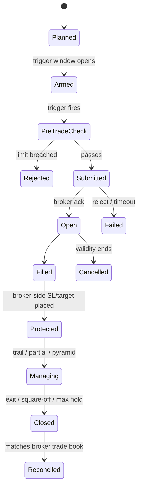

# 20 — Extended Modules (later phases)

Designed now so v1 leaves room for them; built after v1 is proven.

| Module | Phase | Container / project |
|--------|-------|---------------------|
| A. Automated order placement | P12 | `xd-exec` / `XDrishti.Execution` |
| B. Tick & order-book data | Recorder from P7, features P13 | `xd-feed` / `XDrishti.Feed` |
| C. Options & statistical arbitrage | P14 | Engine modules |
| D. Fundamentals & events | P15 | Worker jobs + assistant extraction |
| HFT / latency arbitrage | **Not pursued** | — |

## A. Automated order placement

**Modes per account:** `paper` → `manual_live` → `assisted` (system prepares exact order / super-order
parameters) → `semi_auto` (one-tap confirm in UI) → `auto_live` (within hard limits, every action notified).
**As built (P12-07, [ADR 0163](../adr/0163-an-account-moves-up-the-mode-ladder-one-step-on-stored-evidence-by-an-owner-act-with-a-cooling-off-and-down-at-any-time-and-no-mode-built-here-can-send.md)):** only `paper`, `manual_live` and `assisted` exist; the mode is an insert-only trail, up one step at a time by the owner (live-writes gate, then a fresh password, a cooling-off of two to five sessions, the evidence gate evaluated again at the confirm) and down at any time (the owner without a password, the system when the Trading role is off or the account archived). The gate to `assisted` needs a sandbox suite result and a static-IP attestation that no module stores yet, so it is closed and nothing is promotable. The assisted sheet, `semi_auto` and `auto_live` are later slices; nothing here can send.
**As built (P12-08a, [ADR 0165](../adr/0165-an-intent-is-made-only-from-an-approved-ticket-for-an-account-whose-mode-routes-an-entry-and-a-trigger-it-cannot-act-on-closes-it-with-a-reason-never-later.md)):** the routing table (`ModeRouting`) is total over every mode and action class: `semi_auto` waits for the tap on a BUY entry and acts on its own for the reducing classes, `auto_live` acts on its own, `StopLoosen`, `AddToPosition`, `ReEntry` and `OutsidePlan` are refused in every mode. The intent creator turns an owner-approved ticket with an allocation for an account that may act into one intent (planned, armed from 09:10, checking once on the first crossing inside 09:20 to 15:00 while ready and not halted; otherwise cancelled with the reason, no catch-up; void if the price already ran past the collar; one share while the canary is pending). `semi_auto` is still not storable and the creator is composed by no host, so no intent exists today.

**As built (P12-08b, [ADR 0166](../adr/0166-a-confirm-ticket-is-exact-text-the-server-wrote-decided-once-by-a-primary-key-and-judged-by-the-database-clock-and-a-confirmation-older-than-30-seconds-sends-nothing.md)):** the confirm ticket is a server-written record (`execution.confirm_tickets`): exact text and its SHA-256, the entry's client order id, reference price, notional, worst case at the stop, a 90-second life (`exec.confirm_ttl_s`) and the password rule; one decision per ticket by the primary key of `execution.ticket_outcomes`, whose trigger admits `confirmed` only from the owner through the API, before the expiry by the database clock, with the switch ON, `semi_auto`, no halt and the day unlocked (`execution.day_unlocks`, fresh password, until 15:30 India time). A price beyond 0.30 % or a changed Soft set closes the ticket `refused` (one re-issue); the expiry loop in xd-exec closes unanswered tickets. `IConfirmGate` hands a confirmed entry to submitting only within 30 seconds, else the intent is cancelled `expired_after_confirm`. Routes: `GET /api/execution/confirm-tickets`, `POST .../{id}/confirm`, `POST .../{id}/skip`, `GET|POST /api/execution/day-unlocks`. The issuer, the stored gate and the hand-off are composed by no host and no account can be `semi_auto`, so no ticket exists today; the frontend card is a separate pass.

**As built (P12-09, [ADR 0167](../adr/0167-auto-live-sends-only-inside-an-owner-chosen-limits-sheet-that-the-database-proves-for-every-entry-an-empty-sheet-allows-nothing-and-no-action-happens-without-its-row.md)):** `auto_live` sends only inside a per-account limits sheet (`execution.limits`, insert-only snapshots; an unset cap, empty allow-list or no window allows nothing; ceilings 20 orders a day, 10 open positions, 50 symbols, 09:16 to 15:00, `EQ_MIS` only). A raise needs the password and takes effect at 09:00 India time after one full closed session; a lowering is in force at once. Every system-sent entry (in `semi_auto` too) is one `execution.ledger_entries` row whose trigger proves orders a day, notional per order and per day, window, allow-list and product under an advisory lock per account, and requires its `execution.action_log` row in the same transaction; every automatic action and refusal is a row with its codes and plain text. The guard (`AutoLiveGuard`) runs only with `auto_live_enabled` and `execution_enabled` ON (else `mode.not_auto`, nothing written) and refuses on the worst-case loss cap, a non-owner approval, a provisional plan, a quantity above the plan, a duplicate exposure, a strategy's first live use (routed to a ticket), failed pre-trade checks, no day unlock, an unattended owner, readiness, a stale feed (15 s), a reconciliation break or a halt. The loss-cap halt asks P12-05 for `loss_cap`. Routes: `GET /api/execution/limits`, `PUT /api/execution/limits/{accountId}`. Composed nowhere and no account can be `auto_live`, so nothing new can send.

- **As built (P12-01 and P12-01b, [ADR 0155](../adr/0155-the-execution-service-starts-as-a-pure-skeleton-the-order-state-machine-closed-ports-and-an-in-memory-fake-broker-with-no-network-code.md), [ADR 0156](../adr/0156-the-execution-record-lives-in-schema-execution-written-only-by-the-role-xd-exec-with-checks-by-trigger-and-the-container-sits-in-profile-live-on-its-own-network.md)):** the machine has 14 states (`submitting` before the call and `closing` for our own exit in flight are added to the diagram) and exactly 23 legal moves; the same 23 pairs are a function and a check constraint in schema `execution`, so the database refuses what the Domain refuses. Events are insert-only with a chain (`seq`, `prev_event_id`); `intent_state` is a projection moved by trigger in the same transaction and equals the fold of the events. `xd-api` instructs the service only by inserting rows into `execution.commands`; the service answers each once in `command_results`. No broker call exists yet (P12-02).
- **Broker-side stop first** — protection never depends on the Mac staying up. **As built (P12-04, [ADR 0160](../adr/0160-protection-is-judged-from-the-brokers-book-by-a-pure-monitor-and-enforced-by-a-watchdog-whose-every-action-only-reduces-risk-and-which-no-host-composes-yet.md)):** the invariant is judged from the broker's order book (only a PENDING stop leg counts; unavailable never counts as protected); an unprotected position past `exec.protect_deadline_s` is a CRITICAL `protection_breach` that halts new entries, is repaired once and, by default, flattened with reduce-only marketable limits; a stop only tightens; the target is an engine rule, never a second resting sell; a negative net is `oversold` (freeze, nothing sent). Insert-only alarms; `GET /api/execution/alarms`. Built and tested on the FakeBroker; no host composes it yet; the Dhan wire for stop and super orders is UNVERIFIED.
- Pre-trade checks: same limits as planning + price band vs LTP, freeze quantity, margin. **As built (P12-03, [ADR 0159](../adr/0159-the-pre-send-checklist-is-one-pure-function-over-34-checks-with-unavailable-as-a-reject-stored-insert-only-and-wired-as-the-real-pre-send-step-over-a-closed-facts-source.md)):** 34 checks in a fixed order, 26 Hard (no override by anyone) and 8 Soft (the owner may confirm in `semi_auto` only, bound to the exact Soft set). Gates: `gate_open`, `no_halt`, `broker_kill_switch_off`, `token_valid`, `static_ip_ok`, `session_window`, `feed_fresh`, `streams_alive`. Ticket and shape: `ticket_valid`, `levels_valid`, `quantity_valid`, `product_segment` (entries BUY only), `instrument_tradable`. Prices: `ltp_collar`, `circuit_band`, `spread_depth`, `freeze_quantity`. Money and risk: `margin_funds`, `risk_per_trade`, `exposure_headroom`, `open_positions`, `entries_today`, `daily_loss`, `one_per_symbol`, `order_budget`, `canary_cap`. Soft: `sector_exposure`, `holdings_conflict`, `adv_share`, `results_within_days`, `fno_ban`, `surveillance`, `correlation`, `data_quality`. A missing, impossible or stale input is `unavailable`, which never passes. Exits and protective stops are never judged by this list.
- Idempotent client order ids; order-update stream + end-of-day reconciliation; mismatch ⇒ freeze. **As built (P12-06, [ADR 0162](../adr/0162-reconciliation-only-makes-the-system-stricter-the-poll-is-the-truth-the-stream-is-the-speed-and-nothing-here-can-send-or-open-a-socket.md)):** the poll (order book, trade book, positions) is the truth and the order-update stream only the speed; `streams_alive` is true only within 15 s of a good poll with no gap fill owed. Reconciliation compares broker and record per account and returns one of eight breaks, each a row: `position_mismatch` (net differs after explained foreign trades), `trade_missing` (a broker trade of our order not in fills at its second sighting), `trade_extra` (a fill the broker does not hold), `order_mismatch` (status class or quantity differs beyond the grace), `fill_mismatch` (quantity, or price at four decimals), `unknown_xd_order` (our prefix at the broker with no leg), `foreign_conflict` (a foreign working order in an instrument we manage), `unavailable` (something could not be read). All but the foreign conflict ask for a freeze of that account; the foreign conflict asks for entries and a critical alarm. Nothing is ever corrected automatically; the owner resolves a break (`accept_broker` or `dismiss_foreign`) with the live-writes gate, a fresh password and an owner actor, and a freeze from a break can be released only when every break of the account has a resolution. Recovery after a crash looks unknown legs up by client id, reads the broker, and only then writes; it sends nothing. Built and tested on the FakeBroker and an in-process fake transport; no socket client exists and nothing is composed by a host.
- Kill switch: ours (stop new, cancel pending, optional exit-all) + broker's where available; triggered by
  max drawdown, daily loss, feed loss or a button. **As built (P12-05, [ADR 0161](../adr/0161-the-kill-switch-is-an-insert-only-halt-record-that-only-ever-makes-the-system-stricter-ended-only-by-the-owner-or-by-a-named-automatic-clear-and-composed-nowhere-that-can-send.md)):** halts are an insert-only record with four levels (`entries`, `cancel`, `exit_all`, `freeze`) and a 25-cell permission table; a halt only removes permissions and the entry gate reads the record on every check (an unreadable record is halted). Starting a halt needs a session and no password (`exit_all` needs the step-up window); releasing one is the owner's act with the live-writes gate, a fresh password, a reason and the release rules, and a few state-of-the-world triggers (feed loss, clock skew, broker outage, protection unknown) clear themselves after a quiet period. Cancel and exit-all reuse the protection logic; the broker's own switch is a port that nothing implements yet; the drill sends nothing. Built and tested on the FakeBroker; the entry gate's source stays closed and no host composes the enforcer.
- Prerequisites: ISP static IP whitelisted at Dhan; daily login/2FA; ≤ 2 orders/s; Dhan sandbox testing first.

## B. Tick & order-book data

- Dhan live feed + **20-level depth** (up to 50 instruments/connection) and **200-level depth** (NSE equity
  & derivatives) over WebSocket (binary). No historical depth from brokers ⇒ record our own.
  **Built in P7-16 ([ADR 0135](../adr/0135-the-depth-recorder-stores-the-20-level-book-of-up-to-50-shares-about-once-a-second-behind-three-gates-a-disk-guard-and-no-reader.md)):** the 20-level book of up to 50 shares, about once a second, in `market.depth_snapshots`; off by default behind three gates; nothing reads it until P13.
  **Built in P7-16b ([ADR 0173](../adr/0173-the-trade-tick-recorder-stores-last-trade-updates-of-the-depth-set-when-cumulative-volume-rises-on-a-second-quote-socket-behind-three-gates-its-own-cap-and-no-reader.md)):** the last-trade updates (receive time, raw exchange time, price in paise, last quantity, cumulative volume) of the same set in `market.trade_ticks`, a row only when the cumulative volume rises, from a second Quote-mode socket to the allowed live-feed host; the source of P13's aggressive volume delta (classified against the recorded book, not stored); its own 12 GB cap, the shared 20 GB free floor; off by default behind three gates; nothing reads it until P13.
- Extends the v1 `xd-feed` (which already streams the active set): adds 20-level depth subscriptions for a
  configured recording list; writes to Timescale hypertables (compressed); ~50–100 GB/year.
- **Start recording in P7** so ≥ 6 months exist by P13.
- Uses: order-book imbalance, depth pressure near trigger, aggressive volume delta, spread → meta-model
  features and realistic slippage. Kept only if OOS improves.
- **One comparison core (P13-05, [ADR 0183](../adr/0183-the-feature-set-comparison-fits-one-recipe-twice-on-identical-rows-widens-its-margins-for-the-ledger-count-and-reads-the-hold-out-once.md)):** the depth and tick features (`md-1`) are judged by the same code as the filings features of §D — model A (`tf-1`) against model B (`tf-1` plus the group) on identical rows, monthly folds here, a paired block bootstrap, margins widened for the ledger count.
- **HFT/latency arbitrage not pursued:** home latency vs co-located firms, order-rate limits and costs leave
  no retail edge.

## C. Options & statistical arbitrage

- Data: Dhan **option chain API** (OI, Greeks, IV, bid/ask; ~1 request / 3 s per underlying-expiry) and
  **expired options data API** for backtests; own chain snapshots (5-min for indices, EOD for stocks).
- Chain recorder (built, P14-02, [ADR 0176](../adr/0176-the-option-chain-recorder-stores-five-minute-index-chains-and-a-daily-stock-pass-from-two-new-allow-listed-data-api-endpoints-behind-three-gates-its-own-cap-and-no-reader.md)): `options.chain_snapshots` (strike by strike with bid, ask, last, OI, volume, IV and Greeks as Dhan sends them, prices in paise, a missing quote null with a flag), `chain_requests` (every planned request and how it ended) and `chain_sessions`; the index chains every 5 minutes of the session (09:20-15:30) and the stock chains once a day (14:30-15:25); two new allow-listed endpoints, one request per 3 seconds at most; off by default behind three gates, its own 4 GB cap and the shared 20 GB free floor; compressed, insert-only, nothing reads it yet.
- Expired-options backfill (built, P14-03, [ADR 0177](../adr/0177-the-expired-options-backfill-fetches-rolling-atm-offset-bars-from-one-new-allow-listed-data-api-endpoint-at-night-behind-four-gates-after-an-owner-run-probe-its-own-cap-and-no-reader.md)): `options.rolling_bars` (five years of 5-minute NIFTY and BANKNIFTY and 15-minute share option bars at ATM offsets, rolling contracts, prices in paise, a missing value null) and `options.fetch_log` (every attempt of every key: the resume point and the honest coverage); one new allow-listed endpoint, one request a second at most, only between 16:30 and 08:30; off by default behind the deployment flag, the owner's switch, the owner's acceptance of an owner-run probe and a paused service, its own 3 GB cap and the shared 20 GB free floor; compressed, insert-only, nothing reads it yet.
- Archive quality (built, P14-04, [ADR 0178](../adr/0178-the-option-archive-quality-checks-read-the-recorded-chains-and-rolling-bars-in-bounded-ranges-and-store-insert-only-verdicts-with-an-honest-unavailable-and-no-trading-use.md)): `options.quality_runs` and `options.quality_results` (insert-only) hold one verdict per underlying, session and check - coverage, put-call parity, IV and Greek sanity, volume and open-interest jumps, rolling-series stitching - as `pass`, `warn`, `fail` or `unavailable` with a reason (`unavailable` never counts as `pass`); the service `options-quality` runs daily at 16:15 and is bounded per run; `GET /api/options/coverage` gives the statuses, the usable flags and the cumulative usable chain sessions (the number the spread model of P14-07 compares with 60). The first reader of the archive; aggregates only; nothing trades on it.
- Reference data (built, P14-01, [ADR 0175](../adr/0175-option-contracts-of-a-configured-underlying-list-are-kept-from-the-master-refresh-in-their-own-schema-with-a-dated-lot-history-and-dated-rule-epochs-never-in-the-master-list.md)):
  `options.contracts` (the contracts of the listed underlyings from the daily master refresh, never deleted),
  `options.lot_sizes` (dated lot history) and `options.market_epochs` (dated rule changes); every seed is unconfirmed
  until the owner checks it against the circular; the list is the app setting `options.underlyings` (doc 06 §2.1).
- Option pricing core (built, P14-05, [ADR 0191](../adr/0191-the-option-pricing-core-is-a-pure-black-76-library-with-fixed-units-a-closed-list-of-unavailable-reasons-and-no-reader-yet.md)): pure Black-76 on a forward (Black-Scholes as its spot form), an implied-volatility solver, Greeks, the parity forward and a closed list of unavailable reasons; no reader yet.

  | Quantity | Unit |
  |---|---|
  | Prices | rupees (`double`); paise only at the caller's edge, rounded half away from zero |
  | sigma | fraction per year |
  | `T` | (expiry date 15:30 India time minus now) / (365 x 86,400) |
  | Delta, gamma | per rupee of spot (`F = S e^((r-q)T)`) |
  | Vega | per 1 volatility point (sigma + 0.01) |
  | Theta | per calendar day (annual / 365) |
  | Vendor IV | read as percent / 100, label `percent_assumed` (UNVERIFIED until the P14-02 pilot) |
  | Model price | labelled `bs_fallback` by its caller |
- Option cost and liquidity model (built, P14-07, [ADR 0194](../adr/0194-the-option-cost-model-takes-optional-option-and-futures-lines-on-the-owners-sheet-a-half-spread-from-usable-chain-sessions-else-his-labelled-assumption-else-unavailable-rupee-liquidity-filters-and-a-lot-feasibility-count-apart-from-the-unit.md)): optional option and futures lines on the owner's effective-dated charge sheet (absent: the leg is gross, labelled `costs: none (no option lines)`, never zero), a half-spread measured from the usable chain sessions once there are 60 (`research.option_spread_models` and `research.option_spread_buckets`, insert-only, content-addressed; `xd options spread-model build`), else the owner's labelled assumption, else `spread_unavailable`; rupee liquidity filters (a null open interest or volume is `liquidity_unknown`) and the lot-feasibility count (`not_sizable`, `lot_unknown`) kept apart from the research unit. No decision, live or execution code reads any of it yet.
- Pairs core (built, P14-12, [ADR 0192](../adr/0192-the-pairs-core-is-a-pure-engle-granger-library-with-pinned-mackinnon-tables-a-benjamini-hochberg-rule-that-counts-unavailable-tests-and-a-signal-state-machine-that-never-trades-on-an-unavailable-z-and-no-reader-yet.md)): pure `Domain/Pairs` - log-price spread, OLS hedge ratio, the Engle-Granger residual test with one pre-registered lag (default 1), MacKinnon (2010) finite-sample critical values and the MacKinnon (1994) asymptotic p-value (labelled `asymptotic`), half-life, return correlation, z-score, Benjamini-Hochberg (an unavailable test counts in `m` with `p = 1`) and the entry/exit/stop state machine (an unavailable z holds); closed reasons, no reader yet (P14-13 is the first).
- Pairs study (built, P14-13, [ADR 0196](../adr/0196-the-pairs-study-counts-every-candidate-in-the-ledger-before-any-test-walks-pairs-in-a-separate-pair-1-walker-on-the-simulators-fills-and-judges-them-by-protocol-s-where-a-gross-drop-is-valid-and-a-gross-keep-impossible.md)): same-sector F&O cash pairs (today's sector label; ASM/GSM-flagged shares excluded; `ban_list: unavailable`) are formed each calendar quarter on the 252 daily closes before it - candidates at return correlation >= 0.8 (at most `Pairs:MaxCandidates`, 2,000), **every candidate appended to the test ledger before any test**, Engle-Granger and Benjamini-Hochberg over all candidates, half-life 1 to 20 sessions - and traded intraday by the separate walker `pair-1` on 5-minute spreads (z against the previous 5 or 10 sessions, entry at 1.5, 2.0 or 2.5 and below the 3.5 stop, exit at 0.5, no entry after 14:45, flat at 15:15, both legs filled at the next minute by the simulator's fill and slippage rules, `sim-9` untouched). Four fills of intraday cash are charged by the owner's sheet (`Pairs:CostSheetId`), else the trade is gross and labelled. R is the net rupees over `Y notional x (3.5 - |z|) x sd(W)`. `xd pairs run --from --to [--variant e,L]` and `xd pairs eval --family pairs:intraday-1 [--holdout]` store `research.pair_formations`, `research.pair_trades` and protocol S verdicts in `research.extension_evaluations` (fold unit quarter, `GET /api/research/extensions?family=pairs:intraday-1`): NOT_EVALUABLE below 6 evaluable quarters or 300 pooled trades; KEEP needs the day- and 5-session-block lower bounds of mean R at `0.05 R x Factor(N)` (N counts every candidate and variant), two thirds of the quarters positive, the Lab gates, no pair at 25 % of the net profit and net costs; a gross DROP is valid, a gross KEEP is impossible. With today's 2.1 years of bars the answer is NOT_EVALUABLE until CF-04 Part B. Nothing selects, plans or orders a pair.
- Option expression simulator (built, P14-08, [ADR 0197](../adr/0197-the-option-expression-simulator-re-marks-each-stored-cash-trade-as-one-long-option-on-a-fixed-strike-read-from-the-offsets-with-an-expiry-calendar-of-labelled-derived-dates-a-counted-model-price-fallback-and-every-unpaired-trade-counted-by-reason.md)): `xd options remark --run <run-key> --profile <hash>` re-marks every trade of a stored cash run as one long option under a registered `option_buy` profile (`strike` atm or itm1, `expiry` nearest_safe, optional `premium_stop_pct`, `max_hold_sessions`): a BUY is a call, an intraday SELL a put; the strike is read once from the entry bar and then held by following `strike_px` across the rolling offsets (outside the window the bar is unavailable, never a zero or the last price); entry at the open of the first option bar at or after the cash minute, exits mapped from the cash exits, the lower premium when a premium stop and the cash exit share a bar, a D6 exit at the close of the last session before the expiry; a missing bar is priced by Black-76 on an observed IV no older than `Options:Remark:MaxIvAgeMinutes` (60) and labelled `bs_fallback`, else the trade is `strike_left_window`. Size is the cash trade's rupee risk over the option's delta (fractional units, `R_equiv` = rupees over that risk, both sides gross or both net, else `basis_mismatch`); lot feasibility is a column. Expiry dates come from `options.contracts` or a derived weekday rule (`expiry: derived`, secondary-source data, UNVERIFIED). Every cash trade gets one row in `research.expression_trades` (insert-only, with `research.expression_runs` holding the counts per unpaired reason: `no_series`, `no_series_for_expiry`, `expiry_unknown`, `strike_left_window`, `archive_unusable`, `no_iv`, `illiquid`, `liquidity_unknown`, `basis_mismatch`, `open_at_end`, `spread_unavailable`, `risk_invalid`); the run id hashes every input so a second run writes nothing. Works on synthetic data; with no recorded archive every trade is unpaired. The first user of the pricing core and the cost model; the simulator `sim-9` is unchanged and no decision, live or execution code reads any of it.
- Expression evaluation (built, P14-09, [ADR 0198](0198-protocol-o-judges-the-option-expression-against-cash-on-paired-out-of-sample-trades-after-counting-each-profile-in-the-ledger-first-with-the-hold-out-cut-before-any-number-and-no-gross-result-ever-a-keep-or-a-drop.md)): `xd options expression-eval --family expr:option_buy --run <run-key> [--profile <hash>] [--holdout]` gives the option family a stored protocol O verdict (KEEP, DROP, INCONCLUSIVE or NOT_EVALUABLE with each missing quantity named) in `research.extension_evaluations` (fold unit quarter, `GET /api/research/extensions?family=expr:option_buy`; the P15 phase check does not list it). The population is the out-of-sample test windows (the Lab's walk-forward geometry; the winner of each fold is not re-derived) of a run stored by a full Lab test and re-marked by P14-08; the unit is the paired `d = R_equiv(option) - R_equiv(cash)` on the same rupee risk. **The profile is appended to the test ledger and read back before any date or figure of the run is read**; the hold-out (last six months) is cut by date and filtered out of every query before any number is built, and is read once, after a development KEEP, with `--holdout`. NOT_EVALUABLE below 6 evaluable quarters (20 pairs each) or 400 pooled pairs, with no paired trade (`no_paired_trades`, `spread_unavailable`) or a bound unavailable; KEEP needs both block lower bounds (days and 5 sessions) at `0.05 R x Factor(N)`, two thirds of the quarters positive, the latest rule epoch (from 2025-09-01, 30 pairs or more) positive, the option's own evidence through the Lab's gates, net charges and a Black-76 fallback share of 5 % or less; **every gross result is INCONCLUSIVE**; DROP needs net and an upper bound under 0.05 R. A KEEP is a record: `expression` stays `cash` on every decision path. Expected first answer: NOT_EVALUABLE.
- Families: directional expression (ITM/ATM options for our signals), defined-risk debit spreads (swing),
  index credit spreads / iron condors in range regimes, event/IV-aware positioning.
- New learning dimension **instrument expression** (cash / future / option_buy / debit_spread …).
- Simulation from historical option prices; Black-Scholes with recorded IV only as fallback; premium and
  underlying-based exits; exit before expiry by default; liquidity filters (index options first).
- "Slow" statistical arbitrage: `PAIRS` (cointegration mean reversion) and `BASIS` (cash-futures) on 5m+
  bars — two-leg, so practical with module A.

## D. Fundamentals & events

- Data: exchange filings (results XBRL/PDF), shareholding (promoter holding, pledges), announcements,
  results calendar — stored **point-in-time by filing timestamp**.
  Source (P15-01, [ADR 0179](../adr/0179-filings-come-from-a-local-inbox-folder-with-a-sidecar-that-carries-the-broadcast-time-the-adapter-is-read-only-and-the-public-page-fetcher-is-a-recorded-decision-not-to-build.md)): the owner files downloaded files into `data/filings/inbox/` with a sidecar carrying the exchange's
  broadcast time (with an offset; never guessed); a read-only folder-drop adapter lists them. No automatic fetch is built — it needs the owner's
  reading of the exchange terms first.
  Store (built, P15-02, [ADR 0180](../adr/0180-the-point-in-time-filing-store-keeps-immutable-envelopes-and-answers-what-was-known-at-an-instant-from-the-broadcast-time-plus-a-lag-and-nothing-else.md)): schema `filings` with five insert-only tables (`filings` envelopes with a nullable broadcast time, then `result_facts`, `shareholding`, `announcements`, `calendar`, empty until P15-03/04); `IPointInTimeFilings.AsOf` returns what the market knew at an instant: a filing is visible iff `broadcast_ts + Filings:LagMinutes <= t` (5 minutes, a deployment setting), the latest visible revision of a period is current, a filing without a time is stored, counted and never used; the paused service `filings-ingest` (17:05 on trading days) copies each file once into a `0600` store folder; `GET /api/filings/coverage`, `GET /api/filings`, `GET /api/filings/{id}` return counts and metadata only. Nothing trades on it yet.
  Calendar and shareholding (built, P15-04, [ADR 0181](../adr/0181-the-results-calendar-keeps-each-meeting-row-with-its-own-intimation-time-counts-days-in-trading-sessions-to-an-event-session-and-answers-unavailable-for-an-instrument-with-no-entry.md)): the owner drops a board-meeting csv (`symbol,period_end,meeting_date,purpose,status,intimation_ts`) and a shareholding csv (`symbol,period_end,category,pct,pledged_pct,broadcast_ts`); each row carries the time the exchange published it (an offset is required; blank or invalid is `unavailable`, never guessed). Rows load inside the `filings-ingest` run. `days_to_results` for an instrument and an instant counts trading sessions from the India date of the instant to the *event session* (the first session on or after the meeting date) of the earliest visible, not cancelled results meeting, and a meeting intimated after the instant, or a reschedule before its own time, never counts; no entry is `unavailable` (`no_entry`, `only_cancelled`, `no_upcoming_entry`), never zero and never an estimated date. `GET /api/calendar/results` lists the visible upcoming meetings and the instruments without an entry. Nothing trades on it yet (P15-06 wires the event filter).
  Results XBRL parser (built, P15-03, [ADR 0184](../adr/0184-the-results-xbrl-parser-reads-untrusted-files-through-one-hardened-reader-stores-facts-per-span-and-basis-with-unavailable-for-every-field-the-file-does-not-carry-and-is-labelled-synthetic-until-real-filings-pass.md)): every stored results `.xml`/`.xbrl` file is parsed by one hardened reader (no DTD, no resolver, at most 20 MB, 64 levels, 200,000 elements; each refusal a closed reason on a `rejected` parse row) into `filings.result_facts` (`revenue`, `total_income`, `pbt`, `pat`, `eps_basic`, `eps_diluted`, `exceptional_items`, `audited`) per span (`q`, `ytd`, `fy` from the context period) and basis (`consolidated`, `standalone`), in rupees as filed, with `unavailable` and a closed reason (`not_in_file`, `conflicting_facts`, `unit_unknown`, `scale_unknown`, `bad_value`) for anything the file does not carry plainly; a file with no readable basis, a bank file and a PDF store no fact (`basis_unknown`, `format_not_supported`, `not_xbrl`). The step runs at the end of the `filings-ingest` run and parses each file once per parser version. `IResultFactsAsOf` answers per period, span and basis from the newest visible envelope that carries that span and basis, so one basis never hides the other. The parser version is `xbrl-1-synthetic` until the owner's real filings pass; `GET /api/filings/{id}/facts` shows the outcome. Nothing trades on it yet.
  Announcements and the event-flags eval set (built, P15-07, [ADR 0188](../adr/0188-the-announcements-csv-is-a-third-row-level-drop-the-labelling-sample-is-a-seeded-stratified-draw-the-baseline-is-fixed-before-the-labels-and-the-announcement-text-stays-out-of-git.md), amends ADR 0179): the owner drops an announcements csv (`symbol,broadcast_ts,category,subject,text`, sidecar kind `announcement`, symbol `*`); `filings-ingest` stores each row as its own envelope (no period, never grouped) with its text in the files store; an announcement as a text or pdf file stays an ordinary envelope and is never sampled. `xd eval announcements sample|import|show` draws the stratified 240 for labelling (seeded, order-independent), imports the owner's 200 labels and prints the state; the exchange category baseline is committed before the first sample. No model, no network.
- Uses: swing universe quality filter; features (growth, margin trend, surprise vs last 4 quarters,
  valuation percentile); `PEAD` (post-earnings drift) swing family; event-risk filter.
- Assistant extracts structured fields from PDFs/announcements; outputs are
  features measured like any other, never trade decisions. Announcement flags (built, P15-08, [ADR 0189](../adr/0189-the-llm-announcement-flag-is-one-schema-checked-answer-with-no-tool-over-fenced-untrusted-text-an-order-value-must-be-in-the-text-and-set-d-grades-it-against-the-category-baseline-before-any-use.md)): one schema-checked answer per announcement from the local model with no tool, text fenced as data, an order value kept only if it is in the text (the plan's XBRL cross-check has no field to run on: order value, guidance and rating action are not in results XBRL, and results numbers are never taken from text), stored insert-only with the model and prompt hashes in `filings.extractions`; graded by set D (precision of material at least 0.80 with at least 30 predicted, better than the category baseline by the sign test) before protocol L lets `llm-1` be tested; PDFs are not read.
- **Measured by the shared comparison core (P13-05, [ADR 0183](../adr/0183-the-feature-set-comparison-fits-one-recipe-twice-on-identical-rows-widens-its-margins-for-the-ledger-count-and-reads-the-hold-out-once.md)):** `ev-1` and `fu-1` rows go to `research.trade_features_ext` and are judged on calendar-quarter folds with season blocks, the same verdict table as §B. The features and their extraction are built in P15-05 ([ADR 0185](../adr/0185-the-event-and-fundamental-feature-sets-read-only-what-was-public-at-the-decision-instant-store-nan-with-a-closed-reason-for-every-unknown-and-the-frame-gets-two-results-day-features-with-engine-sim-8.md)): `days_to_results` and `days_since_results` are also frame features a strategy rule may name (engine `sim-8`).
- **`PEAD` (built, P15-09, [ADR 0187](../adr/0187-an-event-side-may-hold-up-to-twenty-sessions-the-event-exit-overlay-runs-and-never-fires-on-unavailable-the-surprise-quintiles-use-the-previous-complete-season-and-pead-is-a-built-in-with-engine-sim-9.md)):** an event side may hold up to 20 sessions, the `event_exit` overlay never fires on unavailable, the surprise quintiles use the previous complete season, and `PEAD` is a long-only built-in with engine `sim-9`; it is judged by protocol P.
- **Phase check (built, P15-12, [ADR 0190](../adr/0190-the-p15-phase-check-reads-stored-verdicts-for-the-current-versions-only-reports-a-filter-in-use-without-a-keep-and-is-never-met-on-thin-stale-or-unreadable-evidence.md)):** `xd events phase-check [--cut ...] [--json]` reads the stored verdicts of the five families for the current versions only and says MET, NOT MET or NOT EVALUABLE; read only, exit 0.
- **Verdicts (P15-10, [ADR 0186](../adr/0186-the-p15-evaluation-protocols-f-x-p-and-l-count-each-trial-in-the-ledger-before-any-number-store-insert-only-verdicts-with-the-missing-quantity-named-and-feed-the-event-filter-only-through-the-verdict-port.md)):** protocols F (event-risk filter), X (`ev-1`, `fu-1`), P (PEAD) and L (the flag) store one insert-only verdict per family in `research.extension_evaluations` (`GET /api/research/extensions`, `/{id}`). With today's data every family is NOT_EVALUABLE with the missing quantity named, except possibly F, whose plausible first verdict is DROP: the calendar cannot say between a meeting and the next intimation, the fail-closed filter then removes more than half of the trades, and the report prints the share lost to `no_upcoming_entry`. A KEEP is a record; no slice turns it into scoring. The event filter's auto option (default OFF, owner-armed) turns the filter ON only for a KEEP that the hold-out confirmed, for the switch's N.
