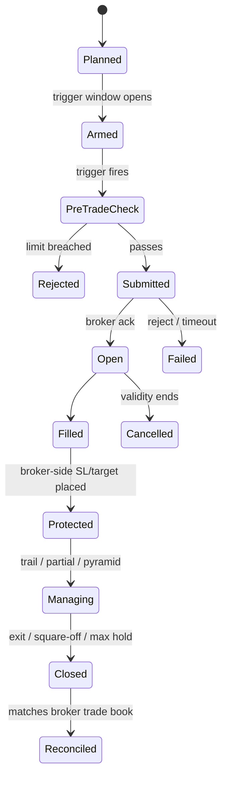

# 20 — Extended Modules (later phases)

Designed now so v1 leaves room for them; built after v1 is proven.

| Module | Phase | Container / project |
|--------|-------|---------------------|
| A. Automated order placement | P12 | `xd-exec` / `XDrishti.Execution` |
| B. Tick & order-book data | Recorder from P7, features P13 | `xd-feed` / `XDrishti.Feed` |
| C. Options & statistical arbitrage | P14 | Engine modules |
| D. Fundamentals & events | P15 | Worker jobs + assistant extraction |
| HFT / latency arbitrage | **Not pursued** | — |

## A. Automated order placement

**Modes per account:** `paper` → `manual_live` → `assisted` (system prepares exact order / super-order
parameters) → `semi_auto` (one-tap confirm in UI) → `auto_live` (within hard limits, every action notified).

- **As built (P12-01 and P12-01b, [ADR 0155](../adr/0155-the-execution-service-starts-as-a-pure-skeleton-the-order-state-machine-closed-ports-and-an-in-memory-fake-broker-with-no-network-code.md), [ADR 0156](../adr/0156-the-execution-record-lives-in-schema-execution-written-only-by-the-role-xd-exec-with-checks-by-trigger-and-the-container-sits-in-profile-live-on-its-own-network.md)):** the machine has 14 states (`submitting` before the call and `closing` for our own exit in flight are added to the diagram) and exactly 23 legal moves; the same 23 pairs are a function and a check constraint in schema `execution`, so the database refuses what the Domain refuses. Events are insert-only with a chain (`seq`, `prev_event_id`); `intent_state` is a projection moved by trigger in the same transaction and equals the fold of the events. `xd-api` instructs the service only by inserting rows into `execution.commands`; the service answers each once in `command_results`. No broker call exists yet (P12-02).
- **Broker-side stop first** — protection never depends on the Mac staying up. **As built (P12-04, [ADR 0160](../adr/0160-protection-is-judged-from-the-brokers-book-by-a-pure-monitor-and-enforced-by-a-watchdog-whose-every-action-only-reduces-risk-and-which-no-host-composes-yet.md)):** the invariant is judged from the broker's order book (only a PENDING stop leg counts; unavailable never counts as protected); an unprotected position past `exec.protect_deadline_s` is a CRITICAL `protection_breach` that halts new entries, is repaired once and, by default, flattened with reduce-only marketable limits; a stop only tightens; the target is an engine rule, never a second resting sell; a negative net is `oversold` (freeze, nothing sent). Insert-only alarms; `GET /api/execution/alarms`. Built and tested on the FakeBroker; no host composes it yet; the Dhan wire for stop and super orders is UNVERIFIED.
- Pre-trade checks: same limits as planning + price band vs LTP, freeze quantity, margin. **As built (P12-03, [ADR 0159](../adr/0159-the-pre-send-checklist-is-one-pure-function-over-34-checks-with-unavailable-as-a-reject-stored-insert-only-and-wired-as-the-real-pre-send-step-over-a-closed-facts-source.md)):** 34 checks in a fixed order, 26 Hard (no override by anyone) and 8 Soft (the owner may confirm in `semi_auto` only, bound to the exact Soft set). Gates: `gate_open`, `no_halt`, `broker_kill_switch_off`, `token_valid`, `static_ip_ok`, `session_window`, `feed_fresh`, `streams_alive`. Ticket and shape: `ticket_valid`, `levels_valid`, `quantity_valid`, `product_segment` (entries BUY only), `instrument_tradable`. Prices: `ltp_collar`, `circuit_band`, `spread_depth`, `freeze_quantity`. Money and risk: `margin_funds`, `risk_per_trade`, `exposure_headroom`, `open_positions`, `entries_today`, `daily_loss`, `one_per_symbol`, `order_budget`, `canary_cap`. Soft: `sector_exposure`, `holdings_conflict`, `adv_share`, `results_within_days`, `fno_ban`, `surveillance`, `correlation`, `data_quality`. A missing, impossible or stale input is `unavailable`, which never passes. Exits and protective stops are never judged by this list.
- Idempotent client order ids; order-update stream + end-of-day reconciliation; mismatch ⇒ freeze. **As built (P12-06, [ADR 0162](../adr/0162-reconciliation-only-makes-the-system-stricter-the-poll-is-the-truth-the-stream-is-the-speed-and-nothing-here-can-send-or-open-a-socket.md)):** the poll (order book, trade book, positions) is the truth and the order-update stream only the speed; `streams_alive` is true only within 15 s of a good poll with no gap fill owed. Reconciliation compares broker and record per account and returns one of eight breaks, each a row: `position_mismatch` (net differs after explained foreign trades), `trade_missing` (a broker trade of our order not in fills at its second sighting), `trade_extra` (a fill the broker does not hold), `order_mismatch` (status class or quantity differs beyond the grace), `fill_mismatch` (quantity, or price at four decimals), `unknown_xd_order` (our prefix at the broker with no leg), `foreign_conflict` (a foreign working order in an instrument we manage), `unavailable` (something could not be read). All but the foreign conflict ask for a freeze of that account; the foreign conflict asks for entries and a critical alarm. Nothing is ever corrected automatically; the owner resolves a break (`accept_broker` or `dismiss_foreign`) with the live-writes gate, a fresh password and an owner actor, and a freeze from a break can be released only when every break of the account has a resolution. Recovery after a crash looks unknown legs up by client id, reads the broker, and only then writes; it sends nothing. Built and tested on the FakeBroker and an in-process fake transport; no socket client exists and nothing is composed by a host.
- Kill switch: ours (stop new, cancel pending, optional exit-all) + broker's where available; triggered by
  max drawdown, daily loss, feed loss or a button. **As built (P12-05, [ADR 0161](../adr/0161-the-kill-switch-is-an-insert-only-halt-record-that-only-ever-makes-the-system-stricter-ended-only-by-the-owner-or-by-a-named-automatic-clear-and-composed-nowhere-that-can-send.md)):** halts are an insert-only record with four levels (`entries`, `cancel`, `exit_all`, `freeze`) and a 25-cell permission table; a halt only removes permissions and the entry gate reads the record on every check (an unreadable record is halted). Starting a halt needs a session and no password (`exit_all` needs the step-up window); releasing one is the owner's act with the live-writes gate, a fresh password, a reason and the release rules, and a few state-of-the-world triggers (feed loss, clock skew, broker outage, protection unknown) clear themselves after a quiet period. Cancel and exit-all reuse the protection logic; the broker's own switch is a port that nothing implements yet; the drill sends nothing. Built and tested on the FakeBroker; the entry gate's source stays closed and no host composes the enforcer.
- Prerequisites: ISP static IP whitelisted at Dhan; daily login/2FA; ≤ 2 orders/s; Dhan sandbox testing first.

## B. Tick & order-book data

- Dhan live feed + **20-level depth** (up to 50 instruments/connection) and **200-level depth** (NSE equity
  & derivatives) over WebSocket (binary). No historical depth from brokers ⇒ record our own.
  **Built in P7-16 ([ADR 0135](../adr/0135-the-depth-recorder-stores-the-20-level-book-of-up-to-50-shares-about-once-a-second-behind-three-gates-a-disk-guard-and-no-reader.md)):** the 20-level book of up to 50 shares, about once a second, in `market.depth_snapshots`; off by default behind three gates; nothing reads it until P13.
- Extends the v1 `xd-feed` (which already streams the active set): adds 20-level depth subscriptions for a
  configured recording list; writes to Timescale hypertables (compressed); ~50–100 GB/year.
- **Start recording in P7** so ≥ 6 months exist by P13.
- Uses: order-book imbalance, depth pressure near trigger, aggressive volume delta, spread → meta-model
  features and realistic slippage. Kept only if OOS improves.
- **HFT/latency arbitrage not pursued:** home latency vs co-located firms, order-rate limits and costs leave
  no retail edge.

## C. Options & statistical arbitrage

- Data: Dhan **option chain API** (OI, Greeks, IV, bid/ask; ~1 request / 3 s per underlying-expiry) and
  **expired options data API** for backtests; own chain snapshots (5-min for indices, EOD for stocks).
- Families: directional expression (ITM/ATM options for our signals), defined-risk debit spreads (swing),
  index credit spreads / iron condors in range regimes, event/IV-aware positioning.
- New learning dimension **instrument expression** (cash / future / option_buy / debit_spread …).
- Simulation from historical option prices; Black-Scholes with recorded IV only as fallback; premium and
  underlying-based exits; exit before expiry by default; liquidity filters (index options first).
- "Slow" statistical arbitrage: `PAIRS` (cointegration mean reversion) and `BASIS` (cash-futures) on 5m+
  bars — two-leg, so practical with module A.

## D. Fundamentals & events

- Data: exchange filings (results XBRL/PDF), shareholding (promoter holding, pledges), announcements,
  results calendar — stored **point-in-time by filing timestamp**.
- Uses: swing universe quality filter; features (growth, margin trend, surprise vs last 4 quarters,
  valuation percentile); `PEAD` (post-earnings drift) swing family; event-risk filter.
- Assistant extracts structured fields from PDFs/announcements, validated against XBRL; outputs are
  features measured like any other, never trade decisions.
